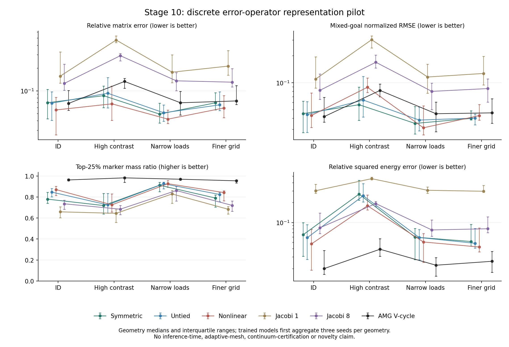
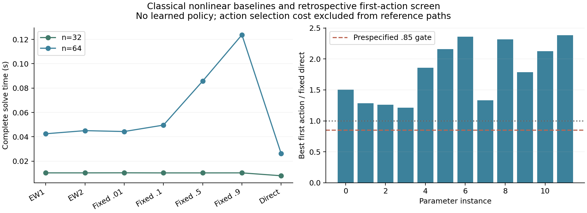
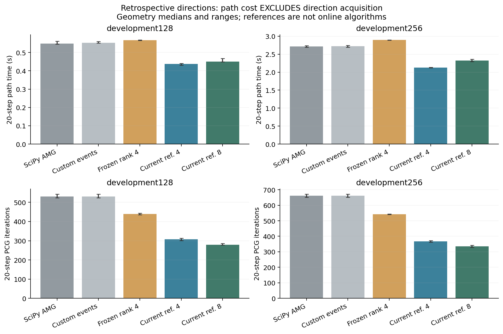
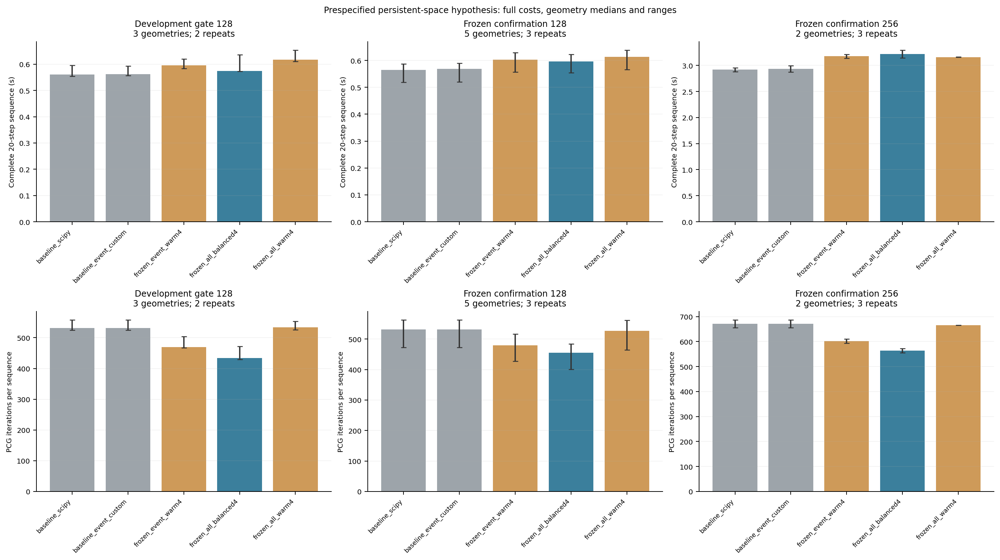
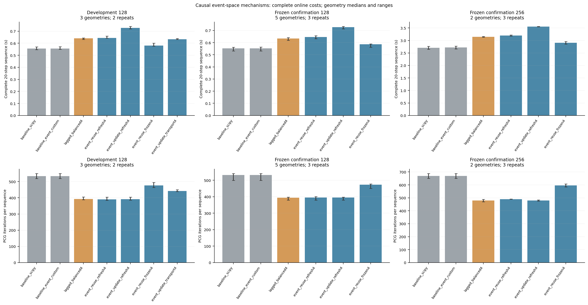
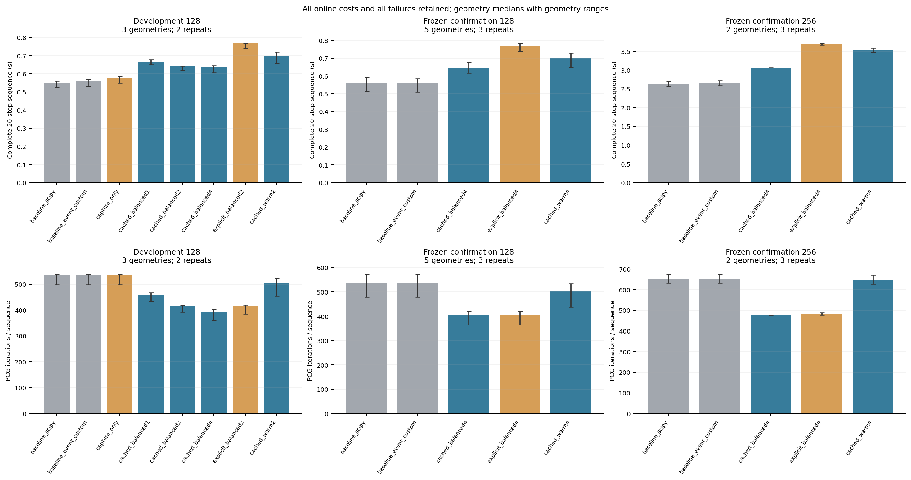
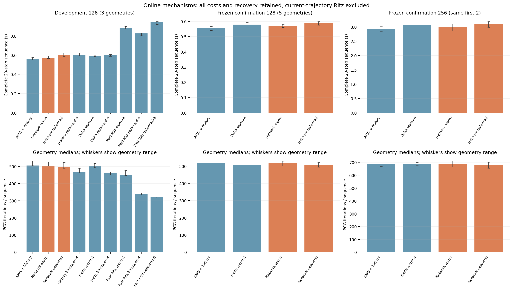
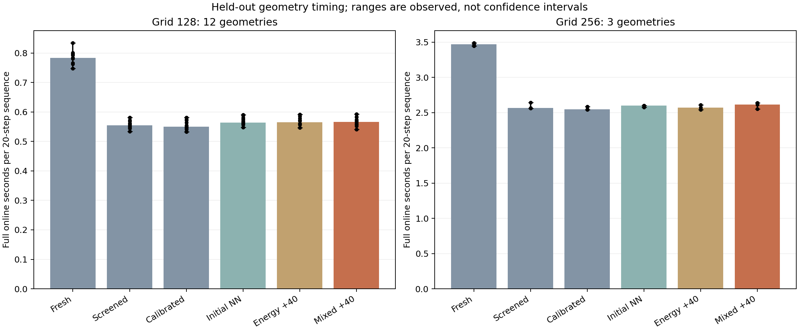
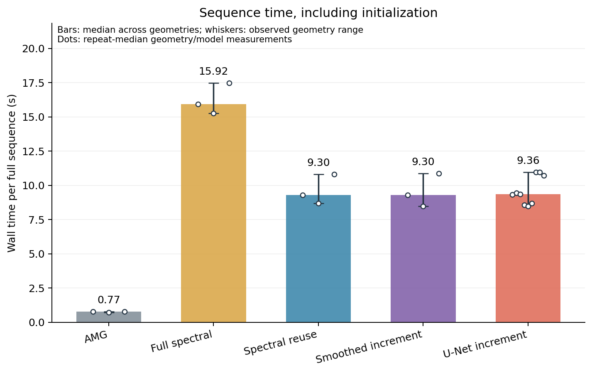
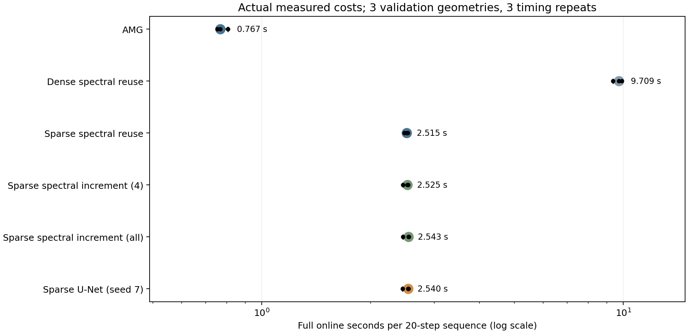

# Darcy-U：AI辅助PDE数值求解的可复现研究

当前已完成第十阶段模型设计复盘和九个小模型的正式训练。**学习粗细网格误差算子取得了整体目标误差预测的正信号，但“硬对称结构提高精度”的预定假设没有通过，局部加密指标也仍落后于AMG。** 本项目尚未证明可归因于AI的完整求解加速或可发表的新颖模型；正向信息与不利结果同时保留。

本仓库保留十个阶段的代码、权重、研究文档和测量。前八阶段的低秩求解路线、第九阶段的单次容差动作路线已停止当前扩展。第十阶段保留SPD Darcy方程，将学习对象改为粗细网格间的离散误差，并通过零训练诊断定位了粗空间分量对局部指标的污染。整体目标估计、局部单元选择、数学结构和实际计算成本分别评价。

## 第十阶段：重新设计学习对象并训练结构对照

研究问题是：在嵌套Galerkin离散中，系数条件、保持双线性/互易/正性的误差算子，能否比同骨架的无对称约束线性模型和非线性模型，更可靠地预测未见系数与组合目标的离散误差？模型预测 `r_f.T H_theta r_g`，而非继续预测低秩方向或内层容差。结构约束和神经伴随均已有文献近邻，本轮是结构假设检验，不主张架构首创。

**139项测试通过；完成9个模型、768条预测评价。** 64训练几何、12验证几何，每几何4右端；三个模型各3种子、60轮。四组测试各16上下文，总计仅32个独立测试几何；窄载荷和倍网格复用ID几何。RTX 4090上记录的训练时间合计22.383秒，未据此计算求解加速。

| 误差矩阵相对误差的几何中位数 | ID | 高对比 | 窄载荷 | 倍网格 |
|---|---:|---:|---:|---:|
| 对称结构模型 | 0.06967 | 0.08632 | 0.04923 | 0.06945 |
| untied线性模型 | 0.06869 | 0.09296 | 0.05125 | 0.06523 |
| nonlinear模型 | 0.05587 | 0.06730 | 0.04220 | 0.05930 |
| 一次AMG V-cycle | 0.06818 | 0.13325 | 0.06951 | 0.07351 |

先在同几何取三个训练种子的中位，再跨几何汇总。对称/untied逐几何配对误差比中位数为 **1.00469 / 0.99204 / 0.96031 / 1.03750**，没有一组达到预定0.9，故结构精度假设不通过。对称/AMG的配对比中位数约为 **0.849 / 0.590 / 0.736 / 0.870**，支持整体误差可学习；它们不能用表中两个中位数相除替代，也不表示完整加速。

局部标记方面，对称模型捕获参考重要单元质量的比率为 **0.780 / 0.719 / 0.913 / 0.790**，AMG为 **0.963 / 0.982 / 0.969 / 0.954**。整体预测较准并未直接转化为适合加密的局部信息。追加的768条零训练诊断发现：去除粗空间分量后，模型标记质量达到 **0.99788 / 0.99480 / 0.99701 / 0.99730**，整体误差矩阵却只变化3.62e-13。此前仅从整体误差判断省略投影，对局部任务不充分，后续接口修订为 `delta_hat=Q H_theta r_g`。所有经典方法同样投影也明显改善；投影后模型的能量误差仍为投影AMG的约1.93–3.49倍，不能归因为AI优势。诊断属于事后分析，不改变正式判据，也没有重新训练。下一项应在新几何上做相同自由度预算的一次真实细化验证。

完整材料：[设计复盘与直接近邻](docs/stage10_design_review_zh.md)、[运行前协议](docs/stage10_protocol_zh.md)、[实验结论](docs/stage10_findings_zh.md)、[独立聚合与图表](results/stage10_report/REPORT_zh.md)、[原始评价](results/stage10_pilot/evaluation.json)、[事后诊断协议](docs/stage10_projection_probe_zh.md)、[诊断结果与图表](results/stage10_projection_report/REPORT_zh.md)。复现入口为 `reproduce_stage10.sh`，权重及训练记录在 `results/stage10_pilot/`。



## 第九阶段：非线性内层精度的经典基线与有限分支

新增二维 `-eps*Delta(u)+beta·grad(u)+u+gamma*u^3=f` 求解器，采用中心扩散、一阶迎风、零Dirichlet边界、解析Jacobian和统一Newton线搜索。比较EW1/EW2、四种固定容差及直接Newton；迭代法均支付每步当前Jacobian的ILU构造和GMRES真残差检查。本轮没有训练AI。

**117项测试通过。** 制造解最后一对网格收敛阶为0.983896（一阶迎风）和1.999989（纯扩散）。504次经典完整求解、552次独立分支求解全部达到共同精度，无线性失败，最大相对非线性真残差9.023547e-9。另有24次高精度离散参考、8次制造解、12次来源轨迹和7次预热。32/64网格共享12个参数实例，分支来自48个预定状态、184个去重动作，每法/动作重复三次。

| 关键结果 | 32网格 | 64网格 |
|---|---:|---:|
| 直接Newton完整中位时间/秒 | 0.008036 | 0.026275 |
| EW1完整中位时间/秒 | 0.010400 | 0.042506 |
| EW1 / 直接Newton配对时间比中位数 | 1.283688 | 1.825870 |
| EW1中ILU构造成本占比 | 67.1% | 75.1% |

固定全实例主基线选为直接Newton，分支统一由EW1续接。64网格事后最佳首动作/直接Newton的配对时间比为 **1.821988**，**0/12**更快，未达到0.85且至少9/12更快的预定门槛。相对同批次原生EW1，最佳首动作中位仅改善约0.67%；部分实例有约10%的局部事后改善，但仍慢于直接Newton。不能将事后选择或后续状态各自的最好时间拼接成可部署策略。

主要成本在反复构造ILU；放宽容差有时减少内层迭代，却增加Newton和重建次数。停止当前PDE族、网格和单次容差动作方案的训练，不扩展为多步搜索继续追分；更大网格、其他预条件器或其他非线性控制未被否定。文献中的2020直接近邻与Botti2015具体算法仍未完整核实，完整强基线覆盖及新颖性尚未成立。

完整材料：[实验报告](results/stage9_report/REPORT_zh.md)、[聚合与轨迹审计](results/stage9_report/summary.json)、[停止决定](results/stage9_screen/decision.json)、[失败原因与下一候选](docs/stage9_findings_zh.md)、[运行前协议](docs/stage9_protocol_zh.md)、[原文核查](docs/stage9_related_work_zh.md)。



## 第八阶段：当前参考空间预算与路线停止决定

本轮没有训练或调用AI。当前参考方向从当前系统已完成的基础PCG轨迹提取，仅用于事后诊断；直接参考解不进入方向生成。两个网格的全部方向预先加载到内存后，五种方法独立计时。参考路径支付组装、历史初值、AMG、当前正交化、投影、平衡构造/应用、PCG、真残差和维护，**排除方向获取与磁盘加载**，不能作为可部署AI加速。

98项测试、100次功能求解通过；正式开发完成1,500次路径求解（900次因果对照、600次事后参考），另有100次基础PCG参考生成和100次直接参考。全部正式路径达到 `1e-8` 真残差，最大 `9.988265e-9`，无PCG失败、恢复或最终精度失败。开发共三个独立几何，128使用全部三个，256复用其中两个；每个方法重复三次、每序列20步。

| 方法 / SciPy强基线 | 128配对时间比中位数 | 256配对时间比中位数 |
|---|---:|---:|
| 事件自实现PCG对照 | 1.008095 | 1.000601 |
| 首步冻结4维、全步作用 | 1.031959 | 1.065588 |
| 当前4维参考，不含获取 | **0.785472** | **0.782694** |
| 当前8维参考，不含获取 | 0.820643 | 0.855451 |

先对完整序列求和，再取同几何重复中位，最后逐几何配对。4维参考在全部五个网格–几何组合更快，4/5达到20%节省；唯一未过线为128/46001的 **0.800845**，20步预算仅差 **0.461毫秒**。这是边界性工程未过线，不能当作统计上否定加速潜力。预定规则要求同一个维数在全部实例达到0.8以内，因此停止后续确认和训练，没有修改门槛或替换不利实例。

4维参考的平均每系统剩余构造预算，在128为 **−0.023、0.398、0.426毫秒**，256为 **2.733、1.976毫秒**。预算紧且尚无实际预测器，但不是全部负值。当前方向也未被证明是精确最慢空间或最优上界。参考生成共同获取费用、直接解、质量核验和加载费用在报告中单列。

失败复盘指向学习对象成本份额不足、学习指标与完整时间不一致、构造/应用成本抵消迭代收益。停止当前扩展，保留数值工具和正向机制信息。本阶段提出的非线性内层求解候选已在第九阶段完成有限成本筛查并停止该动作方案；不能把换网络或换PDE当作已建立的创新。

完整材料：[结果与图表](results/stage8_report/REPORT_zh.md)、[原始聚合与审计](results/stage8_report/summary.json)、[最终决定](results/stage8_decision.json)、[结论与转向](docs/stage8_findings_zh.md)、[路线复盘](docs/route_retrospective_zh.md)、[候选调研与两周停止线](docs/stage8_pivot_literature_zh.md)、[运行前协议](docs/stage8_protocol_zh.md)。



## 第七阶段：首步空间在所有后续步持续作用

本轮没有训练或调用AI。三个回收方案各自支付首步24列轨迹采集与四维空间提取，此后源空间冻结、不再采集或更新。对照全步仅修正初值、事件仅初值/非事件持续作用、全步持续作用，并保留SciPy和事件自实现PCG两种强基线。唯一主候选在运行前固定为全步持续作用，开发和确认没有按速度改选。

**88项测试、100次功能求解通过；600次开发与2100次确认，共2700次正式求解全部达到1e-8真残差**，最大9.989423e-9，无PCG失败、恢复或整空间缓存拒绝。全部81次提取仅发生在首步，27组匹配来源的三种回收法空间哈希一致。确认使用五个新几何，256网格复用其中前两个；独立确认几何仍为五个。

| 冻结确认方法 | 128完整20步中位秒数 | 256完整20步中位秒数 |
|---|---:|---:|
| SciPy AMG-PCG+历史四解 | 0.563931 | 2.919033 |
| 事件步自实现PCG，无回收 | 0.568904 | 2.937222 |
| 首步空间：事件仅初值、非事件持续作用 | 0.602245 | 3.175113 |
| **首步空间：全步持续作用（预定主候选）** | **0.596234** | **3.218154** |
| 首步空间：全步仅修正初值 | 0.613421 | 3.159209 |

完整序列求和→同几何重复中位→几何汇总；主候选/SciPy的逐几何时间比为 **1.060527 / 1.102328**，不能用表中两个汇总时间直接相除代替。主候选迭代中位数为455/564，基线为532/671.5，但0/5和0/2个确认几何更快，均未达到20%节省工程线。

相对同空间的“事件仅初值”策略，后续事件少约12.5%迭代，完整时间配对比却为 **0.991632 / 1.013419**，未形成稳定完整收益。256网格的求解部分本身也更慢，瓶颈不只在首步提取。事后固定实测轨迹、扣除全部空间设置和提取费用，主候选/SciPy仍为 **0.976230 / 1.023371**；该情景不是实际算法或一般下界，且没有免除B的每次应用费用。

本阶段提出的当前系统参考空间预算问题，已在第八阶段执行并据预定规则停止后续训练。完整材料：[结果报告](results/stage7_report/REPORT_zh.md)、[聚合与审计](results/stage7_report/summary.json)、[机制结论和下一问题](docs/stage7_findings_zh.md)、[运行前协议](docs/stage7_protocol_zh.md)。



## 第六阶段：跳变当步的方向更新与刷新时机

本轮没有训练或调用 AI。经典更新在当前 A/M 下把旧四维空间扩展为 `[U, MAU]`，再提取四个低端 Ritz 方向，最多支付 8 次 A 和 8 次 M 向量作用。七种开发策略区分事件前复用、有限更新、事件后提取、只在首步提取和持续运输更新；所有在线事件步仍是初值投影后基础 M 求解，非事件步才使用固定平衡 B。

**82 项数值测试、140 次功能求解通过。** 正式开发 840 次、冻结确认 2,520 次，共 **3,360 次在线求解**全部达到 `1e-8` 真残差，最大 `9.980431e-9`，没有 PCG 失败、直接恢复或缓存/更新空间拒绝。所有更新满足预算。开发三个新几何，确认另五个，256 网格复用其中前两个。

21 个共同基础历史的非首事件探针中，预算更新使所测慢空间剩余误差能量的几何优先中位数从 **0.969437 降至 0.073480**，但一次初值投影的迭代变化中位数仍为零。旧空间与更新空间改为固定平衡接口后，相对各自一次投影均在 **21/21** 个系统减少迭代，配对迭代比中位数为 **0.764706 / 0.687500**。这是离线同空间机制证据，不能作为已完成的事件步在线加速。

| 冻结确认方法 | 128 网格 20 步中位秒数 | 256 网格 20 步中位秒数 |
|---|---:|---:|
| SciPy AMG-PCG + 历史四解 | 0.553227 | 2.705797 |
| 事件步自实现 PCG，无回收 | 0.553051 | 2.719659 |
| 事件后刷新、事件前禁用旧空间 | 0.634425 | 3.144533 |
| 事件前直接复用、事件后刷新 | 0.646808 | 3.195202 |
| 事件前预算更新、事件后刷新 | 0.727809 | 3.555948 |
| 首步提取一次、以后直接复用（选中） | 0.586524 | 2.908668 |

完整序列求和→同几何重复中位→几何汇总；选中方案 / SciPy 的逐几何时间比中位数为 **1.055803 / 1.075054**，不能用表中汇总秒数直接相除替代。选中方案迭代中位数从基线 **532 / 669** 降为 **473 / 596.5**，但全部确认几何的完整时间仍更慢，未达到节省 20% 工程线。

本阶段提出了只提取一次空间、后续跳变步也使用固定平衡接口的实验，现已在第七阶段完成。由于首步之后不再采集，能够避免 MA/BA 缓存混用。

完整材料：[结果报告](results/stage6_report/REPORT_zh.md)、[聚合与审计](results/stage6_report/summary.json)、[机制结论和下一问题](docs/stage6_findings_zh.md)、[运行前协议](docs/stage6_protocol_zh.md)。



## 第五阶段：缓存 PCG 信息与低秩经典回收

本轮仅使用 CPU，没有训练或调用网络。事件步采集已支付的迭代增量 D、AD、MAD，在求解结束后提取最多四个方向供后续步使用；比较 1/2/4 个方向、一次初值投影与固定平衡接口，同时加入原 SciPy 基线、自实现无采集基线、只采集不回收以及同秩显式提取对照。全部在线成本均计入，提取时间属于维护时间的子项。

**71 项数值测试、32 次功能求解、12 个离线缓存核验通过。** 正式完成 960 次开发筛选与 2,100 次冻结确认，共 **3,060 次在线求解**，全部最终真残差不超过 `1e-8`，最大为 `9.994e-9`；没有 PCG 失败、恢复或缓存空间拒绝。开发三个新几何选出秩 4，确认另五个；256 网格复用确认中的前两个。选择秩 4 不表示它已经优于基线。

| 冻结确认方法 | 128 网格 20 步中位秒数 | 256 网格 20 步中位秒数 |
|---|---:|---:|
| SciPy AMG-PCG + 历史四解 | 0.557814 | 2.631227 |
| 事件步自实现 PCG，无回收 | 0.560883 | 2.652694 |
| 缓存 Ritz4 + 平衡接口 | 0.642465 | 3.066115 |
| 显式 Ritz4 + 平衡接口 | 0.766948 | 3.690744 |
| 缓存 Ritz4 + 一次初值投影 | 0.701565 | 3.528526 |

先合计完整序列，再取同几何重复中位数，最后汇总几何。缓存平衡 / SciPy 的逐几何时间比中位数为 **1.146734 / 1.166076**，缓存 / 同秩显式为 **0.838903 / 0.830771**；不能用上表两列中位秒数直接相除替代配对统计。缓存相对显式减少约 45%–50% 提取时间，但全部确认几何仍慢于强基线。显式和缓存对照采用相同采集策略，各自沿数值历史推进，不能称为相同在线轨迹。

迭代中位数从基线的 **535 / 653** 降到缓存平衡的 **405 / 477.5**。即使事后在固定已测轨迹中扣除全部提取时间，相对 SciPy 的配对比仍为 **0.926242 / 0.922621**，未到节省 20% 的工程线；这不是实际算法或一般时间下界。当前未使用旧空间的事件步约占基线一半的 PCG 求解时间，因此下一轮优先诊断这些时刻的因果可得方向，暂不自动扩大 AI 训练。

完整材料：[结果报告](results/stage5_report/REPORT_zh.md)、[原始聚合与审计](results/stage5_report/summary.json)、[机制结论和下一问题](docs/stage5_findings_zh.md)、[运行前协议](docs/stage5_protocol_zh.md)。第四与第五阶段事件策略不同，不能将跨阶段时间差直接归因于缓存。



## 第四阶段：慢方向覆盖与固定平衡接口

本轮冻结第三阶段混合损失模型，没有重新训练。对同一个方向先做当前 A 上的 Galerkin 初值校正，再比较基础 AMG 与固定平衡两层作用；经典对照包括历史解、历史校正和过去 PCG 的低端 Ritz 方向。所有方向提取、GPU 推理/传输、构造、维护、PCG 和恢复均计入完整在线时间。

59 项数值测试和九个方案的小网格功能检查通过。正式完成 **1,080 次开发筛选 + 1,680 次冻结确认 = 2,760 次在线求解**，全部真残差不超过 `1e-8`，没有 PCG 失败或直接恢复；源码、协议、权重、几何划分和结果完整性核验通过。开发为 3 个新几何，确认另有 5 个；256 网格复用其中前两个，独立确认几何仍为 5 个。

共同初值的 9 个网络诊断事件中，网络初始误差能量比中位数为 **0.7832**，但所测四个慢 Ritz 方向仍剩下 **0.9911** 的误差能量，网络方向与该空间的 A 能量重合度仅 **1.38%**。这些是事件合并统计；报告另列先按几何汇总的口径。当前轨迹 Ritz4 只作事后探针：12 个系统总迭代从 384 降至 254（一次投影）或 245（平衡接口），但两接口在 **11/12** 个系统中相同，不能把方向覆盖的作用普遍归因为持续投影。

开发集过去 Ritz4 平衡方法将每条序列的迭代中位数从 **506 降到 340**，总时间却从 **0.554927 增至 0.825755 秒**，其中回收维护中位数为 **0.328217 秒**。即使事后假想免除维护成本，固定已测轨迹的配对改善也仅约 12.1%，并非一个实际算法。

| 冻结确认方法 | 128 网格 20 步中位秒数 | 256 网格 20 步中位秒数 |
|---|---:|---:|
| 当前 Galerkin AMG + 历史四解 | 0.555366 | 2.926375 |
| 开发选出的历史校正一次投影 | 0.578734 | 3.064672 |
| 冻结网络一次投影 | 0.572018 | 2.980691 |
| 冻结网络平衡接口 | 0.589340 | 3.083723 |

网络一次投影/基线的逐几何时间比中位数为 **1.030 / 1.018**，平衡接口为 **1.059 / 1.054**。所有候选在全部确认几何中都慢于基础方法，未达到预定 20% 工程线。

完整材料：[结果报告](results/stage4_report/REPORT_zh.md)、[汇总与审计](results/stage4_report/summary.json)、[机制结论及下一步](docs/stage4_findings_zh.md)、[运行前协议](docs/stage4_protocol_zh.md)、[数学推导与相关工作边界](docs/stage4_mechanism_theory_zh.md)。当前轨迹 Ritz 不能用于在线性能声明；学习 deflation 和谱空间已有直接近邻，本轮不主张这些结构的新颖性。



## 第三阶段：GPU 训练、强经典对照与最终测试

第三阶段先在两个网格上筛选六种经典配置：每步重建 AMG、复用首步 AMG、冻结插值并重建当前 Galerkin 层次，分别搭配上一步解或最近四个解的当前能量投影。随后比较固定 Jacobi 校正、32 网格粗空间 Galerkin 校正和网络校正。网络只在 PCG 开始前改变初值；每次 PCG 内预条件器固定，最终显式相对真残差要求仍为 `1e-8`。

64 个训练几何和 12 个训练验证几何产生 **448/84 个全局校正样本**。宽度 8/16/32、30,297 参数的六通道 U-Net 先训练 40 轮；两个续训分支从同一个初始检查点出发，各训练 40 轮，分别使用纯能量损失和能量加加权残差损失。它们共享种子、批次顺序、学习率与预算，按各自验证目标选择检查点。训练只有一个随机种子，不能据此声称初始化鲁棒性。

训练与最终网络推理使用本机 RTX 4090；有限元组装、AMG 和 PCG 使用 CPU。BLAS 单线程，PyTorch 两个 CPU 线程。GPU 在线成本包含特征构造、传输、推理输出、校正和保护；模型加载与预热在在线计时外，采用模型常驻进程口径。

第三阶段共有 **9,000 次基准求解记录**：经典筛选 1,440 次、两轮开发校准 720/1,440 次、最终测试 5,400 次。最终 128 网格有 12 个未参与选择的几何；256 网格使用其中前三个，属于分辨率迁移检查，独立几何总数仍为 **12**。每个标签重复三次，先对完整 20 步序列求和，再取同几何重复中位数，最后汇总几何。

| 方法 | 128 网格序列时间中位数 / 秒 | 256 网格序列时间中位数 / 秒 |
|---|---:|---:|
| 每步重建 AMG + 上一步解 | 0.783671 | 3.467117 |
| 当前 Galerkin 层次刷新 + 历史四解，合并相同标签 | 0.553718 | 2.554964 |
| 初始能量网络 | 0.563841 | 2.597214 |
| 同预算纯能量续训网络 | 0.565655 | 2.569406 |
| 优化混合损失网络 | 0.566726 | 2.612796 |

`selected_classical` 与 `best_classical` 最终对应相同算法。上表经典时间在每个几何内合并这两个标签的六次完整测量后取中位数，**不是各标签中位数，也不是两个标签中位数的平均值**。网络/经典的配对比先逐几何计算，再取中位数，不能用上表两列汇总时间直接相除替代。

| 网络/最快合并经典的配对中位比 | 128 网格 | 256 网格 |
|---|---:|---:|
| 初始网络 | 1.021322 | 1.016536 |
| 同预算纯能量续训 | 1.022096 | 0.997353 |
| 优化混合损失 | 1.021102 | 1.014196 |

小于 1 表示本次测量中更快，预定工程门槛为不超过 0.8。三个网络在 128 网格均为 **0/12** 个几何过线，在 256 网格均为 **0/3**。优化/同预算对照的配对比为 **1.001040 / 1.012470**，没有支持混合损失带来加速的证据；这些小幅差异也不是统计显著性结论。

第三阶段计时前 **44 项数值测试通过**。最终 5,400 次求解没有 PCG 失败或直接恢复，最大最终真残差为 `9.989869e-9`。经典筛选中复用首步层次的配置出现 **352 次 PCG 失败**，恢复成本与失败记录全部保留，没有从统计中删除。最终冻结的源码、权重、数据划分、选择与聚合规则核对通过；另行重算 24 条唯一网格/几何序列、480 次离线直接参考，系数哈希全部匹配，最大参考真残差 `6.214508e-9`。该审计不证明重算解与原参考解逐比特相同。

完整结果见 [第三阶段报告](results/stage3_report/REPORT_zh.md)、[机器可读汇总](results/stage3_report/summary.json)、[阶段结论](docs/stage3_findings_zh.md) 和 [预先制定的协议](docs/stage3_protocol_zh.md)。



## 前两阶段实现：局部增量粗空间

- 方程：单位正方形上 `-div(k grad p)=f`，齐次 Dirichlet 边界，正的分片常数渗透率；P1 三角形有限元。
- 网络：6 通道输入、宽度 16/32/64 的 U-Net，共 119,396 参数，输出 4 个局部方向。
- 学习：加权子空间覆盖损失；用确定性投影去除旧空间分量，避免依赖某一特征向量的符号和旋转。
- 更新：系数比界复用 → 检查旧空间 → 候选增量 → 完整矩阵数值检查 → 必要时局部谱重建。
- 求解：每次 PCG 内保持固定的两层加性 Schwarz 预条件器，显式检查真残差；失败和直接求解恢复均计入时间。
- 第一轮五组对照：AMG、每步全谱重建、自适应谱复用、平滑误差增量、U-Net 增量。
- 第二轮诊断：增加数学等价的稀疏局部求解与缓存、四方向/全部方向精确谱增量参考；所有方法保留完整在线成本。

浮点接纳检查不是经过舍入误差验证的严格证书。训练用的平均覆盖损失下降，也不等于候选必然通过最坏方向检查或获得加速。

## 第一轮本机实验

已完成 48 条训练序列、12 条验证序列，分别得到 565/144 个局部训练/验证样本。训练对比度为 `1e2–1e4`，三个训练种子为 `7,17,27`，每个训练 50 轮，按验证损失选择模型。

三个模型最佳验证损失为 `0.004247 / 0.004339 / 0.005594`；不添加方向的验证损失为 `0.068372`。这是子空间损失，不是压力误差。

已完成 N=128、20 步、测试种子 `90001,90002,90003`、对比度 `1e4` 的完整对照，每项计时重复 3 次，共 63 次完整序列运行、1,260 次线性求解。17 项检查全部通过；全部求解的真残差低于 `1e-8`，没有直接求解恢复。

| 方法 | 每条 20 步序列中位总时间 / 秒 |
|---|---:|
| AMG | 0.767 |
| 每步全谱重建 | 15.924 |
| 自适应谱复用 | 9.295 |
| 平滑误差增量 | 9.295 |
| U-Net 增量 | 9.364 |

先对重复计时取中位数，再对同一几何的模型取中位数，最后对三个几何取中位数；包含初始化及全部在线检查和回退成本。

**本次没有观察到 AI 的端到端加速优势。** U-Net 候选通过了 9/36 次检查（含模型种子与计时重复，实际仅涉及 4 个不同局部更新案例），但总时间没有优于传统复用和相同流程的平滑误差候选。相对每步全谱重建的节省主要来自复用机制，不能全部归因于 AI；AMG 在当前问题上明显更快。

完整记录见 [中文实验报告](results/pilot_cpu/REPORT_zh.md)、[原始测量](results/pilot_cpu/measurements.json) 和 [结果解读](docs/pilot_findings_zh.md)。当前结果可以指导下一轮研究，尚不能作为已获得加速的论文结论。



前两阶段运行环境：Intel Core Ultra 7 265K，Python 3.10.21、NumPy 1.26.4、SciPy 1.15.3、PyTorch 2.6.0、PyAMG 5.4.1。前两阶段所报告结果来自 CPU；BLAS 线程数为 1，PyTorch 线程数为 2。第一轮运行环境未能访问 CUDA，第二轮完整运行检测到 CUDA 可用，但依照预先固定的协议仍显式使用 CPU。第三阶段的 GPU 训练与推理结果见本页顶部。

## 第二轮诊断：实现优化有效，AI 尚无整体收益

在新验证几何 `70001–70003` 上，六种配置各重复三次，共完成 54 条完整序列、1,080 次线性求解；另审计 20 条共同经典轨迹上的 68 个唯一更新事件。本轮未重新训练或挑选模型。27 项数值检查通过，全部真残差不超过 `1e-8`，没有 PCG 失败或直接恢复。

| 方法 | 每条 20 步序列中位总时间 / 秒 |
|---|---:|
| AMG | 0.767 |
| 原稠密谱复用 | 9.709 |
| 稀疏谱复用 | 2.515 |
| 稀疏四方向精确谱增量 | 2.525 |
| 稀疏全部方向精确谱增量 | 2.543 |
| 稀疏 U-Net 增量 | 2.540 |

这里先对每次完整序列求和，再取每个几何三次计时的中位数，最后汇总三个几何。稠密到稀疏的配对加速为 **3.78–3.90 倍**；180 对逐步记录的复用、修复和粗维数均一致。这是数学等价的局部稀疏求解与缓存收益。冻结 U-Net 仍需 AMG 的 **3.04–3.37 倍**时间，未达到预先约定的端到端改进门槛。

68 个共同事件中，四方向与全部方向精确谱参考均通过全部检查，实际新增 1–2 个方向；三个冻结 U-Net 分别通过 **16/68、15/68、15/68**。在这些案例上，没有“四方向数量不足”的证据。但即使固定实测空间与迭代路径、假设所有谱空间工作免费，剩余成本仍高于 AMG；这只是成本诊断，不能冒充实际算法或普遍下界。

**阶段决定：保留稀疏实现，暂停当前仅学习局部增量构造的大规模训练。** 下一阶段应先确认 AI 可以改善的主要求解成本，再设计模型。本轮是开发验证，不能当作最终测试或论文创新性证明。

详见 [完整诊断报告](results/diagnostic_cpu/REPORT_zh.md)、[阶段判断与下一阶段要求](docs/diagnostic_findings_zh.md)、[原始记录](results/diagnostic_cpu/measurements.json) 和 [计时前固定的协议](docs/diagnostic_protocol_zh.md)。首次中断运行的 420 条记录单独 [保留并标注](results/diagnostic_interrupted_20261119/README.md)，未纳入完整重跑的统计。



## 复现

第九阶段仅需CPU上的NumPy/SciPy/Matplotlib/threadpoolctl，独立复现脚本只运行本阶段19项测试，不训练模型：

```bash
DARCY_PYTHON=/path/to/python bash reproduce_stage9.sh
```

默认输出新的 `reproductions/stage9_时间戳/`，可用 `DARCY_STAGE9_ROOT` 指定，拒绝覆盖已有目录。流程为正确性测试、源码/协议冻结、制造解和离散参考、经典基线、有限分支、停止决定及报告。保持BLAS单线程并避免并行求解计时。仅用已有记录重建图表可运行 `python report_stage9.py`。本机额外运行了全部117项回归测试，日志保留在 `results/stage9_tests.log`。

第八阶段仅需CPU，按运行前门槛决定是否进入确认；原始运行因开发门槛未过而停止。依赖安装后运行：

```bash
DARCY_PYTHON=/path/to/python bash reproduce_stage8.sh
```

默认在新的 `reproductions/stage8_时间戳/` 中执行数值检查、参考生成、开发计时和报告，支持 `DARCY_STAGE8_ROOT`，拒绝覆盖已有目录。只有同一维数在两个网格全部开发几何过线才执行确认；不自动训练。跨硬件计时可能产生不同决策，应保留新结果和来源，不能覆盖原始测量。不要与其他训练或求解并行计时。仅重建已有结果图表可运行 `python report_stage8.py`。

第七阶段仅使用CPU，不使用模型权重；先安装依赖（全套测试仍需PyTorch），再执行：

```bash
/path/to/python -m pip install -r requirements.txt
DARCY_PYTHON=/path/to/python bash reproduce_stage7.sh
```

默认在新的 `reproductions/stage7_时间戳/` 内完成测试、开发数值检查、固定五法确认及图表报告，支持 `DARCY_STAGE7_ROOT`，拒绝覆盖已有目录并保留日志。计时期间不要并行训练或求解。仅从已有测量重建报告可运行 `python report_stage7.py`，不会重新求解PDE。

第六阶段仅使用 CPU，不使用模型权重；先在所选环境安装依赖（全套测试仍需 PyTorch），再执行：

```bash
/path/to/python -m pip install -r requirements.txt
DARCY_PYTHON=/path/to/python bash reproduce_stage6.sh
```

默认在新的 `reproductions/stage6_时间戳/` 中运行测试、共同历史诊断、开发筛选、冻结确认及报告，支持 `DARCY_STAGE6_ROOT`，拒绝覆盖已有目录，保留日志。计时期间不要并行其他训练或求解。仅根据已有结果重建图表可运行 `python report_stage6.py`。

第五阶段仅需 CPU，不使用模型权重。请先在所选 Python 环境安装 `requirements.txt` 依赖（全套数值测试仍需 PyTorch），再在全新目录运行数值测试、缓存核验、开发筛选、冻结确认与报告生成：

```bash
/path/to/python -m pip install -r requirements.txt
DARCY_PYTHON=/path/to/python bash reproduce_stage5.sh
```

默认输出 `reproductions/stage5_时间戳/`，支持 `DARCY_STAGE5_ROOT`，拒绝覆盖已有目录。全部日志保留，核验失败时停止，不放宽门槛。BLAS 单线程，不要与其他训练或求解计时并行。仅从本仓库已有第五阶段记录重新生成报告可运行 `python report_stage5.py`，不会重跑求解。

第四阶段使用已提交的冻结模型，在全新目录完成数值检查、离线诊断、开发筛选、冻结确认和图表报告，不重新训练：

```bash
DARCY_PYTHON=/path/to/python bash reproduce_stage4.sh
```

需要可用 CUDA GPU 和 `requirements.txt` 依赖。默认输出 `reproductions/stage4_时间戳/`，支持 `DARCY_STAGE4_ROOT`，拒绝覆盖已有目录，保留各步骤日志。确认阶段会核验开发筛选完整性及冻结哈希。不要与其他训练或求解工作并行计时。

第三阶段完整复现需要可用的 CUDA GPU，以及安装了 `requirements.txt` 依赖的独立 Python 环境：

```bash
python -m pip install -r requirements.txt
DARCY_PYTHON=/path/to/python bash reproduce_stage3.sh
```

脚本默认在新的 `reproductions/stage3_时间戳/` 目录中执行，拒绝覆盖已有目录；可用 `DARCY_STAGE3_ROOT=/path/to/new-directory` 指定新位置。流程依次运行数值检查、经典筛选、标签生成、三段训练、开发校准、测试前冻结、最终测试、事后参考审计和报告生成。默认重训第三阶段模型，不覆盖仓库内原始结果与权重。不要与其他训练或求解任务并行计时，也不要在看到最终测试结果后修改模型再沿用同一测试集。

以下命令用于第一阶段的历史实验：

```bash
bash reproduce.sh
```

如需指定已有 Python 环境：`DARCY_PYTHON=/path/to/python bash reproduce.sh`。脚本依次执行当前全部数值检查、重新生成数据、训练三个模型、运行完整对照并生成图表报告。不要与其他训练任务并行计时。

仅使用已提交的权重重新测量：

```bash
export OPENBLAS_NUM_THREADS=1 OMP_NUM_THREADS=1 MKL_NUM_THREADS=1
python run_experiment.py benchmark --n 128 --steps 20 \
  --test-seeds 90001 90002 90003 --model-seeds 7 17 27 \
  --repeats 3 --run-name reproduced_cpu
python plot_problem.py results/reproduced_cpu
python report_results.py results/reproduced_cpu
```

第一阶段入口的 GPU 参数 `--device cuda` 只迁移神经网络部分；SciPy 的有限元、谱问题和 PCG 仍在 CPU。第一、二阶段未测量 GPU 收益。

第二轮使用已提交的冻结权重，不重新训练：

```bash
bash reproduce_diagnostics.sh
```

同样支持 `DARCY_PYTHON=/path/to/python`，默认写入 `results/reproduced_diagnostic_cpu/`。设置 `DARCY_RUN_NAME` 可使用新的输出目录；程序拒绝覆盖已有结果。流程包含当前数值检查、六种方法的完整计时、20 条共同经典轨迹的事件审计和报告生成；第二阶段原运行时通过 27 项检查。计时前固定的设置与判断规则见 [诊断协议](docs/diagnostic_protocol_zh.md)。

## 文件

| 文件 | 内容 |
|---|---|
| `fields.py` | 系数序列、局部漂移、通道接通/堵塞与嵌套网格 |
| `numerics.py` | 有限元、局部谱问题、接纳检查、Schwarz-PCG |
| `learning.py` | U-Net、基变换不变特征、子空间损失、训练 |
| `run_experiment.py` | 数据、训练及公平计时入口 |
| `optimized_numerics.py` | 数学等价的稀疏局部求解、完整系数支撑缓存 |
| `exact_increment.py` | 精确谱增量参考、完整检查矩阵的负模式诊断 |
| `diagnose.py` | 第二轮冻结模型计时、唯一事件审计与独立性能剖析 |
| `report_diagnostics.py` | 完整性/哈希核对、诊断聚合与图表报告 |
| `sequence_baselines.py` | 历史能量投影、固定 AMG 复用与当前 Galerkin 层次刷新 |
| `coarse_correction.py` | 当前矩阵上的双线性粗网格 Galerkin 校正 |
| `correction_model.py` | 全局残差条件 U-Net、离散能量与加权残差损失 |
| `sequence_experiment.py` | 第三阶段筛选、训练、校准与冻结后测试 |
| `freeze_stage3.py` | 测试前保存源码、权重、协议与选择哈希 |
| `audit_stage3_references.py` | 全部在线计时结束后的独立直接参考审计 |
| `report_stage3.py` | 完整性核验、相同标签合并、配对统计与第三阶段报告 |
| `reproduce_stage3.sh` | 在新目录重建第三阶段的完整流程 |
| `balanced_augmentation.py` | 当前 A 正交基、固定 SPD 平衡两层作用与 MA 慢 Ritz 提取 |
| `traced_pcg.py` | 带可选迭代增量采集的 PCG，保留真残差刷新和总预算 |
| `mechanism_experiment.py` | 第四阶段几何隔离、诊断、完整在线筛选及冻结确认 |
| `report_stage4.py` | 第四阶段来源审计、几何聚合、机制图表与事后成本核算 |
| `reproduce_stage4.sh` | 在新目录使用冻结模型复现第四阶段 |
| `cached_pcg.py` | PCG 已支付 D/AD/MAD 的分段采集与无额外 A/M 作用的 Ritz 提取 |
| `cached_recycling_experiment.py` | 第五阶段离线等价核验、八组开发对照及冻结确认 |
| `test_cached_pcg.py` | 缓存恒等式、算子调用预算、秩与重启边界的数值测试 |
| `report_stage5.py` | 第五阶段完整性核验、配对统计、事件成本及固定轨迹核算 |
| `reproduce_stage5.sh` | 在新目录重跑第五阶段 CPU 实验与图表报告 |
| `event_space_update.py` | 当前 A/M 下有 8A/8M 预算的四维空间更新与数值失败处理 |
| `test_event_space_update.py` | 空间正确性、真实算子预算、退化与分解失败测试 |
| `event_recycling_experiment.py` | 第六阶段共同历史探针、七组时机/刷新对照及冻结确认 |
| `report_stage6.py`、`reproduce_stage6.sh` | 第六阶段完整审计、事件分类报告及新目录复现 |
| `persistent_recycling_experiment.py` | 第七阶段固定五法、首步空间冻结、全步平衡接口及独立确认 |
| `test_persistent_recycling.py` | 实际B/M对象传递、仅首步采集、来源一致性与真残差检查 |
| `report_stage7.py`、`reproduce_stage7.sh` | 第七阶段完整审计、配对成本统计及新目录复现 |
| `oracle_budget_experiment.py` | 第八阶段当前轨迹参考隔离生成、质量核验、五法预算诊断与自动停止 |
| `test_oracle_budget.py` | 实际算子、来源隔离、秩失败、冻结来源及全几何同维门槛测试 |
| `report_stage8.py`、`reproduce_stage8.sh` | 第八阶段成本/质量审计、几何配对报告及新目录复现 |
| `nonlinear_budget.py` | 非线性对流–反应–扩散、解析Jacobian、EW1/EW2、ILU-GMRES/直接Newton及状态恢复 |
| `nonlinear_screen_experiment.py` | 第九阶段冻结实例、制造解验证、七组经典基线和有限分支机会筛查 |
| `test_nonlinear_budget.py`、`test_nonlinear_screen.py` | 第九阶段离散/求解正确性、真实残差、状态恢复与固定选择/门槛的19项测试 |
| `report_stage9.py`、`reproduce_stage9.sh` | 第九阶段完整成本、来源/轨迹核验、图表与新目录复现 |
| `report_results.py` | 从原始测量生成统计和科学图表 |
| `plot_problem.py` | 离线生成渗透率与压力快照 |
| `checkpoints/` | 第一阶段三个局部模型与第三阶段三个全局模型的权重、训练曲线 |
| `data/pilot.manifest.json` | 数据种子、完整序列哈希及生成成本 |
| `data/stage3_splits.json`、`data/stage3_correction.manifest.json` | 第三阶段几何隔离、样本元数据、标签生成与数据哈希 |
| `data/stage4_splits.json`、`data/stage5_splits.json` | 后续机制探索的新几何及历史排除哈希 |
| `data/stage6_splits.json` | 第六阶段新几何及此前全部阶段与功能检查的排除记录 |
| `data/stage7_splits.json` | 第七阶段新开发/确认几何与历史排除记录 |
| `data/stage8_splits.json` | 第八阶段开发与预留确认几何，含既往几何排除记录 |
| `data/stage9_cases.json` | 第九阶段12个固定PDE参数实例及网格复用范围 |
| `docs/` | 中文研究计划、相关工作、局部推导、实现说明及结果解读 |
| `results/` | 实际配置、原始测量、图表和报告 |

大体积数据文件（包括第三阶段训练、第八阶段参考方向和第九阶段状态 `.npz`）可由代码重建，未上传；复现所需种子、数据/方向/状态哈希、模型权重与测量记录保留。本机依赖副本和缓存不进入版本库。

## 尚需完成的论文工作

第三阶段的12个独立测试几何以及第四至第七阶段各5个独立确认几何仍不足以建立一般化结论；目前右端恒定、测试对比度单一、全局网络仅有一个训练种子。第八阶段只有三个新开发几何，没有进入独立确认；按预定规则停止当前路线的扩展。负结果和正向机制应共同保留，不继续依靠更换秩、损失或确认几何寻找优势。

第九阶段已完成非线性内层精度的经典基线和有限分支筛查，停止当前动作方案的训练。下一候选为目标量驱动网格自适应的富集/估计预算，先检查经典DWR和廉价恢复的实际成本，再决定是否有值得学习的对象；尚未实现或得到性能结果。已有学习目标误差指标与神经伴随近邻，不能凭模型名称宣称创新，见[第九阶段结论](docs/stage9_findings_zh.md)与[候选调研](docs/stage8_pivot_literature_zh.md)。

AMG 使用固定配置，未穷尽调优；前两阶段局部谱修复使用直接特征求解，尚未实现优化的谱回收。现有文献已包含学习粗空间、子空间损失、自适应复用、神经热启动、残差条件校正和序列回收，见 [粗空间相关工作](docs/related_work_zh.md) 与 [第三阶段近邻工作](docs/stage3_related_work_zh.md)。新颖性、有效性和投稿选择需要另行论证，当前结果不构成 Q1 录用承诺。
