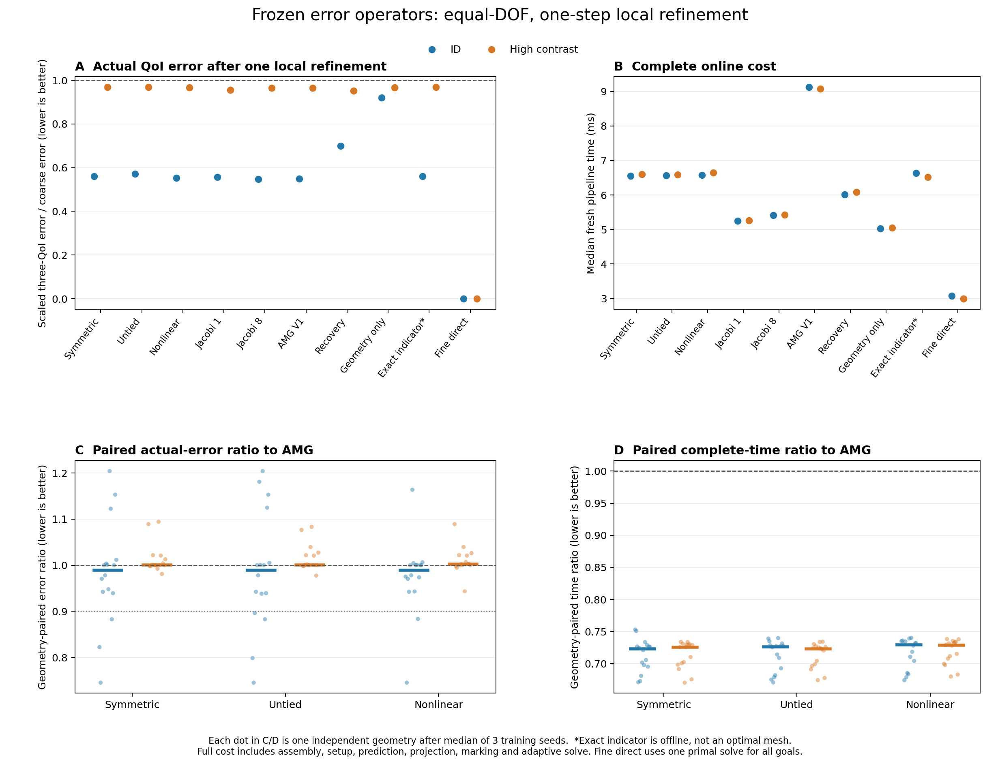

# 第十一阶段：真实局部细化没有显示 AI 标记的额外收益

日期：2026-11-20。已执行冻结模型、独立几何、相同新增自由度的一次真实局部细化。本轮结论是：**停止当前“预测伴随缺陷，再用局部指标排序实现 AI 加密优势”的分支。** 学习方法能产生有效细化，但没有稳定超过经典指标；在当前小网格实现上，一次直接细主问题求解还更快。此结论限制在本轮问题族、预算、单次细化和实现，不能推广为所有学习网格或所有 AMR 无效。

## 本轮实际完成的工作

保持第十阶段的九个模型权重不变：symmetric、untied、nonlinear 各三个训练种子。测试改用从未用于训练、验证或历史测试的 32 个独立几何，ID 52000–52015、高对比 52100–52115。三个目标量共用源项 0 的一次主问题求解，目标取载荷 1、2、3，不把目标和模型种子计为额外独立样本。

粗网格 16×16，指定细参考网格 32×32，分别为 225 和 961 个内部自由度。所有局部细化方法均增加恰好 64 个独立自由度，达到 289。实施三角形红细化并约束悬挂节点；相邻选中方格的公共边中点也计入预算。不同方法实际选中的方格数可以不同，不能用“选相同数量方格”替代公平预算。

保留统一投影 `Q=I−P Ac^{-1}P.T Af`。同一细算子和载荷通过 `T.T Af T`、`T.T f` 装配局部细化问题，避免系数重新采样或积分差异。三目标指标先按在线粗目标值归一化，再聚合绝对局部贡献。每种方法生成一个网格，重求一次主问题，再评价三个目标。

九个模型加六个指标／空间对照、一种直接细解，共 **512 条方法—几何记录**。每条独立重建对象并计时五次，共 **2,560 次完整路径运行**，另有 16 次预热和 32 次独立参考生成。没有重新训练。CPU 和 BLAS 都限制为一个线程，硬件为 Intel Core Ultra 7 265K。158 项测试通过，其中本阶段新增 19 项。全部 480 条局部细化记录达到精确预算，无棋盘格回退；全部能量误差、空间嵌入、线性求解、投影及重复一致性核验通过。

## 真实目标误差与完整成本

主指标 `E=||e_ad/s||_2 / ||e_coarse/s||_2`，其中误差相对于指定细离散解，s 只来自粗解。E=1 表示没有改善，越小越好，E>1 表示三目标综合误差反而变大；这不是连续 PDE 误差上界。先在同一几何内取三个模型种子的中位数，再跨 16 个几何汇总。传统方法不重复成三个伪种子。

| 方法 | ID：E 中位数 | 高对比：E 中位数 | ID：完整毫秒 | 高对比：完整毫秒 |
|---|---:|---:|---:|---:|
| symmetric | 0.560374 | 0.968485 | 6.551 | 6.601 |
| untied | 0.571693 | 0.968485 | 6.563 | 6.587 |
| nonlinear | 0.553780 | 0.967100 | 6.581 | 6.646 |
| Jacobi1 + Q | 0.556206 | 0.955448 | 5.255 | 5.258 |
| Jacobi8 + Q | 0.547901 | 0.965711 | 5.414 | 5.423 |
| AMG V1 + Q | 0.549295 | 0.965007 | 9.124 | 9.076 |
| 二次插值恢复 + Q | 0.699979 | 0.951115 | 6.011 | 6.086 |
| 几何随机排列 | 0.920204 | 0.967377 | 5.023 | 5.051 |
| 精确伴随指标（离线诊断） | 0.560642 | 0.968458 | 6.631 | 6.519 |
| 一次直接细主问题（961 自由度） | 0 | 0 | 3.073 | 2.995 |

计时包括几何与算子／载荷装配、必要粗解、残差、特征与推理或经典方法设置、投影、标记、约束网格构造、适应矩阵装配和一次主问题重求解。模型加载与预热单列，离线评价和结果序列化不进入在线时间；因此是完整的每几何**暖运行**成本，不是包含 Python 启动和模型加载的冷启动时间。直接细解只解一次主问题便得到全部三个目标，没有被人为加上三次细伴随或粗层成本。

当前路径为了保留统一误差算子接口，都会装配全域指定细离散算子；高效传统 AMR 可以采用其他局部装配方式。本轮结果不能证明 AMR 通常慢于直接细解，更不能外推大网格或 GPU 性能。直接细解是本轮指定细参考，零值表示相对于它的离散误差为零，不表示连续 PDE 误差为零。

## 事前门槛没有通过

以下都是先逐几何配对，再取中位数，不能用上表两个跨几何中位数相除替代。

| 主候选 symmetric 的固定检查 | ID | 高对比 | 预定要求 |
|---|---:|---:|---:|
| 相对 AMG 的目标误差比 | 0.989063 | 1.000270 | 两组均 ≤0.90 |
| 比 AMG 更好的几何数 | 8/16 | 4/16 | 两组均 ≥12/16 |
| 相对 Jacobi8 的目标误差比 | 1.000313 | 1.000600 | 两组均 ≤1.00 |
| 相对 AMG 的完整耗时比 | 0.722774 | 0.725843 | 两组均 ≤1.00 |
| 相对直接细解的完整耗时比 | 2.144178 | 2.197374 | 成本边界对照 |

三个训练种子相对 AMG 的分组配对误差比中位数均未超过 1.10，数值核验通过，也没有近零分母。失败来自缺乏规定幅度和一致性的实际精度优势，不是某个坏种子或数值解算失败。学习方法比包含层次构造的 AMG 路径快，但廉价 Jacobi 路径更快，且一次直接细解在此尺度上更快、更准确。与 Jacobi8 的微小误差差异应理解为基本持平，不能夸大成统计上已证实的劣势。

## 从失败中能定位什么

第一，第十阶段去除粗空间污染确实修复了局部接口，但并未创造独有信息。事后查看实际网格，symmetric 与 AMG 选中方格的 Jaccard 重合度中位数约为 ID 0.875、高对比 0.877；先在模型种子内聚合，随后在几何间聚合。高重合度和真实误差基本持平相互一致。Jaccard 只作机制描述，不进入事前门槛。

第二，**更准确地复现既有局部指标，未必能改善有限预算下的实际动作。** 精确伴随指标的高对比 E 中位数也为 0.968458，改善约 3.15%，与学习方法接近。它是精确指标经过同一个贪心预算选择器后的结果，不是所有可行网格中的最优解。因此可怀疑指标局部分解、目标符号、空间耦合和预算选择之间存在不匹配，但不能断言只因某一个因素，更不能将精确指标对照称为实际最优上界。

第三，能量下降与目标量误差下降不是同一件事。高对比组中 symmetric 的 48 条种子—几何结果有 12 条 E>1，AMG 为 4/16，精确伴随指标为 3/16；这些记录均保留。symmetric 的最大 E 约 1.616，能量误差却仍满足不增条件。不能通过只报告能量或标记质量掩盖目标量恶化。重复种子结果不是 48 个独立几何。

第四，本轮没有发现需要更大网络的证据。三个不同结构输出的真实细化结果接近，廉价经典方法已提供相似动作。在这个接口上继续增加训练数据、网络宽度或训练轮数，没有得到本轮证据支持。

## 停止决定与下一候选

停止扩展当前 AI 指标排序分支，不把对称约束、投影后标记质量或比 AMG 设置更快包装成完整论文贡献。保留已验证的 FEM、模型和诊断代码，以及第十阶段全局误差预测的独立正信号；本轮并未检验全局误差校正的完整成本。

下一步应先检验一个**尚未执行**的非学习可行性问题：在相同自由度预算下，直接评价小型局部补丁动作的目标变化，是否能找出明显优于现有指标排序的网格？如果连这个动作候选集都没有空间，就不训练 AI 去模仿它。

在嵌套空间中，候选新增方向为 V，令 `B=P.T Af V`、`K=V.T Af V−B.T Ac^{-1}B`，则一次精确 Galerkin 富集引起的目标变化满足

`ΔJ_j=(V.T r_gj).T K^{-1}(V.T r_f)`。

这里 K 是消去粗变量后的 Schur 补，条件是 V 在粗空间之外独立。公式来自块消元，是经典数值线性代数，不是本项目提出的新算法。它描述有符号目标变化，不能在未知目标误差符号时直接等同于误差下降。补丁之间的相互作用也必须计算，不能相加多个各自最优动作来冒充联合收益。

这将把候选学习对象从“伴随场／局部残差贡献”转向“带预算的动作及其耦合效应”。目前只是新的可行性方向，尚未完成动作实验、训练或新颖性检索，也不声称它已能支撑国际一区论文。后续只有经典可达性、完整成本和已有工作核查同时留下空间，才考虑学习器。

## 复现与完整材料

本机在仓库目录运行 `PYTHON_BIN=/home/user/miniconda3/envs/mini-rl/bin/python bash reproduce_stage11.sh`。脚本建立新的 `reproductions/` 目录，运行本阶段测试、完整实验和独立报告，不覆盖冻结结果。无需重新训练第十阶段模型。

- [运行前协议](stage11_protocol_zh.md)
- [独立统计审计与图表](../results/stage11_report/REPORT_zh.md)
- [冻结输入与硬件信息](../results/stage11_refinement/freeze.json)
- [全部逐几何、逐种子、逐次计时记录](../results/stage11_refinement/rows.json)
- [完成标记及结果哈希](../results/stage11_refinement/complete.json)
- [158 项测试日志](../results/stage11_tests.log)

