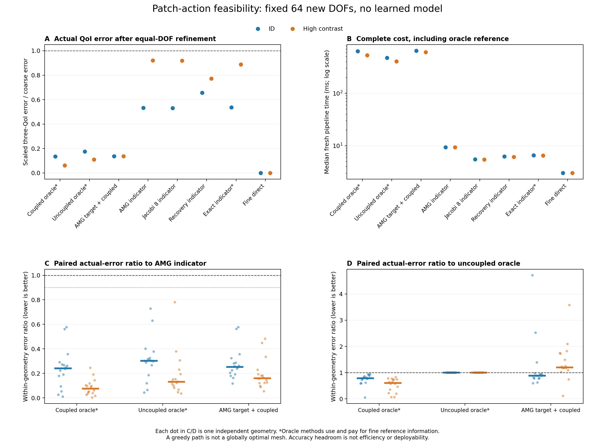

# 第十二阶段：动作选择出现准确性空间，但模型必须同时改变在线计算路径

本阶段已经完成。**在相同新增自由度下，直接评价细化动作对三个目标量的联合影响，明显优于当前的局部指标排序；预先设定的准确性可达性门槛通过。** 这使“学习网格决策”成为值得继续检验的候选，但本轮没有训练或调用 AI，经典 AMG 目标代理已经取得明显改善。现有搜索非常昂贵，不能据此宣布求解加速或模型新颖性。

本文件是冻结实验完成后的解释和下一设计建议；不修改[运行前协议](stage12_protocol_zh.md)。完整逐几何统计和审计见[独立报告](../results/stage12_report/REPORT_zh.md)，所有不利结果一并保留。

## 1. 本轮实际检验的问题

第十一阶段中，学习指标与经典指标产生接近的细化效果，精确伴随指标也没有解决高对比组的问题。因此本轮检验：**失效是否部分发生在“按单元指标排序”这一决策接口，而非只能通过提高误差场预测精度来修复？**

固定二维 SPD Darcy 离散问题、一个源项和三个线性目标。粗网格 225 个自由度，统一细参考 961 个自由度；所有局部细化方法恰增加 64 个独立自由度，得到 289 自由度的真实约束有限元空间。三个目标共用一个网格和一次适应主问题求解。细解只作为固定离散参考，不是连续解的误差证书。

共使用 32 个全新独立几何：ID 与高对比分别 16 个，与第十阶段训练、验证、测试以及第十一阶段测试几何无重叠。比较八种方法，产生 256 条方法/几何记录；每条从全新对象出发计时三次，共 768 次完整路径暖运行。重复不增加独立样本量。

动作目录包含单格、横/纵相邻双格和 2×2 块，共 961 个原始候选。逐步取并集，按新增中心以及相邻已细化格释放的共享边自由度收费，而非按方格数量收费。每一步比较缩放目标误差平方的预测下降量与新增自由度之比。全部终端集合都建立真实网格并重新求解，不把预测收益当成实际收益。

## 2. 机制改变：从误差指标变为目标量变化

设细算子为 \(A_f\)，粗空间延拓为 \(P\)，\(A_c=P^T A_fP\)。令 \(V\) 表示补充细方向，\(I(S)\) 为细化集合 \(S\) 实际释放的独立方向。粗主解和粗伴随产生残差 \(r_f,r_{g_j}\)，经典 Schur 补为

\[
K=V^TA_fV-(P^TA_fV)^TA_c^{-1}(P^TA_fV).
\]

在本轮嵌套空间中，联合细化对第 \(j\) 个目标的变化满足

\[
\Delta J_j(S)=r_{g_j}[I(S)]^T K[I(S),I(S)]^{-1}r_f[I(S)].
\]

这里的索引表示补充方向上的残差分量。公式来自经典块消元，不是新数学方法。它保留目标变化的符号和不同方向的耦合，直接服务于

\[
F(S)=\sum_{j=1}^3\big((\widehat e_{c,j}-\Delta J_j(S))/s_j\big)^2,
\]

其中 \(s_j\) 是协议固定的粗目标尺度。不同方法的区别包括怎样取得粗目标误差估计 \(\widehat e_c\)，以及是否考虑前后动作间的交互作用。

- **Coupled oracle** 用一次精确细主解获知真实粗目标误差，并使用完整耦合变化。它是离线可达性参照，已支付细求解成本；贪心路径不是全局最优网格。
- **Uncoupled oracle** 同样知道真实粗目标误差，每一步只对新出现方向使用原始 Schur 主子块并累加增量。它避免重复计数，也保留同一步内部的耦合，但忽略不同步骤之间的耦合。
- **AMG target + coupled** 用一次 AMG 主残差修正估计三个粗目标误差，再执行耦合动作搜索。其选择路径不使用精确细主解，是可在未知细解时运行的经典诊断方案；“可运行”不代表成本合算。

精确 Schur 终端变化与真实适应求解的目标变化一致性全部通过，最大缩放相对差为约 \(8.64\times10^{-12}\)。新增数值测试覆盖真实网格恒等式、高对比、符号载荷、增量条件化和非 oracle 分支禁止调用细主求解等问题。

## 3. 同预算准确性结果

下表的 \(E\) 是三个缩放目标误差的二范数除以同几何粗解误差范数；粗解为 1，越小越好。表内误差和时间均为跨几何中位数。

| 方法 | ID E | 高对比 E | ID 完整时间 ms | 高对比完整时间 ms |
|---|---:|---:|---:|---:|
| Coupled oracle | 0.134335 | 0.062424 | 635.954 | 529.435 |
| Uncoupled oracle | 0.175576 | 0.110190 | 475.336 | 404.471 |
| AMG target + coupled | 0.136761 | 0.137878 | 648.477 | 608.121 |
| AMG 指标排序 | 0.532312 | 0.921622 | 9.421 | 9.374 |
| Jacobi8 指标排序 | 0.530477 | 0.919635 | 5.523 | 5.476 |
| 二次插值恢复指标 | 0.655970 | 0.772868 | 6.246 | 6.162 |
| 精确伴随指标排序 | 0.536290 | 0.888586 | 6.606 | 6.556 |
| 一次直接细主解 | 0 | 0 | 3.045 | 3.036 |

直接细解不匹配 64 新自由度预算，列出是为了保留实际求解成本参照；它的零误差仅指相对该细离散参考。精确伴随指标排序同样使用参考信息，不能当作所有网格中的最优方案。

配对结果必须先在同一几何上取比，再跨几何取中位数，不能用上表两个中位数直接相除。

| 配对 E 比中位数 | ID | 高对比 |
|---|---:|---:|
| Coupled oracle / AMG 指标 | 0.241720 | 0.074658 |
| Coupled oracle / Jacobi8 指标 | 0.242555 | 0.083430 |
| AMG target + coupled / AMG 指标 | 0.253208 | 0.159827 |
| Coupled oracle / Uncoupled oracle | 0.783147 | 0.610176 |
| AMG target + coupled / Coupled oracle | 1.012615 | 2.139604 |

主 oracle 两组均有 **16/16** 个几何优于 AMG，超过事前要求的至少 12/16；配对比均不超过 0.90，相对 Jacobi8 均不超过 1，数值核验与预算检查通过，无主候选回退。因此准确性可达性门槛通过。这是继续研究的开发门槛，不是显著性检验或期刊录用条件，也没有包含效率条件。

经典 AMG 目标代理同样在两组各 16/16 个几何上优于原 AMG 指标排序，说明正向信号不依赖已经训练出新网络。高对比组中它与真实目标 oracle 仍有明显差距，提示全局目标误差估计值得单独检验；尚不能把差距全部归因于一个确定机制。

## 4. 耦合有用，但并非全部收益来源

考虑前后动作耦合的 oracle 相对 uncoupled 的配对误差比为 0.783 和 0.610。与此同时，uncoupled 本身相对 AMG 指标的配对误差比已达到 0.302 和 0.132。uncoupled 也取得较大改善，说明全部收益并不依赖跨步骤耦合；动作族与选择路径等同时变化，不能将全部改善归于某一个因素。

在 uncoupled 自己最终选出的同一集合上，其累计预测变化与真实联合变化的相对差中位数为 ID 0.124、高对比 0.172。该同集合偏差与两条完整策略的终端比较是不同证据；两种策略可能经过不同路径、选择不同方向，后者不是排除了所有混杂的单因素因果证明。

全部不利记录保留：高对比组 AMG target + coupled 有 2/16 个几何包含负预测增益步骤，但最终全部 \(E<1\)；精确伴随指标在 ID 中有一个几何 \(E>1\)。没有预算回退，没有必需分母退化。原始逐步轨迹可用于复查这些现象。

## 5. 成本直接约束下一模型设计

当前完整耦合搜索评估约数万次候选；AMG target + coupled 的完整时间相对直接细解配对中位数为 **213.44 / 197.72 倍**。因此，本阶段没有实现求解加速。

对已保存计时做了额外的事后算术：逐重复删除整段搜索时间，再逐几何取中位数、与同几何细直接解比较。此操作连搜索内的条件状态更新也一并删除，尚未加入任何替代预测器费用，不代表一个已经实现的算法、性能下界或可达到的速度。

| AMG target + coupled 的事后成本分解 | ID | 高对比 |
|---|---:|---:|
| 搜索占完整时间的比例 | 96.899% | 96.651% |
| 删除搜索后的余量 ms | 20.205 | 20.356 |
| 余量 / 直接细解的配对比 | 6.599 | 6.718 |
| 全局 Schur 设置 ms | 11.067 | 11.095 |

**仅让网络筛掉候选、继续在线构造全局稠密 Schur 矩阵，不能消除当前实现的主要剩余开销。** 当前细直接解约 3 ms，Schur 设置本身约 11 ms；这要求改变网络周围的数值计算流程，而不是只更换网络层数或增加训练量。下一候选不保留当前在线全局稠密 Schur 构造，但去掉它仍不保证加速，整条路径需要重新实测。更大网格或不同实现可能改变成本关系，本轮不能外推其速度，也不能证明其他实现不可能有效。

## 6. 下一候选研究问题和设计边界

下一问题收紧为：**能否只用廉价粗层信息，在固定新增独立自由度下直接提出一个多目标细化集合，保留动作评价的准确性收益，同时避免在线全局 Schur 构造和大规模候选搜索？** 该问题需要同时检验精度和完整成本。

候选学习接口如下；尚未实现、训练或验证，不作为本阶段的新模型成果：

1. 输入系数的单元统计、粗主解与各目标粗伴随的局部特征，以及目标尺度和预算。所有特征装配和粗求解必须收费，禁止输入精确细解、真实测试误差或由全局 Schur 生成的在线特征。
2. 用小型粗网格图网络表示邻接格及共享边，以目标条件和全局汇总表达有符号多目标关系；一次推理输出单格偏好与邻接组合修正。先将此作为待检验的基线结构，不能假设局部消息传递已经捕获椭圆问题的全部长程耦合。
3. 用确定性轻量解码器生成集合，明确计算中心与共享边释放的实际新自由度，达到指定预算；解码和修复成本同样计入。解码不得重新调用本阶段全候选精确 Schur 搜索，否则没有解决成本瓶颈。
4. 最终仍建立约束有限元空间并求解，报告实际三个目标误差及完整时间。训练可使用新训练几何上的离线经典动作搜索作为教师，但教师不是最优答案，离线制标费用须单列。当前 32 个测试几何不能回流作为训练集。

**下一阶段先做成本可行性检查，再决定是否训练上述候选。** 在不构造全局 Schur 的实现中，测量便宜确定性网格提议、预算解码、真实适应装配与求解的完整路径，并在更大网格上重测强基线。若使用预先给定的网格测量剩余求解成本，必须标作诊断，不得免费使用 oracle 网格宣称可部署精度。适应算子能否直接装配、是否仍需要整张细算子，也应作为明确的成本问题检验，而非默认为免费。

若连这一条不含学习的低开销路径都没有可用的成本空间，就停止以当前流程为基础的“AI 求解加速”主张；不能通过忽略设置、特征、转移或解码费用得到正结果。若存在空间，再在新训练/验证划分上训练并冻结，使用全新确认几何比较指标排序、经典目标代理与合适的已有学习标记方法。准确性改善、固定预算收益与端到端加速分别报告。

## 7. 新颖性与论文状态

[相关工作核查](stage12_action_related_work_zh.md)显示，直接学习细化动作、图网络协作、预算权衡、多个量和非局部影响均已有明确近邻。尤其 ASMR++ 已讨论多个 quantities of interest 以及椭圆细化的非局部作用；不能以“现有方法只做单目标、忽略耦合”作为论文动机。

目前可以形成一条可复现的机制证据链：整体误差预测准确度、局部指标一致性和真实预算决策效果并不等价；直接评价联合动作提供了本设置中的准确性空间。但这条证据链尚未构成可发表的新 AI 算法。论文贡献还需要明确区别于现有学习标记方法，并经未见几何、不同预算/网格、必要消融和完整成本比较验证。

## 8. 复现与审计

179 项数值/回归测试通过，本阶段新增 21 项。实验源码、协议及依赖的 44 个输入哈希均与运行前冻结一致；历史一至十一阶段的源码、权重、协议与原始结果未修改。正式输出及报告哈希记录在各目录的 `complete.json`。

独立报告不导入实验运行器或 PDE 求解器，重建目标误差、配对统计、候选合法性、预算、轨迹目标函数和实际目标变化一致性。它没有保存所有候选的数值，因此不能独立证明每步确为所有可行候选中的数值最大值；完整解场也未持久化，能量/残差摘要不能由报告重算。相应数值性质由冻结运行器和数值测试检查，审计边界在报告中明示。

复现入口为 `reproduce_stage12.sh`，新结果写入独立的 `reproductions/` 目录，不覆盖正式原始记录。正式材料包括[原始结果](../results/stage12_actions/rows.json)、[独立报告](../results/stage12_report/REPORT_zh.md)、[逐几何统计与事后成本](../results/stage12_report/summary.json)和[测试日志](../results/stage12_tests.log)。

