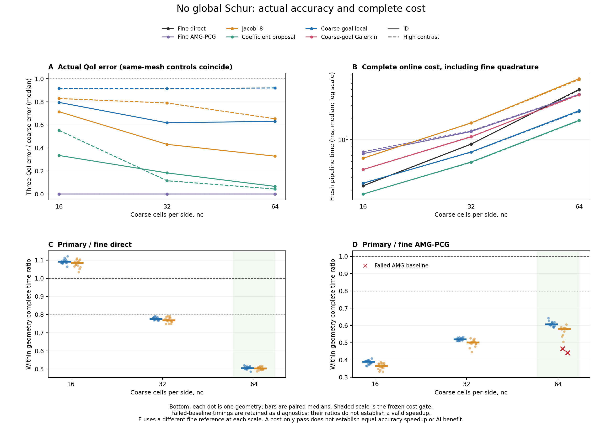

# 第十三阶段：直接局部装配有成本空间，粗梯度提议应重新考虑

本阶段已完成，没有训练或调用 AI。**移除全局 Schur 和全候选搜索后，直接装配实际细化空间确实降低了成本；但冻结的正式门槛仍未通过，且粗主解/伴随梯度提议的准确性较弱。** 在最大测试尺度上，简单系数变化排序同时更快、更准，必须成为以后学习模型的强基线。

本文件解释冻结实验结果，不修改[运行前协议](stage13_protocol_zh.md)。[独立报告](../results/stage13_report/REPORT_zh.md)保留全部尺度、方法、失败和计时。正式数据为 32 个全新独立几何、三个尺度形成的 96 个上下文、576 条方法记录和 1,728 次完整路径暖运行。尺度和计时重复不增加独立样本量。

## 1. 实际完成的计算流程改造

新增直接混合粗细网格装配器，只构造当前约束有限元空间的矩阵，不先装配整张细参考矩阵，也不构造全域 Schur。悬挂节点约束、独立节点顺序、细系数积分和三个目标的定义与历史路径一致。未细化粗三角形的有效系数按其内部细三角积分计算，载荷仍用原细三角三点二阶求积；没有通过粗采样改变离散问题。

全域细系数采样和载荷求积仍需要支付。四个载荷共用求积点，只在同一次 pipeline 的粗装配和适应装配之间复用已经付费的载荷数据。两个细强基线也使用相同的新载荷内核，避免把通用积分优化误算成局部网格方法的贡献。Jacobi8 保留历史完整实现，仅作为既有方法参照。

主候选 `coarse_goal_local` 的实际流程为：粗系统装配 → 一次分解求主问题和三个伴随 → 固定梯度模长代理 → 精确自由度预算解码 → 直接适应装配及主问题求解。`coarse_goal_galerkin` 独立重新计算相同提议，但最终采用完整细矩阵和稀疏插值转换，作为同网格实现控制。

所有 96 个同网格比较通过，最大解相对差约 `3.19e-12`，最大缩放目标差约 `6.61e-12`。因此装配实现差异没有改变选中网格和实际解。全部 384 条适应记录都满足指定新增自由度预算；没有预算回退。

## 2. 最大尺度上的误差和完整成本

`nc=64` 时，粗空间为 3,969 自由度，每个适应方法恰增加 1,024 个独立自由度，得到 4,993 自由度；细参考为 16,129 自由度。一次主解同时回答三个目标。

E 为三个缩放目标误差的二范数除以同几何粗解误差范数，粗解为 1。误差只相对于该尺度指定的细离散参考。表中数值先对同几何三次时间取中位数，再跨几何汇总。

| 方法 | ID E 中位数 | 高对比 E 中位数 | ID 完整时间 ms | 高对比完整时间 ms |
|---|---:|---:|---:|---:|
| 细直接主解 | 0 | 0 | 50.131 | 49.318 |
| 细 AMG-PCG† | 3.45e-11 | 4.98e-11 | 42.307 | 42.795 |
| 历史 Jacobi8 指标 | 0.328534 | 0.652581 | 70.530 | 68.619 |
| 系数变化提议＋直接局部装配 | **0.066598** | **0.043711** | **18.643** | **18.430** |
| 粗梯度提议＋直接局部装配（主候选） | 0.630729 | 0.919819 | 25.369 | 24.786 |
| 同一粗梯度提议＋Galerkin 装配 | 0.630729 | 0.919819 | 42.934 | 42.076 |

† 两个高对比上下文的 AMG 未达到预先固定的严格残差要求。其时间和目标误差保留在表内，不作为合格速度优势的证据。两个细方法不匹配适应自由度预算；表中更少自由度方法更快，不能直接解释为同等精度加速。

## 3. 时间条件满足，但正式门槛未通过

预先要求在 `nc=64` 两组中，主候选相对细直接和细 AMG-PCG 的配对时间比中位数都 ≤0.80，各至少 12/16 个几何更快，并通过全部数值检查。

| 主候选的逐几何配对时间比中位数 | ID | 高对比 |
|---|---:|---:|
| /细直接主解 | 0.504281 | 0.503486 |
| /细 AMG-PCG（包含失败记录，仅描述） | 0.606125 | 0.578603 |
| /同网格 Galerkin 实现 | 0.591237 | 0.592172 |

四项细基线时间条件均为 16/16 更快。但几何 54103、54115 的 AMG 三次重复均在库返回 `info=0` 后未满足实际残差阈值：

| 高对比几何 | 最终实际相对残差 | 冻结阈值 | 迭代数 | 残差刷新/重启 | 目标 E |
|---|---:|---:|---:|---:|---:|
| 54103 | 1.4991e-10 | 1e-10 | 33 | 3 | 6.5347e-11 |
| 54115 | 1.4592e-10 | 1e-10 | 34 | 3 | 4.6101e-11 |

因此严格的总门槛记为 **未通过**，不能在看到结果后放宽阈值，也不能把这两例删去。共有两个失败的方法/上下文、六次失败的重复；独立报告中的多条审计原因不等于更多独立失败样本。

这也不说明 AMG 解明显失准：相同两例细直接解的实际残差分别为 `2.4472e-10`、`2.3432e-10`，满足它事前固定的 `1e-8` 要求；两种细解的目标值几乎一致。该结果提示后续需核查双精度下实际残差与停止标准的关系，并统一不同求解器的精度要求。本阶段没有诊断出唯一原因，没有改写已有通过规则。

成本随尺度的变化也应保留：主候选/细直接的配对中位比在 `nc=16` 为 **1.091 / 1.084**，在 `nc=32` 为 **0.777 / 0.768**，在 `nc=64` 为 **0.504 / 0.503**。小网格仍没有成本收益，不能把较大网格上的观测推广为所有尺度。

## 4. 更关键的模型设计反证

主候选的准确性没有继承第十二阶段联合动作搜索的收益。在 `nc=64`，它相对 Jacobi8 的逐几何配对 E 比中位数为 **1.998 / 1.208**，分别仅 1/16、3/16 个几何改善；相对简单系数提议为 **6.671 / 16.052**，两组均 0/16 更好。高对比组还存在一个目标误差比粗解更大的几何，完整保留。

因此，不应把“已有粗主解与伴随梯度”自动视为值得支付的模型输入，更不能直接把当前代理当成监督学习的高质量教师。这里失败的是一个具体的固定梯度模长代理，尚不能否定所有利用粗解的学习器；但未来若增加粗解特征，应有同预算消融证明它带来的增益足以补偿成本。

当前更强的经典参照只按系数的局部对数变化及邻格跳跃排序。它没有学习、没有伴随求解，也没有多目标联合搜索，却在当前问题族上取得更好的预算决策。以后仅优于 Jacobi8 或旧网络不足以证明 AI 的增益，至少必须与该系数提议比较。

## 5. 事后界面覆盖诊断：保留描述性解释

为解释这一反差，额外对已有数据做了选择分析，**没有新求解、训练、重新选网格或修改正式判定**。脚本按原输入重建 `nc=64` 系数并核对全部 32 个哈希。

当前生成器的低系数相位在 `exp(±0.25)` 内，高系数相位至少为 `5*exp(-0.25)`，因此 `k>2` 可以区分这两相。若一个粗格对应的 2×2 细系数同时包含两相，将它标为“粗格内部被界面切过”。这一标签遗漏恰落在粗格边界上的界面，不是界面长度、误差质量或独立自由度的测度。

| 已选粗格对上述界面格的召回率中位数 | ID | 高对比 |
|---|---:|---:|
| 系数变化提议 | 1.000 | 1.000 |
| 粗主解/伴随梯度提议 | 0.318 | 0.125 |
| Jacobi8 指标 | 0.534 | 0.208 |

系数提议在两组各 16/16 个几何上覆盖全部这类界面格。该现象与其较低 E 同时出现，说明界面覆盖值得在后续机制检验中关注；它不能证明覆盖是唯一原因，不能替代保持其他因素不变的干预，也不能保证不同几何、载荷或预算下仍有效。当前数据主要由两个高系数区域构成，不能据此推广到更复杂介质。

完整定义、逐几何记录、精确率和覆盖数见[事后诊断](../results/stage13_selection_diagnostic.json)，复现程序为 `stage13_selection_diagnostic.py`。该分析是事后解释，未升级为新的正式成功标准。

## 6. 下一阶段的具体决定

保留直接局部装配这项数值实现成果；**不把当前粗梯度代理直接包装成 AI 模型，也不追加网络来复现它。** 下一阶段先处理两个实际问题：

1. 在独立开发几何上核查细直接/AMG 的真实残差、缩放和停止要求，冻结共同的数值验收规则，再用全新确认几何复验。不能修改本阶段阈值使其补过，也不能以失败基线的时间确立加速。
2. 将简单系数提议确立为强准确性和成本基线，明确“超出系数界面覆盖”的增益是否存在。第十二阶段的动作 oracle 使用不同几何、较小尺度且支付了细解，不能把其精度与本轮低成本直接拼成一个模型结果。

只有上述基础确认后，才值得开展小规模学习试验：以系数、源项/目标描述和预算为条件提出网格；粗解信息作为可选消融，而非默认必需输入。学习器必须在新训练/验证/确认划分上实际训练和冻结，对比系数提议及适当的已有学习标记方法，并把特征、数据转移、推理、预算解码和求解全部收费。当前 32 个几何只保留为本阶段测试，不能回流用于调参后再当未见测试。

直接学习网格动作和图网络 AMR 已有[直接近邻](stage12_action_related_work_zh.md)。本轮证明的是实现成本差异、当前代理的局限与更强经典基线，尚未构成新 AI 算法或国际一区论文的创新性证据。

## 7. 复现与验证

199 项数值和回归测试通过，其中本阶段新增 20 项；直接装配与历史 Galerkin 的小网格矩阵/载荷/解对照、高对比与符号载荷、参考隔离、载荷复用、失败 PCG 保留等均已覆盖。52 个冻结输入哈希及全部正式输出哈希匹配。历史一至十二阶段的源码、协议、权重和原始结果未改动。

哈希、数据结构、目标误差、预算和同网格重建检查通过；数值审计中的两个 AMG 不合格记录使正式判定保持失败。这两类核验不得混写为“所有检查通过”。独立报告未重新求解 PDE，不能仅凭哈希重算能量或场一致性；相应数值证据来自测试与冻结运行器，审计边界已明示。

复现入口 `reproduce_stage13.sh` 会创建新目录，不覆盖正式记录。正式材料包括[完整报告与图](../results/stage13_report/REPORT_zh.md)、[原始逐次记录](../results/stage13_cost/rows.json)、[独立统计](../results/stage13_report/summary.json)和[测试日志](../results/stage13_tests.log)。

