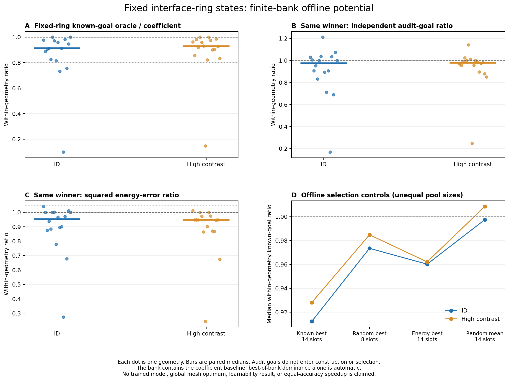

# 第十四阶段：数值基线通过，停止当前有限网格选择器路线

本阶段已完成。**共同数值标准在新确认样本上全部通过；固定界面空间后的有限候选精度收益未达到预先门槛。停止在当前双包含体、B=1024、14候选网格集合上训练选择网络。** 这不是“没有任何改善”，也不是否定所有自适应网格或 AI；被否定的是本次具体候选族达到预定实质收益的假设。

正式确认有32个全新独立几何，常规和高对比各16个；包含288次完整基线路径计时与896次离线候选主解。217项测试通过，本阶段新增18项。没有训练或调用AI，没有宣称同等精度加速。全部原始记录、负面结果及协议保留，旧阶段未改写。

## 1. 先把数值比较做公平

第十三阶段的直接法与AMG使用不同停止要求，两例高对比AMG略超其严格阈值。本轮在另外8个开发几何、32个RHS上设计共同验收，再冻结用于32个确认几何。直接法和对称缩放AMG-PCG均检查原double矩阵的实际相对残差≤1e-9、分量后向误差≤1e-12，并要求所有求解器状态成功。

残差用longdouble点积计算，但矩阵、分解和解仍为double。AMG在每次调用自己的层级上做必要残差修正；所有设置、修正与检查计入完整时间。新规则同时加入分量要求，不能解释为事后放宽第十三阶段阈值。旧阶段仍然未通过。

| 确认方法 | 常规完整时间中位数 ms | 高对比完整时间中位数 ms | 共同数值验收 |
|---|---:|---:|---|
| 细直接主解 | 52.787 | 52.766 | 两组各16/16，三次重复均通过 |
| 细缩放AMG-PCG | 52.493 | 62.326 | 两组各16/16，三次重复均通过 |
| 系数排序＋适应主解 | 20.026 | 19.810 | 两组各16/16，三次重复均通过 |

确认中细直接解最坏实际相对残差1.484e-10，细AMG为5.302e-11；细AMG最坏分量后向误差1.183e-14。细AMG相对细直接参考的目标差异E最坏6.807e-10，低于预定1e-5。96次AMG主问题均进行一次修正，直接法无需修正。上述时间包含各自必要工作；不同自由度方法精度不同，不以表中耗时宣称等精度加速。开发阶段的四RHS时间也不能与这张单主解表混用。

## 2. 把界面覆盖与其余位置的决策分开

粗/适应/细自由度为3969/4993/16129。原系数排序选择S0，I为粗格内部被两相界面切过的格子，H为I加上下左右一圈邻格。

主实验在H内固定选中和未选状态与S0一致，只允许在H外重分配。这样I内中心及与四邻共享边中点的自由状态不变；它比仅保证“I全部选中”更严格。次实验只固定I的覆盖，允许一圈其他状态改变。二者都严格新增1024自由度。

每种干预预先固定14个候选位置：原系数排序、受约束系数排序、源/目标局部化加权、确定性均匀分数、四个平滑随机场的两种强度。实际每个主bank有13张不同网格，因为前两个候选重复。候选构造不使用任何解或审计目标。

所有896条候选记录满足预算和数值要求，所有主候选保持H状态，原系数基线在32/32几何上覆盖全部I。I标签不包含恰沿粗格边界的界面，因此结论不能泛化为所有物理界面或通量误差均固定。椭圆解仍有全局耦合。

## 3. 离线最优选择仍未达到继续门槛

候选网格全部实际求解后，用细参考误差选择已知三个目标上的最优候选。这里的oracle只是在固定有限集合中挑最好，支付了细参考和所有候选求解；它不是全局最优网格，也不是可部署AI。

E为三个缩放目标误差的二范数除以粗解对应误差，粗解为1。表中配对比先对同一几何计算再取中位数，不能用两列E中位数相除代替。

| 主实验指标 | 常规 | 高对比 | 预定要求 |
|---|---:|---:|---|
| 原系数基线E中位数 | 0.081576 | 0.055496 | 参照 |
| 14候选oracle E中位数 | 0.075771 | 0.050722 | 不单独判定 |
| oracle/系数基线配对误差比中位数 | **0.912331** | **0.928159** | 两组均≤0.80 |
| 改善至少10%的几何数 | **6/16** | **4/16** | 两组均≥12/16 |
| 严格改善的几何数 | 14/16 | 14/16 | 不能替代幅度要求 |

配对中位降幅约8.8%/7.2%，是非零但较小的改善。集合包含基线，因此oracle不劣于基线是构造事实，不应据此宣称成功。数值和结构条件均通过，本轮失败明确来自**精度收益条件**。

次实验只固定界面覆盖的配对比为0.908887/0.923864，至少改善10%的几何为7/16、5/16，也未提供足够大的替代收益。不能把次实验换成主实验来宣布通过。

随机8候选中的最优配对比仅0.973450/0.984800；随机8位置均匀选择的期望为1.016963/1.014564。报告还给出等3候选数的源/目标启发式与随机对照，避免将更多候选的best-of-N优势归于物理信息。无目标能量oracle也未自动达到已知目标oracle的效果。

## 4. 平均改善不等于每个目标和样本都改善

三个审计目标在候选构造和选择中完全不可见，但来自相同平滑函数族。主oracle在它们上的配对比中位数为0.975317/0.977836，能量误差平方比为0.952278/0.947197，均通过预设≤1.05的单独护栏条件。但主精度门槛未通过，所以“稳健潜力”总门槛仍未通过。

审计目标在常规6/16、高对比3/16个几何上变差，最坏比分别1.2122和1.1417；能量误差在3/16和1/16个几何上变差。不能把组中位数解释成逐样本保证。目标之间先平方再求和，正负不直接相消；单目标内部的空间误差相消仍未被排除。

原系数基线在常规几何55211的E=2.0181，反而比粗解差；这一尾部失败完整保留。主oracle没有E>1的记录，但少数明显获益样本不能替代跨几何幅度和一致性门槛。

## 5. 失败原因、保留内容与研究转向

**已获得证据：** 直接局部装配及共同数值验收可保留；当前简单系数排序很强。常规/高对比几何中，仅选择I本身需要的自由度范围分别为34–170/54–130，远低于本轮1024预算。基线已完整覆盖这些内部界面，14候选能改变其余细化位置，但本轮实际可获得的目标提升不足预定幅度。

**仍是解释而非定论：** 问题族较简单、预算足以覆盖界面，可能削弱目标条件的额外价值；固定候选族也可能过窄。当前试验没有对所有可能网格求最优，因此不能声称不存在更好的远处网格，更不能证明目标导向AMR或AI原则上无用。

**具体停止决定：** 不训练一个从当前14候选中选网格的网络，不继续把旧粗梯度代理作为教师，不因少数样本有效而改变正式门槛。有限bank oracle已给出这种固定候选选择器的最佳可达已知目标值，实际学习器还会产生选择误差和推理成本。

**下一研究问题改为：当预算不足以解析全部材料界面时，改变观测目标能否产生有价值的细化优先级，并稳定超过系数排序和经典目标导向指标？** 先保持Darcy离散器和原系数族，只改变预算；同一系数、源项下切换目标，隔离目标条件的作用。预算需实际覆盖B<D(I)范围，不能只用仍足以完整覆盖界面的档位。复杂多包含体或通道只作为随后独立因素，保留原问题作负对照。

新问题的收益必须在新开发/确认划分和新协议下测定，不能与本轮结果直接拼成模型改进。只有固定预算的离线空间、强传统基线和目标条件消融显示实质信息，才训练小模型。候选框架可用系数/源/目标/预算条件的网格图网络与精确预算解码，但目前**新颖性没有成立**；已有目标导向指标学习、各向异性学习和网格移动的近邻，见[文献核查与转向评估](stage14_next_direction_review_zh.md)。本阶段结束在该明确停止决定，尚未运行新预算实验。

## 6. 复现与独立审核

正式前冻结70项输入；正式后哈希一致。独立报告不调用PDE求解器，重建32个系数哈希、I/H、函数参数、896组分数、全部预算解码、目标误差与选择器。全部288次完整基线数值记录通过，896候选无数值失败、无预算回退，重复结果一致。

报告移到独立目录后汇总逐字一致；临时篡改分数、界面或目标记录并重算原始文件哈希，仍会被公式/结构审计拒绝；一致保留的模拟数值失败会阻断门槛。所有注入仅发生于临时副本，正式数据未改。

解向量未全部持久化，只有哈希，因此独立报告不能重新计算场残差、后向误差或能量；这些来自冻结运行器和数值测试。原始候选记录使用gzip压缩JSON保存，避免GitHub单文件大小限制。开发在更换存储格式后重跑，与原版全部非计时数值逐值一致；没有调整算法或门槛。复现入口为 `bash reproduce_stage14.sh`，创建新目录而不覆盖正式结果。

材料：[冻结协议](stage14_protocol_zh.md)、[求解器开发报告](stage14_solver_development_zh.md)、[独立统计与图](../results/stage14_report/REPORT_zh.md)、[独立审核记录](../results/stage14_report/verification.json)、[原始确认上下文](../results/stage14_confirmation/contexts.json)、[原始候选记录](../results/stage14_confirmation/rows.json.gz)、[全部测试](../results/stage14_tests.log)。

