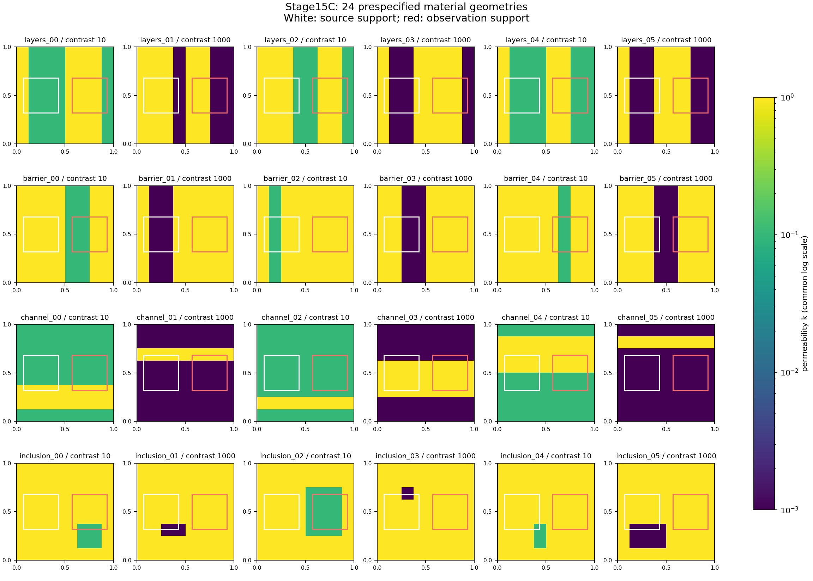
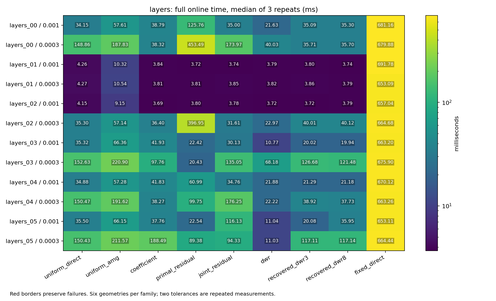
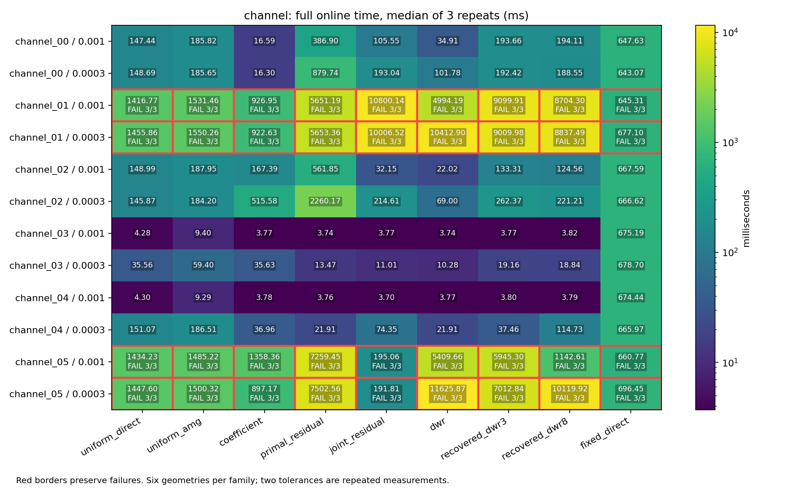

# 第十五阶段C：新几何确认、失败复盘与模型设计停止决定

2026-11-23。**停止当前“用AI替代多轮细化中间层目标误差估计”的研究分支，不启动原拟MLP/GNN训练。** 本轮已完成运行前冻结的24个新几何、两个容限、九种方法、三次重复，共1296条完整路径记录。四个材料族分别仅有1/6、0/6、1/6、1/6个几何通过投入筛查，均未达到事前规定的4/6。

这意味着当前问题和成本结构不足以支持继续投入该模型设计，并不证明所有AI求解PDE的方法无效。经典DWR有局部正向结果；但部分经典方法有效，与需要一个可发表的新AI模型，是两个不同的证据要求。本轮没有训练模型，也没有取得AI加速或新颖性证明。

## 1. 本轮实际检验的问题

问题仍是单位正方形上的稳态Darcy方程 `−∇·(k∇u)=f`，齐次Dirichlet边界，单个局部观测量 `J(u)=∫g u`。源中心为(0.25,0.5)，观测中心为(0.75,0.5)，均为单位积分的张量积光滑局部函数，支撑在半宽0.18的正方形内。冻结协议中的“半径”沿用参数名，实际支撑形状以实现和下图为准。

保持源、目标和绝对容限τ={1e−3,3e−4}不变，只改变材料几何。分层、屏障、通道、包含体各六例，分别从预定有限池无放回抽样，剔除15B旧几何；每族对比度10与1000各三例。初始网格n=8，全部材料界面对齐。24个几何是分析单位，两个容限和三次运行是重复测量，不能当作144个独立几何。



九种方法为均匀细化直接求解、均匀细化AMG、系数指标、主残差、联合残差、优化DWR、3步恢复DWR、8步恢复DWR，以及固定P1 n=256直接求解。DWR沿用15B改进：停止层不计算已无用途的局部标记。固定细网格仅是分辨率参照，不能用其过度求解成本制造AI加速。

新增恢复对照先共享P1分解求主解和伴随，将P1伴随提升至P2空间，再做固定3或8步阻尼Jacobi，用恢复缺陷构造局部标记。恢复向量不参与成功认证；停止仍需实际支付并验收P2伴随求解。除DWR每层核验外，其余自适应方法在初始层、每三层或目标变化足够小时核验。P2装配、粗伴随、恢复迭代、标记及核验全部计时，复用装配只计一次。固定步数恢复不保证收敛或高对比鲁棒性。

## 2. 数值资格和失败没有被隐藏

| 项目 | 结果 | 解释 |
|---|---:|---|
| 完整路径记录 | 1296/1296 | 包含成功、参考不合格和在线资源超限 |
| 参考资格通过 | 21/24几何 | 每几何六次参考计算，共144次 |
| 同参考容限验收成功 | 1134/1296路径 | 合格的21几何中，全部方法、容限和重复均成功 |
| 参考不合格标记 | 162路径 | 三个几何的全部54条路径各自保留 |
| 实际在线资源失败 | 54路径 | 包含在上述162条内：39次自由度上限、15次状态数上限 |
| 合格路径最大q | 0.607987 | `q=|J(u_h)−J_ref|/τ`，以q≤1验收 |

**“162条参考不合格”不等于“162条都只有参考问题”。** 在线状态另行保存：1098次估计停止、144次固定网格完成、39次自由度超限、15次状态数超限；54次资源失败均来自`channel_01`和`channel_05`，各27次。自动比较报告的失败分类优先显示参考资格，完整在线失败见原始记录、报告JSON和独立复核。

三个参考不合格的原因如下：

| 几何 | 失败项 | 证据与边界 |
|---|---|---|
| channel_01 | 独立阶次交叉差 | P1交叉差/τmin=0.586274，大于0.1；P2最细级差虽小，仍不批准 |
| channel_05 | 独立阶次交叉差 | P1交叉差/τmin=0.542144，大于0.1；不临时扩大参考网格 |
| inclusion_04 | 相邻级差符号稳定性 | P2有符号级差为−3.4041e−7、−3.8639e−8、+3.1816e−10，末项反号 |

包含体的最后一次反号很小，不足以证明参考解实际不准确；这里严格执行事前保守规则，不能见到结果后删除该规则。参考资格基于网格、求积和独立阶次稳定性，仍不是连续误差的严格上界；付费DWR停止同样不是认证误差界。

## 3. 事前投入门槛与正式决定

每个“几何—容限”设置同时要求：参考合格且全部九方法三次运行成功；DWR继续层的目标估计费用占比至少30%，且假设这些费用免费后的剩余时间不超过最快成功非DWR对照的80%；DWR完整时间至少快10%，或者最终P1自由度至少少25%。几何必须在两个容限都通过，每个材料族至少4/6几何通过才保留下一次有限设计。

| 材料族 | 两容限都通过的几何 | 预定门槛 | 决定 |
|---|---:|---:|---|
| 分层 layers | 1/6 | ≥4/6 | 停止 |
| 屏障 barrier | 0/6 | ≥4/6 | 停止 |
| 通道 channel | 1/6 | ≥4/6 | 停止 |
| 包含体 inclusion | 1/6 | ≥4/6 | 停止 |

仅`layers_05`、`channel_02`、`inclusion_05`同时通过两个容限。42个数值合格设置中，成本必要条件通过19个，付费目标信息条件通过14个，全部条件通过14个。三个局部正例保留，但不能围绕它们事后重定义“确认材料族”，再宣称稳健成立。

这些阈值是限制研发投入的项目标准，不是定理、显著性检验或期刊标准。逐设置最快对照是事后严格参照，不能当作可部署选择策略。把中间费用删去仅是假设轨迹不变的账本计算：实际算法无法免费预知最后一层，模型特征、推理、触发、回退和轨迹变化都尚未支付。即使筛查通过，也不代表G1完整批准，更不代表G3学习收益。

## 4. 机制解释：为什么不应继续扩大模型

**经典目标信息在部分问题中确实有用，但优势不够稳定。** DWR在42个合格设置的20个中耗时中位数最小。其中5个直接在初始网格停止，微小计时先后不构成标记质量证据；余下15个才包含实际细化。其余22个由廉价残差、系数或恢复方法领先。这个计数是描述结果，不是统计显著性或AI收益。

**相当一部分问题没有需要替代的中间工作。** 42个合格设置中，23个的初始网格离线q已经≤1；但保守的在线估计实际只让其中18个在初始网格停止。应区分“离线已经够准”和“在线已经停止”，前者不能直接当作零成本。全部48个设置中，DWR有20个初始停止，其中两个参考不合格；这些20个设置的中间目标估计成本为零。

**百分比可观不等于绝对时间足够。** 对42个合格设置，先取每设置三次运行的中位数，再跨设置汇总：DWR完整时间中位为11.04毫秒；可替代中间费用中位为4.00毫秒，去掉零费用设置后为9.93毫秒。已有经典实现优化及廉价对照进一步压缩了可用空间。不能只引用某些设置约40%的费用占比，忽略毫秒量级的实际预算。

**固定步数恢复没有成为普遍更便宜的替代。** 在同样42个合格设置上，逐设置恢复/DWR的比值再取中位数：

| 恢复方案 | 完整时间比 | 最终P1自由度比 |
|---|---:|---:|
| 3步Jacobi | 1.3185 | 1.4786 |
| 8步Jacobi | 1.3257 | 1.4832 |

恢复减少某些伴随求解，并不自动减少完整求解时间。这里标记方式和核验频率同时不同，最终自由度变化不能单独归因于恢复标记质量。两种恢复各有20个设置与DWR完全相同的轨迹和最终解，但这些全是初始停止设置，不证明它们在真实细化时复现了DWR质量。固定3/8步表现有限也不能推出学习恢复必然失败。

当前模型设计的主要问题因此是：先假设昂贵目标估计值得学习，再寻找适合的算例；而本批次显示，既有充分中间成本、又需要付费目标信息、且跨几何与容限稳定的交集很小。继续增加MLP宽度、换GNN或收紧容限寻找正结果，会回避尚未通过的问题选择条件。

## 5. 对论文和下一选题的处理

本轮保留为研究记录和失败分析，不能包装成达到一区发表水平的新AI方法。冻结并归档当前分支，保留材料生成器、真实DWR、共同数值验收、强经典对照和失败保留机制；不追加同一路线的样本、容限扫描或模型训练。

下一候选转向**应用中需要反复求解PDE的完整任务**，优先调研Darcy渗透率反演中跨外迭代复用数值信息的条件。具体待研究的问题是：在渗透率和线性系统随反演迭代变化时，历史求解信息是否能以可控成本降低达到同一反演精度的总时间？这只是待调研候选，尚未形成新颖性或AI必要性的结论，也不是复活旧低秩分支的许可。

新的设计前必须先完成三件事：梳理学习预条件、子空间回收、AMG复用/更新和不精确PDE约束优化的直接近邻；固定真实外层任务、精度标准与强经典复用基线，确认实际瓶颈；再以固定预算检查训练、特征、更新、回退及全部PDE求解的总成本。只有经典基线不能解释的稳定收益空间成立，才提出一个最小AI假设。当前没有为该候选新增实验或承诺新的网络架构。

## 6. 可复核性与复现

正式运行用时1329.47秒（约22.16分钟）；在线算法计时总和645.39秒，离线参考合计605.05秒，其余包含预热与结果存储等。不把离线参考计入部署成本，也不把它忽略成零研究成本。

336项单元测试通过；报告119346项数据契约检查通过。额外独立复核重建252条唯一网格轨迹、1114个唯一网格状态，核对1296份最终解哈希，检查432组重复的一致性，完成14项污染拒绝/失败保留对照；门槛从原始记录独立重算，停止决定一致。复核不是第二套独立FEM实现，没有重新求解所有PDE；哈希保护已保存解，不等于第二次验证连续解。机制分析只读取已有数据，没有添加求解或修改门槛。

环境细节与源码摘要见冻结文件。安装`requirements.txt`后，用同一Python安装本地固定依赖：

```bash
python -m pip install --no-deps --target vendor scikit-fem==12.0.2
DARCY_PYTHON=python bash reproduce_stage15c.sh
```

脚本使用单线程BLAS，默认写入新目录，不覆盖本批次。也可传入一个新的输出目录。不同机器的计时可能不同；复现不会保证原有耗时排序。

材料入口：[运行前协议](stage15c_protocol_zh.md)、[完整比较报告](../results/stage15c_report/REPORT_zh.md)、[逐设置与逐路径汇总](../results/stage15c_report/summary.json)、[机制分析](../results/stage15c_mechanisms.json)、[独立复核](../results/stage15c_verification.json)、[冻结配置与源码哈希](../results/stage15c_classical/freeze.json)、[原始路径索引](../results/stage15c_classical/index.json)、[完成清单](../results/stage15c_classical/complete.json)、[完整测试日志](../results/stage15c_final_tests.log)、[复现入口](../reproduce_stage15c.sh)。





图中失败框包含参考不合格标记，不能一概解释为在线求解器失败。其内部的真实资源失败见第2节。
