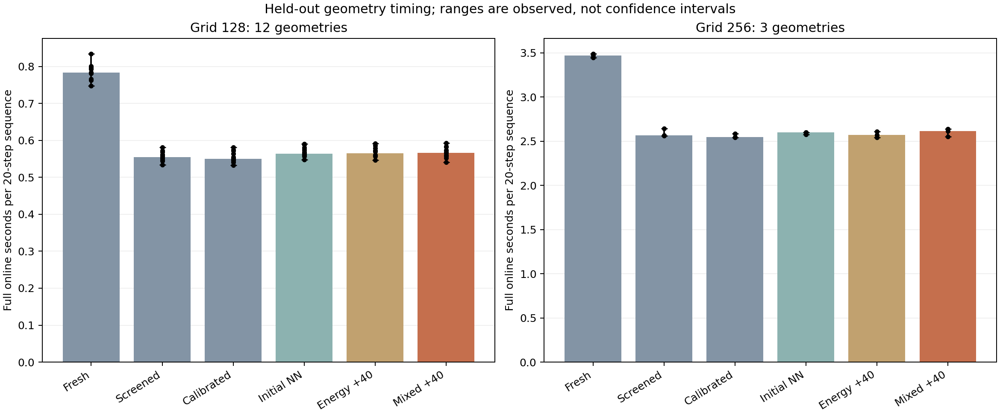

# 第三阶段判断：保留强经典基线，暂停扩大当前初值网络训练

本文依据完整的第三阶段测量、测试前冻结清单与 [生成报告](../results/stage3_report/REPORT_zh.md)。结论是：在当前 Darcy 序列分布、精度和硬件条件下，初始能量网络、同预算纯能量续训、混合损失优化模型均未通过预定的 20% 完整在线加速门槛。混合损失相对同预算对照没有表现出可归因的加速，现阶段不继续扩大这套初值 U-Net 的训练。

## 问题如何转变

第一阶段学习局部粗空间增量，没有优于 AMG。第二阶段将局部求解改为数学等价的稀疏实现并加入安全缓存，明显降低了 Schwarz 的时间；但完整求解仍慢于 AMG，谱修复所占成本也不足以支撑继续训练这一局部网络。前两阶段结果和原始记录继续保留，不能因第三阶段改变研究对象而删除负结果。

第三阶段研究更明确的问题：已经使用当前 Galerkin 层次刷新和历史解投影时，残差条件网络预测剩余全局解校正，能否减少全部在线时间？网络只构造 PCG 初值，每次 PCG 内仍使用固定经典预条件器。有限元、AMG、PCG 在 CPU 上运行，RTX 4090 用于训练和入选网络推理。

## 已执行的对照与规模

经典筛选比较三种 AMG 策略与两种初值，共六个配置。策略包括逐步重建、复用首步层次、冻结插值但逐层重建当前 RAP；初值包括上一步解和最近四个解的当前 A 内积投影。开发校准还包含固定三步 Jacobi 和当前矩阵上的 32 网格双线性 Galerkin 校正，两者使用与网络一致的输入触发条件。

训练集为 64 个几何、448 个校正样本，训练验证集为 12 个几何、84 个样本。六通道 U-Net 有 30,297 个参数。初始模型训练 40 轮；纯能量和混合损失两个续训分支从同一个初始检查点出发，各训练 40 轮。两个分支的种子、批次顺序、学习率和更新预算一致，检查点分别按自身验证目标选择。所有训练使用种子 7，因此没有跨初始化证据。

| 阶段 | 基准求解记录数 | 用途 |
|---|---:|---|
| 经典筛选 | 1,440 | 两网格、三个开发几何、六配置、两次重复 |
| 初始模型开发校准 | 720 | 三个校准几何、六配置、两次重复 |
| 优化与同预算开发校准 | 1,440 | 同一校准组、十二配置、两次重复 |
| 最终 128 网格 | 4,320 | 十二个独立留出几何、六标签、三次重复 |
| 最终 256 网格 | 1,080 | 前述十二几何中的前三个、六标签、三次重复 |
| 合计 | 9,000 | 包含开发筛选与校准；最终测试为其中 5,400 次 |

每条序列 20 步。多种方法、重复计时和第二网格不会增加独立几何数量；最终测试的独立几何总数是 12，256 网格是分辨率迁移检查。

## 最终完整时间

计时包含当前系统组装、历史投影、层次建立或刷新、特征构造、数据传输、推理、校正、保护、PCG、显式真残差验证与失败恢复。模型加载和按尺寸预热在在线计时之外，结果适用于常驻模型，不是完整进程冷启动时间。

先将每条序列 20 步相加，再对同几何重复取中位数，最后汇总几何中位数。`selected_classical` 与 `best_classical` 对应同一配置，在每个几何内合并两个标签的六次完整计时后取中位数；它不同于任何单标签中位数，也不是两中位数的平均值。

| 方法 | 128 网格中位时间 / 秒 | 256 网格中位时间 / 秒 |
|---|---:|---:|
| 每步 AMG + 上一步解 | 0.783671 | 3.467117 |
| 当前 RAP 刷新 + 历史四解，合并相同标签 | 0.553718 | 2.554964 |
| 初始能量网络 | 0.563841 | 2.597214 |
| 同预算纯能量续训 | 0.565655 | 2.569406 |
| 混合损失优化网络 | 0.566726 | 2.612796 |

主比较先逐几何计算网络时间/最快有效经典时间，再对几何取中位数。不能用上述汇总时间直接相除替代配对统计。

| 网络 | 128 配对比中位数 | 128 通过 20% 门槛 | 256 配对比中位数 | 256 通过门槛 |
|---|---:|---:|---:|---:|
| 初始能量 | 1.021322 | 0/12 | 1.016536 | 0/3 |
| 同预算纯能量续训 | 1.022096 | 0/12 | 0.997353 | 0/3 |
| 混合损失优化 | 1.021102 | 0/12 | 1.014196 | 0/3 |

配对比不超过 0.8 且达到共同精度才算通过工程门槛。混合损失网络相对同预算纯能量续训的配对中位比为 **1.001040（128）和 1.012470（256）**；相对初始网络为 **0.999240 和 1.014010**。它在 128 网格上与两个网络对照接近，在 256 网格上没有更快。这些小幅差异不构成统计显著性或普遍性能结论。

本次入选网络均使用 CUDA 推理且不做预测后 Jacobi 平滑，最终配置由开发校准固定。等预算对照排除了把“额外训练轮数”直接当作“新损失收益”的错误归因，但只有一个训练种子，无法建立稳定的损失改进结论。完整配置、所有候选和逐几何比值均保存在 [summary.json](../results/stage3_report/summary.json)。

## 精度、失败和参考审计

第三阶段计时前 44 项数值测试通过。最终 5,400 次求解没有 PCG 失败、直接恢复或最终精度失败，128/256 网格最大显式相对真残差分别为 `9.958942e-9`、`9.989869e-9`，均低于 `1e-8`。最大相对离散能量误差分别为 `1.274028e-10`、`1.538080e-10`；这以当时离线计算的离散参考解为比较对象，不是连续 PDE 的离散误差。

经典筛选中复用首步 AMG 层次的配置出现 352 次 PCG 失败。所有失败耗时、直接恢复和恢复后的精度均保留；筛选不接受存在 PCG 失败的候选，不能把恢复后的准确解描述为原 PCG 成功。两个开发校准阶段均没有 PCG 失败。

全部在线计时结束后，另行重算 24 条唯一网格/几何序列、480 次直接参考求解。系数序列哈希全部匹配，最大显式相对真残差为 `6.214508e-9`，没有非有限步骤、求解异常或求解器警告；额外离线审计耗时 49.275 秒。原参考没有保存逐解哈希，因此该审计证明输入一致并核验重算解，不能证明它与原参考逐比特相同。冻结源码、协议、数据划分、权重、选择、聚合规则及全部原始行数均已核对。

标签生成记录耗时 67.222 秒，三段训练所记录的训练/验证循环与保存时间合计 22.003 秒。这些训练记录不包括数据加载、传入 GPU、模型与优化器初始化及进程启动，不能称为完整离线投入。

## 阶段决定与后续条件

暂停扩大当前残差条件初值 U-Net 的训练，保留当前 RAP 更新、历史能量投影、粗网格校正和其他强经典对照。当前结果支持这一研究决策，不代表所有神经热启动或所有 PDE 学习方法均无效。

重新投入模型开发需要先满足以下条件：

1. 提出新的可检验机制假设，指出它能改善哪个主要求解成本，并用不访问当前真解的诊断说明潜力。单纯增大网络或训练轮数没有得到本轮证据支持。
2. 在同一求解器、精度、输入分布和成本口径下复现最近的神经热启动、残差校正与经典序列回收方法，明确贡献差异。现有工作已覆盖这些大方向，见 [近邻工作核对](stage3_related_work_zh.md)。
3. 如果机制与开发验证显示收益，预先分配新的独立最终测试集，再评估不同右端、对比度、网格及多个训练初始化。当前 12 个最终几何不能继续用于选模后再次冒充留出测试。

第三阶段没有建立可用于宣称普遍加速的新模型贡献，也不能据此保证 Q1 论文录用。可以继续整理严谨的失败分析和可复现基线，但研究题目与投稿潜力需在新假设获得证据后重新判断。

## 复现与数据

在具有 CUDA GPU 的独立 Python 环境中安装仓库依赖后运行 `bash reproduce_stage3.sh`；可通过 `DARCY_PYTHON` 指定解释器。脚本默认创建新的 `reproductions/stage3_时间戳/` 目录，也支持 `DARCY_STAGE3_ROOT`，拒绝覆盖已有结果。流程包含数值测试、筛选、标签生成、三段训练、校准、测试前冻结、最终测试、参考审计和报告生成。

不要与其他训练或求解任务并行计时。大体积训练 `.npz` 不进入仓库；种子、几何划分、样本清单、数据哈希、权重和原始测量保留，完整数据由脚本重新生成。复现后硬件时间可以变化，不能把计时差异自动解释为算法变化。
