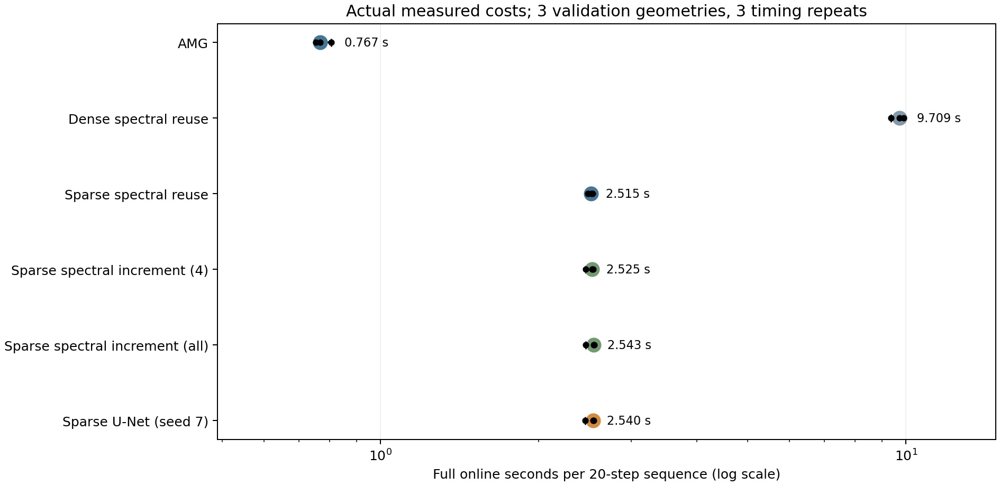
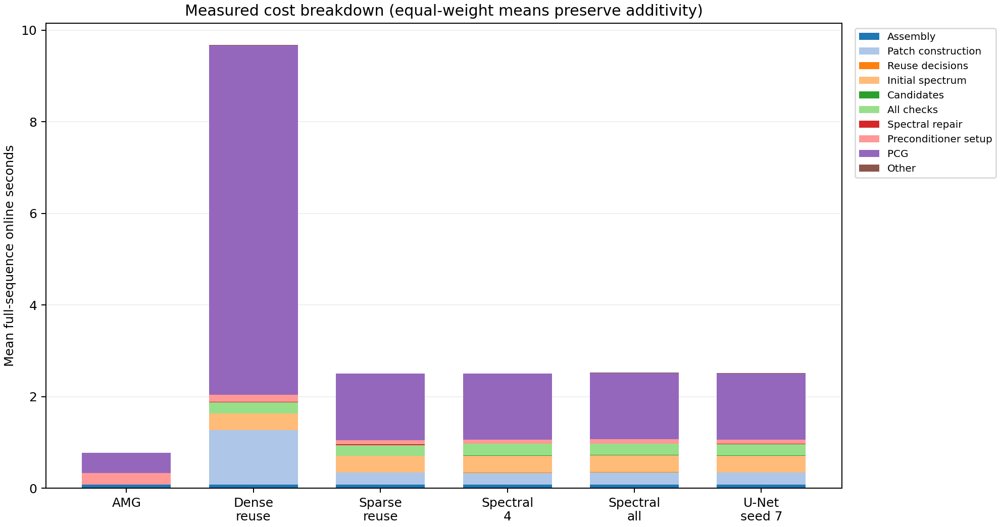

# 第二轮诊断报告：稀疏实现、真实触发与增量方向容量

本报告仅使用保存的实测记录生成。本轮没有重新训练模型，原始先导实验保留。CPU；128×128 单元；每条序列 20 步；对比度 1e4；64 个局部块；BLAS 1 线程、PyTorch 2 线程。

完整计时覆盖三个新验证几何 70001–70003、六种方法、三次计时重复，共 54 次完整序列、1,080 次线性求解。离线事件审计覆盖 70001–70020 共二十个验证几何，包含前三个计时几何，不重复计数。它们是开发验证集，不能被当作最终独立测试集。

## 完整在线时间

先将每次完整序列的 20 步时间相加，再对同一几何的三次计时取中位数，最后汇总三个几何。范围是几何间观测范围，不是置信区间。所有构造、检查、修复、预条件器设置和求解成本均计入；包含初始化。

| 方法 | 总时间中位数 / s | 几何范围 / s | 最大 PCG 次数 | 最大真残差 | 最大相对能量误差 |
|---|---:|---:|---:|---:|---:|
| AMG | 0.767 | 0.754–0.806 | 32 | 9.708e-09 | 4.326e-11 |
| Dense spectral reuse | 9.709 | 9.372–9.891 | 81 | 9.984e-09 | 3.769e-11 |
| Sparse spectral reuse | 2.515 | 2.482–2.534 | 82 | 9.986e-09 | 3.715e-11 |
| Sparse spectral increment (4) | 2.525 | 2.455–2.541 | 82 | 9.986e-09 | 3.635e-11 |
| Sparse spectral increment (all) | 2.543 | 2.459–2.549 | 82 | 9.986e-09 | 3.635e-11 |
| Sparse U-Net (seed 7) | 2.540 | 2.452–2.542 | 82 | 9.986e-09 | 3.585e-11 |

成本分解使用等权平均，以保证各项可加；因此不必等于主表的中位数。局部分解和粗设置是 `setup_seconds` 的子项，没有重复相加。能量误差相对离线直接解，描述离散线性系统求解误差，并非连续 PDE 离散误差。

## 稠密与稀疏实现的配对比较

| 几何 | 稠密谱复用 / s | 稀疏谱复用 / s | 稠密时间 / 稀疏时间 |
|---|---:|---:|---:|
| 70001 | 9.372 | 2.482 | 3.776 |
| 70002 | 9.709 | 2.515 | 3.861 |
| 70003 | 9.891 | 2.534 | 3.904 |

检查了 180 对逐步记录，粗维数、复用与修复分支、检查决定存在 0 对差异。记录一致性本身不能证明基投影完全相同，需结合数值单元测试及算子作用比较。此处改善应归因于局部稀疏求解与缓存实现，不能归因于神经网络。

## 冻结网络对最强传统方法的工程门槛

每个几何的传统基线从 AMG、稠密/稀疏谱复用、完整计时的四方向/全部方向谱增量中取最快者。门槛为网络完整在线时间不超过该基线的 80%，且全部比较方法的每次求解都满足相同最终真残差要求。任何方法最终精度不达标，该几何的速度门槛比较无效，不因剔除失败对照而重新选基线。该 20% 是预先约定的工程筛选线，不是发表标准或统计显著性证明。

| 几何 | 最快传统方法 | 传统时间 / s | 网络时间 / s | 网络 / 传统 | 该几何是否过线 |
|---|---|---:|---:|---:|---|
| 70001 | AMG | 0.806 | 2.452 | 3.043 | 否 |
| 70002 | AMG | 0.754 | 2.540 | 3.370 | 否 |
| 70003 | AMG | 0.767 | 2.542 | 3.315 | 否 |

三个验证几何全部过线：**否**。该判断仅用于本轮资源投入筛选。精度无效时仍保留原始耗时及算术比值供审计，不能将它们解释为有效的加速结论。

## 假设免费成本情景：仅用于诊断

以下两列均由实际时间做减法得到，保持已发生的粗空间与 PCG 路径不变，未实际实现对应求解器。不能作为真实加速比，也不是所有可能 AI 方法的普适下界。

- 候选免费：总时间减去 `candidate_seconds`，包含候选谱计算或网络计算及正交化。
- 全部空间工作免费：再将首步谱构造、全部旧空间/候选检查、谱回退修复设为免费；具体为总时间减去 `spectral_seconds + candidate_seconds + check_seconds + fallback_seconds`。
- 局部矩阵组装、复用逻辑、局部与粗矩阵设置、PCG、直接恢复仍然计入。全部方向参考可能比网络有更多方向，不能把它的迭代表现直接当作四输出网络的性能。

| 方法 | 实测完整时间 / s | 假设候选免费 / s | 假设全部空间工作免费 / s |
|---|---:|---:|---:|
| Sparse spectral increment (4) | 2.525 | 2.510 | 1.917 |
| Sparse spectral increment (all) | 2.543 | 2.529 | 1.934 |
| Sparse U-Net (seed 7) | 2.540 | 2.535 | 1.929 |

表中每列分别按完整序列、重复、几何聚合，不能将列中位数之差解释为某个单独阶段的中位耗时。逐几何的完整结果及假设时间/最快传统时间比均保存在 `summary.json`。只有假设情景过线时，只能说存在潜在空间，不能宣称可部署方法已经取得收益。

## 正确性、候选与失败

下表计数包括全部计时重复，只用于审计实际运行工作量，不作为独立候选样本数。

| 方法 | 候选通过/检查 | 谱修复 | PCG 未达标 | 直接恢复 | 最终未收敛 | 最终真残差超限 |
|---|---:|---:|---:|---:|---:|---:|
| AMG | 0/0 | 0 | 0 | 0 | 0 | 0 |
| Dense spectral reuse | 0/0 | 18 | 0 | 0 | 0 | 0 |
| Sparse spectral reuse | 0/0 | 18 | 0 | 0 | 0 | 0 |
| Sparse spectral increment (4) | 18/18 | 0 | 0 | 0 | 0 | 0 |
| Sparse spectral increment (all) | 18/18 | 0 | 0 | 0 | 0 | 0 |
| Sparse U-Net (seed 7) | 9/18 | 9 | 0 | 0 | 0 | 0 |

直接恢复后的准确解不自动表示 PCG 原本成功；两者分列且恢复成本计入在线时间。非有限记录会阻止报告生成，不能以缺失值跳过失败。

## 二十条共同经典轨迹上的事件审计

审计用时 **22.962 秒**，属于单独的离线诊断成本。20 个几何中，20 个触发了需要补充方向的事件，共 **68 个唯一“几何—时刻—局部块”案例**。同一几何内事件可能相关；三种网络检查同一案例，不增加独立样本量。

只有廉价复用未通过、且旧空间完整数值检查失败才触发候选。每个事件的所有候选共享同一旧空间，随后仍以经典谱修复推进轨迹；这与完整计时中各方法自身的在线轨迹不同。

| 候选 | 通过案例数 | 唯一检查案例数 | 通过率 |
|---|---:|---:|---:|
| spectral4 | 68 | 68 | 100.0% |
| spectral_all | 68 | 68 | 100.0% |
| unet_7 | 16 | 68 | 23.5% |
| unet_17 | 15 | 68 | 22.1% |
| unet_27 | 15 | 68 | 22.1% |

| 验证几何 | 旧空间检查次数 | 唯一触发事件数 | U-Net 7 通过事件数 |
|---|---:|---:|---:|
| 70001 | 72 | 2 | 1 |
| 70002 | 54 | 2 | 1 |
| 70003 | 54 | 2 | 1 |
| 70004 | 80 | 10 | 2 |
| 70005 | 57 | 3 | 1 |
| 70006 | 74 | 2 | 0 |
| 70007 | 54 | 1 | 0 |
| 70008 | 80 | 1 | 0 |
| 70009 | 82 | 10 | 0 |
| 70010 | 80 | 1 | 1 |
| 70011 | 54 | 1 | 0 |
| 70012 | 81 | 10 | 2 |
| 70013 | 42 | 2 | 1 |
| 70014 | 57 | 3 | 2 |
| 70015 | 80 | 1 | 0 |
| 70016 | 84 | 10 | 3 |
| 70017 | 84 | 2 | 1 |
| 70018 | 84 | 2 | 0 |
| 70019 | 46 | 2 | 0 |
| 70020 | 42 | 1 | 0 |

旧完整检查矩阵存在超过四个显著负特征值的案例数：**0**。显著负模式数不超过四个、但四方向谱参考失败的案例数：**0**。全部方向谱参考失败数：**0**。

显著负特征值按原对角合同缩放及 -5e-10 阈值计数。在精确算术下，超过四个负模式表示秩至多四的半正定增量不足；本轮是带容差的浮点诊断。反之，负模式数不超过四个并不保证某个四方向候选通过。四方向参考按低特征值模式顺序补充，并非全局最优四维补空间；其失败不能单独证明所有四方向方法都不可能。

若全部方向参考仍有失败，应先检查数值秩截断、零模与参考谱计算，不应直接归因于网络。各候选新增维数和原完整检查谱保留在 `event_audit.json`。

## 独立预条件器微观计时

第一计时几何首步的稠密/稀疏算子作用相对差异为 **1.538e-12**。微观计时单独执行，不计入序列时间；稀疏端含分项计时器开销，仅用于定位瓶颈。

| 局部后端 | 每次预条件器作用中位时间 / μs | 重复范围 / μs |
|---|---:|---:|
| dense | 5985.1 | 5967.5–6078.2 |
| sparse | 1150.1 | 1077.2–1162.4 |

稀疏剖析累计 62 次作用：局部求解 0.067595 秒，粗求解 0.002987 秒。包括预热及作用差异检查，不能直接与主计时的求解次数相乘当作实测序列总时间。

## 解释边界与可追溯性

本轮仅检验固定问题分布与当前实现。三条计时几何不足以支持普遍加速、统计显著性或一区论文创新已经成立。数值谱检查不等于带舍入误差控制的严格认证，所用粗空间也没有由本轮计时自动获得全局鲁棒收敛定理。

协议、算法源码及冻结权重哈希均已核对。报告输入、每次完整序列聚合、每个几何的比较、假设成本字段和失败计数保存在 `summary.json`。原始逐步记录为 `measurements.json`；事件审计、微观剖析和完成标记分别保存在 `event_audit.json`、`preconditioner_profile.json`、`complete.json`。
