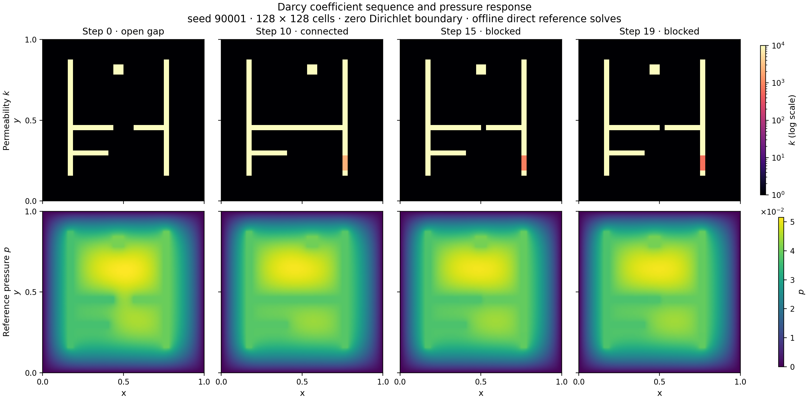
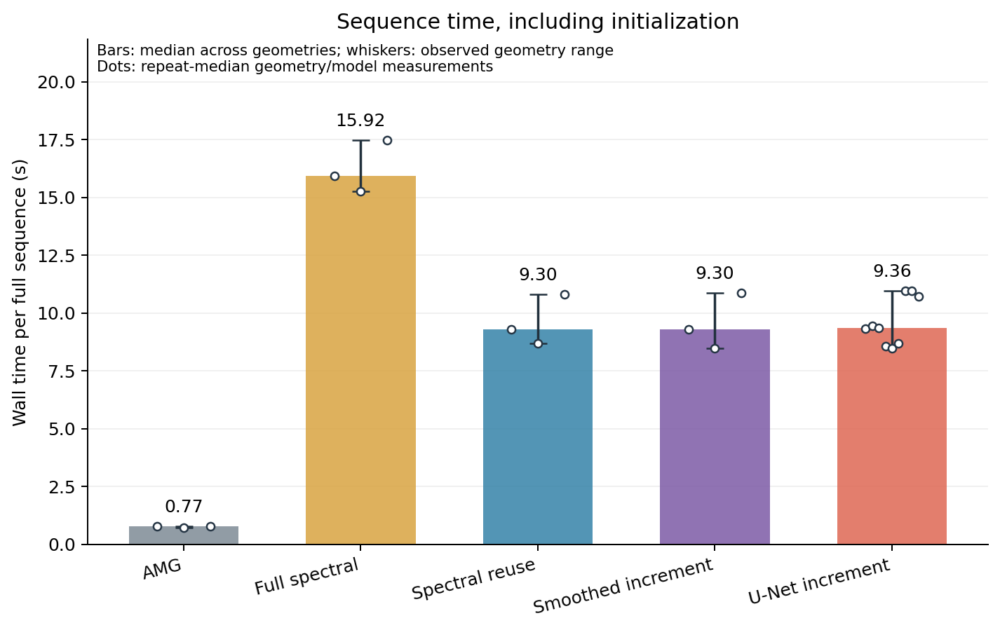
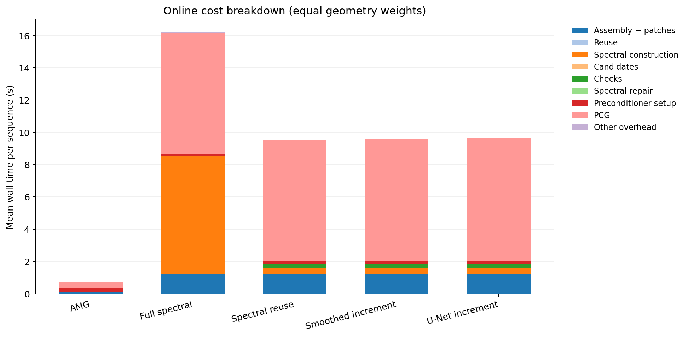
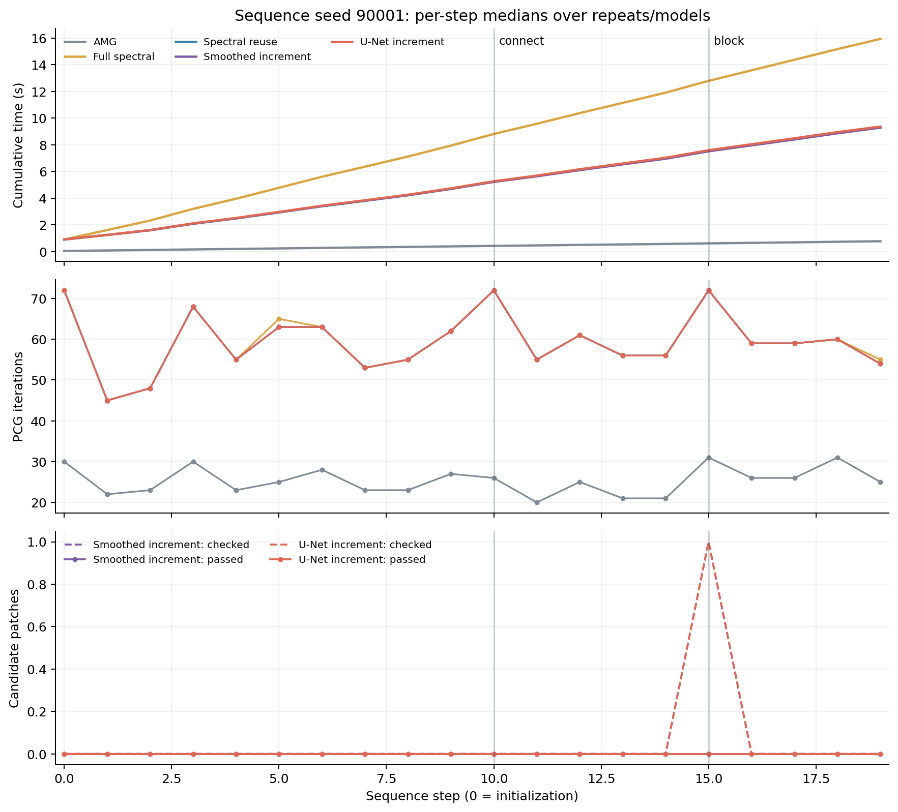
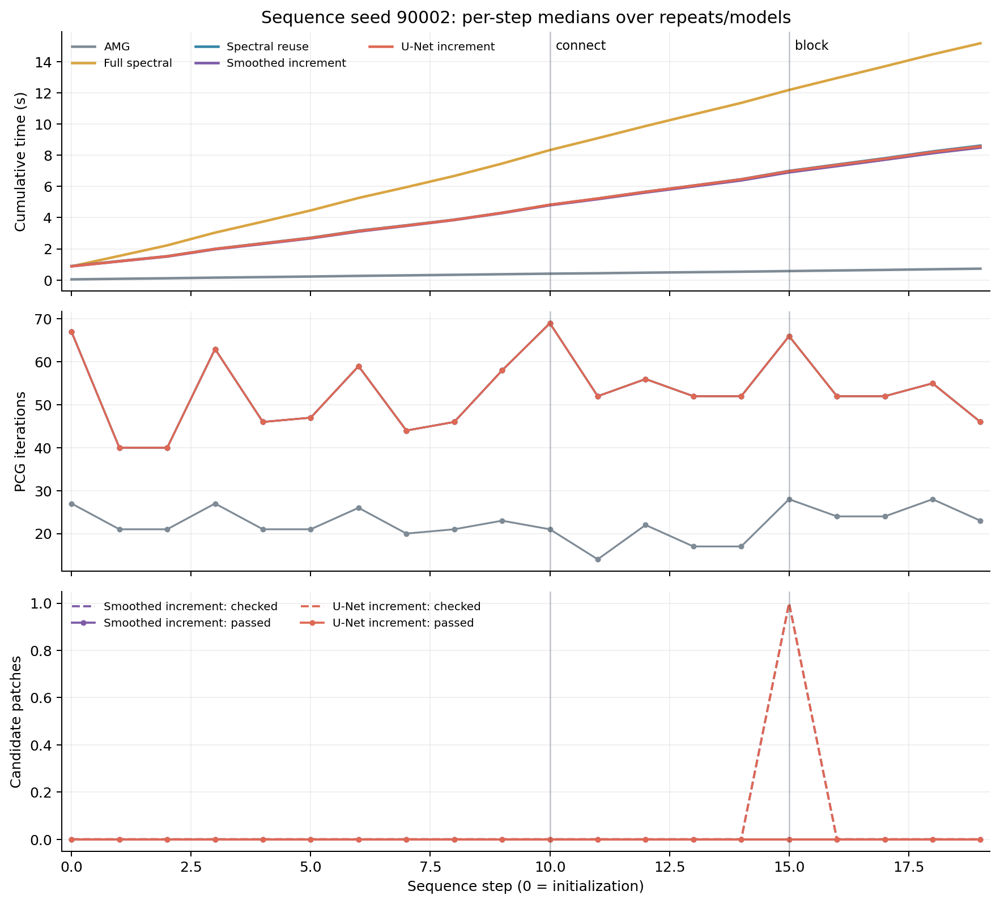
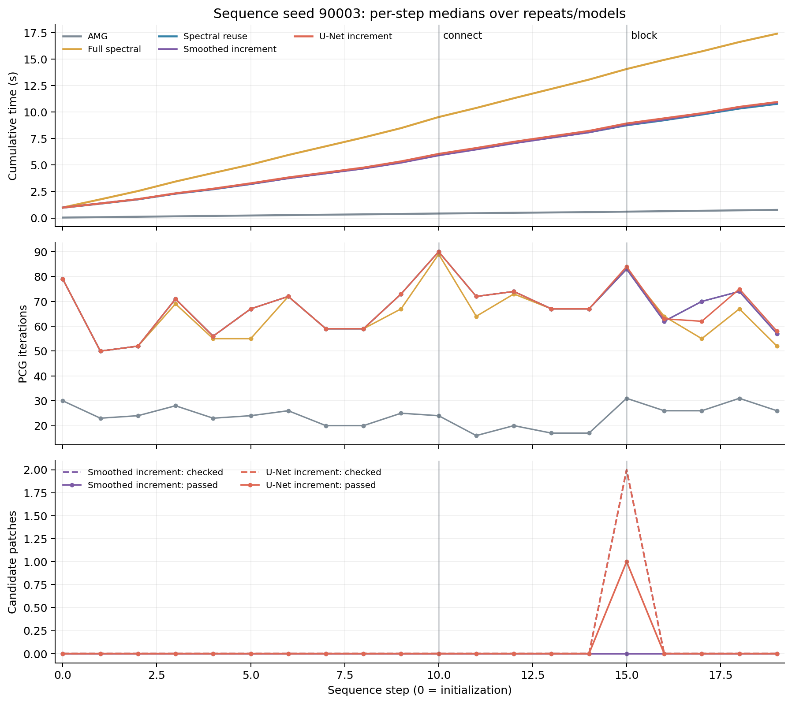
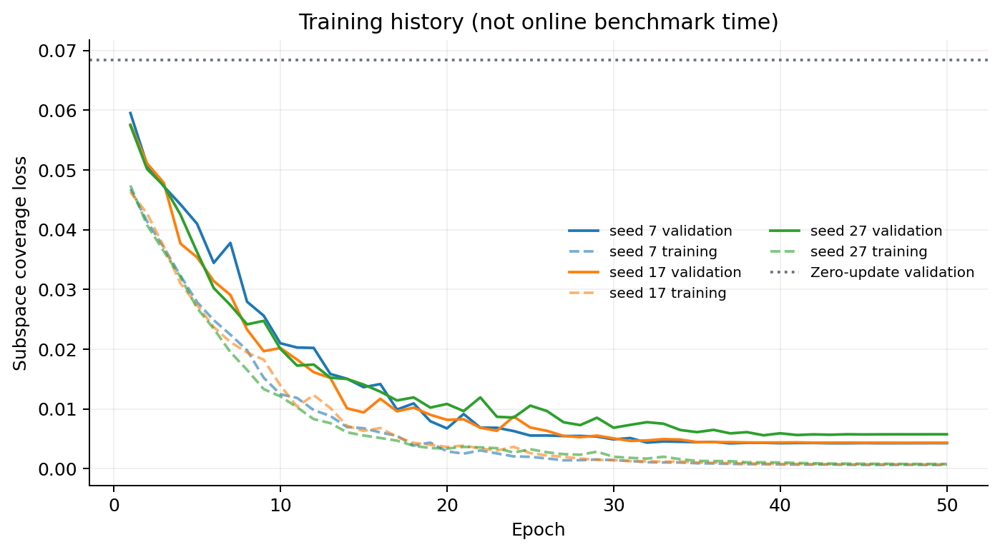

# Darcy 增量粗空间实验报告：pilot_cpu

本报告由实际保存的测量记录生成。运行设备：CPU；网格 128×128；每条序列 20 步；对比度 1e+04；右端 `one`；系数类型 `mixed`。

独立测试几何种子：[90001, 90002, 90003]；每个配置计时 3 次；网络种子：[7, 17, 27]。BLAS 线程 1，PyTorch 线程 2。

## 统计口径

先将每个“几何—模型—重复”配置的全部时刻耗时相加，包含初始构造；再对计时重复取中位数。总表先对同一几何的模型种子取中位数，再对独立几何取中位数。几何范围与模型范围均是实际观测范围，不是置信区间。重复计时和多个模型种子没有被算作新的独立几何。

耗时分解使用等权平均，以保证各项可相加，因此与总表中位数可以不同。`setup_seconds` 已包括局部分解与粗矩阵设置，未再次叠加其子项。

## 整条序列的在线时间与误差

| 方法 | 中位总时间 / s | 几何间范围 / s | 几何×模型范围 / s | 最大 PCG 次数 | 最大相对残差 | 最大相对能量误差 |
|---|---:|---:|---:|---:|---:|---:|
| AMG | 0.767 | 0.725–0.775 | 0.725–0.775 | 31 | 9.916e-09 | 6.849e-11 |
| Full spectral | 15.924 | 15.250–17.470 | 15.250–17.470 | 89 | 9.984e-09 | 4.974e-11 |
| Spectral reuse | 9.295 | 8.695–10.798 | 8.695–10.798 | 90 | 9.951e-09 | 5.242e-11 |
| Smoothed increment | 9.295 | 8.479–10.875 | 8.479–10.875 | 90 | 9.951e-09 | 5.242e-11 |
| U-Net increment | 9.364 | 8.549–10.947 | 8.467–10.966 | 90 | 9.951e-09 | 5.502e-11 |

PCG 次数包含迭代尝试的实际工作量；若迭代失败后使用直接求解恢复，恢复耗时已计入在线总时间，最终误差可能来自恢复后的解。恢复次数见下表。

## 候选接纳与修复

| 方法 | 候选通过 / 检查 | 通过率 | 谱修复次数 | 直接求解恢复次数 | 最终未收敛次数 | 最终残差超过容差次数 | 粗空间维数范围 |
|---|---:|---:|---:|---:|---:|---:|---:|
| AMG | 0 / 0 | 不适用（没有候选检查） | 0 | 0 | 0 | 0 | 3–3 |
| Full spectral | 0 / 0 | 不适用（没有候选检查） | 0 | 0 | 0 | 0 | 38–53 |
| Spectral reuse | 0 / 0 | 不适用（没有候选检查） | 12 | 0 | 0 | 0 | 38–50 |
| Smoothed increment | 0 / 12 | 0.0% | 12 | 0 | 0 | 0 | 38–50 |
| U-Net increment | 9 / 36 | 25.0% | 27 | 0 | 0 | 0 | 38–54 |

计数覆盖全部实际计时运行，包含重复与模型种子，不能直接把不同运行数量的方法按总计数排名。没有触发候选检查时通过率为不适用，不能报告为 100%。AMG 的维数是最粗层大小，Schwarz 的维数是全部拼接粗基列数，两者不是同一指标。

最终未收敛按 `final_converged` 独立计数；另行直接检查最终相对残差是否超过记录容差（本次 1.0e-08）。直接求解恢复不自动等同于最终收敛。旧版记录缺少该标志时从最终残差推导。所有方法合计非有限最终残差数量：0。

## 与 U-Net 的配对时间比较

比值定义为“基线总时间 / U-Net 总时间”：大于 1 表示本次观测中 U-Net 用时更少，小于 1 表示用时更多。配对先在同一几何内进行；下列数值不外推到未测场景。

| 基线 | 配对比值中位数 | 几何间观测范围 |
|---|---:|---:|
| AMG | 0.083 | 0.070–0.085 |
| Full spectral | 1.701 | 1.596–1.784 |
| Spectral reuse | 0.993 | 0.986–1.017 |
| Smoothed increment | 0.993 | 0.992–0.993 |

## 分模型结果

| 方法 | 模型种子 | 独立几何数量 | 序列时间中位数 / s | 范围 / s |
|---|---:|---:|---:|---:|
| AMG | — | 3 | 0.767 | 0.725–0.775 |
| Full spectral | — | 3 | 15.924 | 15.250–17.470 |
| Spectral reuse | — | 3 | 9.295 | 8.695–10.798 |
| Smoothed increment | — | 3 | 9.295 | 8.479–10.875 |
| U-Net increment | 7 | 3 | 9.321 | 8.549–10.947 |
| U-Net increment | 17 | 3 | 9.437 | 8.467–10.966 |
| U-Net increment | 27 | 3 | 9.364 | 8.688–10.707 |

## 逐步行为

下图每步先对重复和模型取中位数，再累加作趋势展示；其累计曲线终点不必等于整条序列先求和后的中位数。

## 离线成本与参考解

数据和标签生成用时：40.198 秒；局部样本数：{'train': 565, 'val': 144}。

| 模型种子 | 未新增方向的验证损失 | 训练后最佳验证损失 | 验证损失相对降低 | 最佳轮数 | 训练时间 / s |
|---|---:|---:|---:|---:|---:|
| 7 | 0.068372 | 0.004247 | 93.8% | 37 | 62.640 |
| 17 | 0.068372 | 0.004339 | 93.7% | 47 | 66.990 |
| 27 | 0.068372 | 0.005594 | 91.8% | 39 | 63.397 |

该损失衡量局部参考子空间的覆盖程度。验证损失降低说明学习到了标签中的部分缺失方向，不等同于谱接纳率提高、PDE 误差降低或端到端时间减少。

所有读取的模型权重与训练历史 SHA-256 均已与本次运行清单中的 `checkpoint_sha256` 核对一致。

离线直接参考解与对应组装共计 2.406 秒；参考解最大相对残差 1.759e-09。

参考解和能量误差评估在在线计时之外，未提供给网络或求解器。参考解计时不是在线方法对照项。训练、标签生成与参考解成本未被隐入在线加速比；尚未据此声称离线成本已摊销。

## 解释范围与待完成工作

这是本机 CPU 合成问题先导实验。它仅支持上述实测配置内的时间和精度结论。几何数量较少时不能据观测范围声称统计显著性、普遍加速或论文创新已经成立。

- 谱检查为浮点数值检查，不是带舍入误差控制的严格认证。
- AMG 配置固定，未穷尽调参；传统谱修复使用直接局部特征求解，尚非优化后的回收特征求解器。
- 需要更多独立几何、多个对比度、不同右端和尺度实验，以及最近邻学习方法对照。
- 网络收益必须相对于共享检查与回退流程的平滑误差方法单独成立；复用收益不能全部归因于 AI。
- 粗空间检查成本若抵消了候选生成的节省，应如实保留负结果并调整算法。

## 可追溯文件

- `measurements.json` / `measurements.csv`：逐时刻原始记录。
- `manifest.json`：硬件、配置、软件版本、数据种子和源代码哈希。
- `summary.json`：完整聚合规则、每次完整序列和每个几何/模型结果。
- `figures/`：PNG 预览与 PDF 科学绘图。
