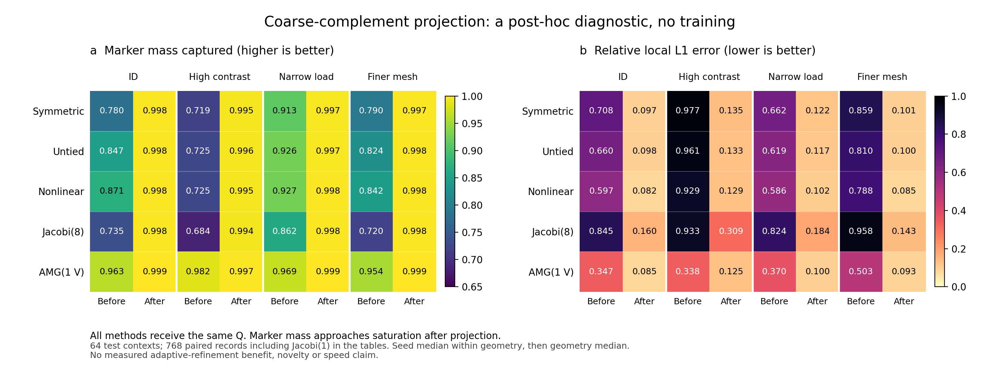

# 第十阶段投影诊断：全局误差不变，局部分解明显改善

这是在正式结果揭示局部标记偏弱后制定并执行的**事后、零训练机制诊断**。所有学习模型和经典方法接受同一粗空间正交补投影；正式训练、测试记录和结构收益判据不变。它不构成独立确认实验，也不声称新的算法创新、端到端加速或真实自适应细化收益。

## 核心发现

预测中的粗空间分量对全局误差矩阵不可见，却会改变固定单元分解。去除它后，多种方法的局部指标大幅改善，包括经典 Jacobi 与 AMG。因此，这首先暴露了表示及评估的一致性问题，不能将改进归因于 AI。

| 测试组 | Symmetric 移除的误差能量份额 | 标记质量：前 → 后 | 局部 L1：前 → 后 | 投影后能量误差 / 投影 AMG，逐几何配对中位 |
|---|---:|---:|---:|---:|
| 同分布 | 65.27% | 0.7797 → 0.9979 | 0.7080 → 0.0969 | 1.9298 |
| 高对比度 | 67.58% | 0.7188 → 0.9948 | 0.9766 → 0.1352 | 3.4936 |
| 窄载荷 | 59.86% | 0.9126 → 0.9970 | 0.6617 → 0.1215 | 2.6085 |
| 倍分辨率 | 68.42% | 0.7902 → 0.9973 | 0.8586 → 0.1011 | 2.0253 |

“移除份额”先对四右端分别计算粗分量能量 / 原误差能量并取均值，再按训练种子、几何逐层取中位；不是两个总体中位数相除。能量误差指相对 A 范数的**平方**。投影后 Symmetric 的剩余误差能量仍高于同样投影的 AMG；标记质量则对多个方法已接近 1，难以据此区分实际细化价值。



图中每个值按同几何三个训练种子中位、再跨几何中位汇总；经典方法只有一个确定性记录。左图越高越好，右图越低越好。图为五个主要对照，以下完整表保留 Jacobi(1)。

## 同一投影与数学边界

定义 $A_c=P^TAP$、$Q=I-PA_c^{-1}P^TA$，对每个当前预测使用 $\widehat\delta_Q=Q\widehat\delta$。真实两层缺陷满足 $P^TA\delta=0$。令 $c=(I-Q)\widehat\delta$，则

$$
r_i^T\widehat\delta_{Q,j}=r_i^T\widehat\delta_j,\qquad \|\widehat\delta-\delta\|_A^2-\|\widehat\delta_Q-\delta\|_A^2=\|c\|_A^2.
$$

全局矩阵不变和能量不增来自经典正交投影；局部标记改善没有由这两个恒等式保证。该处理也未消除细空间正交补内的预测误差。对两个线性学习模型，它相当于输出 QHθr；非线性模型则先计算 Nθ(r)，再施加 Q。不能把 QHθ 本身一般性地称作欧氏对称正定矩阵。原先残差对上的双线性与互易性结论应通过完整误差映射讨论。

## 全方法结果

### 同分布

| 方法 | 全局矩阵误差，前后不变 | 相对能量误差平方：前 → 后 | 标记质量：前 → 后 | 局部 L1：前 → 后 | 标记改善几何数 |
|---|---:|---:|---:|---:|---:|
| Symmetric | 0.0697 | 0.0652 → 0.0216 | 0.7797 → 0.9979 | 0.7080 → 0.0969 | 16/16 |
| Untied | 0.0687 | 0.0590 → 0.0213 | 0.8467 → 0.9977 | 0.6596 → 0.0980 | 16/16 |
| Nonlinear | 0.0559 | 0.0474 → 0.0164 | 0.8709 → 0.9983 | 0.5970 → 0.0825 | 16/16 |
| Jacobi(1) | 0.1565 | 0.3034 → 0.2070 | 0.6589 → 0.9631 | 0.9351 → 0.3419 | 16/16 |
| Jacobi(8) | 0.1256 | 0.0833 → 0.0242 | 0.7352 → 0.9980 | 0.8451 → 0.1596 | 16/16 |
| AMG(1 V) | 0.0682 | 0.0200 → 0.0077 | 0.9626 → 0.9989 | 0.3473 → 0.0850 | 16/16 |

### 高对比度

| 方法 | 全局矩阵误差，前后不变 | 相对能量误差平方：前 → 后 | 标记质量：前 → 后 | 局部 L1：前 → 后 | 标记改善几何数 |
|---|---:|---:|---:|---:|---:|
| Symmetric | 0.0863 | 0.2691 → 0.0837 | 0.7188 → 0.9948 | 0.9766 → 0.1352 | 16/16 |
| Untied | 0.0930 | 0.2545 → 0.0808 | 0.7251 → 0.9958 | 0.9612 → 0.1325 | 16/16 |
| Nonlinear | 0.0673 | 0.1795 → 0.0606 | 0.7254 → 0.9951 | 0.9292 → 0.1287 | 16/16 |
| Jacobi(1) | 0.4708 | 0.4617 → 0.3710 | 0.6447 → 0.9698 | 0.9319 → 0.5542 | 16/16 |
| Jacobi(8) | 0.2921 | 0.1935 → 0.1002 | 0.6843 → 0.9939 | 0.9326 → 0.3087 | 16/16 |
| AMG(1 V) | 0.1332 | 0.0394 → 0.0254 | 0.9823 → 0.9975 | 0.3385 → 0.1254 | 16/16 |

### 窄载荷

| 方法 | 全局矩阵误差，前后不变 | 相对能量误差平方：前 → 后 | 标记质量：前 → 后 | 局部 L1：前 → 后 | 标记改善几何数 |
|---|---:|---:|---:|---:|---:|
| Symmetric | 0.0492 | 0.0602 → 0.0226 | 0.9126 → 0.9970 | 0.6617 → 0.1215 | 16/16 |
| Untied | 0.0512 | 0.0593 → 0.0222 | 0.9264 → 0.9967 | 0.6186 → 0.1171 | 16/16 |
| Nonlinear | 0.0422 | 0.0508 → 0.0182 | 0.9270 → 0.9980 | 0.5858 → 0.1018 | 16/16 |
| Jacobi(1) | 0.1766 | 0.3079 → 0.1929 | 0.8293 → 0.9684 | 0.9360 → 0.3876 | 16/16 |
| Jacobi(8) | 0.1358 | 0.0773 → 0.0230 | 0.8617 → 0.9982 | 0.8244 → 0.1843 | 16/16 |
| AMG(1 V) | 0.0695 | 0.0226 → 0.0086 | 0.9694 → 0.9990 | 0.3700 → 0.1001 | 16/16 |

### 倍分辨率

| 方法 | 全局矩阵误差，前后不变 | 相对能量误差平方：前 → 后 | 标记质量：前 → 后 | 局部 L1：前 → 后 | 标记改善几何数 |
|---|---:|---:|---:|---:|---:|
| Symmetric | 0.0695 | 0.0516 → 0.0152 | 0.7902 → 0.9973 | 0.8586 → 0.1011 | 16/16 |
| Untied | 0.0652 | 0.0485 → 0.0141 | 0.8242 → 0.9975 | 0.8102 → 0.1001 | 16/16 |
| Nonlinear | 0.0593 | 0.0426 → 0.0124 | 0.8422 → 0.9979 | 0.7882 → 0.0850 | 16/16 |
| Jacobi(1) | 0.2125 | 0.2979 → 0.2151 | 0.6839 → 0.9691 | 1.0051 → 0.3308 | 16/16 |
| Jacobi(8) | 0.1303 | 0.0805 → 0.0230 | 0.7199 → 0.9978 | 0.9582 → 0.1427 | 16/16 |
| AMG(1 V) | 0.0735 | 0.0259 → 0.0093 | 0.9543 → 0.9990 | 0.5027 → 0.0928 | 16/16 |

## 完整性与证据范围

已独立核验全部 **768 条唯一匹配记录、64 个 context、9 个冻结模型和3个经典方法**。四组各16个 context，但窄载荷和倍分辨率复用同分布几何，所以只有32个独立系数几何。窄载荷同时改变四个源项与目标；局部指标固定源项0对四个目标。

核验了 probe complete 的输出哈希、26 个输入当前路径哈希、8 个冻结源码、正式协议及9个权重哈希。报告从原始记录重新聚合，和 probe 汇总一致。最大 CPU/GPU 全局 Gram 重放差为 1.381e-07；**这只核验全局矩阵，不证明完整预测向量相等**。所有投影前后比较采用本次同一 CPU 预测。

与正式 GPU 记录比较，CPU 投影前的标记质量在 1/768 条记录上变化超过10⁻¹²，最大绝对差为 2.450e-04。该差异保留在原始记录中，未将 CPU 重放冒充逐位相同的预测。

| 数值检查 | 最大相对差/缺陷 |
|---|---:|
| 全局 Gram 变化 / 参考 Gram 范数 | 3.615e-13 |
| 全局 Gram 变化 / 投影前 Gram 范数 | 2.577e-13 |
| 误差能量分解恒等式 | 6.614e-12 |
| 投影后粗正交残差 | 2.688e-13 |
| 参考缺陷粗正交残差 | 2.223e-12 |

检查容差为10⁻⁸，未发现能量上升记录。完整矩阵主指标最大绝对变化为 2.785e-13。从正式记录复算的结构贡献判据为**未通过**；此事后投影不更改该判据。

## 成本与下一步限制

本次 CPU 诊断记录的全部投影时间合计 0.0934 秒，数据生成 0.7862 秒、预测 1.0117 秒、AMG准备 0.2661 秒。每次投影包含细矩阵乘、限制、已有粗 LU 求解、延拓及减法；同一 context 的因子分解由参考数据生成准备并复用。模型加载和指标评估另有开销，以上组件并非全部端到端成本。**这些数值只说明诊断工作量，不用于比较速度或声称加速。**

合理的后续验证是：保持同一 PDE 和固定模型，在独立几何上给全部方法同样的投影，并检验固定标记预算的一次真实细化后 QoI 误差和完整成本，保留投影 AMG 与一次细主问题求解覆盖多目标的强对照。现有 top-25% 标记质量接近饱和，不能代替这种验证；在此之前没有证据支持扩大训练或声称 AMR 优势。

参考标签仍是两个离散网格间的误差，不是连续 PDE 的真误差证书。正交投影、结构正确性和局部指标改善也不建立论文新颖性。

## 数据与复现

[原始768条记录](../stage10_projection_probe/rows.json)、[诊断运行前方案](../../docs/stage10_projection_probe_zh.md)、[正式原始评价](../stage10_pilot/evaluation.json)、[本报告审计及汇总](summary.json)、[矢量图](figures/projection.pdf)。

```bash
python report_stage10_projection.py --source results/stage10_projection_probe --output results/stage10_projection_report
```

报告仅读取既有数据并绘图，不运行模型、PDE求解或训练。通过记录中的唯一 stage10_projection_probe.py 路径识别历史仓库根目录，再把其下相对路径映射到当前仓库，因此支持 GitHub 克隆目录变更。映射只改变读取位置，不修改原始 manifest；当前文件不匹配冻结哈希时停止。
