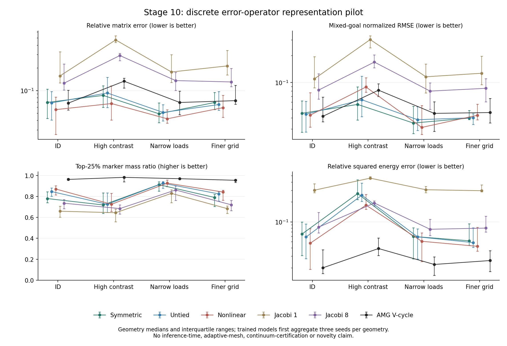

# 第十阶段：离散误差算子结构消融

**预定的结构准确率假设未通过。本轮检验表示与一致性，没有完整求解加速、自适应网格闭环或新颖性结论。**

正式完成9个模型（3种结构×3个初始化），768条测试记录。64个训练几何、12个验证几何；测试有16个ID和16个独立高对比几何。窄载荷与细网格复用ID的16个几何，共64个测试配置，独立测试几何仍为32个。

源码、协议、完成标记、结果文件和9个checkpoint哈希均通过核验，768条方法/几何/种子组合无缺漏或重复。报告独立重算已保存4×4矩阵可确定的指标；场能量、局部标记和向量线性误差仅核验记录的有限性与范围，未重新求解。

## 冻结假设的判断

主指标为误差矩阵相对Frobenius误差。先在同一几何内对三个训练种子取中位，再逐几何计算symmetric/untied之比，最后汇总几何；不是两个汇总中位误差相除。

| 测试 | S/untied配对中位比 | S误差更低的几何 | 达到≤0.9 |
|---|---:|---:|---|
| ID | 1.004691 | 7/16 | 否 |
| 高对比 | 0.992042 | 8/16 | 否 |
| 窄源项–目标载荷 | 0.960305 | 11/16 | 否 |
| 更细网格 | 1.037495 | 5/16 | 否 |

预定准确率条件为ID≤0.9，至少一个分布外测试≤0.9，其余分布外测试≤1.1；准确率门槛：`False`。结构检查：`True`。这是工程研究判据，不是统计显著性检验；不能从某个单独种子或测试子集挑选有利结论。

symmetric的全部192条原始行中，最大互易缺陷为5.524e-08，最大混合线性缺陷为3.659e-07，逐组合最大为6.028e-07；原始及混合预测矩阵的相对最小特征值分别至少为0.000333、1.172e-05。结构保持与误差预测准确是两个不同命题。

## 所有方法的同口径结果

以下每项先取同几何三个模型种子的中位，再取16个几何的中位；经典方法每几何只有一行。能量误差为平方能量范数之比，未开平方。标记质量越大越好，其余表列误差越小越好。

### ID

| 方法 | 矩阵相对误差 | 混合交叉归一RMSE | 缺陷相对能量误差 | 标记质量比 |
|---|---:|---:|---:|---:|
| symmetric | 0.069671 | 0.045174 | 0.065237 | 0.779744 |
| untied | 0.068691 | 0.044127 | 0.058955 | 0.846680 |
| nonlinear | 0.055866 | 0.043126 | 0.047429 | 0.870906 |
| jacobi1 | 0.156541 | 0.110054 | 0.303382 | 0.658891 |
| jacobi8 | 0.125586 | 0.082259 | 0.083289 | 0.735155 |
| amg_v1 | 0.068179 | 0.041812 | 0.020043 | 0.962595 |

### 高对比

| 方法 | 矩阵相对误差 | 混合交叉归一RMSE | 缺陷相对能量误差 | 标记质量比 |
|---|---:|---:|---:|---:|
| symmetric | 0.086316 | 0.056853 | 0.269119 | 0.718767 |
| untied | 0.092960 | 0.064092 | 0.254466 | 0.725117 |
| nonlinear | 0.067300 | 0.089091 | 0.179534 | 0.725442 |
| jacobi1 | 0.470793 | 0.302639 | 0.461698 | 0.644711 |
| jacobi8 | 0.292116 | 0.169494 | 0.193542 | 0.684307 |
| amg_v1 | 0.133246 | 0.082091 | 0.039397 | 0.982335 |

### 窄源项–目标载荷

| 方法 | 矩阵相对误差 | 混合交叉归一RMSE | 缺陷相对能量误差 | 标记质量比 |
|---|---:|---:|---:|---:|
| symmetric | 0.049228 | 0.035131 | 0.060151 | 0.912620 |
| untied | 0.051247 | 0.038302 | 0.059316 | 0.926367 |
| nonlinear | 0.042205 | 0.031390 | 0.050764 | 0.927046 |
| jacobi1 | 0.176637 | 0.115965 | 0.307866 | 0.829324 |
| jacobi8 | 0.135754 | 0.080142 | 0.077266 | 0.861716 |
| amg_v1 | 0.069508 | 0.045098 | 0.022569 | 0.969350 |

### 更细网格

| 方法 | 矩阵相对误差 | 混合交叉归一RMSE | 缺陷相对能量误差 | 标记质量比 |
|---|---:|---:|---:|---:|
| symmetric | 0.069452 | 0.039937 | 0.051632 | 0.790241 |
| untied | 0.065231 | 0.040319 | 0.048461 | 0.824195 |
| nonlinear | 0.059303 | 0.042982 | 0.042573 | 0.842239 |
| jacobi1 | 0.212529 | 0.127025 | 0.297854 | 0.683920 |
| jacobi8 | 0.130298 | 0.086099 | 0.080504 | 0.719919 |
| amg_v1 | 0.073514 | 0.046087 | 0.025865 | 0.954285 |

图中点为几何中位数，竖线是几何四分位区间，不是置信区间。训练种子先在几何内聚合。完整逐几何、逐种子及逐组合统计保存在summary.json，原始4×4矩阵仍保留在evaluation.json。

## 逐种子透明性

| 初始化 | ID S/U | 高对比 S/U | 窄载荷 S/U | 细网格 S/U |
|---|---:|---:|---:|---:|
| 51001 | 1.007842 | 1.017472 | 1.028982 | 1.001912 |
| 51002 | 1.027442 | 0.880350 | 1.008682 | 1.098573 |
| 51003 | 1.018169 | 0.958230 | 0.940833 | 1.070454 |

以上逐种子结果用于暴露初始化变化，不用于测试后挑选模型。三个模型宽度和训练预算相同，untied/nonlinear含额外合成参数，因此不是等参数量消融。

| 模型 | 参数量 | 验证选择的epoch（按种子顺序） |
|---|---:|---|
| symmetric | 3276 | 60, 60, 60 |
| untied | 4500 | 60, 60, 59 |
| nonlinear | 4500 | 60, 60, 60 |

记录的数据生成合计1.401秒，9个训练/验证/保存循环合计22.383秒。这些是本轮工作记录，不是在线速度对照，也未覆盖完整进程初始化等全部离线费用。

## 结论边界

- 学习目标是同一嵌套有限元系统的粗细网格离散误差，不是连续PDE真误差或严格误差上界。
- 窄载荷测试同时改变四个源项与目标；符号/幅值组合检验结构和组合预测，不单独建立一般目标量泛化。
- 局部标记固定源项为第一个载荷，使用统一的元素弱残差分解；最高25%单元的质量捕获不能替代实际细化后的误差下降。
- 经典AMG、Jacobi与全部神经消融均保留。即使某个全局指标更好，也不能忽略能量误差、局部指标或新增计算成本。
- 未执行网格适应、完整成本比较或最近方法的完整复现；结构一致性与本次误差结果均不足以证明创新成立。

[完整聚合](summary.json) · [原始逐例结果](../stage10_pilot/evaluation.json) · [冻结协议](../../docs/stage10_protocol_zh.md) · [原始完成记录](../stage10_pilot/complete.json)
