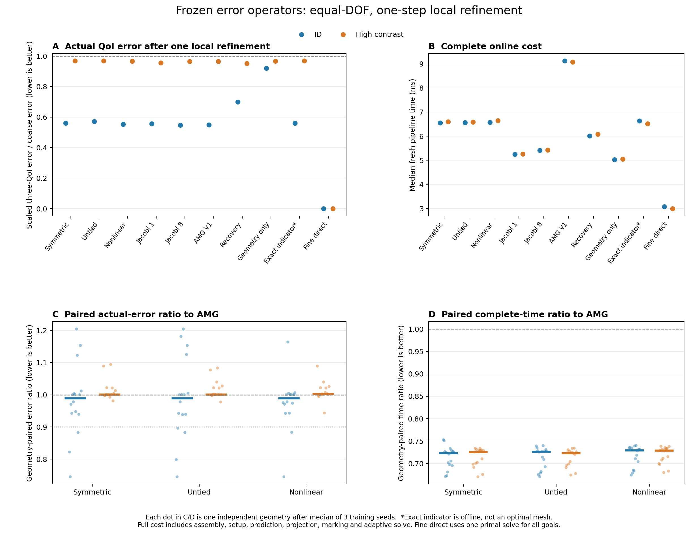

# 第十一阶段：相同新增自由度的一次真实局部细化

本报告由独立程序读取冻结结果生成，未导入实验运行器，也未重新训练或重跑求解。

正式实验：是；独立几何 **32**；方法/种子结果 **512**；每项 **5 次**全新问题对象暖运行，共 **2560** 次。
每个适应网格恰新增 **64** 个内部自由度；粗/适应/细参考维数为 **225/289/961**。三个目标共用同一个细化网格和一次主问题求解。

## 事前门槛

准确性门槛：**未通过**；准确性与完整成本联合门槛：**未通过**。
对称模型是事前主候选，其他网络只作为消融。失败后不把表现更好的消融临时换成主候选，也不增加训练量追逐本测试集。10% 是开发决策门槛，不是显著性检验或论文录用条件。

| 测试组 | S/AMG 配对 E 比中位数 | 严格改善数 | S/Jacobi8 配对 E 比 | S/AMG 完整时间比 | 准确性/成本门槛 |
|---|---:|---:|---:|---:|---|
| id | 0.989063 | 8/16 | 1.00031 | 0.722774 | False / True |
| contrast | 1.00027 | 4/16 | 1.0006 | 0.725843 | False / True |

每个配对比先在同一几何上计算，再跨几何取中位数；不能用下面两列跨几何中位数相除替代。三个训练种子先在同一几何上取中位数，不是 48 个独立 PDE 样本。

## 全部方法的真实解误差与完整成本

E 是三个目标误差经粗目标值归一化后的二范数，相对粗解该范数的比例；粗解 E=1。小于 1 才代表实际目标量改善，能量误差降低不保证每个目标量都改善。所有误差只相对指定细离散参考解。

| 方法 | ID E | 高对比 E | ID 能量误差比 | 高对比能量误差比 | ID 完整耗时 ms | 高对比完整耗时 ms |
|---|---:|---:|---:|---:|---:|---:|
| Symmetric | 0.5604 | 0.9685 | 0.5597 | 0.8433 | 6.551 | 6.601 |
| Untied | 0.5717 | 0.9685 | 0.5492 | 0.8431 | 6.563 | 6.587 |
| Nonlinear | 0.5538 | 0.9671 | 0.5506 | 0.8542 | 6.581 | 6.646 |
| Jacobi 1 | 0.5562 | 0.9554 | 0.559 | 0.8554 | 5.255 | 5.258 |
| Jacobi 8 | 0.5479 | 0.9657 | 0.5609 | 0.8653 | 5.414 | 5.423 |
| AMG V1 | 0.5493 | 0.965 | 0.563 | 0.8554 | 9.124 | 9.076 |
| Recovery | 0.7 | 0.9511 | 0.6329 | 0.8773 | 6.011 | 6.086 |
| Geometry only | 0.9202 | 0.9674 | 0.9007 | 0.9408 | 5.023 | 5.051 |
| Exact indicator* | 0.5606 | 0.9685 | 0.5625 | 0.8485 | 6.631 | 6.519 |
| Fine direct | 0 | 0 | 0 | 0 | 3.073 | 2.995 |

Exact indicator* 使用三个精确细伴随缺陷，是离线诊断；其分解与求解成本按实际计入。它采用同一固定预算选择器，不是实际目标误差的全局最优网格。Fine direct 只做一次细主问题求解便回答全部三个目标，误差为零，绝不作为误差比的分母。

## 每个训练种子的配对结果

| 测试组 | 模型 | 训练种子 | /AMG E 比 | /Jacobi8 E 比 | /Recovery E 比 |
|---|---|---:|---:|---:|---:|
| id | Symmetric | 51001 | 0.995377 | 1 | 0.932953 |
| id | Symmetric | 51002 | 0.989063 | 1 | 0.931111 |
| id | Symmetric | 51003 | 0.984499 | 1 | 0.900332 |
| id | Untied | 51001 | 0.997617 | 1 | 0.911063 |
| id | Untied | 51002 | 0.989063 | 1 | 0.900303 |
| id | Untied | 51003 | 0.986093 | 0.998689 | 0.893201 |
| id | Nonlinear | 51001 | 1.00352 | 1.00287 | 0.928293 |
| id | Nonlinear | 51002 | 0.98859 | 0.997078 | 0.893468 |
| id | Nonlinear | 51003 | 1 | 1 | 0.897361 |
| contrast | Symmetric | 51001 | 1.00005 | 1.00078 | 1.01702 |
| contrast | Symmetric | 51002 | 1.00348 | 1.00073 | 1.01685 |
| contrast | Symmetric | 51003 | 1.00309 | 1.00055 | 1.01297 |
| contrast | Untied | 51001 | 1 | 1 | 1.01588 |
| contrast | Untied | 51002 | 1.00075 | 0.999938 | 1.01781 |
| contrast | Untied | 51003 | 1.00161 | 1 | 1.01325 |
| contrast | Nonlinear | 51001 | 1.00296 | 1.00338 | 1.0094 |
| contrast | Nonlinear | 51002 | 1.00075 | 1.00028 | 1.01685 |
| contrast | Nonlinear | 51003 | 1.00111 | 1.0005 | 1.01848 |

## 标记预算、网格与目标误差退化

表内方格数是逐几何种子中位数的范围；回退和 E>1 均按原始方法/种子行计数，分母含训练种子，不能当作独立几何比例。

| 测试组 | 方法 | 选中方格数范围 | 棋盘回退行数 | E>1 行数 | 完整时间/Fine direct 配对中位数 |
|---|---|---:|---:|---:|---:|
| id | Symmetric | 27–33 | 0/48 | 0/48 | 2.144 |
| id | Untied | 27–34 | 0/48 | 0/48 | 2.144 |
| id | Nonlinear | 27–34 | 0/48 | 0/48 | 2.145 |
| id | Jacobi 1 | 27–34 | 0/16 | 0/16 | 1.701 |
| id | Jacobi 8 | 27–33 | 0/16 | 0/16 | 1.762 |
| id | AMG V1 | 27–33 | 0/16 | 0/16 | 2.99 |
| id | Recovery | 28–35 | 0/16 | 0/16 | 1.967 |
| id | Geometry only | 48–48 | 0/16 | 2/16 | 1.639 |
| id | Exact indicator* | 27–32 | 0/16 | 0/16 | 2.159 |
| id | Fine direct | 0–0 | 0/16 | 0/16 | 1 |
| contrast | Symmetric | 26–33 | 0/48 | 12/48 | 2.197 |
| contrast | Untied | 26–34 | 0/48 | 11/48 | 2.192 |
| contrast | Nonlinear | 26–33 | 0/48 | 10/48 | 2.211 |
| contrast | Jacobi 1 | 26–34 | 0/16 | 2/16 | 1.753 |
| contrast | Jacobi 8 | 26–31 | 0/16 | 4/16 | 1.807 |
| contrast | AMG V1 | 25–32 | 0/16 | 4/16 | 3.049 |
| contrast | Recovery | 26–33 | 0/16 | 3/16 | 2.036 |
| contrast | Geometry only | 48–48 | 0/16 | 2/16 | 1.685 |
| contrast | Exact indicator* | 25–33 | 0/16 | 3/16 | 2.169 |
| contrast | Fine direct | 0–0 | 0/16 | 0/16 | 1 |

粗误差分母退化几何：**0**；经典分母退化记录：**0**。记录完整保留，不补抽、不悄悄删除；所需分母退化会使正式门槛判为证据不足。

各目标的误差比例、学习方法与 AMG/精确指标的网格 Jaccard 重合度、全部逐几何配对值及范围均保存在 summary.json。网格重合是事后描述性机制诊断，不进入过线标准；原始训练种子行不作为独立几何。网格重合或单一诊断不能确定失败的唯一原因。

## 完整计时与复核边界

CPU 单线程；每次都重新生成系数、装配、构造自己的粗层和预条件器/恢复算子，执行预测、投影、指标、预算选择、适应空间构造、矩阵分解与主问题求解。跨方法不借用设置缓存。三目标可在同一次方法运行内共享分解。
进程内模型载入、库导入、暖机、离线参考求解、结果核验和序列化不计入每几何在线时间；模型载入单列，训练不在本阶段发生。每个几何先取五次暖运行中位数，随后才做种子及几何聚合。没有 GPU 推理，也不据此外推其他硬件或规模。
九个模型载入合计 **0.00595899 s**；所有分支暖机 **0.144271 s**；实验墙钟 **18.1286 s**。墙钟包含非在线参考、核验及序列化，与在线时间之和不是同一口径。

| 测试组 | 方法 | 装配+粗求解 ms | 此后完整路径 ms |
|---|---|---:|---:|
| id | Symmetric | 2.946 | 3.607 |
| id | Jacobi 8 | 2.943 | 2.454 |
| id | AMG V1 | 2.944 | 6.128 |
| id | Recovery | 2.938 | 3.068 |
| id | Fine direct | 1.785 | 1.296 |
| contrast | Symmetric | 2.97 | 3.618 |
| contrast | Jacobi 8 | 2.977 | 2.447 |
| contrast | AMG V1 | 2.97 | 6.118 |
| contrast | Recovery | 2.976 | 3.106 |
| contrast | Fine direct | 1.793 | 1.201 |

两个分量各自取中位数，因此不要求相加恰好等于总耗时中位数。逐重复阶段分量在原始结果，独立重算的分量之和及未归类差额保存在 summary.json 的 audit 字段；报告不把网络前向时间当作完整求解成本。

独立复核通过：**36 个冻结输入哈希**、全部结果哈希、模型权重来源、历史几何哈希无重叠、全部 3 目标误差重建、精确新增自由度、标记规则重建、五次计时中位数。
最大求解相对残差 **1.122e-11**；最大投影粗正交残差 **2.717e-13**；最大粗空间嵌入差 **0.000e+00**。
独立报告程序未重跑 PDE：能量与残差保存值核验范围，完整解向量未持久化，不能声称在报告阶段独立重算能量或解字段。实际求解与重复一致性由冻结运行器及数值单元测试核验。

本轮只是一轮、固定网格层级、固定三个目标、固定自由度预算的检验，不证明多轮 AMR 收敛、连续误差认证、跨尺度泛化、模型新颖性或论文可发表。

原始结果目录：`results/stage11_refinement`；完整逐几何聚合见 `summary.json`。
