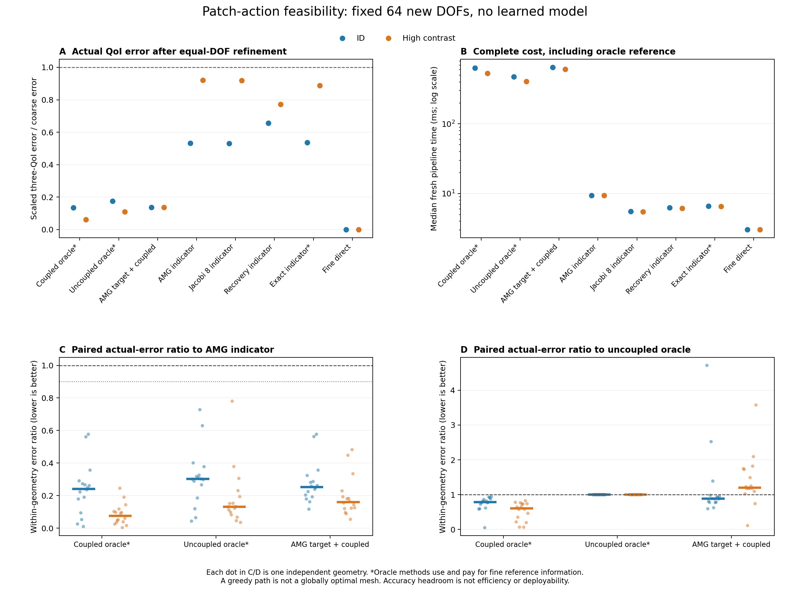

# 第十二阶段：局部补丁动作与相互作用

本报告由独立程序读取冻结结果生成，不导入实验运行器、Schur 实现、PDE 求解器或 AI 模型。阶段内没有训练或使用 AI 模型。

正式实验：**是**；独立几何 **32**；方法/几何结果 **256**；每项 **3 次**全新对象暖运行，共 **768** 次。
粗/适应/细参考自由度为 **225/289/961**。每个适应方法恰新增 **64** 自由度，三个目标共用一个网格和一次适应主问题求解。

## 事前可达性门槛

主候选 **Coupled oracle** 的准确性可达性门槛：**通过**。
预定要求为：两组相对 AMG 的配对 E 比中位数均不超过 0.90、每组至少 12/16 个严格改善；两组相对 Jacobi8 均不超过 1；无必需分母退化、全部数值核验通过，且主候选无预算完成回退。这里的 10% 与 12/16 是开发决策阈值，不是显著性检验或发表条件。

| 测试组 | Oracle/AMG 配对 E 比 | 严格改善数 | Oracle/Jacobi8 配对 E 比 | 主候选回退 | 门槛 |
|---|---:|---:|---:|---:|---|
| id | 0.24172 | 16/16 | 0.242555 | 0 | True |
| contrast | 0.0746576 | 16/16 | 0.0834303 | 0 | True |

每个比值先在同一几何上计算，再跨独立几何取中位数，不能用两列跨几何中位数相除替代。三个重复仅用于计时与确定性核验，不增加独立样本量。

**该门槛没有效率条件。** 主 oracle 已求得精确细主解来知道真实粗目标误差；其网格即使更好，也没有节省当前实例的求解工作。通过仅表示当前有限贪心动作族中存在值得进一步检验的信息，不能据此主张可部署、AI 必要性或方法新颖性。

## 实际解误差与完整成本

E 为三个目标误差按粗目标值归一化后二范数，相对于粗解同一范数的比例；粗解 E=1。能量改善不能代替目标误差改善，全部误差仅相对于固定细离散参考。

| 方法 | ID E 中位数 [范围] | 高对比 E 中位数 [范围] | ID 能量误差比 | 高对比能量误差比 | ID 完整时间 ms | 高对比完整时间 ms |
|---|---:|---:|---:|---:|---:|---:|
| Coupled oracle* | 0.1343 [0.004656, 0.2342] | 0.06242 [0.002983, 0.1143] | 0.282 | 0.1315 | 636 | 529.4 |
| Uncoupled oracle* | 0.1756 [0.01792, 0.2998] | 0.1102 [0.03253, 0.6154] | 0.3147 | 0.2401 | 475.3 | 404.5 |
| AMG target + coupled | 0.1368 [0.08443, 0.2342] | 0.1379 [0.0535, 0.3127] | 0.2716 | 0.2079 | 648.5 | 608.1 |
| AMG indicator | 0.5323 [0.4061, 0.887] | 0.9216 [0.3603, 0.9896] | 0.5982 | 0.8393 | 9.421 | 9.374 |
| Jacobi 8 indicator | 0.5305 [0.4061, 0.887] | 0.9196 [0.3603, 0.9864] | 0.5974 | 0.8857 | 5.523 | 5.476 |
| Recovery indicator | 0.656 [0.2292, 0.7596] | 0.7729 [0.2562, 0.9985] | 0.6176 | 0.7666 | 6.246 | 6.162 |
| Exact indicator* | 0.5363 [0.383, 1.202] | 0.8886 [0.3597, 0.9896] | 0.6027 | 0.8393 | 6.606 | 6.556 |
| Fine direct | 0 [0, 0] | 0 [0, 0] | 0 | 0 | 3.045 | 3.036 |

带 * 的方法使用精确细参考信息且全部实际收费。Coupled oracle 是固定候选族上的贪心搜索，不是全局最优网格；Exact indicator 是精确指标配合同一预算排序器，也不是最优动作。Fine direct 用一次细主解回答全部三个目标，零离散误差且不匹配 64 自由度预算，不能作为误差比分母。

## 相互作用消融与可部署目标估计

Uncoupled oracle 对每一步新出现的独立方向使用原始 Schur 主子块求增量并累加，避免重叠补丁重复计数，但忽略不同步骤之间的交叉耦合。它的末端误差仍来自真实联合网格求解。AMG target + coupled 用一次 AMG 主残差修正估计粗目标误差，其选择函数不接受精确参考；它是经典探索性诊断，不是学习模型。

| 测试组 | 方法 | /AMG 配对 E 比 | /AMG 改善数 | /Uncoupled 配对 E 比 | /Fine direct 完整时间比 |
|---|---|---:|---:|---:|---:|
| id | Coupled oracle* | 0.24172 | 16/16 | 0.783147 | 208.749 |
| id | Uncoupled oracle* | 0.30177 | 16/16 | 1 | 156.44 |
| id | AMG target + coupled | 0.253208 | 16/16 | 0.882726 | 213.439 |
| contrast | Coupled oracle* | 0.0746576 | 16/16 | 0.610176 | 171.666 |
| contrast | Uncoupled oracle* | 0.13169 | 16/16 | 1 | 129.587 |
| contrast | AMG target + coupled | 0.159827 | 16/16 | 1.20432 | 197.72 |

| 测试组 | 方法 | 目标估计相对误差 | 预测/实际变化差 | 预测末端 F | 实际末端 F |
|---|---|---:|---:|---:|---:|
| id | Coupled oracle* | 1.25197e-14 | 8.47224e-14 | 7.08218e-05 | 7.08218e-05 |
| id | Uncoupled oracle* | 1.25197e-14 | 0.124086 | 0.000173505 | 0.000102608 |
| id | AMG target + coupled | 0.0719446 | 8.35322e-14 | 2.40207e-05 | 8.11602e-05 |
| contrast | Coupled oracle* | 4.15957e-15 | 7.02702e-13 | 0.000234837 | 0.000234837 |
| contrast | Uncoupled oracle* | 4.15957e-15 | 0.171775 | 0.00249077 | 0.000471977 |
| contrast | AMG target + coupled | 0.123856 | 5.19189e-13 | 1.81488e-05 | 0.000920582 |

目标估计相对误差为 `||(target−e_c)/s||/max(||e_c/s||,1e-12)`；预测/实际变化差为 `||(predicted_change−actual_change)/s||/max(||actual_change/s||,1e-12)`。F 是未再除以粗误差的缩放误差平方，不能与 E 混用。AMG 行的预测 F 同时包含目标估计差异；uncoupled 的真实目标已知，其末端预测差描述被忽略的交互作用。
两种 oracle 可能走不同的贪心路径、得到不同新增方向。完整策略的末端比较与同终端集合的预测偏差属于描述性机制检验，不足以确定唯一因果机制。所有逐几何值、范围与网格重合度保存在 summary.json。

## 搜索轨迹、预算与全部负结果

| 测试组 | 方法 | 步数中位数（范围） | 候选评价数中位数 | 含负增益步骤的几何 | 回退几何 | E>1 几何 |
|---|---|---:|---:|---:|---:|---:|
| id | Coupled oracle* | 40 (29–45) | 32142 | 0/16 | 0 | 0 |
| id | Uncoupled oracle* | 34.5 (25–39) | 27920 | 0/16 | 0 | 0 |
| id | AMG target + coupled | 38.5 (29–45) | 31966 | 0/16 | 0 | 0 |
| contrast | Coupled oracle* | 33 (26–45) | 26695 | 0/16 | 0 | 0 |
| contrast | Uncoupled oracle* | 30 (21–41) | 24276 | 0/16 | 0 | 0 |
| contrast | AMG target + coupled | 37.5 (30–44) | 30089 | 2/16 | 0 | 0 |

原始动作目录含单格、横/纵相邻双格和 2×2 块；16×16 粗网格共 961 项。每步与当前集合取并集，按新增加的中心与释放的内部共享边自由度收费；去重后只评价可行候选。预算是 64 个新增自由度，不是 64 个动作或方格。所有负增益步骤和回退均保留。表中候选评价数只统计贪心循环；每次搜索另外评价初始 256 个单格和一次终端精确集合，触发回退时再评价两个棋盘集合。这些均计入完整搜索成本，并在原始结果与 summary.json 单列。

粗误差退化几何 **0**；经典误差分母退化记录 **0**。这些记录不丢弃、不重抽；必需分母退化会使正式门槛不通过。

## 时间收费与独立审计边界

CPU 与数值库均单线程。每次从新对象开始，包括系数/载荷装配、必要粗求解、完整 Schur 设置与存储、候选结构、所有搜索、真实约束网格、适应装配求解及目标评价；oracle 自己构造参考并收费，不免费借用其他方法的细分解。非 oracle 的离线评价参考不计入其在线路径。初始化、独立预热、报告与序列化单列，不把微小暖运行差异解释为速度优势。
八个分支独立预热合计 **1.71803 s**；正式循环墙钟 **163.19 s**。墙钟含离线评价与序列化，与在线路径时间之和不是同一口径。
全局 Schur 是本次小网格诊断工具，不能直接外推到大规模网格；准确性门槛不含成本，但完整成本始终展示。

| 测试组 | 方法 | 目标构建 ms | Schur 设置 ms | 搜索 ms | 适应求解 ms |
|---|---|---:|---:|---:|---:|
| id | Coupled oracle* | 1.206 | 11.02 | 618.7 | 0.6633 |
| id | Uncoupled oracle* | 1.203 | 11.44 | 457.2 | 0.6582 |
| id | AMG target + coupled | 3.754 | 11.07 | 628.7 | 0.6629 |
| contrast | Coupled oracle* | 1.204 | 11.06 | 512.2 | 0.665 |
| contrast | Uncoupled oracle* | 1.207 | 11.04 | 386.7 | 0.6504 |
| contrast | AMG target + coupled | 3.547 | 11.1 | 587 | 0.6609 |

表内各分量分别取中位数，不要求相加等于总时间中位数；装配、粗求解、网格构造和诊断等其余成本也计入完整路径。全部重复的分量之和与未归类余量在 summary.json 的 audit 字段。

### 事后成本诊断：仅删除已测搜索时间

以下只对已有计时做算术，不新增运行、不影响正式门槛：每次重复先计算 `total_seconds−candidate_search_seconds`，再取逐几何三次中位数；与同几何细直接解的时间中位数相除后，才跨几何汇总。搜索占比也先逐重复计算，再依次取几何及组中位数。

| 测试组 | 方法 | 搜索占比 % | 删除搜索后的余量 ms | 余量/Fine direct 配对比 |
|---|---|---:|---:|---:|
| id | Coupled oracle* | 97.2327 | 17.5532 | 5.77554 |
| id | Uncoupled oracle* | 96.1486 | 17.8255 | 5.83146 |
| id | AMG target + coupled | 96.8991 | 20.2046 | 6.59876 |
| contrast | Coupled oracle* | 96.6512 | 17.5905 | 5.8153 |
| contrast | Uncoupled oracle* | 95.5502 | 17.4278 | 5.82215 |
| contrast | AMG target + coupled | 96.6506 | 20.3557 | 6.71827 |

这是假设性记账：整段搜索及其内部条件状态更新等工作一起被删除，尚未加入任何替代预测器推理或新架构成本。因此，它不是实测加速、可实现的性能下界或速度优势证据。当前 Schur 设置本身约 11 ms，而细直接解完整路径约 3 ms；仅压缩搜索，仍留下明显的设置与求解成本。其他算法或规模可以改变这些成本，不能把本表当成普遍不可能性结论。逐几何记录与聚合规则在 summary.json 的 posthoc_cost 字段，可由同一报告程序重建。

独立审计：**44 个输入哈希**、全部输出哈希、**32 个独立几何**及历史无重叠、全部三目标误差与尺度、精确预算、指标排序和动作轨迹中的候选合法性/新增方向/目标函数/收费均通过。
独立报告未重跑 PDE；精确候选数值排名、Schur 正定性、保存的能量/求解残差及完整解字段不能由仅存摘要重新证明。报告重建记录的选择轨迹与最终 Schur/实际目标变化一致性，完整数值核验由冻结运行器和数值测试完成。报告不会把记录的获胜得分当成对所有未保存候选值的独立最优性验证。

原始结果目录：`results/stage12_actions`；全部逐几何配对、动作审计与计时分量见 `summary.json`。
