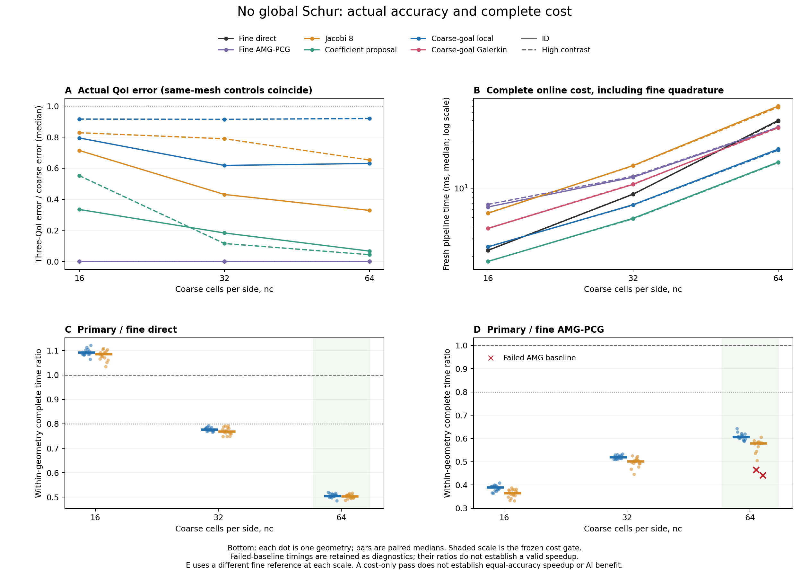

# 第十三阶段：移除全局 Schur 后的成本可行性

本报告仅读取冻结输出，不导入 PDE 求解器、数值装配器或实验运行器。没有训练、加载或测试 AI 模型。

正式实验：**是**；**32 个独立几何**，在 3 个尺度上形成 **96 个上下文**、**576 条方法记录**和 **1728 次完整路径计时**。尺度重复、三目标和计时重复均不是额外独立样本。

主候选 `coarse_goal_local` 在 nc=64 的预定**成本门槛：未通过**。数值审计：未通过；粗误差分母退化上下文 0 个。

## 预定成本判据

每组分别要求主候选相对细直接和细 AMG-PCG 的逐几何时间比中位数≤0.80，并至少 12/16 个几何严格更快。所有预算、数值、重复和同网格实现核验均须通过。该开发门槛不包含等精度条件。

| 测试组 | 细基线 | 配对完整时间比中位数 | 严格更快 | 时间比条件 | 个数条件 |
|---|---|---:|---:|---|---|
| id | Fine direct | 0.5042806 | 16/16 | True | True |
| id | Fine AMG-PCG | 0.6061247 | 16/16 | True | True |
| contrast | Fine direct | 0.5034863 | 16/16 | True | True |
| contrast | Fine AMG-PCG | 0.5786033 | 16/16 | True | True |

所有比值先在同一几何、同一尺度内计算，再跨几何取中位数；不能用两个组中位数相除替代。表内时间条件只检查测得的时间；失败基线的计时被保留，但相关时间比仅作描述，不能作为对有效基线的速度优势。完整门槛同时要求全部数值通过。未通过时不能换成次要系数代理重新判定，通过时也不能继承第十二阶段联合搜索的准确性或宣称未来网络已获得加速。

## 全部方法的实际误差和完整成本

E 为三个目标误差按粗目标值缩放后二范数，相对于同一粗解误差范数的比例；粗解 E=1，指定细直接参考 E=0。各尺度的细参考不同，这些 E 不是相对于共同连续真解的网格收敛误差。Fine AMG-PCG 的目标偏差据实保留，没有强行设为0。

### nc=16，粗/适应/细自由度 225/289/961

| 方法 | ID E中位数 [范围] | 高对比 E中位数 [范围] | ID完整时间 ms | 高对比完整时间 ms | ID/高对比 E>1个数 | ID/高对比预算回退 |
|---|---:|---:|---:|---:|---:|---:|
| Fine direct | 0 [0, 0] | 0 [0, 0] | 2.2899 | 2.2999 | 0/0 | 0/0 |
| Fine AMG-PCG | 1.2165e-11 [8.0263e-13, 1.6947e-10] | 6.7059e-12 [2.7725e-13, 3.1981e-11] | 6.417 | 6.8225 | 0/0 | 0/0 |
| Jacobi 8 | 0.71423 [0.39484, 0.9584] | 0.82823 [0.61812, 1.0084] | 5.5316 | 5.568 | 0/1 | 0/0 |
| Coefficient proposal | 0.33472 [0.11832, 1.1207] | 0.55231 [0.045423, 0.81476] | 1.7597 | 1.7654 | 1/0 | 0/0 |
| Coarse-goal local | 0.79465 [0.30381, 0.99141] | 0.91611 [0.075518, 1.0262] | 2.4912 | 2.4965 | 0/1 | 0/0 |
| Coarse-goal Galerkin | 0.79465 [0.30381, 0.99141] | 0.91611 [0.075518, 1.0262] | 3.8535 | 3.8692 | 0/1 | 0/0 |

### nc=32，粗/适应/细自由度 961/1217/3969

| 方法 | ID E中位数 [范围] | 高对比 E中位数 [范围] | ID完整时间 ms | 高对比完整时间 ms | ID/高对比 E>1个数 | ID/高对比预算回退 |
|---|---:|---:|---:|---:|---:|---:|
| Fine direct | 0 [0, 0] | 0 [0, 0] | 8.695 | 8.7241 | 0/0 | 0/0 |
| Fine AMG-PCG | 2.6805e-11 [3.0997e-12, 1.8174e-10] | 5.195e-12 [2.6822e-13, 6.1034e-11] | 13.015 | 13.296 | 0/0 | 0/0 |
| Jacobi 8 | 0.43109 [0.24371, 0.73268] | 0.78949 [0.49712, 1.0728] | 17.179 | 17.053 | 0/2 | 0/0 |
| Coefficient proposal | 0.18349 [0.047911, 0.44868] | 0.11556 [0.032289, 0.39099] | 4.9081 | 4.8542 | 0/0 | 0/0 |
| Coarse-goal local | 0.61788 [0.22969, 1.6536] | 0.91444 [0.030917, 1.0023] | 6.773 | 6.7242 | 1/1 | 0/0 |
| Coarse-goal Galerkin | 0.61788 [0.22969, 1.6536] | 0.91444 [0.030917, 1.0023] | 10.977 | 11.069 | 1/1 | 0/0 |

### nc=64，粗/适应/细自由度 3969/4993/16129

| 方法 | ID E中位数 [范围] | 高对比 E中位数 [范围] | ID完整时间 ms | 高对比完整时间 ms | ID/高对比 E>1个数 | ID/高对比预算回退 |
|---|---:|---:|---:|---:|---:|---:|
| Fine direct | 0 [0, 0] | 0 [0, 0] | 50.131 | 49.318 | 0/0 | 0/0 |
| Fine AMG-PCG | 3.4501e-11 [4.7139e-12, 2.5315e-10] | 4.9787e-11 [2.3569e-12, 1.9891e-10] | 42.307 | 42.795 | 0/0 | 0/0 |
| Jacobi 8 | 0.32853 [0.053176, 0.72414] | 0.65258 [0.1115, 1.031] | 70.53 | 68.619 | 0/1 | 0/0 |
| Coefficient proposal | 0.066598 [0.015231, 0.27473] | 0.043711 [0.012918, 0.15481] | 18.643 | 18.43 | 0/0 | 0/0 |
| Coarse-goal local | 0.63073 [0.19555, 0.9809] | 0.91982 [0.08604, 1.1572] | 25.369 | 24.786 | 0/1 | 0/0 |
| Coarse-goal Galerkin | 0.63073 [0.19555, 0.9809] | 0.91982 [0.08604, 1.1572] | 42.934 | 42.076 | 0/1 | 0/0 |

细基线求解全部细自由度，不匹配适应预算。适应方法均恰好新增 nc²/4 个独立自由度：中心加被释放的共享边中点，不能把选中方格数当作预算。Coarse-goal local 与 Galerkin 使用完全相同的代理、网格和积分，误差应重合；其差别是最终装配实现。

## 相同网格的实现一致性与强基线

同网格直接/全域 Galerkin 路径的最大已记录解相对差 **3.190296e-12**，可由保存目标值独立重建的最大缩放目标差 **6.608234e-12**。

| nc | 组 | Local/Galerkin 配对时间比 | Coarse-goal/Jacobi8 配对 E比 | 改善数 | PCG迭代中位数 [范围] | PCG最大 E | PCG最大残差 |
|---:|---|---:|---:|---:|---:|---:|---:|
| 16 | id | 0.64741 | 1.0293 | 8/16 | 13 [12, 14] | 1.6947e-10 | 8.6753e-11 |
| 16 | contrast | 0.64577 | 1.062 | 6/16 | 15 [13, 17] | 3.1981e-11 | 8.8372e-11 |
| 32 | id | 0.61314 | 1.434 | 2/16 | 16 [15, 17] | 1.8174e-10 | 9.4387e-11 |
| 32 | contrast | 0.60736 | 1.1475 | 4/16 | 17.5 [16, 20] | 6.1034e-11 | 9.9911e-11 |
| 64 | id | 0.59124 | 1.998 | 1/16 | 18 [17, 19] | 2.5315e-10 | 9.8866e-11 |
| 64 | contrast | 0.59217 | 1.2077 | 3/16 | 20 [19, 34] | 1.9891e-10 | 1.4991e-10 |

PCG 必须实际残差≤1e-10、converged 为真且 info=0，并且 E≤1e-5；任何不合格记录均使成本门槛不通过。预算回退、误差变差和未通过记录均保留。能量单调性是嵌套空间性质，不能代替目标误差改善。

未收敛 AMG 上下文共 **2 个**；以下列首个重复的诊断，失败重复数逐项保存。库退出状态 info=0 不能代替实际残差判据，目标误差很小也不允许事后放宽门槛。

| nc/组/几何 | 初始实际残差 | 最终实际残差 | 迭代 | 重启 | info | converged | E | 失败重复 |
|---|---:|---:|---:|---:|---:|---|---:|---:|
| 64/contrast/54103 | 2.8328977e-10 | 1.4991231e-10 | 33 | 3 | 0 | False | 6.5347428e-11 | 3/3 |
| 64/contrast/54115 | 2.6794919e-10 | 1.4592103e-10 | 34 | 3 | 0 | False | 4.6100553e-11 | 3/3 |

## 全成本及剩余时间

直接局部路径省去全域细稀疏矩阵、稀疏 T 和 Schur，并未省去输入系数的细采样和全域细三角三点二阶求积。首次粗装配支付四载荷求积，适应装配只在同一条新建 pipeline 内复用这份已收费数据。两种同网格后端使用相同复用规则；不跨方法、重复、几何共享。细直接/AMG 基线与直接局部路径共用同一载荷求积实现，避免把通用载荷装配优化冒充局部网格优势。

所有计时包含系数生成、所需积分、粗装配/分解及四解、特征、预算解码、适应装配/分解/主解、三个目标及实际残差；fine AMG 还包含层级设置和全部迭代。交付物为适应系数和三个目标。细场提升、独立参考与误差评价在两条同网格路径的计时外。历史 Jacobi8 路径保留其原有完整实现成本。

| nc | 组 | 粗装配 ms | 粗分解＋四解 ms | 特征 ms | 预算解码 ms | 适应装配 ms | 适应求解＋目标 ms |
|---:|---|---:|---:|---:|---:|---:|---:|
| 16 | id | 0.99837 | 0.26806 | 0.14218 | 0.066908 | 0.56446 | 0.32359 |
| 16 | contrast | 0.99357 | 0.2679 | 0.14164 | 0.067329 | 0.55874 | 0.32296 |
| 32 | id | 2.7451 | 0.96702 | 0.30347 | 0.13934 | 1.1628 | 1.2296 |
| 32 | contrast | 2.738 | 0.96224 | 0.30248 | 0.13864 | 1.1529 | 1.2108 |
| 64 | id | 10.096 | 4.2762 | 0.95327 | 0.40309 | 3.6163 | 5.5312 |
| 64 | contrast | 10.04 | 4.2114 | 0.93516 | 0.39065 | 3.4558 | 5.3867 |

上表仅解释主候选构成；各分量单独取中位数，其和不必等于完整时间中位数。完整路径还含系数/载荷函数生成与计时余量。全部逐重复分量和范围保存在 summary.json。

| nc | 组 | 相对逐几何更快细基线的余量 ms | 达到该基线80%时间的余量 ms |
|---:|---|---:|---:|
| 16 | id | -0.2089 | -0.66592 |
| 16 | contrast | -0.1934 | -0.65145 |
| 32 | id | 1.9565 | 0.20392 |
| 32 | contrast | 2.0258 | 0.27645 |
| 64 | id | 16.578 | 8.2223 |
| 64 | contrast | 17.991 | 9.4336 |

余量在每个尺度保留全部 32 个几何，以两种已测细基线时间的逐几何最小值减主候选完整时间；负数表示当前路径已超时。当前计时集合含 2 个 AMG 未收敛上下文，它们没有从上述记账中删除。因此包含不合格基线的组，其余量只作诊断，不能解释为合格速度优势或可用推理预算。这也尚未支付任何新模型推理、额外特征或训练成本，不能当成已实现的网络加速。

独立预热 **0.3770223 s**；正式循环墙钟 **47.42588 s**。墙钟含离线参考、评价和序列化，不等于在线时间之和。

## 独立审计和限制

验证了 **52 个冻结输入哈希**、全部原始输出哈希、历史几何身份/系数指纹无重叠、全部目标误差、真实预算、保存分数对应的确定性选择，以及同网格目标一致性。数值失败记录 **16 条**，全部保存在 summary.json 的 audit.numeric_failures。

报告没有重跑 PDE。完整系数场、粗解和细解未存储，不能从字段哈希重建代理分数公式、能量范数、残差或解场相等性；这些由冻结装配测试与运行器核查。报告可重算已保存目标和分数的相关逻辑，并检查保存的重复有效性标记，但不把标记等同于再次独立求解。

原始目录：`results/stage13_cost`。复现报告：`python report_stage13.py --source <原始目录> --output <新报告目录>`。
