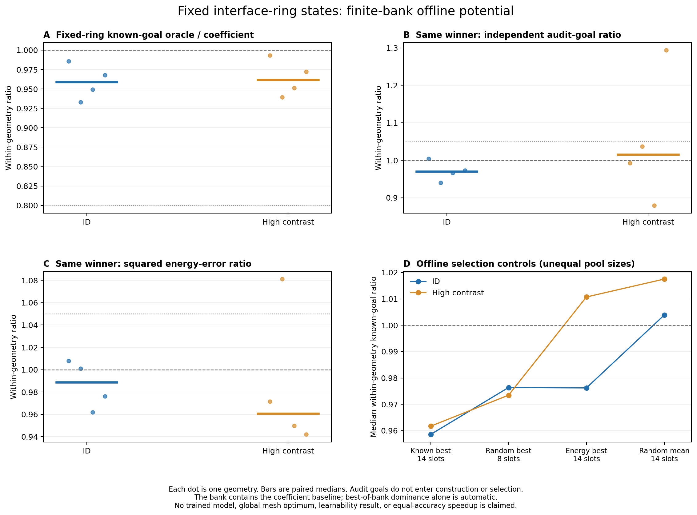

# 第十四阶段：统一数值验收与界面之外的有限候选潜力

**本目录仅为开发/烟雾实现复核，不给出正式确认结论。**

主实验固定界面闭一环内的选中/未选状态，精确保持新增自由度 1,024。共 8 个独立几何；两个各14位置的候选集合共 224 条候选求解记录。重复、候选与两种约束不增加独立样本量。

数值与结构验收：**通过**。主有限候选潜力门槛：**未通过**；包含独立目标/能量护栏的稳健潜力总门槛：**未通过**。

候选构造只读系数、源项与三个已知目标描述。已知目标 oracle 在14个预先固定候选中，使用细参考误差选择最小者；它明确支付离线参考及全候选求解，不是在线算法、全局最优网格或已训练模型。集合含原系数基线，因此 oracle 不劣于该基线是构造事实，只有非平凡改善幅度才有研究意义。

## 主实验：固定界面一环的同预算比较

E 是三个已知目标的缩放误差二范数除以同几何粗解误差范数，粗解为1。先平方再求和，三个目标之间不会直接正负抵消。每个目标内部的空间误差抵消仍可能存在。所有比值先在同几何计算再取中位数。

| 选择规则 | ID E | 高对比 E | ID /系数基线 | 高对比 /系数基线 |
|---|---:|---:|---:|---:|
| 原系数基线 | 0.088827 | 0.042809 | 1 | 1 |
| 固定一环＋系数排序 | 0.088827 | 0.042809 | 1 | 1 |
| 固定一环＋确定性均匀分数 | 0.0900904 | 0.0440468 | 1.01416 | 1.11445 |
| 已知目标 oracle（14位置） | 0.0851729 | 0.0411103 | 0.958578 | 0.961697 |
| 随机分数子集 oracle（8位置） | 0.0854182 | 0.0425169 | 0.976372 | 0.97346 |
| 离线能量 oracle（14位置） | 0.08533 | 0.0436994 | 0.97622 | 1.01073 |
| 目标/源项启发式 oracle（3位置） | 0.0869778 | 0.0419967 | 0.979539 | 1.01724 |
| 固定随机子集 oracle（3位置） | 0.0854182 | 0.0426751 | 0.982692 | 0.990085 |
| 均匀随机14位置的期望 | 0.0885964 | 0.0433957 | 1.00387 | 1.01753 |
| 均匀随机14位置去重网格的期望 | 0.0885787 | 0.0434408 | 1.00417 | 1.01887 |
| 随机分数8位置的期望 | 0.088688 | 0.0433761 | 1.00603 | 1.01064 |
| 随机分数8位置去重网格的期望 | 0.088688 | 0.0433761 | 1.00603 | 1.01064 |

随机8位置与全14位置的最小值不是相同候选数控制；另列3位置启发式与预先固定的3位置随机子集，两者候选数相同。四个随机场各带两个强度，位置并不独立。随机期望为确定性已保存候选上的算术期望，没有额外随机试验。去重网格数与所有选择索引保存在 summary.json。

| 组 | 主 oracle 至少改善10% | audit误差 /基线 | 能量平方误差 /基线 | 最大已知目标误差 /基线 |
|---|---:|---:|---:|---:|
| id | 0/4 | 0.969795 | 0.988634 | 0.957549 |
| contrast | 0/4 | 1.01489 | 0.960592 | 0.954769 |

主门槛要求两组配对误差比中位数均≤0.8，且各至少12/16几何改善≥10%，并通过全部数值、预算、覆盖与固定一环检查。额外护栏要求同一已知目标赢家的三个独立audit目标误差比和能量平方误差比中位数均≤1.05，分母不得退化。audit目标从未参与候选构造或选择；护栏失败不否定已知目标有限候选空间，但阻止称为稳健、可转移的潜力。

## 次实验与机制边界

次实验只固定全部粗格内部界面覆盖，允许一环其他状态改变。其 oracle /原系数基线比：

| 组 | 固定一环（主） | 仅固定覆盖（次） |
|---|---:|---:|
| id | 0.958578 | 0.95333 |
| contrast | 0.961697 | 0.965775 |

界面标签仅指2×2细系数在粗格内部同时出现两相，不包括恰沿粗格边界的界面。固定闭一环还固定了这些界面格与邻格共享边中点的自由度状态；不等于固定所有物理界面、通量误差或全域影响。改变其他格后的椭圆解仍全局耦合。若只有次实验改善，不能解释为已排除界面邻近细化收益。

## 求解器验收及成本边界

直接法与缩放 AMG-PCG 对同一原始双精度矩阵使用统一验收：扩展精度计算的实际相对残差≤1e-9，分量后向误差≤1e-12，所有求解器状态成功。扩展精度仅用于残差评估，不代表高精度 PDE 装配或高精度真实解。设置、全部修正与验收计入完整基线成本。第十三阶段原有失败结论保持不变。

| 组 | 基线方法 | 完整路径 ms 中位数 | 全部数值合格上下文 |
|---|---|---:|---:|
| id | coefficient_local | 19.9638 | 4/4 |
| id | fine_amg | 53.3064 | 4/4 |
| id | fine_direct | 54.9628 | 4/4 |
| contrast | coefficient_local | 19.9766 | 4/4 |
| contrast | fine_amg | 63.0611 | 4/4 |
| contrast | fine_direct | 53.4017 | 4/4 |

候选集合重复使用离线已经支付的载荷/参考数据，其 seconds 字段不能与完整基线路径当作在线速度比较。本轮没有训练、推理或等精度加速证明。

## 独立复核

核对 66 个冻结输入哈希、原始输出哈希，以独立NumPy公式重建 8 个系数哈希、界面及一环、全部高斯函数参数、224 个候选分数；独立重建分数解码、自由度预算，以及全部已知/audit目标误差和 oracle 选择。独立检查完整基线 24 次。结构失败 0 条，数值失败 0 条；全部记录保留。

报告不导入 PDE 代码、不重新求解；保存数据没有完整解场，无法独立重算残差、后向误差或能量。这里重建其验收逻辑，相关数值证据来自冻结运行器与独立数值测试。高斯函数参数已重建，载荷求积及保存的载荷数组哈希没有重新计算；不将函数参数复核等同于复核载荷装配。

原始数据：`results/stage14_mechanism_development`。
