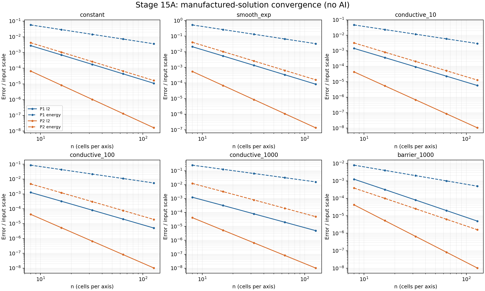

# 第十五阶段A数值核验报告

本轮预定数值门槛：**通过**。这是六个确定性制造解上的实现与精度核验，不是总体统计结论、连续误差证书或学习收益证明。

30个均匀网格上下文、24个局部细化状态；重建18次实际标记及下一网格。共126次求解器调用、504个右端解（每次4右端共用分解/层级）；包括12次AMG调用和6次18阶求积对照。完整审查耗时29.50秒，包含离线解析评价与重复核验，不能作为部署求解耗时。

| 案例 | P1 L2阶 | P1能量阶 | P2 L2阶 | P2能量阶 | 最细P2目标误差/τ | DWR效能范围 |
|---|---:|---:|---:|---:|---:|---:|
| constant | 1.9996 | 0.9998 | 3.0000 | 1.9998 | 3.014e-05 | 0.999977–0.999981 |
| smooth_exp | 1.9996 | 0.9998 | 2.9999 | 1.9998 | 3.083e-04 | 0.999970–1.000011 |
| layered_conductive_10 | 1.9996 | 0.9999 | 3.0003 | 1.9992 | 2.207e-05 | 0.999951–0.999957 |
| layered_conductive_100 | 1.9996 | 0.9999 | 3.0004 | 1.9966 | 2.146e-05 | 0.999932–0.999949 |
| layered_conductive_1000 | 1.9996 | 0.9999 | 3.0004 | 1.9951 | 2.141e-05 | 0.999928–0.999948 |
| layered_barrier_1000 | 1.9996 | 0.9999 | 3.0004 | 1.9951 | 8.795e-06 | 0.999984–1.000259 |

最坏实际相对残差：9.860e-12；最坏分量后向误差：7.828e-13。归一化DWR恒等式/局部总和最坏差：3.115e-13；强/弱式最坏全局差：4.510e-17。

失败检查数：0。完整逐项结果在summary.json，原始输入/记录在实验目录，不删失败样本。

局部标记使用强式体/面DWR贡献的绝对值聚合与固定θ=.5的Dörfler规则；解析真值只参与离线评价。三轮固定细化不从真误差决定提前停止。不同合法局部化不必产生相同排名。

**边界：** 参考检查有已知解析解支撑，仅适用于本轮固定材料与制造载荷。未对齐双包含体、一般屏障/通道、平衡通量认证、NGO-AFEM与同精度成本尚未完成。G1/G2/G3均未评价，训练模型数0。下一项应完成代表性问题的强基线，而不是直接训练。
