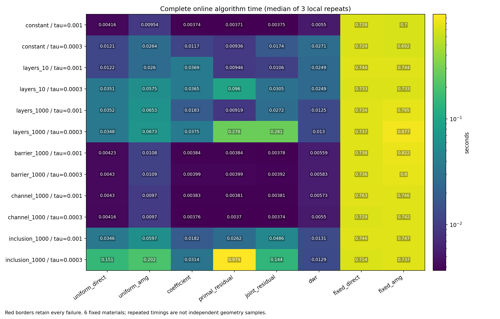
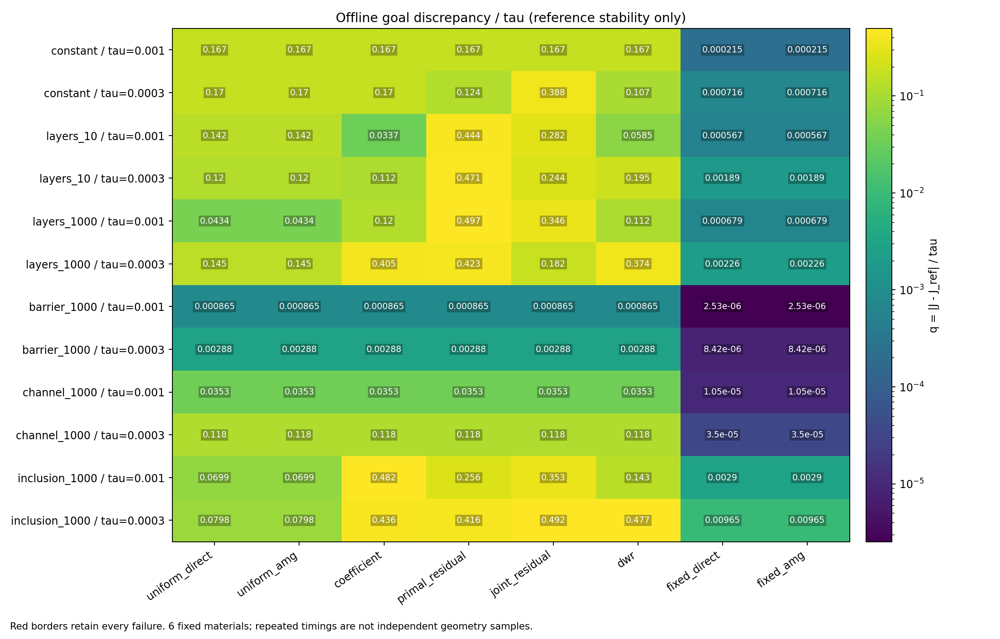

# 第十五阶段B：经典基线同精度成本核查

原始记录完整性核查通过：18957项。共288条路径，退出后同精度验收成功288条，失败0条。失败记录全部保留。

本轮六个确定性材料使用相同固定源和单目标观测。自适应方法采用预先规定的付费核验计划；固定P1网格方法的分辨率提前固定，无在线目标误差核验。所有输出均在退出后按同一目标容限与参考资格检查验收。

## 参考稳定性

资格重算复用已冻结的参考评估公式；它不是第二套独立有限元实现，也不提供连续误差严格上界。参考不合格时，相应路径全部不计为同精度成功。

| 材料 | 参考资格 | 最细差/最小τ | 求积差/最小τ | P1阶次交叉差/最小τ |
|---|---|---:|---:|---:|
| constant | 通过 | 6.32e-07 | 1.31e-09 | 0.000179 |
| layers_10 | 通过 | 2.34e-07 | 1.9e-09 | 0.000472 |
| layers_1000 | 通过 | 4.6e-07 | 2.19e-09 | 0.000566 |
| barrier_1000 | 通过 | 1.05e-07 | 1.33e-11 | 2.11e-06 |
| channel_1000 | 通过 | 2.36e-08 | 1.28e-08 | 8.73e-06 |
| inclusion_1000 | 通过 | 0.00283 | 4.19e-10 | 0.0026 |

## 成功与失败计数

跨材料的时间中位数仅作描述，不是同精度加速比；比较应查看下方同一材料、同一容限的三次重复中位数。

| 方法 | 成功/总数 | 失败 | 所有路径时间中位(s) | P2装配+伴随+估计占比中位 | 退出后状态 |
|---|---:|---:|---:|---:|---|
| uniform_direct | 36/36 | 0 | 0.0122 | 61.2% | success:36 |
| uniform_amg | 36/36 | 0 | 0.02601 | 62.7% | success:36 |
| coefficient | 36/36 | 0 | 0.01475 | 56.4% | success:36 |
| primal_residual | 36/36 | 0 | 0.009297 | 54.6% | success:36 |
| joint_residual | 36/36 | 0 | 0.01396 | 46.7% | success:36 |
| dwr | 36/36 | 0 | 0.01253 | 70.5% | success:36 |
| fixed_direct | 36/36 | 0 | 0.7336 | 0.0% | success:36 |
| fixed_amg | 36/36 | 0 | 0.7457 | 0.0% | success:36 |

## 配对结果

只对同一材料、同一容限下三次均成功的方法给出相对最快成功方法的时间比。没有通过参考资格或有任何重复失败的方法不参与该比值。时间包括初始网格、装配、全部实际线性验收、伴随/估计、标记、细化及算法记录准备；输出文件写入与离线参考另计。

| 材料 | τ | 方法 | 成功/3 | 时间中位(s) | 时间范围(s) | 最大q | 时间/最快成功 |
|---|---:|---|---:|---:|---|---:|---:|
| constant | 0.001 | uniform_direct | 3/3 | 0.004162 | 0.004114–0.00425 | 0.1671 | 1.12 |
| constant | 0.001 | uniform_amg | 3/3 | 0.009537 | 0.00953–0.01001 | 0.1671 | 2.57 |
| constant | 0.001 | coefficient | 3/3 | 0.003738 | 0.003714–0.00378 | 0.1671 | 1.01 |
| constant | 0.001 | primal_residual | 3/3 | 0.003715 | 0.0037–0.003784 | 0.1671 | 1 |
| constant | 0.001 | joint_residual | 3/3 | 0.00375 | 0.003724–0.003791 | 0.1671 | 1.01 |
| constant | 0.001 | dwr | 3/3 | 0.005501 | 0.005486–0.006134 | 0.1671 | 1.48 |
| constant | 0.001 | fixed_direct | 3/3 | 0.7283 | 0.7276–0.7323 | 0.0002147 | 196 |
| constant | 0.001 | fixed_amg | 3/3 | 0.7004 | 0.6865–0.7054 | 0.0002147 | 189 |
| constant | 0.0003 | uniform_direct | 3/3 | 0.01207 | 0.01191–0.01255 | 0.1702 | 1.29 |
| constant | 0.0003 | uniform_amg | 3/3 | 0.0264 | 0.02579–0.02641 | 0.1702 | 2.82 |
| constant | 0.0003 | coefficient | 3/3 | 0.01174 | 0.01162–0.01186 | 0.1702 | 1.25 |
| constant | 0.0003 | primal_residual | 3/3 | 0.009363 | 0.009255–0.009366 | 0.1245 | 1 |
| constant | 0.0003 | joint_residual | 3/3 | 0.01744 | 0.01727–0.01747 | 0.3885 | 1.86 |
| constant | 0.0003 | dwr | 3/3 | 0.02706 | 0.02691–0.02716 | 0.1069 | 2.89 |
| constant | 0.0003 | fixed_direct | 3/3 | 0.7292 | 0.7285–0.7333 | 0.0007156 | 77.9 |
| constant | 0.0003 | fixed_amg | 3/3 | 0.6923 | 0.6859–0.6963 | 0.0007156 | 73.9 |
| layers_10 | 0.001 | uniform_direct | 3/3 | 0.01222 | 0.01218–0.01233 | 0.1416 | 1.29 |
| layers_10 | 0.001 | uniform_amg | 3/3 | 0.02599 | 0.02562–0.02603 | 0.1416 | 2.75 |
| layers_10 | 0.001 | coefficient | 3/3 | 0.03693 | 0.03674–0.03704 | 0.03374 | 3.9 |
| layers_10 | 0.001 | primal_residual | 3/3 | 0.00946 | 0.009338–0.009469 | 0.4443 | 1 |
| layers_10 | 0.001 | joint_residual | 3/3 | 0.01064 | 0.01036–0.01065 | 0.2816 | 1.12 |
| layers_10 | 0.001 | dwr | 3/3 | 0.02489 | 0.02466–0.0249 | 0.05851 | 2.63 |
| layers_10 | 0.001 | fixed_direct | 3/3 | 0.7441 | 0.7387–0.7446 | 0.0005666 | 78.7 |
| layers_10 | 0.001 | fixed_amg | 3/3 | 0.744 | 0.7422–0.7453 | 0.0005666 | 78.6 |
| layers_10 | 0.0003 | uniform_direct | 3/3 | 0.03515 | 0.03452–0.03604 | 0.1202 | 1.41 |
| layers_10 | 0.0003 | uniform_amg | 3/3 | 0.05746 | 0.05716–0.05763 | 0.1202 | 2.31 |
| layers_10 | 0.0003 | coefficient | 3/3 | 0.03654 | 0.03648–0.037 | 0.1125 | 1.47 |
| layers_10 | 0.0003 | primal_residual | 3/3 | 0.09602 | 0.09562–0.0967 | 0.4708 | 3.86 |
| layers_10 | 0.0003 | joint_residual | 3/3 | 0.0305 | 0.02973–0.03055 | 0.2442 | 1.23 |
| layers_10 | 0.0003 | dwr | 3/3 | 0.0249 | 0.02482–0.02507 | 0.195 | 1 |
| layers_10 | 0.0003 | fixed_direct | 3/3 | 0.7331 | 0.7197–0.7525 | 0.001889 | 29.4 |
| layers_10 | 0.0003 | fixed_amg | 3/3 | 0.7328 | 0.7238–0.7989 | 0.001889 | 29.4 |
| layers_1000 | 0.001 | uniform_direct | 3/3 | 0.03517 | 0.03453–0.03603 | 0.04343 | 3.83 |
| layers_1000 | 0.001 | uniform_amg | 3/3 | 0.06533 | 0.06432–0.06944 | 0.04343 | 7.11 |
| layers_1000 | 0.001 | coefficient | 3/3 | 0.01828 | 0.01814–0.01873 | 0.1204 | 1.99 |
| layers_1000 | 0.001 | primal_residual | 3/3 | 0.009187 | 0.008996–0.009428 | 0.4966 | 1 |
| layers_1000 | 0.001 | joint_residual | 3/3 | 0.0272 | 0.02664–0.02768 | 0.3458 | 2.96 |
| layers_1000 | 0.001 | dwr | 3/3 | 0.01252 | 0.01249–0.0127 | 0.1123 | 1.36 |
| layers_1000 | 0.001 | fixed_direct | 3/3 | 0.7345 | 0.7326–0.735 | 0.0006788 | 79.9 |
| layers_1000 | 0.001 | fixed_amg | 3/3 | 0.7947 | 0.791–0.7967 | 0.0006788 | 86.5 |
| layers_1000 | 0.0003 | uniform_direct | 3/3 | 0.03479 | 0.03474–0.03517 | 0.1448 | 2.67 |
| layers_1000 | 0.0003 | uniform_amg | 3/3 | 0.06727 | 0.06563–0.06772 | 0.1448 | 5.16 |
| layers_1000 | 0.0003 | coefficient | 3/3 | 0.03754 | 0.03711–0.03829 | 0.4045 | 2.88 |
| layers_1000 | 0.0003 | primal_residual | 3/3 | 0.2784 | 0.2719–0.279 | 0.4226 | 21.3 |
| layers_1000 | 0.0003 | joint_residual | 3/3 | 0.2812 | 0.2759–0.2817 | 0.1825 | 21.6 |
| layers_1000 | 0.0003 | dwr | 3/3 | 0.01304 | 0.01251–0.01348 | 0.3743 | 1 |
| layers_1000 | 0.0003 | fixed_direct | 3/3 | 0.7367 | 0.7313–0.7389 | 0.002263 | 56.5 |
| layers_1000 | 0.0003 | fixed_amg | 3/3 | 0.8771 | 0.8708–0.8927 | 0.002263 | 67.3 |
| barrier_1000 | 0.001 | uniform_direct | 3/3 | 0.004227 | 0.004202–0.004248 | 0.0008646 | 1.12 |
| barrier_1000 | 0.001 | uniform_amg | 3/3 | 0.01079 | 0.01069–0.01203 | 0.0008646 | 2.86 |
| barrier_1000 | 0.001 | coefficient | 3/3 | 0.003837 | 0.003727–0.005183 | 0.0008646 | 1.02 |
| barrier_1000 | 0.001 | primal_residual | 3/3 | 0.00384 | 0.003811–0.004144 | 0.0008646 | 1.02 |
| barrier_1000 | 0.001 | joint_residual | 3/3 | 0.003776 | 0.003757–0.003874 | 0.0008646 | 1 |
| barrier_1000 | 0.001 | dwr | 3/3 | 0.005592 | 0.005497–0.005653 | 0.0008646 | 1.48 |
| barrier_1000 | 0.001 | fixed_direct | 3/3 | 0.7384 | 0.716–0.774 | 2.526e-06 | 196 |
| barrier_1000 | 0.001 | fixed_amg | 3/3 | 0.822 | 0.7566–0.8246 | 2.526e-06 | 218 |
| barrier_1000 | 0.0003 | uniform_direct | 3/3 | 0.004299 | 0.004237–0.004323 | 0.002882 | 1.1 |
| barrier_1000 | 0.0003 | uniform_amg | 3/3 | 0.01086 | 0.0108–0.01131 | 0.002882 | 2.77 |
| barrier_1000 | 0.0003 | coefficient | 3/3 | 0.00399 | 0.003924–0.004175 | 0.002882 | 1.02 |
| barrier_1000 | 0.0003 | primal_residual | 3/3 | 0.003994 | 0.003821–0.004024 | 0.002882 | 1.02 |
| barrier_1000 | 0.0003 | joint_residual | 3/3 | 0.003922 | 0.00381–0.003946 | 0.002882 | 1 |
| barrier_1000 | 0.0003 | dwr | 3/3 | 0.00583 | 0.005549–0.005855 | 0.002882 | 1.49 |
| barrier_1000 | 0.0003 | fixed_direct | 3/3 | 0.7364 | 0.712–0.7696 | 8.42e-06 | 188 |
| barrier_1000 | 0.0003 | fixed_amg | 3/3 | 0.8003 | 0.7298–0.8029 | 8.42e-06 | 204 |
| channel_1000 | 0.001 | uniform_direct | 3/3 | 0.004301 | 0.004136–0.004527 | 0.03534 | 1.13 |
| channel_1000 | 0.001 | uniform_amg | 3/3 | 0.009703 | 0.009536–0.01011 | 0.03534 | 2.55 |
| channel_1000 | 0.001 | coefficient | 3/3 | 0.003831 | 0.003686–0.004101 | 0.03534 | 1.01 |
| channel_1000 | 0.001 | primal_residual | 3/3 | 0.003812 | 0.003695–0.003959 | 0.03534 | 1 |
| channel_1000 | 0.001 | joint_residual | 3/3 | 0.003811 | 0.003746–0.003877 | 0.03534 | 1 |
| channel_1000 | 0.001 | dwr | 3/3 | 0.005733 | 0.005417–0.005783 | 0.03534 | 1.5 |
| channel_1000 | 0.001 | fixed_direct | 3/3 | 0.7625 | 0.7273–0.78 | 1.05e-05 | 200 |
| channel_1000 | 0.001 | fixed_amg | 3/3 | 0.746 | 0.7355–0.781 | 1.05e-05 | 196 |
| channel_1000 | 0.0003 | uniform_direct | 3/3 | 0.004163 | 0.004106–0.004209 | 0.1178 | 1.13 |
| channel_1000 | 0.0003 | uniform_amg | 3/3 | 0.009702 | 0.009524–0.009761 | 0.1178 | 2.63 |
| channel_1000 | 0.0003 | coefficient | 3/3 | 0.003762 | 0.003737–0.003818 | 0.1178 | 1.02 |
| channel_1000 | 0.0003 | primal_residual | 3/3 | 0.003695 | 0.003648–0.003854 | 0.1178 | 1 |
| channel_1000 | 0.0003 | joint_residual | 3/3 | 0.003742 | 0.003637–0.003777 | 0.1178 | 1.01 |
| channel_1000 | 0.0003 | dwr | 3/3 | 0.005499 | 0.00544–0.005582 | 0.1178 | 1.49 |
| channel_1000 | 0.0003 | fixed_direct | 3/3 | 0.7285 | 0.7233–0.7381 | 3.501e-05 | 197 |
| channel_1000 | 0.0003 | fixed_amg | 3/3 | 0.7417 | 0.7316–0.7529 | 3.501e-05 | 201 |
| inclusion_1000 | 0.001 | uniform_direct | 3/3 | 0.03459 | 0.03451–0.03532 | 0.06989 | 2.63 |
| inclusion_1000 | 0.001 | uniform_amg | 3/3 | 0.05974 | 0.05966–0.05983 | 0.06989 | 4.55 |
| inclusion_1000 | 0.001 | coefficient | 3/3 | 0.01824 | 0.01763–0.01853 | 0.4817 | 1.39 |
| inclusion_1000 | 0.001 | primal_residual | 3/3 | 0.02624 | 0.02608–0.02642 | 0.256 | 2 |
| inclusion_1000 | 0.001 | joint_residual | 3/3 | 0.04864 | 0.0484–0.05009 | 0.3534 | 3.7 |
| inclusion_1000 | 0.001 | dwr | 3/3 | 0.01314 | 0.01254–0.01317 | 0.1431 | 1 |
| inclusion_1000 | 0.001 | fixed_direct | 3/3 | 0.7436 | 0.7266–0.7599 | 0.002896 | 56.6 |
| inclusion_1000 | 0.001 | fixed_amg | 3/3 | 0.7465 | 0.7427–0.759 | 0.002896 | 56.8 |
| inclusion_1000 | 0.0003 | uniform_direct | 3/3 | 0.1514 | 0.1495–0.1581 | 0.07979 | 11.7 |
| inclusion_1000 | 0.0003 | uniform_amg | 3/3 | 0.2016 | 0.2001–0.2056 | 0.07979 | 15.6 |
| inclusion_1000 | 0.0003 | coefficient | 3/3 | 0.03136 | 0.03061–0.03169 | 0.436 | 2.43 |
| inclusion_1000 | 0.0003 | primal_residual | 3/3 | 0.9741 | 0.9593–0.9756 | 0.4156 | 75.4 |
| inclusion_1000 | 0.0003 | joint_residual | 3/3 | 0.1444 | 0.1417–0.1448 | 0.4921 | 11.2 |
| inclusion_1000 | 0.0003 | dwr | 3/3 | 0.01293 | 0.01279–0.01301 | 0.4771 | 1 |
| inclusion_1000 | 0.0003 | fixed_direct | 3/3 | 0.7141 | 0.7053–0.7339 | 0.009654 | 55.2 |
| inclusion_1000 | 0.0003 | fixed_amg | 3/3 | 0.7367 | 0.7363–0.7542 | 0.009654 | 57 |

## 决策边界

- 六个固定材料不是独立随机样本；三次重复仅描述本机计时波动，不支持统计显著性或泛化结论。
- 参考资格只表示预定网格/阶次/求积稳定性，不是连续目标误差上界。
- DWR停止是带安全系数的经验核验；固定网格基线不使用在线目标误差核验，两者都需退出后的相同精度验收。
- 缺少带数据振荡项的平衡通量对照、一般未对齐材料几何及多目标原生循环算法。
- P2成本并不自动成为可替代成本：廉价方法的最终付费核验仍须保留，学习还会引入推断与回退成本。
- G1成本资格、G2可用信息与G3学习确认均未批准；本轮没有训练模型，也不证明AI优势或论文新颖性。

G1：NOT_APPROVED；G2、G3：NOT_EVALUATED。P2成本占比只能定位待研究成本；不能据此承诺可替代比例或AI加速。
