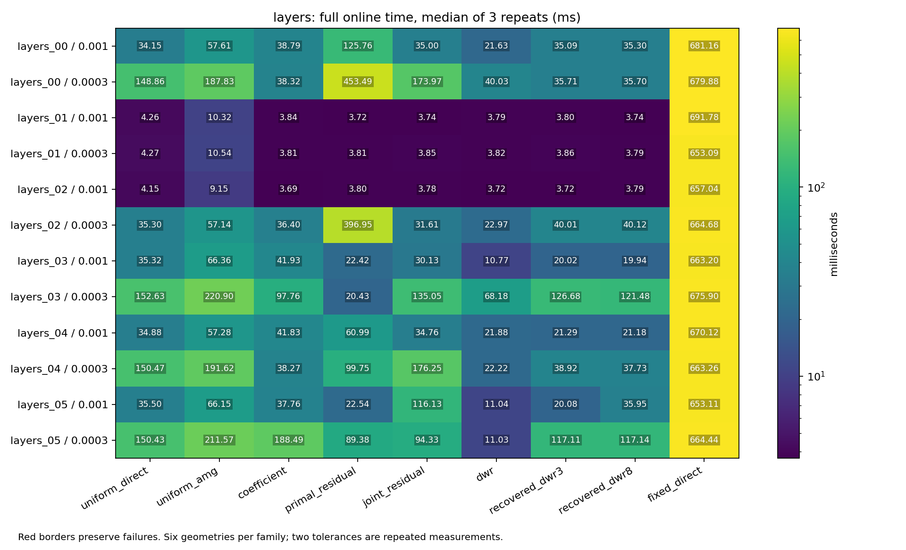
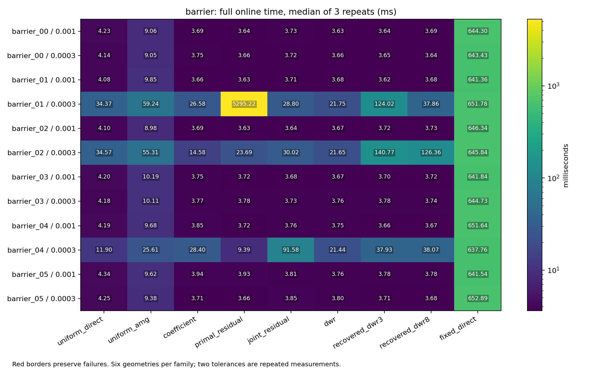
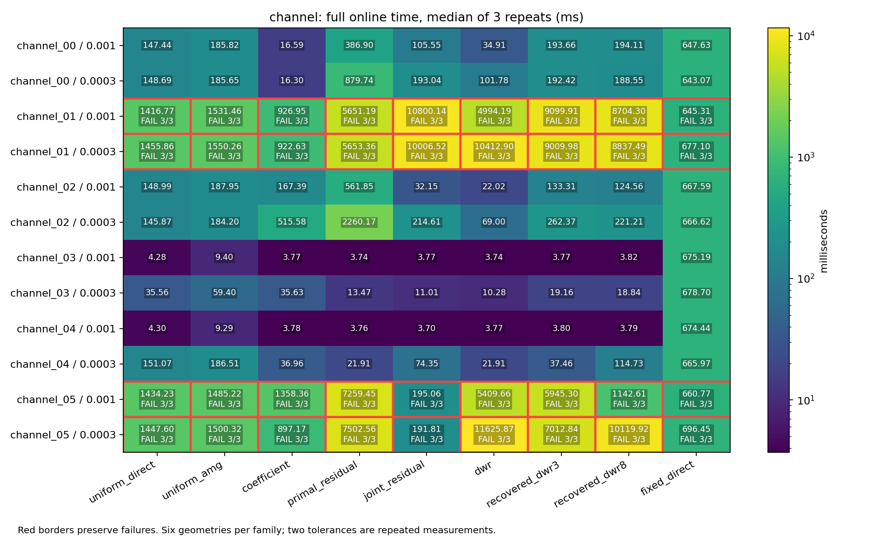
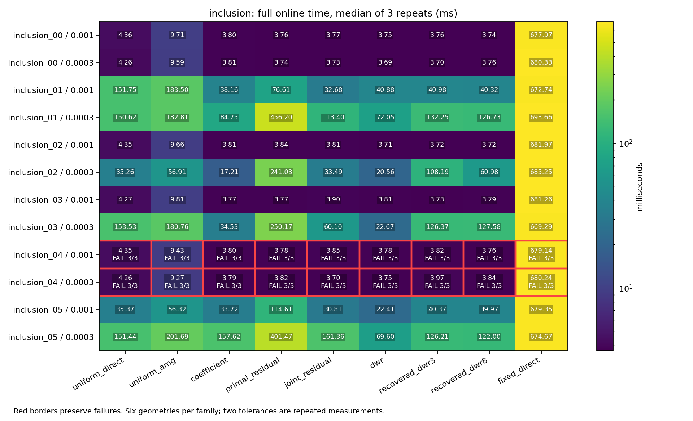

# 第十五阶段C：新几何经典确认

24个新几何、两个容限、九方法、三次重复，共1296条路径；成功1134，失败162。数据契约检查119346项通过。

这是同批次的经典方法比较，没有训练AI。参考精度为经验稳定性，失败样本始终保留。

## 预定投入筛查

决定：`STOP_CURRENT_ESTIMATOR_REPLACEMENT_BRANCH`。

| 材料族 | 两容限均通过的几何 | 保留作有限设计 |
|---|---:|---|
| layers | 1/6 | 否 |
| barrier | 0/6 | 否 |
| channel | 1/6 | 否 |
| inclusion | 1/6 | 否 |

门槛来自运行前协议：每族至少4/6几何、每几何两个容限均通过数值、成本必要条件和目标信息条件。事后最快对照是严格筛查参照，不是在线选择策略。该筛查即使通过也不是G1完整批准或AI净收益。

| 方法 | 成功/总数 | 失败原因 |
|---|---:|---|
| uniform_direct | 126/144 | {'reference_unqualified': 18} |
| uniform_amg | 126/144 | {'reference_unqualified': 18} |
| coefficient | 126/144 | {'reference_unqualified': 18} |
| primal_residual | 126/144 | {'reference_unqualified': 18} |
| joint_residual | 126/144 | {'reference_unqualified': 18} |
| dwr | 126/144 | {'reference_unqualified': 18} |
| recovered_dwr3 | 126/144 | {'reference_unqualified': 18} |
| recovered_dwr8 | 126/144 | {'reference_unqualified': 18} |
| fixed_direct | 126/144 | {'reference_unqualified': 18} |

## 逐设置筛查

中间费用免费是假设轨迹不变的算术情景，保留最终核验；实际算法不能免费预知终止层。时间/自由度比只与同一设置中最快的成功非DWR对照比较。全部方法成功才允许批准设置。

| 几何 | τ | 最快对照 | DWR时间比 | DWR自由度比 | 中间费用占比 | 假设剩余时间比 | 数值/成本/信息 | 通过 |
|---|---:|---|---:|---:|---:|---:|---|---|
| layers_00 | 0.001 | uniform_direct | 0.633 | 0.219 | 45.1% | 0.347 | True/True/True | True |
| layers_00 | 0.0003 | recovered_dwr8 | 1.121 | 1.036 | 46.7% | 0.597 | True/True/False | False |
| layers_01 | 0.001 | primal_residual | 1.020 | 1.000 | 0.0% | 1.020 | True/False/False | False |
| layers_01 | 0.0003 | recovered_dwr8 | 1.006 | 1.000 | 0.0% | 1.006 | True/False/False | False |
| layers_02 | 0.001 | coefficient | 1.007 | 1.000 | 0.0% | 1.007 | True/False/False | False |
| layers_02 | 0.0003 | joint_residual | 0.727 | 0.664 | 44.7% | 0.394 | True/True/True | True |
| layers_03 | 0.001 | recovered_dwr8 | 0.540 | 0.519 | 37.2% | 0.338 | True/True/True | True |
| layers_03 | 0.0003 | primal_residual | 3.337 | 3.969 | 47.6% | 1.749 | True/False/False | False |
| layers_04 | 0.001 | recovered_dwr8 | 1.033 | 0.963 | 45.2% | 0.565 | True/True/False | False |
| layers_04 | 0.0003 | recovered_dwr8 | 0.589 | 0.481 | 44.3% | 0.328 | True/True/True | True |
| layers_05 | 0.001 | recovered_dwr3 | 0.550 | 0.532 | 35.9% | 0.352 | True/True/True | True |
| layers_05 | 0.0003 | primal_residual | 0.123 | 0.091 | 36.0% | 0.079 | True/True/True | True |
| barrier_00 | 0.001 | primal_residual | 0.997 | 1.000 | 0.0% | 0.997 | True/False/False | False |
| barrier_00 | 0.0003 | recovered_dwr8 | 1.005 | 1.000 | 0.0% | 1.005 | True/False/False | False |
| barrier_01 | 0.001 | recovered_dwr3 | 1.016 | 1.000 | 0.0% | 1.016 | True/False/False | False |
| barrier_01 | 0.0003 | coefficient | 0.818 | 0.365 | 45.3% | 0.446 | True/True/True | True |
| barrier_02 | 0.001 | primal_residual | 1.010 | 1.000 | 0.0% | 1.010 | True/False/False | False |
| barrier_02 | 0.0003 | coefficient | 1.485 | 0.867 | 45.6% | 0.807 | True/False/False | False |
| barrier_03 | 0.001 | joint_residual | 0.998 | 1.000 | 0.0% | 0.998 | True/False/False | False |
| barrier_03 | 0.0003 | joint_residual | 1.007 | 1.000 | 0.0% | 1.007 | True/False/False | False |
| barrier_04 | 0.001 | recovered_dwr3 | 1.024 | 1.000 | 0.0% | 1.024 | True/False/False | False |
| barrier_04 | 0.0003 | primal_residual | 2.284 | 3.541 | 43.3% | 1.295 | True/False/False | False |
| barrier_05 | 0.001 | recovered_dwr3 | 0.995 | 1.000 | 0.0% | 0.995 | True/False/False | False |
| barrier_05 | 0.0003 | primal_residual | 1.038 | 1.000 | 0.0% | 1.038 | True/False/False | False |
| channel_00 | 0.001 | coefficient | 2.104 | 1.010 | 48.1% | 1.080 | True/False/False | False |
| channel_00 | 0.0003 | coefficient | 6.243 | 3.602 | 49.9% | 3.126 | True/False/False | False |
| channel_01 | 0.001 | None | — | — | 44.9% | — | False/False/False | False |
| channel_01 | 0.0003 | None | — | — | 45.4% | — | False/False/False | False |
| channel_02 | 0.001 | joint_residual | 0.685 | 0.544 | 44.4% | 0.380 | True/True/True | True |
| channel_02 | 0.0003 | uniform_direct | 0.473 | 0.188 | 48.7% | 0.243 | True/True/True | True |
| channel_03 | 0.001 | primal_residual | 1.000 | 1.000 | 0.0% | 1.000 | True/False/False | False |
| channel_03 | 0.0003 | joint_residual | 0.934 | 1.054 | 37.9% | 0.577 | True/True/False | False |
| channel_04 | 0.001 | joint_residual | 1.019 | 1.000 | 0.0% | 1.019 | True/False/False | False |
| channel_04 | 0.0003 | primal_residual | 1.000 | 1.258 | 44.5% | 0.555 | True/True/False | False |
| channel_05 | 0.001 | None | — | — | 46.6% | — | False/False/False | False |
| channel_05 | 0.0003 | None | — | — | 44.1% | — | False/False/False | False |
| inclusion_00 | 0.001 | recovered_dwr8 | 1.004 | 1.000 | 0.0% | 1.004 | True/False/False | False |
| inclusion_00 | 0.0003 | recovered_dwr3 | 0.998 | 1.000 | 0.0% | 0.998 | True/False/False | False |
| inclusion_01 | 0.001 | joint_residual | 1.251 | 1.257 | 46.5% | 0.671 | True/True/False | False |
| inclusion_01 | 0.0003 | coefficient | 0.850 | 0.516 | 48.7% | 0.440 | True/True/True | True |
| inclusion_02 | 0.001 | recovered_dwr8 | 0.999 | 1.000 | 0.0% | 0.999 | True/False/False | False |
| inclusion_02 | 0.0003 | coefficient | 1.195 | 0.550 | 45.6% | 0.650 | True/True/True | True |
| inclusion_03 | 0.001 | recovered_dwr3 | 1.023 | 1.000 | 0.0% | 1.023 | True/False/False | False |
| inclusion_03 | 0.0003 | coefficient | 0.657 | 0.313 | 44.3% | 0.367 | True/True/True | True |
| inclusion_04 | 0.001 | None | — | — | 0.0% | — | False/False/False | False |
| inclusion_04 | 0.0003 | None | — | — | 0.0% | — | False/False/False | False |
| inclusion_05 | 0.001 | joint_residual | 0.727 | 0.692 | 45.2% | 0.399 | True/True/True | True |
| inclusion_05 | 0.0003 | recovered_dwr8 | 0.571 | 0.512 | 49.2% | 0.290 | True/True/True | True |

## 参考稳定性

| 几何 | 准入 | 最细级差/τmin | 求积差/τmin | P1交叉差/τmin | 失败项 |
|---|---|---:|---:|---:|---|
| layers_00 | True | 1.26e-06 | 3.08e-09 | 0.000787 | 无 |
| layers_01 | True | 2.5e-07 | 5.89e-11 | 1.4e-05 | 无 |
| layers_02 | True | 1.37e-07 | 9.66e-10 | 0.000216 | 无 |
| layers_03 | True | 1.61e-06 | 6.48e-09 | 0.00158 | 无 |
| layers_04 | True | 2.15e-06 | 3.94e-09 | 0.00106 | 无 |
| layers_05 | True | 2.84e-06 | 8.1e-09 | 0.00196 | 无 |
| barrier_00 | True | 1.19e-07 | 5.91e-10 | 0.000118 | 无 |
| barrier_01 | True | 1.17e-06 | 2.21e-09 | 0.000383 | 无 |
| barrier_02 | True | 1.31e-06 | 2.47e-09 | 0.000399 | 无 |
| barrier_03 | True | 1.24e-07 | 4.29e-10 | 9.13e-05 | 无 |
| barrier_04 | True | 1.3e-07 | 1.01e-09 | 0.000169 | 无 |
| barrier_05 | True | 3.9e-07 | 9.82e-12 | 1.52e-06 | 无 |
| channel_00 | True | 8.05e-06 | 2.28e-09 | 0.0051 | 无 |
| channel_01 | False | 0.000849 | 9.36e-08 | 0.586 | independent_order |
| channel_02 | True | 7.76e-06 | 1.25e-10 | 0.00461 | 无 |
| channel_03 | True | 3.32e-07 | 8.63e-09 | 0.00024 | 无 |
| channel_04 | True | 2.34e-06 | 4.4e-09 | 0.000776 | 无 |
| channel_05 | False | 0.000817 | 2.84e-07 | 0.542 | independent_order |
| inclusion_00 | True | 0.00306 | 1.53e-09 | 0.0026 | 无 |
| inclusion_01 | True | 0.015 | 1.47e-09 | 0.0131 | 无 |
| inclusion_02 | True | 0.00241 | 8.64e-10 | 0.00187 | 无 |
| inclusion_03 | True | 0.00841 | 1.36e-09 | 0.00672 | 无 |
| inclusion_04 | False | 1.06e-06 | 1.32e-09 | 0.00013 | stable_difference_sign |
| inclusion_05 | True | 0.0114 | 1.75e-09 | 0.0099 | 无 |

## 完整时间图

## 全部配对记录

| 几何 | τ | 方法 | 成功/3 | 时间中位ms | 范围ms | 最大q | 最终P1自由度中位 |
|---|---:|---|---:|---:|---|---:|---:|
| layers_00 | 0.001 | uniform_direct | 3/3 | 34.153 | 34.131–36.258 | 0.060 | 961 |
| layers_00 | 0.001 | uniform_amg | 3/3 | 57.611 | 55.967–60.831 | 0.060 | 961 |
| layers_00 | 0.001 | coefficient | 3/3 | 38.793 | 37.731–38.834 | 0.052 | 923 |
| layers_00 | 0.001 | primal_residual | 3/3 | 125.759 | 123.779–126.658 | 0.357 | 1514 |
| layers_00 | 0.001 | joint_residual | 3/3 | 34.999 | 34.863–36.680 | 0.302 | 343 |
| layers_00 | 0.001 | dwr | 3/3 | 21.626 | 21.303–22.380 | 0.192 | 210 |
| layers_00 | 0.001 | recovered_dwr3 | 3/3 | 35.094 | 35.074–36.171 | 0.020 | 410 |
| layers_00 | 0.001 | recovered_dwr8 | 3/3 | 35.302 | 35.100–36.320 | 0.020 | 413 |
| layers_00 | 0.001 | fixed_direct | 3/3 | 681.158 | 671.808–698.482 | 0.001 | 65025 |
| layers_00 | 0.0003 | uniform_direct | 3/3 | 148.859 | 148.499–150.082 | 0.050 | 3969 |
| layers_00 | 0.0003 | uniform_amg | 3/3 | 187.829 | 183.351–189.635 | 0.050 | 3969 |
| layers_00 | 0.0003 | coefficient | 3/3 | 38.320 | 38.068–38.948 | 0.175 | 923 |
| layers_00 | 0.0003 | primal_residual | 3/3 | 453.492 | 453.076–459.164 | 0.346 | 5219 |
| layers_00 | 0.0003 | joint_residual | 3/3 | 173.971 | 172.846–176.001 | 0.040 | 2533 |
| layers_00 | 0.0003 | dwr | 3/3 | 40.035 | 39.587–40.757 | 0.172 | 428 |
| layers_00 | 0.0003 | recovered_dwr3 | 3/3 | 35.713 | 35.289–36.036 | 0.066 | 410 |
| layers_00 | 0.0003 | recovered_dwr8 | 3/3 | 35.700 | 35.009–35.803 | 0.067 | 413 |
| layers_00 | 0.0003 | fixed_direct | 3/3 | 679.876 | 674.566–681.094 | 0.003 | 65025 |
| layers_01 | 0.001 | uniform_direct | 3/3 | 4.255 | 4.223–4.455 | 0.015 | 49 |
| layers_01 | 0.001 | uniform_amg | 3/3 | 10.322 | 10.293–10.708 | 0.015 | 49 |
| layers_01 | 0.001 | coefficient | 3/3 | 3.836 | 3.828–3.901 | 0.015 | 49 |
| layers_01 | 0.001 | primal_residual | 3/3 | 3.722 | 3.652–3.743 | 0.015 | 49 |
| layers_01 | 0.001 | joint_residual | 3/3 | 3.744 | 3.659–3.805 | 0.015 | 49 |
| layers_01 | 0.001 | dwr | 3/3 | 3.795 | 3.682–3.849 | 0.015 | 49 |
| layers_01 | 0.001 | recovered_dwr3 | 3/3 | 3.801 | 3.612–3.814 | 0.015 | 49 |
| layers_01 | 0.001 | recovered_dwr8 | 3/3 | 3.741 | 3.682–3.825 | 0.015 | 49 |
| layers_01 | 0.001 | fixed_direct | 3/3 | 691.778 | 682.603–700.753 | 0.000 | 65025 |
| layers_01 | 0.0003 | uniform_direct | 3/3 | 4.271 | 4.227–4.291 | 0.049 | 49 |
| layers_01 | 0.0003 | uniform_amg | 3/3 | 10.538 | 10.424–10.551 | 0.049 | 49 |
| layers_01 | 0.0003 | coefficient | 3/3 | 3.806 | 3.744–3.823 | 0.049 | 49 |
| layers_01 | 0.0003 | primal_residual | 3/3 | 3.814 | 3.720–3.839 | 0.049 | 49 |
| layers_01 | 0.0003 | joint_residual | 3/3 | 3.855 | 3.834–3.905 | 0.049 | 49 |
| layers_01 | 0.0003 | dwr | 3/3 | 3.816 | 3.679–8.799 | 0.049 | 49 |
| layers_01 | 0.0003 | recovered_dwr3 | 3/3 | 3.856 | 3.694–3.864 | 0.049 | 49 |
| layers_01 | 0.0003 | recovered_dwr8 | 3/3 | 3.793 | 3.716–3.848 | 0.049 | 49 |
| layers_01 | 0.0003 | fixed_direct | 3/3 | 653.094 | 651.328–659.688 | 0.000 | 65025 |
| layers_02 | 0.001 | uniform_direct | 3/3 | 4.151 | 4.068–4.184 | 0.242 | 49 |
| layers_02 | 0.001 | uniform_amg | 3/3 | 9.147 | 9.045–9.356 | 0.242 | 49 |
| layers_02 | 0.001 | coefficient | 3/3 | 3.695 | 3.646–3.884 | 0.242 | 49 |
| layers_02 | 0.001 | primal_residual | 3/3 | 3.795 | 3.623–3.810 | 0.242 | 49 |
| layers_02 | 0.001 | joint_residual | 3/3 | 3.780 | 3.746–3.924 | 0.242 | 49 |
| layers_02 | 0.001 | dwr | 3/3 | 3.721 | 3.641–3.821 | 0.242 | 49 |
| layers_02 | 0.001 | recovered_dwr3 | 3/3 | 3.718 | 3.716–3.812 | 0.242 | 49 |
| layers_02 | 0.001 | recovered_dwr8 | 3/3 | 3.791 | 3.700–3.847 | 0.242 | 49 |
| layers_02 | 0.001 | fixed_direct | 3/3 | 657.041 | 654.411–665.519 | 0.000 | 65025 |
| layers_02 | 0.0003 | uniform_direct | 3/3 | 35.301 | 34.371–36.379 | 0.055 | 961 |
| layers_02 | 0.0003 | uniform_amg | 3/3 | 57.139 | 56.755–58.838 | 0.055 | 961 |
| layers_02 | 0.0003 | coefficient | 3/3 | 36.398 | 36.327–36.603 | 0.030 | 867 |
| layers_02 | 0.0003 | primal_residual | 3/3 | 396.950 | 393.110–398.204 | 0.197 | 5226 |
| layers_02 | 0.0003 | joint_residual | 3/3 | 31.611 | 31.510–32.768 | 0.367 | 339 |
| layers_02 | 0.0003 | dwr | 3/3 | 22.970 | 22.493–23.348 | 0.184 | 225 |
| layers_02 | 0.0003 | recovered_dwr3 | 3/3 | 40.010 | 39.473–40.460 | 0.321 | 492 |
| layers_02 | 0.0003 | recovered_dwr8 | 3/3 | 40.116 | 39.598–40.547 | 0.352 | 503 |
| layers_02 | 0.0003 | fixed_direct | 3/3 | 664.685 | 650.361–675.054 | 0.001 | 65025 |
| layers_03 | 0.001 | uniform_direct | 3/3 | 35.317 | 34.673–36.098 | 0.121 | 961 |
| layers_03 | 0.001 | uniform_amg | 3/3 | 66.360 | 65.427–67.053 | 0.121 | 961 |
| layers_03 | 0.001 | coefficient | 3/3 | 41.930 | 41.112–42.633 | 0.162 | 928 |
| layers_03 | 0.001 | primal_residual | 3/3 | 22.424 | 22.380–22.636 | 0.132 | 194 |
| layers_03 | 0.001 | joint_residual | 3/3 | 30.131 | 30.113–30.309 | 0.336 | 269 |
| layers_03 | 0.001 | dwr | 3/3 | 10.772 | 10.720–10.852 | 0.450 | 97 |
| layers_03 | 0.001 | recovered_dwr3 | 3/3 | 20.023 | 19.776–20.192 | 0.179 | 188 |
| layers_03 | 0.001 | recovered_dwr8 | 3/3 | 19.945 | 19.767–20.076 | 0.208 | 187 |
| layers_03 | 0.001 | fixed_direct | 3/3 | 663.196 | 659.987–665.282 | 0.002 | 65025 |
| layers_03 | 0.0003 | uniform_direct | 3/3 | 152.631 | 151.144–154.560 | 0.101 | 3969 |
| layers_03 | 0.0003 | uniform_amg | 3/3 | 220.898 | 219.626–221.182 | 0.101 | 3969 |
| layers_03 | 0.0003 | coefficient | 3/3 | 97.760 | 96.741–98.806 | 0.081 | 1964 |
| layers_03 | 0.0003 | primal_residual | 3/3 | 20.432 | 20.208–20.506 | 0.439 | 194 |
| layers_03 | 0.0003 | joint_residual | 3/3 | 135.050 | 134.240–140.038 | 0.472 | 1768 |
| layers_03 | 0.0003 | dwr | 3/3 | 68.178 | 67.960–69.050 | 0.199 | 770 |
| layers_03 | 0.0003 | recovered_dwr3 | 3/3 | 126.675 | 126.566–129.534 | 0.402 | 1626 |
| layers_03 | 0.0003 | recovered_dwr8 | 3/3 | 121.476 | 119.992–122.233 | 0.426 | 1567 |
| layers_03 | 0.0003 | fixed_direct | 3/3 | 675.905 | 664.896–721.993 | 0.006 | 65025 |
| layers_04 | 0.001 | uniform_direct | 3/3 | 34.877 | 34.791–35.261 | 0.081 | 961 |
| layers_04 | 0.001 | uniform_amg | 3/3 | 57.278 | 56.633–57.825 | 0.081 | 961 |
| layers_04 | 0.001 | coefficient | 3/3 | 41.825 | 41.554–42.111 | 0.033 | 899 |
| layers_04 | 0.001 | primal_residual | 3/3 | 60.985 | 60.486–60.986 | 0.359 | 822 |
| layers_04 | 0.001 | joint_residual | 3/3 | 34.761 | 34.598–35.092 | 0.194 | 324 |
| layers_04 | 0.001 | dwr | 3/3 | 21.875 | 21.831–22.173 | 0.083 | 207 |
| layers_04 | 0.001 | recovered_dwr3 | 3/3 | 21.287 | 21.247–21.491 | 0.117 | 223 |
| layers_04 | 0.001 | recovered_dwr8 | 3/3 | 21.184 | 21.157–21.433 | 0.051 | 215 |
| layers_04 | 0.001 | fixed_direct | 3/3 | 670.116 | 664.494–684.337 | 0.001 | 65025 |
| layers_04 | 0.0003 | uniform_direct | 3/3 | 150.465 | 149.874–153.304 | 0.068 | 3969 |
| layers_04 | 0.0003 | uniform_amg | 3/3 | 191.619 | 187.397–195.133 | 0.068 | 3969 |
| layers_04 | 0.0003 | coefficient | 3/3 | 38.265 | 37.914–38.322 | 0.112 | 899 |
| layers_04 | 0.0003 | primal_residual | 3/3 | 99.752 | 99.202–100.629 | 0.274 | 1584 |
| layers_04 | 0.0003 | joint_residual | 3/3 | 176.252 | 175.673–179.580 | 0.015 | 2601 |
| layers_04 | 0.0003 | dwr | 3/3 | 22.221 | 21.880–22.477 | 0.278 | 207 |
| layers_04 | 0.0003 | recovered_dwr3 | 3/3 | 38.916 | 38.682–39.691 | 0.015 | 458 |
| layers_04 | 0.0003 | recovered_dwr8 | 3/3 | 37.733 | 37.714–38.858 | 0.065 | 430 |
| layers_04 | 0.0003 | fixed_direct | 3/3 | 663.257 | 661.653–670.350 | 0.004 | 65025 |
| layers_05 | 0.001 | uniform_direct | 3/3 | 35.495 | 35.191–37.124 | 0.149 | 961 |
| layers_05 | 0.001 | uniform_amg | 3/3 | 66.146 | 64.298–66.910 | 0.149 | 961 |
| layers_05 | 0.001 | coefficient | 3/3 | 37.762 | 37.297–38.048 | 0.319 | 928 |
| layers_05 | 0.001 | primal_residual | 3/3 | 22.541 | 22.207–22.582 | 0.387 | 194 |
| layers_05 | 0.001 | joint_residual | 3/3 | 116.132 | 116.001–118.055 | 0.102 | 1146 |
| layers_05 | 0.001 | dwr | 3/3 | 11.036 | 10.979–11.931 | 0.167 | 100 |
| layers_05 | 0.001 | recovered_dwr3 | 3/3 | 20.083 | 19.982–20.577 | 0.161 | 188 |
| layers_05 | 0.001 | recovered_dwr8 | 3/3 | 35.947 | 35.169–36.153 | 0.466 | 405 |
| layers_05 | 0.001 | fixed_direct | 3/3 | 653.112 | 652.784–661.817 | 0.002 | 65025 |
| layers_05 | 0.0003 | uniform_direct | 3/3 | 150.429 | 150.108–150.827 | 0.125 | 3969 |
| layers_05 | 0.0003 | uniform_amg | 3/3 | 211.570 | 210.345–217.044 | 0.125 | 3969 |
| layers_05 | 0.0003 | coefficient | 3/3 | 188.493 | 186.930–189.666 | 0.076 | 4093 |
| layers_05 | 0.0003 | primal_residual | 3/3 | 89.377 | 88.751–89.816 | 0.097 | 1093 |
| layers_05 | 0.0003 | joint_residual | 3/3 | 94.331 | 93.318–95.184 | 0.341 | 1146 |
| layers_05 | 0.0003 | dwr | 3/3 | 11.035 | 10.969–11.259 | 0.556 | 100 |
| layers_05 | 0.0003 | recovered_dwr3 | 3/3 | 117.105 | 115.391–117.817 | 0.462 | 1496 |
| layers_05 | 0.0003 | recovered_dwr8 | 3/3 | 117.140 | 117.027–117.428 | 0.500 | 1488 |
| layers_05 | 0.0003 | fixed_direct | 3/3 | 664.435 | 654.763–668.192 | 0.008 | 65025 |
| barrier_00 | 0.001 | uniform_direct | 3/3 | 4.227 | 4.197–4.272 | 0.112 | 49 |
| barrier_00 | 0.001 | uniform_amg | 3/3 | 9.064 | 9.062–9.201 | 0.112 | 49 |
| barrier_00 | 0.001 | coefficient | 3/3 | 3.690 | 3.628–3.695 | 0.112 | 49 |
| barrier_00 | 0.001 | primal_residual | 3/3 | 3.636 | 3.594–3.700 | 0.112 | 49 |
| barrier_00 | 0.001 | joint_residual | 3/3 | 3.731 | 3.643–3.736 | 0.112 | 49 |
| barrier_00 | 0.001 | dwr | 3/3 | 3.626 | 3.606–3.628 | 0.112 | 49 |
| barrier_00 | 0.001 | recovered_dwr3 | 3/3 | 3.638 | 3.613–4.025 | 0.112 | 49 |
| barrier_00 | 0.001 | recovered_dwr8 | 3/3 | 3.688 | 3.647–3.937 | 0.112 | 49 |
| barrier_00 | 0.001 | fixed_direct | 3/3 | 644.304 | 632.606–645.981 | 0.000 | 65025 |
| barrier_00 | 0.0003 | uniform_direct | 3/3 | 4.142 | 3.700–4.233 | 0.373 | 49 |
| barrier_00 | 0.0003 | uniform_amg | 3/3 | 9.046 | 8.957–9.235 | 0.373 | 49 |
| barrier_00 | 0.0003 | coefficient | 3/3 | 3.754 | 3.746–3.760 | 0.373 | 49 |
| barrier_00 | 0.0003 | primal_residual | 3/3 | 3.661 | 3.581–3.720 | 0.373 | 49 |
| barrier_00 | 0.0003 | joint_residual | 3/3 | 3.722 | 3.676–3.749 | 0.373 | 49 |
| barrier_00 | 0.0003 | dwr | 3/3 | 3.659 | 3.574–3.666 | 0.373 | 49 |
| barrier_00 | 0.0003 | recovered_dwr3 | 3/3 | 3.653 | 3.596–3.685 | 0.373 | 49 |
| barrier_00 | 0.0003 | recovered_dwr8 | 3/3 | 3.641 | 3.636–4.219 | 0.373 | 49 |
| barrier_00 | 0.0003 | fixed_direct | 3/3 | 643.434 | 642.678–645.949 | 0.000 | 65025 |
| barrier_01 | 0.001 | uniform_direct | 3/3 | 4.083 | 3.908–4.207 | 0.355 | 49 |
| barrier_01 | 0.001 | uniform_amg | 3/3 | 9.846 | 9.785–10.021 | 0.355 | 49 |
| barrier_01 | 0.001 | coefficient | 3/3 | 3.661 | 3.646–3.690 | 0.355 | 49 |
| barrier_01 | 0.001 | primal_residual | 3/3 | 3.625 | 3.620–3.663 | 0.355 | 49 |
| barrier_01 | 0.001 | joint_residual | 3/3 | 3.714 | 3.623–3.726 | 0.355 | 49 |
| barrier_01 | 0.001 | dwr | 3/3 | 3.681 | 3.672–3.695 | 0.355 | 49 |
| barrier_01 | 0.001 | recovered_dwr3 | 3/3 | 3.624 | 3.616–3.663 | 0.355 | 49 |
| barrier_01 | 0.001 | recovered_dwr8 | 3/3 | 3.682 | 3.615–4.148 | 0.355 | 49 |
| barrier_01 | 0.001 | fixed_direct | 3/3 | 641.356 | 640.121–644.421 | 0.000 | 65025 |
| barrier_01 | 0.0003 | uniform_direct | 3/3 | 34.374 | 33.118–34.481 | 0.097 | 961 |
| barrier_01 | 0.0003 | uniform_amg | 3/3 | 59.242 | 58.569–60.894 | 0.097 | 961 |
| barrier_01 | 0.0003 | coefficient | 3/3 | 26.580 | 26.482–27.264 | 0.304 | 565 |
| barrier_01 | 0.0003 | primal_residual | 3/3 | 5295.220 | 5291.684–5344.442 | 0.208 | 35300 |
| barrier_01 | 0.0003 | joint_residual | 3/3 | 28.802 | 28.722–29.508 | 0.330 | 329 |
| barrier_01 | 0.0003 | dwr | 3/3 | 21.751 | 21.218–21.829 | 0.086 | 206 |
| barrier_01 | 0.0003 | recovered_dwr3 | 3/3 | 124.022 | 119.402–124.748 | 0.193 | 1587 |
| barrier_01 | 0.0003 | recovered_dwr8 | 3/3 | 37.857 | 37.266–38.016 | 0.344 | 454 |
| barrier_01 | 0.0003 | fixed_direct | 3/3 | 651.780 | 644.669–653.806 | 0.002 | 65025 |
| barrier_02 | 0.001 | uniform_direct | 3/3 | 4.103 | 3.969–4.299 | 0.374 | 49 |
| barrier_02 | 0.001 | uniform_amg | 3/3 | 8.980 | 8.946–9.632 | 0.374 | 49 |
| barrier_02 | 0.001 | coefficient | 3/3 | 3.686 | 3.658–3.739 | 0.374 | 49 |
| barrier_02 | 0.001 | primal_residual | 3/3 | 3.629 | 3.619–3.732 | 0.374 | 49 |
| barrier_02 | 0.001 | joint_residual | 3/3 | 3.639 | 3.604–3.684 | 0.374 | 49 |
| barrier_02 | 0.001 | dwr | 3/3 | 3.665 | 3.654–3.670 | 0.374 | 49 |
| barrier_02 | 0.001 | recovered_dwr3 | 3/3 | 3.717 | 3.650–3.860 | 0.374 | 49 |
| barrier_02 | 0.001 | recovered_dwr8 | 3/3 | 3.727 | 3.640–3.734 | 0.374 | 49 |
| barrier_02 | 0.001 | fixed_direct | 3/3 | 646.340 | 635.484–647.647 | 0.000 | 65025 |
| barrier_02 | 0.0003 | uniform_direct | 3/3 | 34.566 | 34.520–34.711 | 0.101 | 961 |
| barrier_02 | 0.0003 | uniform_amg | 3/3 | 55.306 | 54.993–56.292 | 0.101 | 961 |
| barrier_02 | 0.0003 | coefficient | 3/3 | 14.581 | 14.469–14.980 | 0.504 | 240 |
| barrier_02 | 0.0003 | primal_residual | 3/3 | 23.687 | 23.192–23.962 | 0.269 | 172 |
| barrier_02 | 0.0003 | joint_residual | 3/3 | 30.019 | 29.563–30.943 | 0.142 | 269 |
| barrier_02 | 0.0003 | dwr | 3/3 | 21.652 | 21.637–22.027 | 0.308 | 208 |
| barrier_02 | 0.0003 | recovered_dwr3 | 3/3 | 140.774 | 140.313–141.859 | 0.149 | 1845 |
| barrier_02 | 0.0003 | recovered_dwr8 | 3/3 | 126.364 | 125.227–127.666 | 0.133 | 1638 |
| barrier_02 | 0.0003 | fixed_direct | 3/3 | 645.842 | 644.020–647.737 | 0.002 | 65025 |
| barrier_03 | 0.001 | uniform_direct | 3/3 | 4.198 | 4.192–4.319 | 0.091 | 49 |
| barrier_03 | 0.001 | uniform_amg | 3/3 | 10.189 | 10.180–10.771 | 0.091 | 49 |
| barrier_03 | 0.001 | coefficient | 3/3 | 3.749 | 3.730–3.936 | 0.091 | 49 |
| barrier_03 | 0.001 | primal_residual | 3/3 | 3.717 | 3.675–3.767 | 0.091 | 49 |
| barrier_03 | 0.001 | joint_residual | 3/3 | 3.678 | 3.641–3.744 | 0.091 | 49 |
| barrier_03 | 0.001 | dwr | 3/3 | 3.671 | 3.670–3.712 | 0.091 | 49 |
| barrier_03 | 0.001 | recovered_dwr3 | 3/3 | 3.701 | 3.664–3.736 | 0.091 | 49 |
| barrier_03 | 0.001 | recovered_dwr8 | 3/3 | 3.722 | 3.719–3.771 | 0.091 | 49 |
| barrier_03 | 0.001 | fixed_direct | 3/3 | 641.840 | 638.682–655.388 | 0.000 | 65025 |
| barrier_03 | 0.0003 | uniform_direct | 3/3 | 4.176 | 4.139–4.265 | 0.304 | 49 |
| barrier_03 | 0.0003 | uniform_amg | 3/3 | 10.107 | 10.047–10.128 | 0.304 | 49 |
| barrier_03 | 0.0003 | coefficient | 3/3 | 3.768 | 3.698–4.035 | 0.304 | 49 |
| barrier_03 | 0.0003 | primal_residual | 3/3 | 3.785 | 3.686–4.131 | 0.304 | 49 |
| barrier_03 | 0.0003 | joint_residual | 3/3 | 3.731 | 3.723–3.891 | 0.304 | 49 |
| barrier_03 | 0.0003 | dwr | 3/3 | 3.758 | 3.632–3.826 | 0.304 | 49 |
| barrier_03 | 0.0003 | recovered_dwr3 | 3/3 | 3.776 | 3.707–3.788 | 0.304 | 49 |
| barrier_03 | 0.0003 | recovered_dwr8 | 3/3 | 3.741 | 3.741–3.789 | 0.304 | 49 |
| barrier_03 | 0.0003 | fixed_direct | 3/3 | 644.725 | 643.824–659.729 | 0.000 | 65025 |
| barrier_04 | 0.001 | uniform_direct | 3/3 | 4.193 | 4.091–4.227 | 0.179 | 49 |
| barrier_04 | 0.001 | uniform_amg | 3/3 | 9.684 | 9.478–9.733 | 0.179 | 49 |
| barrier_04 | 0.001 | coefficient | 3/3 | 3.852 | 3.821–3.940 | 0.179 | 49 |
| barrier_04 | 0.001 | primal_residual | 3/3 | 3.720 | 3.691–3.913 | 0.179 | 49 |
| barrier_04 | 0.001 | joint_residual | 3/3 | 3.756 | 3.715–3.768 | 0.179 | 49 |
| barrier_04 | 0.001 | dwr | 3/3 | 3.749 | 3.643–3.793 | 0.179 | 49 |
| barrier_04 | 0.001 | recovered_dwr3 | 3/3 | 3.661 | 3.641–3.730 | 0.179 | 49 |
| barrier_04 | 0.001 | recovered_dwr8 | 3/3 | 3.665 | 3.640–3.731 | 0.179 | 49 |
| barrier_04 | 0.001 | fixed_direct | 3/3 | 651.642 | 637.558–653.490 | 0.000 | 65025 |
| barrier_04 | 0.0003 | uniform_direct | 3/3 | 11.897 | 11.830–12.096 | 0.163 | 225 |
| barrier_04 | 0.0003 | uniform_amg | 3/3 | 25.614 | 25.477–25.912 | 0.163 | 225 |
| barrier_04 | 0.0003 | coefficient | 3/3 | 28.401 | 28.248–29.429 | 0.071 | 675 |
| barrier_04 | 0.0003 | primal_residual | 3/3 | 9.388 | 9.182–9.453 | 0.357 | 61 |
| barrier_04 | 0.0003 | joint_residual | 3/3 | 91.581 | 91.439–92.064 | 0.081 | 1202 |
| barrier_04 | 0.0003 | dwr | 3/3 | 21.440 | 21.421–22.576 | 0.215 | 216 |
| barrier_04 | 0.0003 | recovered_dwr3 | 3/3 | 37.926 | 37.387–39.264 | 0.450 | 455 |
| barrier_04 | 0.0003 | recovered_dwr8 | 3/3 | 38.068 | 37.742–38.514 | 0.404 | 443 |
| barrier_04 | 0.0003 | fixed_direct | 3/3 | 637.760 | 636.648–646.772 | 0.001 | 65025 |
| barrier_05 | 0.001 | uniform_direct | 3/3 | 4.337 | 4.248–4.701 | 0.009 | 49 |
| barrier_05 | 0.001 | uniform_amg | 3/3 | 9.624 | 9.532–9.834 | 0.009 | 49 |
| barrier_05 | 0.001 | coefficient | 3/3 | 3.944 | 3.786–3.980 | 0.009 | 49 |
| barrier_05 | 0.001 | primal_residual | 3/3 | 3.934 | 3.707–4.001 | 0.009 | 49 |
| barrier_05 | 0.001 | joint_residual | 3/3 | 3.807 | 3.755–4.018 | 0.009 | 49 |
| barrier_05 | 0.001 | dwr | 3/3 | 3.765 | 3.682–3.768 | 0.009 | 49 |
| barrier_05 | 0.001 | recovered_dwr3 | 3/3 | 3.783 | 3.689–3.911 | 0.009 | 49 |
| barrier_05 | 0.001 | recovered_dwr8 | 3/3 | 3.784 | 3.699–3.811 | 0.009 | 49 |
| barrier_05 | 0.001 | fixed_direct | 3/3 | 641.535 | 638.027–653.179 | 0.000 | 65025 |
| barrier_05 | 0.0003 | uniform_direct | 3/3 | 4.255 | 4.191–4.402 | 0.030 | 49 |
| barrier_05 | 0.0003 | uniform_amg | 3/3 | 9.377 | 9.339–9.497 | 0.030 | 49 |
| barrier_05 | 0.0003 | coefficient | 3/3 | 3.715 | 3.691–3.727 | 0.030 | 49 |
| barrier_05 | 0.0003 | primal_residual | 3/3 | 3.658 | 3.652–4.464 | 0.030 | 49 |
| barrier_05 | 0.0003 | joint_residual | 3/3 | 3.851 | 3.668–4.323 | 0.030 | 49 |
| barrier_05 | 0.0003 | dwr | 3/3 | 3.798 | 3.755–3.974 | 0.030 | 49 |
| barrier_05 | 0.0003 | recovered_dwr3 | 3/3 | 3.713 | 3.660–3.797 | 0.030 | 49 |
| barrier_05 | 0.0003 | recovered_dwr8 | 3/3 | 3.684 | 3.673–3.779 | 0.030 | 49 |
| barrier_05 | 0.0003 | fixed_direct | 3/3 | 652.886 | 634.377–677.534 | 0.000 | 65025 |
| channel_00 | 0.001 | uniform_direct | 3/3 | 147.442 | 146.903–149.901 | 0.098 | 3969 |
| channel_00 | 0.001 | uniform_amg | 3/3 | 185.823 | 182.738–188.370 | 0.098 | 3969 |
| channel_00 | 0.001 | coefficient | 3/3 | 16.593 | 16.510–16.791 | 0.052 | 304 |
| channel_00 | 0.001 | primal_residual | 3/3 | 386.899 | 384.281–389.158 | 0.305 | 5258 |
| channel_00 | 0.001 | joint_residual | 3/3 | 105.553 | 103.981–105.823 | 0.137 | 1494 |
| channel_00 | 0.001 | dwr | 3/3 | 34.912 | 34.049–35.421 | 0.281 | 307 |
| channel_00 | 0.001 | recovered_dwr3 | 3/3 | 193.660 | 192.853–195.867 | 0.128 | 2480 |
| channel_00 | 0.001 | recovered_dwr8 | 3/3 | 194.110 | 191.848–195.243 | 0.144 | 2455 |
| channel_00 | 0.001 | fixed_direct | 3/3 | 647.634 | 644.679–650.828 | 0.006 | 65025 |
| channel_00 | 0.0003 | uniform_direct | 3/3 | 148.691 | 145.314–152.200 | 0.326 | 3969 |
| channel_00 | 0.0003 | uniform_amg | 3/3 | 185.654 | 180.031–186.226 | 0.326 | 3969 |
| channel_00 | 0.0003 | coefficient | 3/3 | 16.304 | 15.934–16.532 | 0.173 | 304 |
| channel_00 | 0.0003 | primal_residual | 3/3 | 879.742 | 870.587–890.675 | 0.338 | 9838 |
| channel_00 | 0.0003 | joint_residual | 3/3 | 193.038 | 192.769–194.271 | 0.108 | 2847 |
| channel_00 | 0.0003 | dwr | 3/3 | 101.780 | 100.424–101.861 | 0.114 | 1095 |
| channel_00 | 0.0003 | recovered_dwr3 | 3/3 | 192.421 | 191.296–193.357 | 0.427 | 2480 |
| channel_00 | 0.0003 | recovered_dwr8 | 3/3 | 188.549 | 188.372–194.556 | 0.481 | 2455 |
| channel_00 | 0.0003 | fixed_direct | 3/3 | 643.071 | 641.185–646.421 | 0.020 | 65025 |
| channel_01 | 0.001 | uniform_direct | 0/3 | 1416.766 | 1408.940–1514.131 | 0.704 | 65025 |
| channel_01 | 0.001 | uniform_amg | 0/3 | 1531.456 | 1531.173–1573.328 | 0.704 | 65025 |
| channel_01 | 0.001 | coefficient | 0/3 | 926.948 | 917.703–937.627 | 0.379 | 28818 |
| channel_01 | 0.001 | primal_residual | 0/3 | 5651.187 | 5650.712–5678.952 | 1.215 | 43542 |
| channel_01 | 0.001 | joint_residual | 0/3 | 10800.143 | 10704.521–11096.730 | 0.366 | 69486 |
| channel_01 | 0.001 | dwr | 0/3 | 4994.194 | 4968.133–5020.585 | 0.378 | 32163 |
| channel_01 | 0.001 | recovered_dwr3 | 0/3 | 9099.906 | 8988.598–9272.370 | 0.032 | 59282 |
| channel_01 | 0.001 | recovered_dwr8 | 0/3 | 8704.299 | 8673.496–9325.905 | 0.032 | 58128 |
| channel_01 | 0.001 | fixed_direct | 0/3 | 645.305 | 645.219–734.801 | 0.704 | 65025 |
| channel_01 | 0.0003 | uniform_direct | 0/3 | 1455.857 | 1445.030–1478.359 | 2.345 | 65025 |
| channel_01 | 0.0003 | uniform_amg | 0/3 | 1550.261 | 1511.921–1579.648 | 2.345 | 65025 |
| channel_01 | 0.0003 | coefficient | 0/3 | 922.626 | 918.912–941.689 | 1.264 | 28818 |
| channel_01 | 0.0003 | primal_residual | 0/3 | 5653.363 | 5538.988–5678.160 | 4.051 | 43542 |
| channel_01 | 0.0003 | joint_residual | 0/3 | 10006.517 | 9774.065–10034.209 | 1.221 | 69486 |
| channel_01 | 0.0003 | dwr | 0/3 | 10412.904 | 10342.341–10503.062 | 0.239 | 55159 |
| channel_01 | 0.0003 | recovered_dwr3 | 0/3 | 9009.982 | 8993.727–9419.197 | 0.106 | 59282 |
| channel_01 | 0.0003 | recovered_dwr8 | 0/3 | 8837.486 | 8655.194–9064.077 | 0.107 | 58128 |
| channel_01 | 0.0003 | fixed_direct | 0/3 | 677.102 | 668.170–713.421 | 2.345 | 65025 |
| channel_02 | 0.001 | uniform_direct | 3/3 | 148.992 | 148.468–154.669 | 0.088 | 3969 |
| channel_02 | 0.001 | uniform_amg | 3/3 | 187.952 | 185.317–188.981 | 0.088 | 3969 |
| channel_02 | 0.001 | coefficient | 3/3 | 167.388 | 164.840–170.053 | 0.055 | 3553 |
| channel_02 | 0.001 | primal_residual | 3/3 | 561.855 | 554.429–568.350 | 0.285 | 6220 |
| channel_02 | 0.001 | joint_residual | 3/3 | 32.154 | 30.950–32.281 | 0.197 | 397 |
| channel_02 | 0.001 | dwr | 3/3 | 22.018 | 21.626–22.181 | 0.276 | 216 |
| channel_02 | 0.001 | recovered_dwr3 | 3/3 | 133.307 | 131.598–139.229 | 0.217 | 1687 |
| channel_02 | 0.001 | recovered_dwr8 | 3/3 | 124.558 | 122.294–125.668 | 0.224 | 1511 |
| channel_02 | 0.001 | fixed_direct | 3/3 | 667.585 | 665.020–674.531 | 0.006 | 65025 |
| channel_02 | 0.0003 | uniform_direct | 3/3 | 145.873 | 145.347–149.510 | 0.295 | 3969 |
| channel_02 | 0.0003 | uniform_amg | 3/3 | 184.199 | 183.398–186.402 | 0.295 | 3969 |
| channel_02 | 0.0003 | coefficient | 3/3 | 515.578 | 515.160–522.382 | 0.066 | 10432 |
| channel_02 | 0.0003 | primal_residual | 3/3 | 2260.170 | 2260.126–2278.429 | 0.279 | 20422 |
| channel_02 | 0.0003 | joint_residual | 3/3 | 214.614 | 212.502–218.762 | 0.325 | 2924 |
| channel_02 | 0.0003 | dwr | 3/3 | 69.004 | 67.126–69.523 | 0.193 | 748 |
| channel_02 | 0.0003 | recovered_dwr3 | 3/3 | 262.374 | 260.620–264.918 | 0.134 | 3114 |
| channel_02 | 0.0003 | recovered_dwr8 | 3/3 | 221.210 | 220.360–222.274 | 0.020 | 2808 |
| channel_02 | 0.0003 | fixed_direct | 3/3 | 666.622 | 664.026–682.530 | 0.018 | 65025 |
| channel_03 | 0.001 | uniform_direct | 3/3 | 4.280 | 4.227–4.373 | 0.243 | 49 |
| channel_03 | 0.001 | uniform_amg | 3/3 | 9.404 | 9.201–9.433 | 0.243 | 49 |
| channel_03 | 0.001 | coefficient | 3/3 | 3.767 | 3.704–3.773 | 0.243 | 49 |
| channel_03 | 0.001 | primal_residual | 3/3 | 3.743 | 3.666–3.768 | 0.243 | 49 |
| channel_03 | 0.001 | joint_residual | 3/3 | 3.774 | 3.612–3.869 | 0.243 | 49 |
| channel_03 | 0.001 | dwr | 3/3 | 3.744 | 3.705–3.765 | 0.243 | 49 |
| channel_03 | 0.001 | recovered_dwr3 | 3/3 | 3.771 | 3.757–4.308 | 0.243 | 49 |
| channel_03 | 0.001 | recovered_dwr8 | 3/3 | 3.815 | 3.804–4.551 | 0.243 | 49 |
| channel_03 | 0.001 | fixed_direct | 3/3 | 675.193 | 664.666–675.900 | 0.000 | 65025 |
| channel_03 | 0.0003 | uniform_direct | 3/3 | 35.561 | 35.495–36.035 | 0.061 | 961 |
| channel_03 | 0.0003 | uniform_amg | 3/3 | 59.401 | 59.332–60.894 | 0.061 | 961 |
| channel_03 | 0.0003 | coefficient | 3/3 | 35.633 | 35.468–36.022 | 0.233 | 547 |
| channel_03 | 0.0003 | primal_residual | 3/3 | 13.468 | 13.433–13.556 | 0.051 | 92 |
| channel_03 | 0.0003 | joint_residual | 3/3 | 11.009 | 10.828–11.142 | 0.317 | 74 |
| channel_03 | 0.0003 | dwr | 3/3 | 10.284 | 10.232–10.509 | 0.365 | 78 |
| channel_03 | 0.0003 | recovered_dwr3 | 3/3 | 19.165 | 18.597–19.536 | 0.067 | 156 |
| channel_03 | 0.0003 | recovered_dwr8 | 3/3 | 18.844 | 18.653–19.483 | 0.083 | 152 |
| channel_03 | 0.0003 | fixed_direct | 3/3 | 678.695 | 656.594–681.758 | 0.001 | 65025 |
| channel_04 | 0.001 | uniform_direct | 3/3 | 4.302 | 4.152–4.593 | 0.548 | 49 |
| channel_04 | 0.001 | uniform_amg | 3/3 | 9.291 | 9.285–9.485 | 0.548 | 49 |
| channel_04 | 0.001 | coefficient | 3/3 | 3.778 | 3.715–3.804 | 0.548 | 49 |
| channel_04 | 0.001 | primal_residual | 3/3 | 3.756 | 3.707–3.778 | 0.548 | 49 |
| channel_04 | 0.001 | joint_residual | 3/3 | 3.703 | 3.651–3.793 | 0.548 | 49 |
| channel_04 | 0.001 | dwr | 3/3 | 3.772 | 3.681–3.815 | 0.548 | 49 |
| channel_04 | 0.001 | recovered_dwr3 | 3/3 | 3.800 | 3.781–3.819 | 0.548 | 49 |
| channel_04 | 0.001 | recovered_dwr8 | 3/3 | 3.795 | 3.774–4.450 | 0.548 | 49 |
| channel_04 | 0.001 | fixed_direct | 3/3 | 674.444 | 674.032–690.973 | 0.001 | 65025 |
| channel_04 | 0.0003 | uniform_direct | 3/3 | 151.072 | 147.168–152.805 | 0.049 | 3969 |
| channel_04 | 0.0003 | uniform_amg | 3/3 | 186.512 | 182.595–189.445 | 0.049 | 3969 |
| channel_04 | 0.0003 | coefficient | 3/3 | 36.962 | 35.827–37.610 | 0.152 | 890 |
| channel_04 | 0.0003 | primal_residual | 3/3 | 21.913 | 21.124–21.952 | 0.286 | 163 |
| channel_04 | 0.0003 | joint_residual | 3/3 | 74.354 | 72.809–74.485 | 0.137 | 954 |
| channel_04 | 0.0003 | dwr | 3/3 | 21.907 | 20.924–21.939 | 0.097 | 205 |
| channel_04 | 0.0003 | recovered_dwr3 | 3/3 | 37.459 | 36.239–37.511 | 0.443 | 439 |
| channel_04 | 0.0003 | recovered_dwr8 | 3/3 | 114.728 | 113.702–116.279 | 0.225 | 1417 |
| channel_04 | 0.0003 | fixed_direct | 3/3 | 665.972 | 660.486–673.850 | 0.003 | 65025 |
| channel_05 | 0.001 | uniform_direct | 0/3 | 1434.230 | 1430.658–1437.241 | 0.651 | 65025 |
| channel_05 | 0.001 | uniform_amg | 0/3 | 1485.221 | 1478.174–1485.473 | 0.651 | 65025 |
| channel_05 | 0.001 | coefficient | 0/3 | 1358.360 | 1331.842–1367.918 | 0.041 | 28496 |
| channel_05 | 0.001 | primal_residual | 0/3 | 7259.446 | 7092.930–7386.867 | 0.139 | 54273 |
| channel_05 | 0.001 | joint_residual | 0/3 | 195.062 | 191.299–195.536 | 0.017 | 2743 |
| channel_05 | 0.001 | dwr | 0/3 | 5409.662 | 5395.206–5424.682 | 0.235 | 32971 |
| channel_05 | 0.001 | recovered_dwr3 | 0/3 | 5945.296 | 5915.815–5995.477 | 0.155 | 41075 |
| channel_05 | 0.001 | recovered_dwr8 | 0/3 | 1142.608 | 1140.265–1148.645 | 0.318 | 11800 |
| channel_05 | 0.001 | fixed_direct | 0/3 | 660.765 | 659.063–674.857 | 0.651 | 65025 |
| channel_05 | 0.0003 | uniform_direct | 0/3 | 1447.602 | 1438.006–1475.906 | 2.169 | 65025 |
| channel_05 | 0.0003 | uniform_amg | 0/3 | 1500.317 | 1472.979–1534.394 | 2.169 | 65025 |
| channel_05 | 0.0003 | coefficient | 0/3 | 897.170 | 879.259–897.239 | 0.137 | 28496 |
| channel_05 | 0.0003 | primal_residual | 0/3 | 7502.559 | 7329.225–7515.134 | 0.465 | 54273 |
| channel_05 | 0.0003 | joint_residual | 0/3 | 191.815 | 191.679–193.437 | 0.057 | 2743 |
| channel_05 | 0.0003 | dwr | 0/3 | 11625.874 | 11441.712–11670.965 | 1.944 | 59334 |
| channel_05 | 0.0003 | recovered_dwr3 | 0/3 | 7012.835 | 6973.458–7084.829 | 0.518 | 41075 |
| channel_05 | 0.0003 | recovered_dwr8 | 0/3 | 10119.919 | 10001.014–10262.912 | 1.880 | 62847 |
| channel_05 | 0.0003 | fixed_direct | 0/3 | 696.445 | 688.910–710.610 | 2.169 | 65025 |
| inclusion_00 | 0.001 | uniform_direct | 3/3 | 4.364 | 4.318–4.371 | 0.134 | 49 |
| inclusion_00 | 0.001 | uniform_amg | 3/3 | 9.710 | 9.677–10.208 | 0.134 | 49 |
| inclusion_00 | 0.001 | coefficient | 3/3 | 3.798 | 3.778–4.296 | 0.134 | 49 |
| inclusion_00 | 0.001 | primal_residual | 3/3 | 3.760 | 3.694–3.800 | 0.134 | 49 |
| inclusion_00 | 0.001 | joint_residual | 3/3 | 3.770 | 3.756–3.820 | 0.134 | 49 |
| inclusion_00 | 0.001 | dwr | 3/3 | 3.749 | 3.738–3.769 | 0.134 | 49 |
| inclusion_00 | 0.001 | recovered_dwr3 | 3/3 | 3.765 | 3.759–4.028 | 0.134 | 49 |
| inclusion_00 | 0.001 | recovered_dwr8 | 3/3 | 3.736 | 3.731–3.821 | 0.134 | 49 |
| inclusion_00 | 0.001 | fixed_direct | 3/3 | 677.974 | 660.077–679.696 | 0.003 | 65025 |
| inclusion_00 | 0.0003 | uniform_direct | 3/3 | 4.258 | 4.156–4.448 | 0.448 | 49 |
| inclusion_00 | 0.0003 | uniform_amg | 3/3 | 9.594 | 9.569–10.171 | 0.448 | 49 |
| inclusion_00 | 0.0003 | coefficient | 3/3 | 3.807 | 3.724–4.199 | 0.448 | 49 |
| inclusion_00 | 0.0003 | primal_residual | 3/3 | 3.738 | 3.700–4.365 | 0.448 | 49 |
| inclusion_00 | 0.0003 | joint_residual | 3/3 | 3.731 | 3.683–3.826 | 0.448 | 49 |
| inclusion_00 | 0.0003 | dwr | 3/3 | 3.695 | 3.682–3.748 | 0.448 | 49 |
| inclusion_00 | 0.0003 | recovered_dwr3 | 3/3 | 3.702 | 3.702–3.761 | 0.448 | 49 |
| inclusion_00 | 0.0003 | recovered_dwr8 | 3/3 | 3.757 | 3.729–3.841 | 0.448 | 49 |
| inclusion_00 | 0.0003 | fixed_direct | 3/3 | 680.334 | 674.363–683.656 | 0.010 | 65025 |
| inclusion_01 | 0.001 | uniform_direct | 3/3 | 151.754 | 151.121–151.820 | 0.113 | 3969 |
| inclusion_01 | 0.001 | uniform_amg | 3/3 | 183.498 | 183.433–185.579 | 0.113 | 3969 |
| inclusion_01 | 0.001 | coefficient | 3/3 | 38.162 | 37.682–38.214 | 0.251 | 712 |
| inclusion_01 | 0.001 | primal_residual | 3/3 | 76.614 | 76.568–77.066 | 0.345 | 996 |
| inclusion_01 | 0.001 | joint_residual | 3/3 | 32.679 | 32.599–32.782 | 0.357 | 358 |
| inclusion_01 | 0.001 | dwr | 3/3 | 40.883 | 40.528–41.092 | 0.470 | 450 |
| inclusion_01 | 0.001 | recovered_dwr3 | 3/3 | 40.977 | 40.822–41.798 | 0.441 | 482 |
| inclusion_01 | 0.001 | recovered_dwr8 | 3/3 | 40.325 | 39.861–40.650 | 0.460 | 460 |
| inclusion_01 | 0.001 | fixed_direct | 3/3 | 672.737 | 669.659–685.475 | 0.015 | 65025 |
| inclusion_01 | 0.0003 | uniform_direct | 3/3 | 150.624 | 150.296–151.849 | 0.376 | 3969 |
| inclusion_01 | 0.0003 | uniform_amg | 3/3 | 182.814 | 180.971–183.639 | 0.376 | 3969 |
| inclusion_01 | 0.0003 | coefficient | 3/3 | 84.750 | 83.588–85.226 | 0.461 | 1538 |
| inclusion_01 | 0.0003 | primal_residual | 3/3 | 456.196 | 456.024–462.254 | 0.270 | 6414 |
| inclusion_01 | 0.0003 | joint_residual | 3/3 | 113.399 | 113.166–114.718 | 0.397 | 1400 |
| inclusion_01 | 0.0003 | dwr | 3/3 | 72.047 | 71.850–72.713 | 0.482 | 793 |
| inclusion_01 | 0.0003 | recovered_dwr3 | 3/3 | 132.246 | 129.963–134.598 | 0.365 | 1701 |
| inclusion_01 | 0.0003 | recovered_dwr8 | 3/3 | 126.735 | 126.130–128.751 | 0.410 | 1591 |
| inclusion_01 | 0.0003 | fixed_direct | 3/3 | 693.660 | 672.758–711.794 | 0.049 | 65025 |
| inclusion_02 | 0.001 | uniform_direct | 3/3 | 4.349 | 4.305–4.403 | 0.230 | 49 |
| inclusion_02 | 0.001 | uniform_amg | 3/3 | 9.660 | 9.659–9.723 | 0.230 | 49 |
| inclusion_02 | 0.001 | coefficient | 3/3 | 3.809 | 3.792–4.398 | 0.230 | 49 |
| inclusion_02 | 0.001 | primal_residual | 3/3 | 3.840 | 3.706–4.456 | 0.230 | 49 |
| inclusion_02 | 0.001 | joint_residual | 3/3 | 3.807 | 3.806–4.476 | 0.230 | 49 |
| inclusion_02 | 0.001 | dwr | 3/3 | 3.712 | 3.707–3.798 | 0.230 | 49 |
| inclusion_02 | 0.001 | recovered_dwr3 | 3/3 | 3.720 | 3.710–3.774 | 0.230 | 49 |
| inclusion_02 | 0.001 | recovered_dwr8 | 3/3 | 3.716 | 3.705–3.878 | 0.230 | 49 |
| inclusion_02 | 0.001 | fixed_direct | 3/3 | 681.971 | 677.950–704.684 | 0.002 | 65025 |
| inclusion_02 | 0.0003 | uniform_direct | 3/3 | 35.261 | 34.805–35.454 | 0.075 | 961 |
| inclusion_02 | 0.0003 | uniform_amg | 3/3 | 56.913 | 56.493–57.727 | 0.075 | 961 |
| inclusion_02 | 0.0003 | coefficient | 3/3 | 17.207 | 16.653–17.483 | 0.072 | 309 |
| inclusion_02 | 0.0003 | primal_residual | 3/3 | 241.034 | 238.140–241.906 | 0.290 | 3127 |
| inclusion_02 | 0.0003 | joint_residual | 3/3 | 33.488 | 33.236–33.723 | 0.506 | 367 |
| inclusion_02 | 0.0003 | dwr | 3/3 | 20.559 | 20.215–20.703 | 0.500 | 170 |
| inclusion_02 | 0.0003 | recovered_dwr3 | 3/3 | 108.189 | 107.662–108.492 | 0.190 | 1323 |
| inclusion_02 | 0.0003 | recovered_dwr8 | 3/3 | 60.985 | 60.784–61.221 | 0.289 | 653 |
| inclusion_02 | 0.0003 | fixed_direct | 3/3 | 685.250 | 681.911–686.339 | 0.007 | 65025 |
| inclusion_03 | 0.001 | uniform_direct | 3/3 | 4.273 | 4.272–4.291 | 0.608 | 49 |
| inclusion_03 | 0.001 | uniform_amg | 3/3 | 9.812 | 9.732–9.907 | 0.608 | 49 |
| inclusion_03 | 0.001 | coefficient | 3/3 | 3.775 | 3.759–3.841 | 0.608 | 49 |
| inclusion_03 | 0.001 | primal_residual | 3/3 | 3.771 | 3.696–4.383 | 0.608 | 49 |
| inclusion_03 | 0.001 | joint_residual | 3/3 | 3.900 | 3.796–4.382 | 0.608 | 49 |
| inclusion_03 | 0.001 | dwr | 3/3 | 3.814 | 3.754–4.443 | 0.608 | 49 |
| inclusion_03 | 0.001 | recovered_dwr3 | 3/3 | 3.730 | 3.685–3.878 | 0.608 | 49 |
| inclusion_03 | 0.001 | recovered_dwr8 | 3/3 | 3.786 | 3.758–3.818 | 0.608 | 49 |
| inclusion_03 | 0.001 | fixed_direct | 3/3 | 681.258 | 679.271–682.531 | 0.007 | 65025 |
| inclusion_03 | 0.0003 | uniform_direct | 3/3 | 153.525 | 150.601–154.078 | 0.170 | 3969 |
| inclusion_03 | 0.0003 | uniform_amg | 3/3 | 180.760 | 178.019–182.909 | 0.170 | 3969 |
| inclusion_03 | 0.0003 | coefficient | 3/3 | 34.525 | 33.908–34.812 | 0.137 | 677 |
| inclusion_03 | 0.0003 | primal_residual | 3/3 | 250.168 | 246.652–254.022 | 0.182 | 3293 |
| inclusion_03 | 0.0003 | joint_residual | 3/3 | 60.098 | 58.282–60.632 | 0.496 | 692 |
| inclusion_03 | 0.0003 | dwr | 3/3 | 22.672 | 22.658–22.718 | 0.524 | 212 |
| inclusion_03 | 0.0003 | recovered_dwr3 | 3/3 | 126.365 | 126.278–129.842 | 0.286 | 1574 |
| inclusion_03 | 0.0003 | recovered_dwr8 | 3/3 | 127.581 | 126.513–128.383 | 0.267 | 1568 |
| inclusion_03 | 0.0003 | fixed_direct | 3/3 | 669.293 | 664.906–687.600 | 0.025 | 65025 |
| inclusion_04 | 0.001 | uniform_direct | 0/3 | 4.354 | 4.234–4.412 | 0.044 | 49 |
| inclusion_04 | 0.001 | uniform_amg | 0/3 | 9.431 | 9.308–9.515 | 0.044 | 49 |
| inclusion_04 | 0.001 | coefficient | 0/3 | 3.800 | 3.747–3.896 | 0.044 | 49 |
| inclusion_04 | 0.001 | primal_residual | 0/3 | 3.777 | 3.760–3.794 | 0.044 | 49 |
| inclusion_04 | 0.001 | joint_residual | 0/3 | 3.849 | 3.783–4.303 | 0.044 | 49 |
| inclusion_04 | 0.001 | dwr | 0/3 | 3.776 | 3.731–4.275 | 0.044 | 49 |
| inclusion_04 | 0.001 | recovered_dwr3 | 0/3 | 3.819 | 3.760–4.445 | 0.044 | 49 |
| inclusion_04 | 0.001 | recovered_dwr8 | 0/3 | 3.764 | 3.697–3.835 | 0.044 | 49 |
| inclusion_04 | 0.001 | fixed_direct | 0/3 | 679.136 | 676.058–681.204 | 0.000 | 65025 |
| inclusion_04 | 0.0003 | uniform_direct | 0/3 | 4.260 | 4.246–4.321 | 0.146 | 49 |
| inclusion_04 | 0.0003 | uniform_amg | 0/3 | 9.269 | 9.191–9.377 | 0.146 | 49 |
| inclusion_04 | 0.0003 | coefficient | 0/3 | 3.788 | 3.714–3.822 | 0.146 | 49 |
| inclusion_04 | 0.0003 | primal_residual | 0/3 | 3.817 | 3.765–3.842 | 0.146 | 49 |
| inclusion_04 | 0.0003 | joint_residual | 0/3 | 3.705 | 3.702–3.813 | 0.146 | 49 |
| inclusion_04 | 0.0003 | dwr | 0/3 | 3.747 | 3.742–4.387 | 0.146 | 49 |
| inclusion_04 | 0.0003 | recovered_dwr3 | 0/3 | 3.969 | 3.783–4.374 | 0.146 | 49 |
| inclusion_04 | 0.0003 | recovered_dwr8 | 0/3 | 3.839 | 3.799–4.459 | 0.146 | 49 |
| inclusion_04 | 0.0003 | fixed_direct | 0/3 | 680.239 | 679.861–696.444 | 0.001 | 65025 |
| inclusion_05 | 0.001 | uniform_direct | 3/3 | 35.366 | 35.170–35.737 | 0.224 | 961 |
| inclusion_05 | 0.001 | uniform_amg | 3/3 | 56.319 | 56.181–56.534 | 0.224 | 961 |
| inclusion_05 | 0.001 | coefficient | 3/3 | 33.722 | 33.418–34.039 | 0.342 | 504 |
| inclusion_05 | 0.001 | primal_residual | 3/3 | 114.612 | 113.959–114.696 | 0.356 | 1624 |
| inclusion_05 | 0.001 | joint_residual | 3/3 | 30.809 | 30.583–31.338 | 0.516 | 295 |
| inclusion_05 | 0.001 | dwr | 3/3 | 22.414 | 22.052–22.569 | 0.332 | 204 |
| inclusion_05 | 0.001 | recovered_dwr3 | 3/3 | 40.368 | 39.410–40.663 | 0.391 | 449 |
| inclusion_05 | 0.001 | recovered_dwr8 | 3/3 | 39.975 | 39.443–40.035 | 0.406 | 436 |
| inclusion_05 | 0.001 | fixed_direct | 3/3 | 679.354 | 673.268–679.578 | 0.011 | 65025 |
| inclusion_05 | 0.0003 | uniform_direct | 3/3 | 151.442 | 149.884–154.890 | 0.282 | 3969 |
| inclusion_05 | 0.0003 | uniform_amg | 3/3 | 201.691 | 200.102–203.226 | 0.282 | 3969 |
| inclusion_05 | 0.0003 | coefficient | 3/3 | 157.624 | 154.017–165.748 | 0.261 | 3083 |
| inclusion_05 | 0.0003 | primal_residual | 3/3 | 401.470 | 400.829–408.374 | 0.288 | 5610 |
| inclusion_05 | 0.0003 | joint_residual | 3/3 | 161.364 | 158.606–164.335 | 0.292 | 2272 |
| inclusion_05 | 0.0003 | dwr | 3/3 | 69.601 | 69.598–70.598 | 0.418 | 763 |
| inclusion_05 | 0.0003 | recovered_dwr3 | 3/3 | 126.213 | 125.787–126.966 | 0.355 | 1580 |
| inclusion_05 | 0.0003 | recovered_dwr8 | 3/3 | 121.996 | 119.932–123.999 | 0.349 | 1490 |
| inclusion_05 | 0.0003 | fixed_direct | 3/3 | 674.672 | 669.295–676.592 | 0.037 | 65025 |

## 边界

- 24个几何来自有限对齐池的分层无放回抽样；容限与计时重复不是独立几何。
- 参考稳定性和DWR安全系数不构成连续误差证书。
- 事后最快对照不是部署选择器；中间层识别和免费估计仅是固定轨迹算术情景。
- 未训练AI；固定Jacobi恢复不是高对比可靠估计，也未证明学习必要性或新颖性。
- 本轮不覆盖一般未对齐材料、多目标循环和通量认证。
