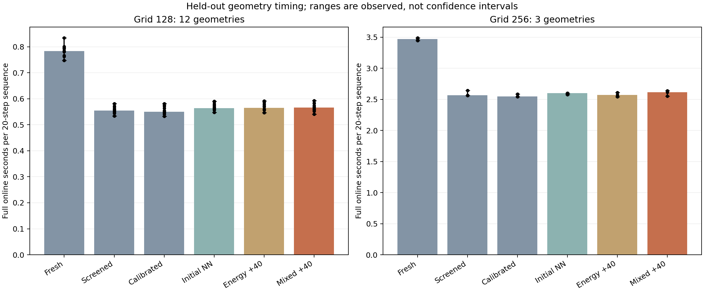
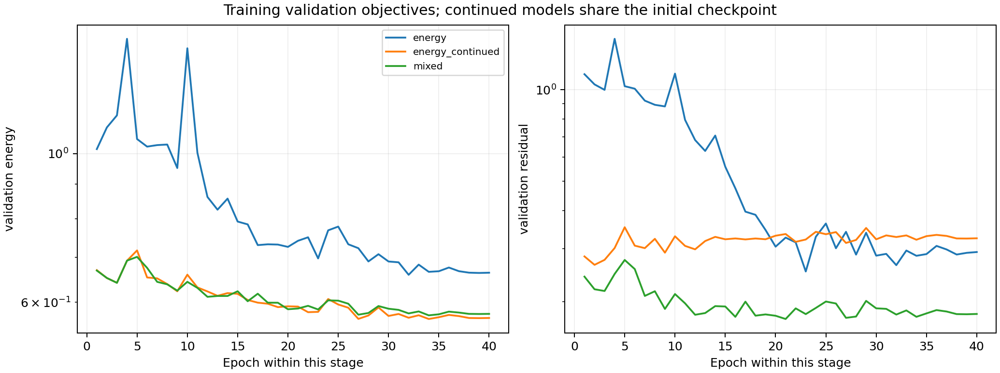

# 第三阶段报告：残差条件热启动与强经典序列基线

本报告由保存的完整运行生成，未重新执行求解器或挑选模型。问题仍为二维 Darcy/P1、对比度 1e4、恒定右端、每条序列 20 步，最终显式相对真残差要求为 1e-8。网络只改变 PCG 初值，每次 PCG 使用固定的经典 AMG 预条件器。

最终 128 网格测试包含 12 个未用于选择的物理几何；256 网格使用其中前三个，是分辨率迁移检查，不是新增独立几何。每个标签三次计时重复，共 5400 次求解测量（128 网格 4320 次，256 网格 1080 次），独立物理几何仍为 12 个。先求完整序列总时间，再对同一几何的重复取中位数，最后汇总几何中位数和范围。范围不是置信区间。

## 最终完整在线时间

### 网格 128，12 个几何

| 方法标签 | 时间中位数 / s | 几何范围 / s | 序列迭代数中位数 | 最大最终真残差 | 最大相对能量误差 |
|---|---:|---:|---:|---:|---:|
| fresh_previous | 0.784 | 0.748–0.835 | 488.0 | 9.921e-09 | 7.474e-11 |
| selected_classical | 0.555 | 0.534–0.581 | 525.5 | 9.910e-09 | 7.554e-11 |
| best_classical | 0.551 | 0.533–0.582 | 525.5 | 9.910e-09 | 7.554e-11 |
| initial_network | 0.564 | 0.548–0.591 | 522.5 | 9.889e-09 | 7.554e-11 |
| budget_control_network | 0.566 | 0.547–0.592 | 524.0 | 9.959e-09 | 1.274e-10 |
| optimized_network | 0.567 | 0.541–0.593 | 524.5 | 9.929e-09 | 7.554e-11 |

相同算法的重复标签：selected_classical、best_classical。保留各标签原始测量以复现运行，但它们不是额外独立算法或物理样本。

### 网格 256，3 个几何

| 方法标签 | 时间中位数 / s | 几何范围 / s | 序列迭代数中位数 | 最大最终真残差 | 最大相对能量误差 |
|---|---:|---:|---:|---:|---:|
| fresh_previous | 3.467 | 3.445–3.490 | 605.0 | 9.934e-09 | 1.500e-10 |
| selected_classical | 2.567 | 2.562–2.642 | 641.0 | 9.990e-09 | 1.450e-10 |
| best_classical | 2.547 | 2.541–2.586 | 641.0 | 9.990e-09 | 1.450e-10 |
| initial_network | 2.597 | 2.577–2.599 | 635.0 | 9.947e-09 | 1.538e-10 |
| budget_control_network | 2.569 | 2.542–2.607 | 639.0 | 9.923e-09 | 1.469e-10 |
| optimized_network | 2.613 | 2.550–2.640 | 640.0 | 9.979e-09 | 1.487e-10 |

相同算法的重复标签：selected_classical、best_classical。保留各标签原始测量以复现运行，但它们不是额外独立算法或物理样本。

在线成本包含组装、历史维护、层次构造或刷新、特征准备、传输、推理、校正、保护、PCG、真实残差验证及失败恢复。`correction_seconds` 已包含推理和保护子项；这些子项没有重复加入总时间。模型加载和按实际尺寸预热在在线计时外，且没有单独保存耗时；结果采用模型常驻进程口径，不代表进程冷启动后的完整部署时间。

## 配对比较与 20% 工程筛选线

先按完整算法配置（忽略标签名称）合并完全相同的经典方法；在每个几何内汇集这些别名的完整运行时间取中位数，再从不同且所有重复最终精度合格的经典配置中取最快者。网络完整时间除以该时间，小于 1 表示本次测量中更快，不超过 0.8 为预定 20% 工程门槛。即使经典方法使用了恢复也保留其完整成本与失败记录；未达共同最终精度的经典配置不作为有效基线。这个门槛不是论文发表标准。

| 网格 | 网络 | 网络/最快经典的配对中位比 | 几何比值范围 | 过20%线的几何数 |
|---|---|---:|---:|---:|
| 128 | initial_network | 1.021 | 1.016–1.028 | 0/12 |
| 128 | budget_control_network | 1.022 | 1.013–1.030 | 0/12 |
| 128 | optimized_network | 1.021 | 1.010–1.032 | 0/12 |
| 256 | initial_network | 1.017 | 1.000–1.019 | 0/3 |
| 256 | budget_control_network | 0.997 | 0.997–1.020 | 0/3 |
| 256 | optimized_network | 1.014 | 1.000–1.033 | 0/3 |

上述主口径按测试前制定的 `docs/stage3_reporting_rules_zh.md` 合并相同经典配置，只增加同一算法的计时观测，不增加独立几何。`summary.json` 另外保留按原标签最小中位数选基线的敏感性比较；后者更易受相同算法重复计时的噪声影响，不与主口径混用。

| 网格 | 优化/初始网络配对比中位数 | 优化/等预算纯能量续训配对比中位数 |
|---|---:|---:|
| 128 | 0.999 | 1.001 |
| 256 | 1.014 | 1.012 |

优化模型相对初始模型增加了训练预算；等预算纯能量续训用于区分这一因素。部署设备及是否进行 Jacobi 平滑也经过校准选择，因此最终优化与等预算对照的完整时间差是所选部署方案的联合差异；不能自动全部归因于损失函数。若选中 mixed_smooth3，即便优于 continued，也只能归因于混合损失与平滑后处理组合。单独考察损失差异只使用优化校准中同设备、无平滑的 mixed/continued 配对结果。

## 最终部署配置

| 网格 | 标签 | AMG策略 | 初值 | 校正 | 设备 | 预测平滑次数 |
|---|---|---|---|---|---|---:|
| 128 | fresh_previous | fresh | previous | none | CPU | 0 |
| 128 | selected_classical | refresh_galerkin | history4 | none | CPU | 0 |
| 128 | best_classical | refresh_galerkin | history4 | none | CPU | 0 |
| 128 | initial_network | refresh_galerkin | history4 | network | cuda | 0 |
| 128 | budget_control_network | refresh_galerkin | history4 | network | cuda | 0 |
| 128 | optimized_network | refresh_galerkin | history4 | network | cuda | 0 |
| 256 | fresh_previous | fresh | previous | none | CPU | 0 |
| 256 | selected_classical | refresh_galerkin | history4 | none | CPU | 0 |
| 256 | best_classical | refresh_galerkin | history4 | none | CPU | 0 |
| 256 | initial_network | refresh_galerkin | history4 | network | cuda | 0 |
| 256 | budget_control_network | refresh_galerkin | history4 | network | cuda | 0 |
| 256 | optimized_network | refresh_galerkin | history4 | network | cuda | 0 |

`reuse_first` 固定使用首步层次；`refresh_galerkin` 固定传递算子但使用当前矩阵逐层重算 RAP，并重建平滑器和粗解缓存；`fresh` 每步完整重建。历史 Galerkin 初值使用最近四个已计算的解，不能称为完整复现某个回收 Krylov 算法。

## 推理开销、残差与失败

以下计数覆盖实际计时运行，包含重复，不是独立样本数。残差比例先对同一几何/时刻的重复取中位，再作为描述性事件统计；同一几何内事件相关。

| 网格 | 网络 | 实际调用数 | 唯一几何/时刻数 | 每次推理中位 ms | 校正后/前残差中位比 | 残差下降案例数 |
|---|---|---:|---:|---:|---:|---:|
| 128 | initial_network | 252 | 84 | 1.633 | 0.297 | 76 |
| 128 | budget_control_network | 252 | 84 | 1.631 | 0.380 | 73 |
| 128 | optimized_network | 252 | 84 | 1.620 | 0.312 | 84 |
| 256 | initial_network | 63 | 21 | 3.172 | 0.829 | 18 |
| 256 | budget_control_network | 63 | 21 | 3.186 | 0.968 | 14 |
| 256 | optimized_network | 63 | 21 | 3.222 | 0.855 | 21 |

能量线搜索只保护离散二次能量；欧氏残差、迭代数和总时间仍可能增加。混合物理损失下降也不保证在线求解更快。零步长调用数及能量变化保留在汇总中，零步长不能自动解释为某种特定拒绝原因。

| 阶段 | 网格 | 方法 | PCG失败 | 直接恢复 | 最终未达精度 | 非有限最终残差数 |
|---|---|---|---:|---:|---:|---:|
| stage3_screen | 128 | fresh_previous | 0 | 0 | 0 | 0 |
| stage3_screen | 128 | fresh_history4 | 0 | 0 | 0 | 0 |
| stage3_screen | 128 | reuse_first_previous | 80 | 80 | 0 | 0 |
| stage3_screen | 128 | reuse_first_history4 | 74 | 74 | 0 | 0 |
| stage3_screen | 128 | refresh_galerkin_previous | 0 | 0 | 0 | 0 |
| stage3_screen | 128 | refresh_galerkin_history4 | 0 | 0 | 0 | 0 |
| stage3_screen | 256 | fresh_previous | 0 | 0 | 0 | 0 |
| stage3_screen | 256 | fresh_history4 | 0 | 0 | 0 | 0 |
| stage3_screen | 256 | reuse_first_previous | 102 | 102 | 0 | 0 |
| stage3_screen | 256 | reuse_first_history4 | 96 | 96 | 0 | 0 |
| stage3_screen | 256 | refresh_galerkin_previous | 0 | 0 | 0 | 0 |
| stage3_screen | 256 | refresh_galerkin_history4 | 0 | 0 | 0 | 0 |
| stage3_calibration_initial | 128 | fresh_previous | 0 | 0 | 0 | 0 |
| stage3_calibration_initial | 128 | selected_classical | 0 | 0 | 0 | 0 |
| stage3_calibration_initial | 128 | selected_jacobi3 | 0 | 0 | 0 | 0 |
| stage3_calibration_initial | 128 | selected_coarse32 | 0 | 0 | 0 | 0 |
| stage3_calibration_initial | 128 | energy_cpu | 0 | 0 | 0 | 0 |
| stage3_calibration_initial | 128 | energy_cuda | 0 | 0 | 0 | 0 |
| stage3_calibration_optimized | 128 | fresh_previous | 0 | 0 | 0 | 0 |
| stage3_calibration_optimized | 128 | selected_classical | 0 | 0 | 0 | 0 |
| stage3_calibration_optimized | 128 | selected_jacobi3 | 0 | 0 | 0 | 0 |
| stage3_calibration_optimized | 128 | selected_coarse32 | 0 | 0 | 0 | 0 |
| stage3_calibration_optimized | 128 | energy_cpu | 0 | 0 | 0 | 0 |
| stage3_calibration_optimized | 128 | energy_cuda | 0 | 0 | 0 | 0 |
| stage3_calibration_optimized | 128 | continued_cpu | 0 | 0 | 0 | 0 |
| stage3_calibration_optimized | 128 | continued_cuda | 0 | 0 | 0 | 0 |
| stage3_calibration_optimized | 128 | mixed_cpu | 0 | 0 | 0 | 0 |
| stage3_calibration_optimized | 128 | mixed_cuda | 0 | 0 | 0 | 0 |
| stage3_calibration_optimized | 128 | mixed_smooth3_cpu | 0 | 0 | 0 | 0 |
| stage3_calibration_optimized | 128 | mixed_smooth3_cuda | 0 | 0 | 0 | 0 |
| stage3_test128 | 128 | fresh_previous | 0 | 0 | 0 | 0 |
| stage3_test128 | 128 | selected_classical | 0 | 0 | 0 | 0 |
| stage3_test128 | 128 | best_classical | 0 | 0 | 0 | 0 |
| stage3_test128 | 128 | initial_network | 0 | 0 | 0 | 0 |
| stage3_test128 | 128 | budget_control_network | 0 | 0 | 0 | 0 |
| stage3_test128 | 128 | optimized_network | 0 | 0 | 0 | 0 |
| stage3_test256 | 256 | fresh_previous | 0 | 0 | 0 | 0 |
| stage3_test256 | 256 | selected_classical | 0 | 0 | 0 | 0 |
| stage3_test256 | 256 | best_classical | 0 | 0 | 0 | 0 |
| stage3_test256 | 256 | initial_network | 0 | 0 | 0 | 0 |
| stage3_test256 | 256 | budget_control_network | 0 | 0 | 0 | 0 |
| stage3_test256 | 256 | optimized_network | 0 | 0 | 0 | 0 |

失败不会从总时间或分母中删除。直接恢复后的准确解不意味着 PCG 原本成功。能量误差相对离线离散参考解，不代表连续 PDE 的离散误差。

## 训练与离线成本

训练几何 64 个，训练验证几何 12 个；全局校正事件样本数 {'train': 448, 'validation': 84}。标签生成 67.222 秒；三段训练所记录的训练/验证循环及保存计时合计 22.003 秒。计时起点晚于数据加载、数据传入 GPU、模型和优化器初始化，因此不包含这些阶段或训练进程启动成本。训练种子仅 7，不能据此声称跨初始化鲁棒性。

| 模型 | 本段轮数 | 最佳轮数 | 验证相对能量平方损失 | 验证加权残差损失 | 本段循环及保存秒 |
|---|---:|---:|---:|---:|---:|
| correction_energy | 40 | 32 | 0.659615 | 0.264261 | 7.400 |
| correction_energy_continued | 40 | 34 | 0.566765 | 0.320503 | 7.113 |
| correction_mixed | 40 | 34 | 0.573888 | 0.178542 | 7.490 |

初始能量模型训练 40 轮；两个续训分支从同一初始检查点出发，各增加 40 轮，种子、批大小、学习率及数据哈希已核对一致。等预算指相同更新轮数和名义批次顺序，不是相同训练秒数。两续训分支各按自身验证目标选检查点，因此是训练流程对照，目标值不能跨不同损失直接排序。

训练标签使用旧离线直接解近似已收敛历史，在线使用实际 PCG 历史；真残差达到 1e-8 不能推出状态或特征差异也不超过 1e-8。训练 hard_change 样本可能包含线上因初值残差已达容差而跳过的项，这些训练与部署分布差异仍需后续量化。

## 事后离线直接参考解审计

在线计时全部结束后，另行重算 24 条唯一网格/几何序列、480 次直接求解，额外离线成本 49.275 秒，最大显式相对残差 6.215e-09。输入系数序列哈希全部匹配：是；重算参考解全部通过相应残差要求：是。非有限步骤 0，异常步骤 0，求解器警告 0。

| 原运行阶段 | 重算次数 | 最大显式相对残差 | 系数哈希全部匹配 | 未达精度步骤 |
|---|---:|---:|---|---:|
| stage3_screen | 120 | 6.156e-09 | 是 | 0 |
| stage3_calibration_initial | 60 | 1.710e-09 | 是 | 0 |
| stage3_calibration_optimized | 60 | 1.710e-09 | 是 | 0 |
| stage3_test128 | 240 | 1.817e-09 | 是 | 0 |
| stage3_test256 | 60 | 6.215e-09 | 是 | 0 |

不同阶段可能共享同一序列，因此表中重算次数不能相加作为独立求解数。原运行只存系数序列哈希，未保存原参考解的逐比特哈希；本审计证明输入一致并检验事后重算解的残差，不能证明重算解与原参考解逐比特相同。报告中的能量误差仍是相对当时计算的离散直接参考解，不是精确算术解或连续 PDE 真解的误差证书。

## 开发筛选与校准

开发筛选与两次校准不属于最终测试。以下展示完整时间中位数与精度标记，所有逐几何结果、失败计数和实际选择在 `summary.json` 可查。

| 阶段 | 网格 | 方法 | 序列时间中位数 / s | 全部最终精度合格 |
|---|---|---|---:|---|
| stage3_screen | 128 | fresh_previous | 0.761 | 是 |
| stage3_screen | 128 | fresh_history4 | 0.732 | 是 |
| stage3_screen | 128 | reuse_first_previous | 7.899 | 是 |
| stage3_screen | 128 | reuse_first_history4 | 7.684 | 是 |
| stage3_screen | 128 | refresh_galerkin_previous | 0.558 | 是 |
| stage3_screen | 128 | refresh_galerkin_history4 | 0.538 | 是 |
| stage3_screen | 256 | fresh_previous | 3.388 | 是 |
| stage3_screen | 256 | fresh_history4 | 3.359 | 是 |
| stage3_screen | 256 | reuse_first_previous | 34.989 | 是 |
| stage3_screen | 256 | reuse_first_history4 | 34.692 | 是 |
| stage3_screen | 256 | refresh_galerkin_previous | 2.695 | 是 |
| stage3_screen | 256 | refresh_galerkin_history4 | 2.638 | 是 |
| stage3_calibration_initial | 128 | fresh_previous | 0.777 | 是 |
| stage3_calibration_initial | 128 | selected_classical | 0.555 | 是 |
| stage3_calibration_initial | 128 | selected_jacobi3 | 0.564 | 是 |
| stage3_calibration_initial | 128 | selected_coarse32 | 0.553 | 是 |
| stage3_calibration_initial | 128 | energy_cpu | 0.585 | 是 |
| stage3_calibration_initial | 128 | energy_cuda | 0.562 | 是 |
| stage3_calibration_optimized | 128 | fresh_previous | 0.791 | 是 |
| stage3_calibration_optimized | 128 | selected_classical | 0.553 | 是 |
| stage3_calibration_optimized | 128 | selected_jacobi3 | 0.558 | 是 |
| stage3_calibration_optimized | 128 | selected_coarse32 | 0.554 | 是 |
| stage3_calibration_optimized | 128 | energy_cpu | 0.585 | 是 |
| stage3_calibration_optimized | 128 | energy_cuda | 0.560 | 是 |
| stage3_calibration_optimized | 128 | continued_cpu | 0.582 | 是 |
| stage3_calibration_optimized | 128 | continued_cuda | 0.560 | 是 |
| stage3_calibration_optimized | 128 | mixed_cpu | 0.590 | 是 |
| stage3_calibration_optimized | 128 | mixed_cuda | 0.566 | 是 |
| stage3_calibration_optimized | 128 | mixed_smooth3_cpu | 0.592 | 是 |
| stage3_calibration_optimized | 128 | mixed_smooth3_cuda | 0.575 | 是 |

相同续训预算、相同部署设备且无预测平滑的开发校准比较：

| 设备 | mixed/纯能量续训的完整时间配对中位比 | 几何范围 |
|---|---:|---:|
| cpu | 1.002 | 0.998–1.019 |
| cuda | 1.001 | 0.995–1.016 |

该对照缩小了额外训练、设备和平滑因素的混淆，但仍只是一个训练种子和开发校准几何上的结果。

筛选分别确定各网格 AMG/历史策略；128 网格校准锁定经典校正、模型、设备及预测平滑选择，随后按固定规则迁移至 256。测试结果没有用于再次选配置。报告分别保存已有训练循环、数据生成、开发校准和参考解计时；未覆盖所有离线成本，也未测量完整进程启动成本，不能据此声称完整研究或部署投入已经摊销。

## 可追溯性与研究结论边界

各阶段行数由清单中的网格、方法、种子、重复和 20 步推导，逐键检查完整性与唯一性；所有原始文件只读。最终源码、协议、数据划分、权重、冻结选择及报告聚合规则哈希已与测试前冻结清单核验，冻结时间不晚于两个最终运行的创建时间。最终测试共有 12 个独立几何，不能将 256 子集、多个方法标签或重复计时累加为更多独立问题。

已有文献包含神经热启动、残差条件校正、柔性神经预条件和经典序列回收。本轮即使通过工程门槛，也不自动建立新颖性、一般化加速或期刊录用结论；若没有通过，应保留负结果而非在同一测试集上继续选模。
