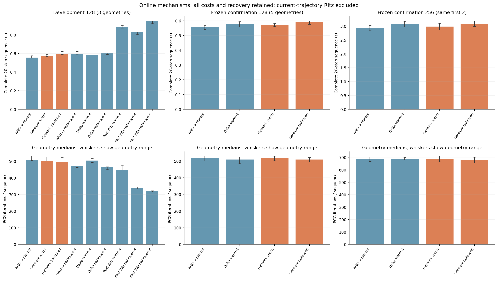
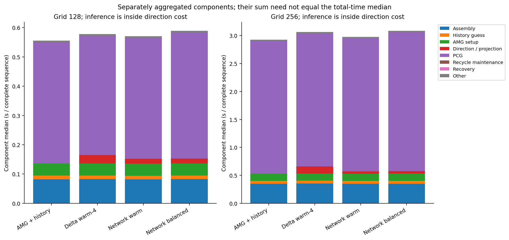
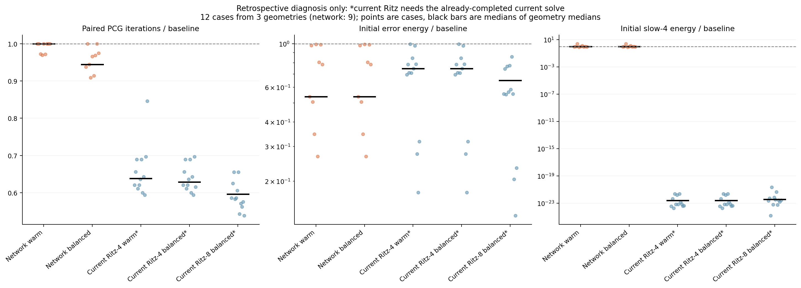

# 第四阶段机制探索结果

生成时间：2026-11-19T06:01:58.645545+00:00。

本阶段检验固定平衡粗空间能否改善 AMG-PCG 的全过程；没有重新训练模型。在线计时包含完整成本。
当前轨迹 Ritz 由同一个系统求解完成后获得，仅用于回顾性潜力诊断，不能作为在线算法或端到端加速证据。

## 完整性与统计口径

开发筛选共 1080 次求解，确认共 1680 次求解；确认独立几何为 5 个，256 网格复用其中前 2 个。诊断为 3 个开发几何上的 12 个预定时刻，网络有 9 个配对 case。
全部在线求解的最终真残差最大值为 9.989e-09；PCG 失败 0 次，直接恢复 0 次，恢复后仍失败 0 次。
源码、协议、分组、权重和确认选择文件哈希均核对通过；完整行键与预定日程逐一匹配，没有缺失或重复行。
时间先按 20 步求和，再取同几何重复中位数，最后汇总独立几何。范围是几何间最小值—最大值，并非置信区间。诊断多个时刻共享几何，不能当成 12 个独立样本。
推理及传输已包含在方向构造/校正时间中，不能重复相加。组件分别取中位数通常不会严格加回总时间中位数。失败与恢复全部保留；恢复时间包含在总时间中。

## 开发筛选：128 网格、3 个几何、每项 2 次

| 方法 | 20 步总秒数：中位数 [范围] | 迭代总数中位数 | 配对时间/基线 | PCG失败/恢复/最终失败 |
|---|---:|---:|---:|---:|
| baseline | 0.555 [0.550, 0.576] | 506.0 | 1.000 | 0/0/0 |
| network_warm | 0.570 [0.565, 0.590] | 503.0 | 1.027 | 0/0/0 |
| network_balanced | 0.598 [0.589, 0.622] | 497.0 | 1.080 | 0/0/0 |
| history_balanced4 | 0.598 [0.592, 0.621] | 470.0 | 1.079 | 0/0/0 |
| delta_warm4 | 0.587 [0.585, 0.594] | 505.0 | 1.053 | 0/0/0 |
| delta_balanced4 | 0.602 [0.589, 0.607] | 464.0 | 1.071 | 0/0/0 |
| ritz_warm4 | 0.878 [0.872, 0.899] | 450.0 | 1.583 | 0/0/0 |
| ritz_balanced4 | 0.826 [0.802, 0.829] | 340.0 | 1.458 | 0/0/0 |
| ritz_balanced8 | 0.944 [0.919, 0.949] | 321.0 | 1.671 | 0/0/0 |

组件为每条完整序列的几何中位秒数：

| 方法 | 组装 | 历史初值 | AMG | 方向/校正 | PCG | 回收维护 | 恢复 | 其余 |
|---|---:|---:|---:|---:|---:|---:|---:|---:|
| baseline | 0.0850 | 0.0127 | 0.0425 | 0.0002 | 0.4085 | 0.0000 | 0.0000 | 0.0057 |
| network_warm | 0.0847 | 0.0127 | 0.0423 | 0.0171 | 0.4070 | 0.0000 | 0.0000 | 0.0055 |
| network_balanced | 0.0854 | 0.0129 | 0.0432 | 0.0177 | 0.4334 | 0.0000 | 0.0000 | 0.0057 |
| history_balanced4 | 0.0836 | 0.0125 | 0.0425 | 0.0275 | 0.4278 | 0.0000 | 0.0000 | 0.0054 |
| delta_warm4 | 0.0849 | 0.0126 | 0.0422 | 0.0296 | 0.4091 | 0.0003 | 0.0000 | 0.0054 |
| delta_balanced4 | 0.0848 | 0.0127 | 0.0426 | 0.0321 | 0.4246 | 0.0003 | 0.0000 | 0.0057 |
| ritz_warm4 | 0.0831 | 0.0128 | 0.0426 | 0.0297 | 0.3728 | 0.3312 | 0.0000 | 0.0056 |
| ritz_balanced4 | 0.0826 | 0.0127 | 0.0425 | 0.0319 | 0.3190 | 0.3282 | 0.0000 | 0.0057 |
| ritz_balanced8 | 0.0841 | 0.0127 | 0.0434 | 0.0618 | 0.3208 | 0.4147 | 0.0000 | 0.0059 |

同来源 warm / balanced 配对（小于 1 表示 balanced 更小）：

| 方向来源 | 配对时间比中位数 | 配对迭代比中位数 | 迭代差中位数 |
|---|---:|---:|---:|
| network_warm → network_balanced | 1.055 | 0.988 | -6.0 |
| delta_warm4 → delta_balanced4 | 1.022 | 0.913 | -43.0 |
| ritz_warm4 → ritz_balanced4 | 0.922 | 0.746 | -114.0 |

各方法后续沿自己的实际计算历史推进，在线配对控制的是方向来源及接口，并非强制所有后续方向逐位相同。诊断部分才使用完全相同的当前空间和初值直接比较接口。

## 冻结确认：128 网格、5 个几何、每项 3 次

| 方法 | 20 步总秒数：中位数 [范围] | 迭代总数中位数 | 配对时间/基线 | PCG失败/恢复/最终失败 |
|---|---:|---:|---:|---:|
| baseline | 0.555 [0.540, 0.567] | 518.0 | 1.000 | 0/0/0 |
| delta_warm4 | 0.579 [0.558, 0.594] | 509.0 | 1.041 | 0/0/0 |
| network_warm | 0.572 [0.560, 0.581] | 517.0 | 1.030 | 0/0/0 |
| network_balanced | 0.589 [0.576, 0.599] | 509.0 | 1.059 | 0/0/0 |

组件为每条完整序列的几何中位秒数：

| 方法 | 组装 | 历史初值 | AMG | 方向/校正 | PCG | 回收维护 | 恢复 | 其余 |
|---|---:|---:|---:|---:|---:|---:|---:|---:|
| baseline | 0.0823 | 0.0123 | 0.0413 | 0.0002 | 0.4138 | 0.0000 | 0.0000 | 0.0055 |
| delta_warm4 | 0.0828 | 0.0121 | 0.0413 | 0.0287 | 0.4073 | 0.0002 | 0.0000 | 0.0054 |
| network_warm | 0.0820 | 0.0122 | 0.0413 | 0.0164 | 0.4137 | 0.0000 | 0.0000 | 0.0054 |
| network_balanced | 0.0827 | 0.0121 | 0.0414 | 0.0170 | 0.4306 | 0.0000 | 0.0000 | 0.0054 |

同来源 warm / balanced 配对（小于 1 表示 balanced 更小）：

| 方向来源 | 配对时间比中位数 | 配对迭代比中位数 | 迭代差中位数 |
|---|---:|---:|---:|
| network_warm → network_balanced | 1.030 | 0.984 | -8.0 |

各方法后续沿自己的实际计算历史推进，在线配对控制的是方向来源及接口，并非强制所有后续方向逐位相同。诊断部分才使用完全相同的当前空间和初值直接比较接口。

## 冻结确认：256 网格、2 个已有确认几何、每项 3 次

| 方法 | 20 步总秒数：中位数 [范围] | 迭代总数中位数 | 配对时间/基线 | PCG失败/恢复/最终失败 |
|---|---:|---:|---:|---:|
| baseline | 2.926 [2.828, 3.024] | 685.0 | 1.000 | 0/0/0 |
| delta_warm4 | 3.065 [2.962, 3.167] | 688.5 | 1.047 | 0/0/0 |
| network_warm | 2.981 [2.864, 3.097] | 688.0 | 1.018 | 0/0/0 |
| network_balanced | 3.084 [2.984, 3.183] | 678.5 | 1.054 | 0/0/0 |

组件为每条完整序列的几何中位秒数：

| 方法 | 组装 | 历史初值 | AMG | 方向/校正 | PCG | 回收维护 | 恢复 | 其余 |
|---|---:|---:|---:|---:|---:|---:|---:|---:|
| baseline | 0.3480 | 0.0515 | 0.1310 | 0.0003 | 2.3706 | 0.0000 | 0.0000 | 0.0247 |
| delta_warm4 | 0.3519 | 0.0509 | 0.1314 | 0.1248 | 2.3809 | 0.0008 | 0.0000 | 0.0244 |
| network_warm | 0.3478 | 0.0519 | 0.1302 | 0.0397 | 2.3849 | 0.0000 | 0.0000 | 0.0229 |
| network_balanced | 0.3509 | 0.0511 | 0.1305 | 0.0411 | 2.4879 | 0.0000 | 0.0000 | 0.0238 |

同来源 warm / balanced 配对（小于 1 表示 balanced 更小）：

| 方向来源 | 配对时间比中位数 | 配对迭代比中位数 | 迭代差中位数 |
|---|---:|---:|---:|
| network_warm → network_balanced | 1.035 | 0.986 | -9.5 |

各方法后续沿自己的实际计算历史推进，在线配对控制的是方向来源及接口，并非强制所有后续方向逐位相同。诊断部分才使用完全相同的当前空间和初值直接比较接口。

## 预定 12 个系统的离线诊断

下表先逐 case 相对同一基础初值配对，再在每个几何内取时刻中位数，最后取 3 个独立几何的中位数。网络项有 9 个 case，当前轨迹 Ritz 项有 12 个。解误差能量是 eᵀAe；slow4 是前 4 个低端 Ritz 方向的 A 投影能量，并非完整慢特征空间。

| 变体 | case数 | 迭代数几何中位数 | 迭代/基线几何中位数 | 初始误差能量/基线 | slow4剩余能量/基线 | PCG失败 |
|---|---:|---:|---:|---:|---:|---:|
| baseline | 12 | 31.0 | 1.000 | 1.000e+00 | 1.000e+00 | 0 |
| network_warm | 9 | 32.0 | 1.000 | 5.378e-01 | 9.960e-01 | 0 |
| network_balanced | 9 | 30.0 | 0.944 | 5.378e-01 | 9.960e-01 | 0 |
| current_ritz4_warm | 12 | 20.5 | 0.638 | 7.477e-01 | 2.442e-23 | 0 |
| current_ritz4_balanced | 12 | 20.5 | 0.629 | 7.477e-01 | 2.442e-23 | 0 |
| current_ritz8_balanced | 12 | 19.0 | 0.596 | 6.505e-01 | 3.623e-23 | 0 |

两种聚合口径须区分：把 9 个网络事件合并，初始误差能量比的中位数为 0.783208（下降约 21.7%）；先在每个几何内取事件中位数、再在 3 个几何间取中位数，则为 0.537793（下降约 46.2%）。差异来自中位数的聚合顺序，不是新增实验或改动结果；本报告主表使用后一口径，独立开发几何只有 3 个。
按同一几何优先口径，初始误差能量中位数为 2.509e-02；slow4 在基础误差中的能量占比中位数为 0.252。
网络单方向与该 slow4 空间的 A 能量重合度几何中位数为 0.013，几何中位数范围 [0.007, 0.014]。这个比值不是预测误差，也不能独立证明方向无效。
Ritz 投影方程相对残差最大值为 6.874e-13，全算子 Ritz 相对残差最大值为 4.673e-02。小型投影方程准确不代表已经得到完整算子的精确特征向量。
回顾性 Ritz 提取耗时几何中位数为 0.0593 秒；这不包含获得当前完整轨迹的先行求解，因而不是在线方向生成成本。诊断中的每步真残差及 rᵀMr 记录也会增加诊断成本，诊断耗时不参与在线排序。
汇总 JSON 同时保留逐 case 统计及几何优先统计，避免用一种中位数冒充另一种口径。没有逐迭代 slow4 能量记录，因此本实验没有直接观测或证明慢方向误差在迭代中重新出现；只能报告同空间接口消融差异。

同空间、同初值的诊断接口比较，迭代比和迭代差也采用几何优先口径：

| 对照 | balanced/warm 迭代中位比 | 迭代差中位数 | 初始能量比最大绝对差 |
|---|---:|---:|---:|
| network_warm__network_balanced | 0.971 | -1.0 | 0.000e+00 |
| current_ritz4_warm__current_ritz4_balanced | 1.000 | 0.0 | 0.000e+00 |

完整配对系统如下；当前轨迹列均为回顾性。

| 几何/步 | 基础 | 网络warm | 网络balanced | 当前Ritz4 warm | 当前Ritz4 balanced | 当前Ritz8 balanced | 初始能量 | slow4占比 | 网络重合度 |
|---|---:|---:|---:|---:|---:|---:|---:|---:|---:|
| 42001/0 | 29 | — | — | 18 | 18 | 17 | 3.017e-02 | 0.305 | 不适用 |
| 42001/6 | 32 | 32 | 30 | 21 | 21 | 20 | 2.133e-02 | 0.216 | 0.007 |
| 42001/10 | 29 | 29 | 29 | 20 | 20 | 19 | 2.886e-02 | 0.288 | 0.049 |
| 42001/15 | 36 | 35 | 34 | 22 | 22 | 21 | 2.031e-02 | 0.005 | 0.005 |
| 42002/0 | 29 | — | — | 18 | 18 | 17 | 2.770e-02 | 0.290 | 不适用 |
| 42002/6 | 33 | 32 | 30 | 21 | 21 | 20 | 1.543e-02 | 0.156 | 0.012 |
| 42002/10 | 29 | 29 | 28 | 20 | 20 | 19 | 2.669e-02 | 0.252 | 0.051 |
| 42002/15 | 35 | 34 | 32 | 21 | 21 | 19 | 1.133e-02 | 0.024 | 0.013 |
| 42003/0 | 28 | — | — | 18 | 18 | 16 | 2.777e-02 | 0.214 | 不适用 |
| 42003/6 | 32 | 32 | 31 | 19 | 19 | 18 | 2.480e-02 | 0.725 | 0.014 |
| 42003/10 | 33 | 33 | 33 | 23 | 23 | 19 | 2.650e-02 | 0.825 | 0.028 |
| 42003/15 | 39 | 39 | 38 | 33 | 24 | 21 | 2.376e-02 | 0.682 | 0.014 |

## 过去 Ritz 回收的维护成本审计

以下仅为事后成本核算：固定已测迭代轨迹，先对每个完整重复合计 T、维护时间和方向/校正时间，再分别算 T−维护及 T−维护−方向/校正；对每个几何取重复中位数，除以同几何基础方法时间中位数，最后汇总几何配对比。匹配基础方法所容许的维护预算则为基础时间减去 T−维护的重复中位数。
这些计算不是可执行的免费回收算法，也不是所有未来算法的时间下界；替换提取方式可能改变方向、迭代数和其他成本，不能假定实测轨迹保持不变。

| 开发候选 | 实测维护秒数几何中位数 | 匹配基础方法可用维护预算几何中位数 | 配对(T−维护)/T基础 | 配对(T−维护−方向/校正)/T基础 |
|---|---:|---:|---:|---:|
| ritz_warm4 | 0.3312 | 0.0084 | 0.9853 | 0.9319 |
| ritz_balanced4 | 0.3282 | 0.0665 | 0.8792 | 0.8216 |
| ritz_balanced8 | 0.4147 | 0.0254 | 0.9542 | 0.8409 |

对 ritz_balanced4，固定当前已测轨迹并扣除全部维护时间时，配对时间比中位数仍为 0.8792；进一步扣除方向/校正构造时间后为 0.8216。这两个删成本比值应与 0.8 的工程线比较，不能仅凭减少维护成本便承诺达到 20% 加速。新提取机制是否改善轨迹、是否达到完整时间目标，仍需实际测量。

## 工程筛选与可支持的结论

开发集冻结的经典候选为 `delta_warm4`；它按开发集完整时间选定，没有根据确认结果重选。

- 128 网格 `delta_warm4`：几何配对时间比中位数 1.041；0/5 个几何更快；至少节省 20% 的几何为 0/5。
- 128 网格 `network_warm`：几何配对时间比中位数 1.030；0/5 个几何更快；至少节省 20% 的几何为 0/5。
- 128 网格 `network_balanced`：几何配对时间比中位数 1.059；0/5 个几何更快；至少节省 20% 的几何为 0/5。
- 256 网格 `delta_warm4`：几何配对时间比中位数 1.047；0/2 个几何更快；至少节省 20% 的几何为 0/2。
- 256 网格 `network_warm`：几何配对时间比中位数 1.018；0/2 个几何更快；至少节省 20% 的几何为 0/2。
- 256 网格 `network_balanced`：几何配对时间比中位数 1.054；0/2 个几何更快；至少节省 20% 的几何为 0/2。

20% 仅为投入下一轮实验的工程线：报告同时列逐几何计数和配对中位数，不以少量几何概括一般性。更低的能量、残差或迭代数都不能替代完整时间收益；经典回收的收益不能归给 AI。
若当前轨迹 Ritz 减少迭代而过去轨迹没有完整时间收益，只能保留‘当前预条件慢空间预测可能有价值’这一待检验假设；不能由本实验推断已有可训练的新模型。冻结的单方向网络失败也不能证明全部学习粗空间无效。
本轮确认仍是机制探索，尚无多模型随机种子、广泛方程或论文级最终测试。后续算法改变需使用新分配的测试几何并重新冻结方案。

## 文献边界和复核入口

平衡两层、deflation 和 Krylov 回收是已有数值方法。直接参考 [Nabben–Vuik (2006)](https://epubs.siam.org/doi/10.1137/040608246)、[Tang 等 (2009)](https://link.springer.com/article/10.1007/s10915-009-9272-6) 与 [Parks 等 (2006)](https://epubs.siam.org/doi/10.1137/040607277)。
学习 deflation 空间已有 [Kopaničáková 等 (2025)](https://link.springer.com/article/10.1007/s44379-025-00039-7)；学习谱空间亦有 [NeuraLSP](https://arxiv.org/html/2601.20174v3)。此处不把这些经典结构或近邻已有内容宣称为本项目的新颖性。
理论与完整近邻界限见 [机制理论文档](../../docs/stage4_mechanism_theory_zh.md)，预定选择与计时规则见 [协议](../../docs/stage4_protocol_zh.md)。
原始记录：[诊断](../stage4_diagnosis/measurements.json)、[筛选](../stage4_screen/measurements.json)、[128确认](../stage4_confirm128/measurements.json)、[256确认](../stage4_confirm256/measurements.json)。
逐几何配对、全部组件、所有完整序列和输入哈希保存在 [summary.json](summary.json)。

