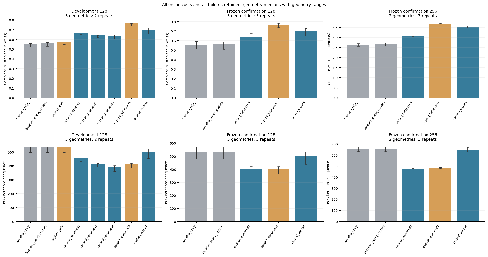
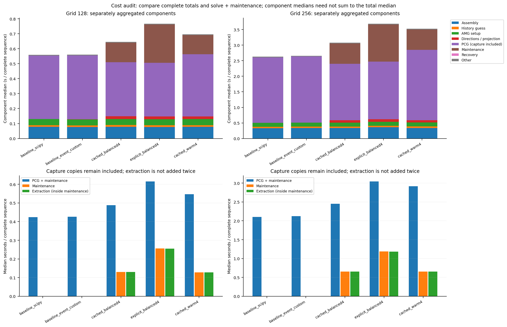
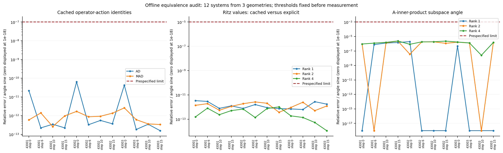

# 第五阶段：复用 PCG 缓存的低秩回收实验

生成时间：2026-11-19T06:34:22.283310+00:00。状态：`complete`。

本阶段没有训练或调用 AI 模型。任何收益首先归于经典数值缓存、回收策略及实现，不能据此声称 AI 加速或新的学习算法。

## 预定缓存等价核验

三个开发几何、四个固定时刻，共 12 个系统；同一几何内时刻不独立。核验门槛在正式运行前固定，没有按结果放宽。

| 指标 | 最大值 | 预定门槛 |
|---|---:|---:|
| 缓存 AD 相对偏差 | 6.332e-11 | 1e-7 |
| 缓存 MAD 相对偏差 | 2.598e-12 | 1e-7 |
| 秩 1 Ritz 值相对偏差 | 3.379e-12 | 1e-5 |
| 秩 1 最大主角正弦 | 1.976e-06 | 1e-3 |
| 秩 2 Ritz 值相对偏差 | 2.662e-12 | 1e-5 |
| 秩 2 最大主角正弦 | 2.352e-06 | 1e-3 |
| 秩 4 Ritz 值相对偏差 | 1.039e-12 | 1e-5 |
| 秩 4 最大主角正弦 | 2.393e-06 | 1e-3 |

核验通过 12/12。缓存提取使用已支付的 D、AD、MAD；最后一项若没有已支付的下一次 Mr，则跳过；真残差刷新前后不相减。

| 几何/步 | AD 偏差 | MAD 偏差 | 秩1/2/4通过 | PCG真残差 |
|---|---:|---:|---|---:|
| 43001/0 | 2.157e-11 | 5.914e-13 | 是/是/是 | 3.912e-09 |
| 43001/6 | 2.221e-13 | 1.398e-12 | 是/是/是 | 5.943e-09 |
| 43001/10 | 3.462e-13 | 2.609e-13 | 是/是/是 | 7.868e-09 |
| 43001/15 | 2.225e-13 | 9.701e-13 | 是/是/是 | 7.712e-09 |
| 43002/0 | 6.332e-11 | 1.687e-12 | 是/是/是 | 6.210e-09 |
| 43002/6 | 3.276e-13 | 8.723e-13 | 是/是/是 | 5.178e-09 |
| 43002/10 | 5.549e-13 | 9.289e-13 | 是/是/是 | 7.974e-09 |
| 43002/15 | 3.670e-13 | 1.352e-12 | 是/是/是 | 6.010e-09 |
| 43003/0 | 4.241e-11 | 2.598e-12 | 是/是/是 | 8.058e-09 |
| 43003/6 | 1.820e-13 | 6.098e-13 | 是/是/是 | 9.767e-09 |
| 43003/10 | 3.475e-13 | 3.630e-13 | 是/是/是 | 3.574e-09 |
| 43003/15 | 1.579e-13 | 3.363e-13 | 是/是/是 | 7.041e-09 |

## 在线成本与统计口径

每条完整序列先合计 20 步，再取同几何重复中位数，最后取几何中位数与范围；图中范围不是置信区间。所有失败、恢复和缓存拒绝均保留。确认仅有五个独立几何，256 网格复用前两个。
总时间包括组装、历史四解初值、AMG 刷新、当前方向投影、求解、缓存采集与复制、真残差、恢复、提取及历史维护。直接参考解只用于计时外误差核验。采集开销可能位于求解内，因此必须同时检查 solve+maintenance，不能只比较维护时间。
提取秒数若单独记录，是维护时间的子项，不能再加到总时间中；组件各自取中位数，其和不必等于总时间中位数。显式对照与缓存对照采集相同的三份缓存，仅在提取阶段重新施加 A/M，以隔离提取机制；这不证明显式方案已经存储最优。

已核验在线记录 3060 条，PCG 失败 0，恢复 0，最终失败 0，整个缓存空间拒绝 0；最终真残差最大值 9.994e-09。
逐列统计另计：采集时拒绝 0 列，末步缺少下一次已支付 Mr 而跳过 0 列，提取时拒绝 0 列，因线性相关筛去 0 列。末步跳过及相关列筛选不等于整个空间被拒绝。

## 开发筛选：128网格、3几何、2重复

| 方法 | 总秒数中位数 [几何范围] | 迭代中位数 | 对SciPy配对时间比 | 对自实现配对时间比 | 失败/恢复/最终失败/拒绝 |
|---|---:|---:|---:|---:|---:|
| baseline_scipy | 0.551 [0.525, 0.558] | 536.0 | 1.000 | 0.984 | 0/0/0/0 |
| baseline_event_custom | 0.560 [0.529, 0.569] | 536.0 | 1.017 | 1.000 | 0/0/0/0 |
| capture_only | 0.578 [0.549, 0.585] | 536.0 | 1.047 | 1.030 | 0/0/0/0 |
| cached_balanced1 | 0.665 [0.649, 0.677] | 460.0 | 1.213 | 1.191 | 0/0/0/0 |
| cached_balanced2 | 0.642 [0.618, 0.643] | 416.0 | 1.166 | 1.147 | 0/0/0/0 |
| cached_balanced4 | 0.635 [0.606, 0.644] | 392.0 | 1.153 | 1.133 | 0/0/0/0 |
| explicit_balanced2 | 0.767 [0.740, 0.767] | 416.0 | 1.390 | 1.368 | 0/0/0/0 |
| cached_warm2 | 0.700 [0.656, 0.720] | 503.0 | 1.253 | 1.239 | 0/0/0/0 |

| 方法 | PCG秒数 | 维护秒数 | 其中提取秒数 | PCG+维护秒数 | 当前方向/投影秒数 |
|---|---:|---:|---:|---:|---:|
| baseline_scipy | 0.4168 | 0.0001 | 0.0000 | 0.4169 | 0.0001 |
| baseline_event_custom | 0.4262 | 0.0001 | 0.0000 | 0.4263 | 0.0001 |
| capture_only | 0.4438 | 0.0001 | 0.0000 | 0.4439 | 0.0001 |
| cached_balanced1 | 0.4052 | 0.1192 | 0.1190 | 0.5234 | 0.0076 |
| cached_balanced2 | 0.3636 | 0.1283 | 0.1281 | 0.4955 | 0.0105 |
| cached_balanced4 | 0.3485 | 0.1297 | 0.1295 | 0.4792 | 0.0194 |
| explicit_balanced2 | 0.3671 | 0.2530 | 0.2529 | 0.6211 | 0.0105 |
| cached_warm2 | 0.4242 | 0.1293 | 0.1292 | 0.5536 | 0.0096 |

同秩同策略对照及实现/采集对照：比值小于 1 表示分子较小。

| 分子 / 分母 | 总时间配对比 | 迭代配对比 | PCG+维护配对比 | 维护配对比 | 提取配对比 |
|---|---:|---:|---:|---:|---:|
| baseline_event_custom / baseline_scipy | 1.017 | 1.000 | 1.014 | 1.046 | 不适用 |
| capture_only / baseline_event_custom | 1.030 | 1.000 | 1.046 | 1.131 | 不适用 |
| cached_balanced2 / explicit_balanced2 | 0.838 | 1.000 | 0.798 | 0.508 | 0.507 |
| cached_balanced2 / cached_warm2 | 0.918 | 0.831 | 0.897 | 0.992 | 0.992 |

按本组全部几何的中位时间选出的最快有效基线为 `baseline_scipy`。下表固定使用这一种基线，再逐几何配对；不在每个几何上另选基线。JSON 另外保留逐几何两基线取小的事后保守包络，它不可作为可执行选择器或主结论。

| 候选 | 对固定最快有效基线时间比中位数 | 更快几何数 | 至少节省20%几何数 | 配对中位20%工程线 |
|---|---:|---:|---:|---|
| capture_only | 1.047 | 0/3 | 0/3 | 未通过 |
| cached_balanced1 | 1.213 | 0/3 | 0/3 | 未通过 |
| cached_balanced2 | 1.166 | 0/3 | 0/3 | 未通过 |
| cached_balanced4 | 1.153 | 0/3 | 0/3 | 未通过 |
| explicit_balanced2 | 1.390 | 0/3 | 0/3 | 未通过 |
| cached_warm2 | 1.253 | 0/3 | 0/3 | 未通过 |

以下为事后固定轨迹成本核算：每次完整重复计算 T−提取时间，再在同几何取重复中位数并对基线配对。不是免费提取算法、加速预测或普遍时间下界。

| 回收候选 | (T−提取)/SciPy 配对中位比 | (T−提取)/自实现 配对中位比 |
|---|---:|---:|
| cached_balanced1 | 0.9984 | 0.9803 |
| cached_balanced2 | 0.9273 | 0.9122 |
| cached_balanced4 | 0.9154 | 0.9005 |
| explicit_balanced2 | 0.9272 | 0.9148 |
| cached_warm2 | 1.0215 | 1.0031 |

预定事件步占基础求解时间的份额（每个完整重复先算比例，再取几何优先中位数）：`baseline_scipy` 为 49.8%，`baseline_event_custom` 为 50.1%。本阶段事件步禁用旧空间，因此事件求解成本仍需通过其他机制改善。

## 冻结确认：128网格、5几何、3重复

| 方法 | 总秒数中位数 [几何范围] | 迭代中位数 | 对SciPy配对时间比 | 对自实现配对时间比 | 失败/恢复/最终失败/拒绝 |
|---|---:|---:|---:|---:|---:|
| baseline_scipy | 0.558 [0.514, 0.591] | 535.0 | 1.000 | 1.000 | 0/0/0/0 |
| baseline_event_custom | 0.561 [0.509, 0.585] | 535.0 | 1.000 | 1.000 | 0/0/0/0 |
| cached_balanced4 | 0.642 [0.615, 0.677] | 405.0 | 1.147 | 1.157 | 0/0/0/0 |
| explicit_balanced4 | 0.767 [0.737, 0.782] | 405.0 | 1.388 | 1.367 | 0/0/0/0 |
| cached_warm4 | 0.702 [0.649, 0.728] | 503.0 | 1.258 | 1.244 | 0/0/0/0 |

| 方法 | PCG秒数 | 维护秒数 | 其中提取秒数 | PCG+维护秒数 | 当前方向/投影秒数 |
|---|---:|---:|---:|---:|---:|
| baseline_scipy | 0.4235 | 0.0001 | 0.0000 | 0.4235 | 0.0002 |
| baseline_event_custom | 0.4264 | 0.0001 | 0.0000 | 0.4265 | 0.0001 |
| cached_balanced4 | 0.3608 | 0.1298 | 0.1296 | 0.4886 | 0.0187 |
| explicit_balanced4 | 0.3581 | 0.2557 | 0.2555 | 0.6155 | 0.0185 |
| cached_warm4 | 0.4153 | 0.1279 | 0.1277 | 0.5468 | 0.0173 |

同秩同策略对照及实现/采集对照：比值小于 1 表示分子较小。

| 分子 / 分母 | 总时间配对比 | 迭代配对比 | PCG+维护配对比 | 维护配对比 | 提取配对比 |
|---|---:|---:|---:|---:|---:|
| baseline_event_custom / baseline_scipy | 1.000 | 1.000 | 1.003 | 1.012 | 不适用 |
| cached_balanced4 / explicit_balanced4 | 0.839 | 1.000 | 0.796 | 0.505 | 0.504 |
| cached_balanced4 / cached_warm4 | 0.930 | 0.809 | 0.901 | 1.014 | 1.015 |

按本组全部几何的中位时间选出的最快有效基线为 `baseline_scipy`。下表固定使用这一种基线，再逐几何配对；不在每个几何上另选基线。JSON 另外保留逐几何两基线取小的事后保守包络，它不可作为可执行选择器或主结论。

| 候选 | 对固定最快有效基线时间比中位数 | 更快几何数 | 至少节省20%几何数 | 配对中位20%工程线 |
|---|---:|---:|---:|---|
| cached_balanced4 | 1.147 | 0/5 | 0/5 | 未通过 |
| explicit_balanced4 | 1.388 | 0/5 | 0/5 | 未通过 |
| cached_warm4 | 1.258 | 0/5 | 0/5 | 未通过 |

以下为事后固定轨迹成本核算：每次完整重复计算 T−提取时间，再在同几何取重复中位数并对基线配对。不是免费提取算法、加速预测或普遍时间下界。

| 回收候选 | (T−提取)/SciPy 配对中位比 | (T−提取)/自实现 配对中位比 |
|---|---:|---:|
| cached_balanced4 | 0.9262 | 0.9357 |
| explicit_balanced4 | 0.9175 | 0.9114 |
| cached_warm4 | 1.0178 | 1.0261 |

预定事件步占基础求解时间的份额（每个完整重复先算比例，再取几何优先中位数）：`baseline_scipy` 为 50.1%，`baseline_event_custom` 为 50.4%。本阶段事件步禁用旧空间，因此事件求解成本仍需通过其他机制改善。

## 冻结确认：256网格、2已有几何、3重复

| 方法 | 总秒数中位数 [几何范围] | 迭代中位数 | 对SciPy配对时间比 | 对自实现配对时间比 | 失败/恢复/最终失败/拒绝 |
|---|---:|---:|---:|---:|---:|
| baseline_scipy | 2.631 [2.565, 2.698] | 653.0 | 1.000 | 0.992 | 0/0/0/0 |
| baseline_event_custom | 2.653 [2.583, 2.722] | 653.0 | 1.008 | 1.000 | 0/0/0/0 |
| cached_balanced4 | 3.066 [3.061, 3.072] | 477.5 | 1.166 | 1.157 | 0/0/0/0 |
| explicit_balanced4 | 3.691 [3.672, 3.709] | 482.5 | 1.404 | 1.392 | 0/0/0/0 |
| cached_warm4 | 3.529 [3.473, 3.584] | 649.0 | 1.341 | 1.331 | 0/0/0/0 |

| 方法 | PCG秒数 | 维护秒数 | 其中提取秒数 | PCG+维护秒数 | 当前方向/投影秒数 |
|---|---:|---:|---:|---:|---:|
| baseline_scipy | 2.1022 | 0.0003 | 0.0000 | 2.1025 | 0.0002 |
| baseline_event_custom | 2.1247 | 0.0003 | 0.0000 | 2.1251 | 0.0002 |
| cached_balanced4 | 1.8114 | 0.6534 | 0.6521 | 2.4515 | 0.0792 |
| explicit_balanced4 | 1.8545 | 1.1901 | 1.1841 | 3.0446 | 0.0817 |
| cached_warm4 | 2.2601 | 0.6556 | 0.6544 | 2.9162 | 0.0752 |

同秩同策略对照及实现/采集对照：比值小于 1 表示分子较小。

| 分子 / 分母 | 总时间配对比 | 迭代配对比 | PCG+维护配对比 | 维护配对比 | 提取配对比 |
|---|---:|---:|---:|---:|---:|
| baseline_event_custom / baseline_scipy | 1.008 | 1.000 | 1.011 | 0.987 | 不适用 |
| cached_balanced4 / explicit_balanced4 | 0.831 | 0.990 | 0.805 | 0.549 | 0.551 |
| cached_balanced4 / cached_warm4 | 0.869 | 0.737 | 0.841 | 0.997 | 0.997 |

按本组全部几何的中位时间选出的最快有效基线为 `baseline_scipy`。下表固定使用这一种基线，再逐几何配对；不在每个几何上另选基线。JSON 另外保留逐几何两基线取小的事后保守包络，它不可作为可执行选择器或主结论。

| 候选 | 对固定最快有效基线时间比中位数 | 更快几何数 | 至少节省20%几何数 | 配对中位20%工程线 |
|---|---:|---:|---:|---|
| cached_balanced4 | 1.166 | 0/2 | 0/2 | 未通过 |
| explicit_balanced4 | 1.404 | 0/2 | 0/2 | 未通过 |
| cached_warm4 | 1.341 | 0/2 | 0/2 | 未通过 |

以下为事后固定轨迹成本核算：每次完整重复计算 T−提取时间，再在同几何取重复中位数并对基线配对。不是免费提取算法、加速预测或普遍时间下界。

| 回收候选 | (T−提取)/SciPy 配对中位比 | (T−提取)/自实现 配对中位比 |
|---|---:|---:|
| cached_balanced4 | 0.9226 | 0.9152 |
| explicit_balanced4 | 0.9534 | 0.9457 |
| cached_warm4 | 1.0926 | 1.0838 |

预定事件步占基础求解时间的份额（每个完整重复先算比例，再取几何优先中位数）：`baseline_scipy` 为 48.2%，`baseline_event_custom` 为 48.3%。本阶段事件步禁用旧空间，因此事件求解成本仍需通过其他机制改善。

## 冻结选择与全部确认几何配对

开发集预定规则选中 `cached_balanced4`。选择只在秩 1/2/4 的合格缓存 balanced 候选间进行，即使它们均慢于基线也会选一个确认；选中本身不代表收益。

| 网格/方法/几何 | 总秒数 | SciPy秒数 | 自实现秒数 | 对该网格固定最快有效基线比 |
|---|---:|---:|---:|---:|
| 128/cached_balanced4/43011 | 0.6304 | 0.5578 | 0.5701 | 1.1301 |
| 128/cached_balanced4/43012 | 0.6425 | 0.5481 | 0.5495 | 1.1723 |
| 128/cached_balanced4/43013 | 0.6771 | 0.5910 | 0.5851 | 1.1456 |
| 128/cached_balanced4/43014 | 0.6434 | 0.5611 | 0.5609 | 1.1467 |
| 128/cached_balanced4/43015 | 0.6155 | 0.5136 | 0.5088 | 1.1984 |
| 128/explicit_balanced4/43011 | 0.7740 | 0.5578 | 0.5701 | 1.3875 |
| 128/explicit_balanced4/43012 | 0.7658 | 0.5481 | 0.5495 | 1.3974 |
| 128/explicit_balanced4/43013 | 0.7825 | 0.5910 | 0.5851 | 1.3239 |
| 128/explicit_balanced4/43014 | 0.7669 | 0.5611 | 0.5609 | 1.3669 |
| 128/explicit_balanced4/43015 | 0.7370 | 0.5136 | 0.5088 | 1.4352 |
| 128/cached_warm4/43011 | 0.7016 | 0.5578 | 0.5701 | 1.2577 |
| 128/cached_warm4/43012 | 0.7024 | 0.5481 | 0.5495 | 1.2816 |
| 128/cached_warm4/43013 | 0.7281 | 0.5910 | 0.5851 | 1.2319 |
| 128/cached_warm4/43014 | 0.6860 | 0.5611 | 0.5609 | 1.2226 |
| 128/cached_warm4/43015 | 0.6489 | 0.5136 | 0.5088 | 1.2636 |
| 256/cached_balanced4/43011 | 3.0606 | 2.6977 | 2.7219 | 1.1345 |
| 256/cached_balanced4/43012 | 3.0717 | 2.5648 | 2.5835 | 1.1976 |
| 256/explicit_balanced4/43011 | 3.6723 | 2.6977 | 2.7219 | 1.3613 |
| 256/explicit_balanced4/43012 | 3.7092 | 2.5648 | 2.5835 | 1.4462 |
| 256/cached_warm4/43011 | 3.5845 | 2.6977 | 2.7219 | 1.3287 |
| 256/cached_warm4/43012 | 3.4726 | 2.5648 | 2.5835 | 1.3539 |

## 可支持的结论与边界

缓存等价核验通过只说明在这批已检查轨迹上，缓存和显式提取一致；它不证明所有系统上的舍入误差均可忽略。全算子 Ritz 方向仍是有限空间的近似，不能把小型投影方程精度当成完整特征向量精度。
判断收益应先看自实现无采集基线与 SciPy 的差异，再看采集开销、同秩缓存/显式差异和 warm/balanced 差异；迭代减少、维护减少或某个单次测量更快都不等价于完整时间改善。每种方法沿自己的数值历史推进，在线空间并非逐位相同。
20% 是工程投入筛选线，不是统计显著性或论文录用标准。当前只有单右端、单对比度及少量新几何；不能直接外推到其他 PDE 或声称达到国际一区发表条件。本阶段不包含学习模型，不产生 AI 创新或 AI 加速证据。
本阶段事件步禁用旧空间，只用本次缓存更新供下一步使用；第四阶段事件策略不同，因此不能用跨阶段计时差直接归因缓存优化。后续任何方案改变都需重新冻结实验并使用新的确认几何。

逐步原始记录见 [开发集](../stage5_screen/measurements.json)、[128 确认集](../stage5_confirm128/measurements.json)、[256 确认集](../stage5_confirm256/measurements.json)，离线核验见 [缓存核验记录](../stage5_cache_audit/measurements.json)。逐几何配对、完整重复序列成本、失败及哈希审计见 [summary.json](summary.json)；预定规则见 [协议](../../docs/stage5_protocol_zh.md)。

