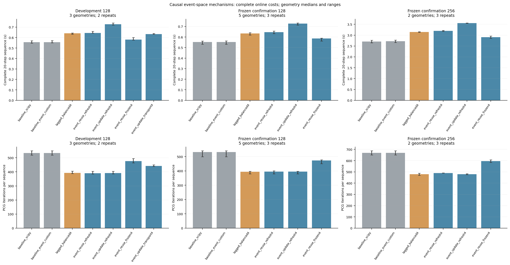
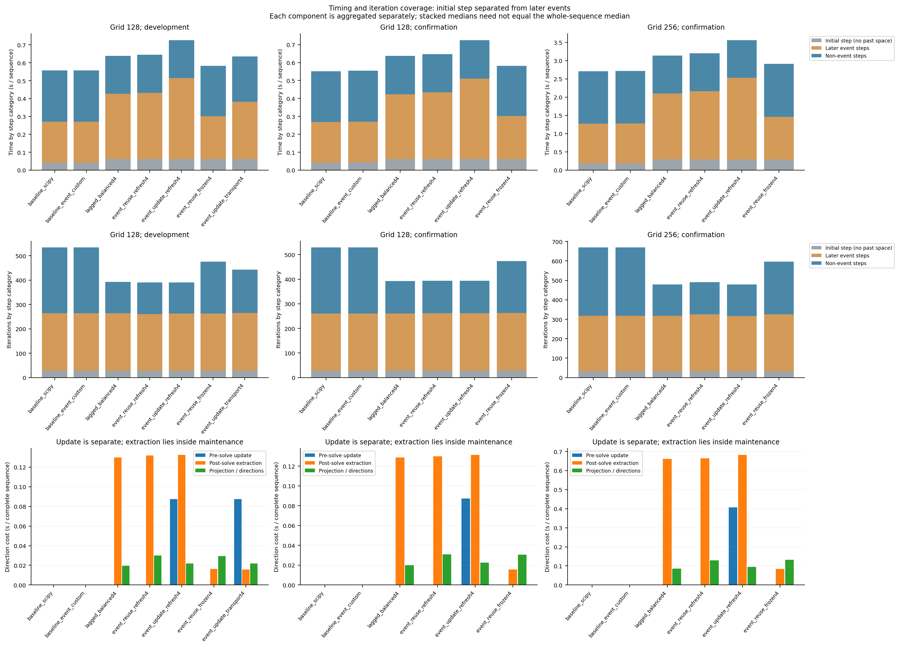
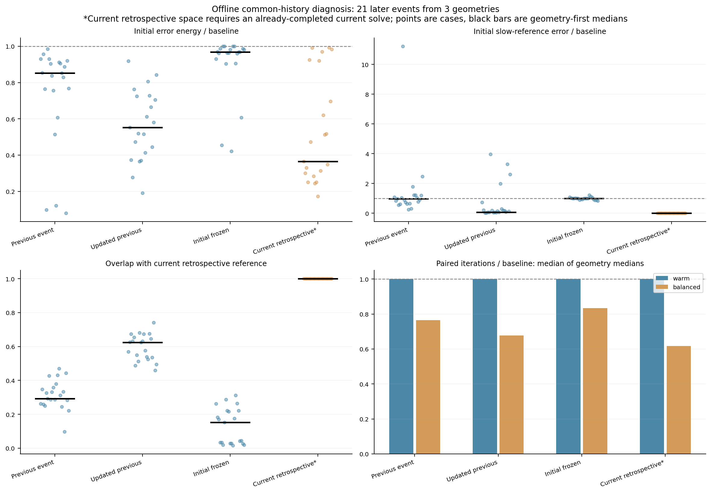

# 第六阶段：跳变当步的历史方向、预算更新与刷新时机

生成时间：2026-11-19T06:54:52.903331+00:00。状态：`complete`。

本阶段是经典数值机制探索，没有训练或调用 AI。只使用本阶段同协议实际测得的 PDE 结果进行比较，不把跨阶段时间差归因于新算法，也不将经典收益归为 AI 创新。

## 共同基础轨迹上的离线诊断

三个开发几何各七个非首事件，共 21 个系统。所有探针对同一当前 A、M 和基础历史初值进行比较；历史轨迹始终由基础求解推进，直接参考解不驱动历史。上一事件和首步方向在时间上可得；current_retrospective 需要当前系统已完成轨迹，只是事后有限空间参考，不能用于在线性能声明。
下面先在每个几何内对七个事件取中位数，再对三个几何取中位数。error 为 eᵀAe 相对基础初值的比值；slow 为当前事后四维参考空间中的 A 投影误差能量比；空间重合度为当前参考空间被候选空间覆盖的平均平方主角余弦。当前参考只有至多 24 个已完成增量，不能当成精确完整慢特征空间。

| 方向 | error能量比 | slow剩余能量比 | 参考空间重合度 | warm迭代/基础 | balanced迭代/基础 | balanced/warm迭代 | warm/balanced失败 |
|---|---:|---:|---:|---:|---:|---:|---:|
| previous_event | 0.8525 | 0.9694 | 0.2919 | 1.0000 | 0.7647 | 0.7647 | 0/0 |
| updated_previous | 0.5532 | 0.0735 | 0.6245 | 1.0000 | 0.6774 | 0.6875 | 0/0 |
| initial_frozen | 0.9678 | 0.9865 | 0.1522 | 1.0000 | 0.8333 | 0.8333 | 0/0 |
| current_retrospective | 0.3645 | 0.0000 | 1.0000 | 1.0000 | 0.6176 | 0.6452 | 0/0 |

同空间、同初值的接口配对：改善事件仅计两接口均准确的系统；任何失败对另行保留。事件数是相关观测，不作为 21 个独立样本。

| 方向 | balanced/warm迭代几何优先中位比 [范围] | 迭代差几何优先中位数 | balanced更少/相同/更多事件 | 失败对 | 中位迭代差改善几何数 |
|---|---:|---:|---:|---:|---:|
| previous_event | 0.7647 [0.7576, 0.7742] | -8.0 | 21/0/0 | 0 | 3/3 |
| updated_previous | 0.6875 [0.6857, 0.7273] | -10.0 | 21/0/0 | 0 | 3/3 |
| initial_frozen | 0.8333 [0.8056, 0.8889] | -6.0 | 21/0/0 | 0 | 3/3 |
| current_retrospective | 0.6452 [0.6176, 0.6452] | -11.0 | 20/1/0 | 0 | 3/3 |

有限更新相对直接复用的几何优先配对结果：warm 迭代比 1.0000，balanced 迭代比 0.9167；误差能量比之差 -0.3011，参考空间重合度之差 0.2984。这些差值与比值分别在同系统内计算后再按几何汇总，不能用上表中位数相减或相除替代。
基准探针 PCG 失败 0 次，全部方向/接口探针失败 0 次；直接参考解真残差最大值 1.774e-09。单次更新的最大 A/M 向量作用数 8/8，预定预算 8/8。
八维更新候选包含旧四维空间，但截取四个低端 Ritz 方向后不保证包含旧空间，也不保证对当前右端更有效。谱量、空间重合度、误差及迭代需要共同解释，不能用其中一项替代完整在线时间。
离线 setup_seconds 仅为当前空间处理组件，不包括历史采集、当前事后空间提取、投影或平衡算子构造；该时间不作为可比较的完整在线成本，原始组件仅在 JSON 中保留。离线 balanced 接口探针也不是线上事件策略：本轮在线事件使用一次投影后仍由基础 M 求解，避免把 BA 缓存误读为 MA。

完整配对系统如下，当前事后方向仅用于诊断：

| 几何/步 | 上一方向来源步 | 基础迭代 | 上一事件warm | 更新warm | 首步冻结warm | 当前事后warm | 上一事件balanced | 更新balanced |
|---|---:|---:|---:|---:|---:|---:|---:|---:|
| 44001/3 | 0 | 33 | 32 | 33 | 32 | 31 | 24 | 23 |
| 44001/6 | 3 | 34 | 34 | 34 | 34 | 34 | 24 | 23 |
| 44001/9 | 6 | 33 | 33 | 33 | 33 | 31 | 26 | 22 |
| 44001/10 | 9 | 31 | 31 | 31 | 31 | 31 | 24 | 22 |
| 44001/12 | 10 | 31 | 30 | 31 | 31 | 29 | 24 | 21 |
| 44001/15 | 12 | 37 | 36 | 37 | 37 | 37 | 32 | 30 |
| 44001/18 | 15 | 36 | 36 | 35 | 36 | 36 | 27 | 24 |
| 44002/3 | 0 | 34 | 34 | 34 | 34 | 34 | 26 | 23 |
| 44002/6 | 3 | 34 | 34 | 34 | 34 | 33 | 25 | 22 |
| 44002/9 | 6 | 34 | 34 | 34 | 34 | 34 | 25 | 23 |
| 44002/10 | 9 | 34 | 34 | 33 | 33 | 34 | 24 | 23 |
| 44002/12 | 10 | 33 | 32 | 32 | 32 | 33 | 26 | 22 |
| 44002/15 | 12 | 39 | 39 | 39 | 39 | 39 | 32 | 29 |
| 44002/18 | 15 | 36 | 36 | 36 | 36 | 36 | 28 | 26 |
| 44003/3 | 0 | 33 | 33 | 33 | 33 | 31 | 24 | 24 |
| 44003/6 | 3 | 32 | 32 | 32 | 32 | 31 | 24 | 22 |
| 44003/9 | 6 | 33 | 33 | 33 | 33 | 32 | 25 | 23 |
| 44003/10 | 9 | 31 | 31 | 31 | 31 | 31 | 26 | 23 |
| 44003/12 | 10 | 28 | 27 | 28 | 28 | 18 | 23 | 21 |
| 44003/15 | 12 | 37 | 37 | 38 | 37 | 37 | 32 | 31 |
| 44003/18 | 15 | 36 | 37 | 36 | 36 | 36 | 27 | 24 |

## 在线统计口径

每条完整序列先合计 20 步，再按同几何重复取中位数，最后汇总独立几何及逐几何配对比。几何范围不是置信区间；重复次数和第二种网格不增加独立几何数。所有失败、恢复和方向拒绝保留。
将首步（无历史方向）、后续事件步和非事件步分别统计；后续事件部分不包含首步。每次求解内预条件器固定。离线直接解及当前系统事后轨迹只用于诊断，不能作为在线输入或加速证据。
总计时包含组装、历史初值、AMG、更新、投影、求解、缓存采集/复制、真残差、恢复和维护。update_seconds 是独立组件；extraction_seconds 是维护的子项，不能重复相加。组件分别取中位数，其和不必等于总时间中位数。

在线记录共 3360 条；PCG 失败 0，直接恢复 0，最终失败 0，整个缓存空间拒绝 0，整个更新空间拒绝 0。最终显式相对真残差最大值 9.980e-09。
更新预算核验：单次空间更新的 A/M 向量作用最多为 8/8，预定上限均为 8。该预算不包括历史初值、投影、残差检查及 PCG 本身的作用，全部真实成本仍计入总时间。

## 开发筛选：128网格、3个几何、2次重复

| 方法 | 完整序列秒数中位数 [范围] | 迭代中位数 | 对SciPy配对时间比 | 对自实现配对时间比 | PCG失败/恢复/最终失败/缓存拒绝/更新拒绝 |
|---|---:|---:|---:|---:|---:|
| baseline_scipy | 0.556 [0.546, 0.569] | 534.0 | 1.000 | 0.995 | 0/0/0/0/0 |
| baseline_event_custom | 0.556 [0.549, 0.572] | 534.0 | 1.005 | 1.000 | 0/0/0/0/0 |
| lagged_balanced4 | 0.641 [0.632, 0.644] | 393.0 | 1.157 | 1.152 | 0/0/0/0/0 |
| event_reuse_refresh4 | 0.644 [0.642, 0.659] | 390.0 | 1.158 | 1.157 | 0/0/0/0/0 |
| event_update_refresh4 | 0.727 [0.719, 0.740] | 391.0 | 1.307 | 1.308 | 0/0/0/0/0 |
| event_reuse_frozen4 | 0.580 [0.576, 0.601] | 476.0 | 1.054 | 1.049 | 0/0/0/0/0 |
| event_update_transport4 | 0.632 [0.631, 0.640] | 442.0 | 1.134 | 1.135 | 0/0/0/0/0 |

| 方法 | 首步总秒数 | 后续事件总秒数 | 非事件总秒数 | 首步迭代 | 后续事件迭代 | 非事件迭代 |
|---|---:|---:|---:|---:|---:|---:|
| baseline_scipy | 0.0430 | 0.2269 | 0.2873 | 29.0 | 235.0 | 270.0 |
| baseline_event_custom | 0.0431 | 0.2281 | 0.2860 | 29.0 | 235.0 | 270.0 |
| lagged_balanced4 | 0.0621 | 0.3642 | 0.2126 | 29.0 | 235.0 | 129.0 |
| event_reuse_refresh4 | 0.0616 | 0.3703 | 0.2135 | 29.0 | 232.0 | 129.0 |
| event_update_refresh4 | 0.0617 | 0.4531 | 0.2121 | 29.0 | 234.0 | 128.0 |
| event_reuse_frozen4 | 0.0628 | 0.2375 | 0.2823 | 29.0 | 234.0 | 213.0 |
| event_update_transport4 | 0.0617 | 0.3209 | 0.2528 | 29.0 | 236.0 | 178.0 |

每条完整序列的成本几何中位数：

| 方法 | 更新秒数 | 投影/方向秒数 | PCG秒数 | 维护秒数 | 其中提取秒数 | PCG+维护秒数 |
|---|---:|---:|---:|---:|---:|---:|
| baseline_scipy | 0.0000 | 0.0001 | 0.4205 | 0.0001 | 0.0000 | 0.4206 |
| baseline_event_custom | 0.0000 | 0.0001 | 0.4218 | 0.0001 | 0.0000 | 0.4219 |
| lagged_balanced4 | 0.0000 | 0.0196 | 0.3523 | 0.1302 | 0.1300 | 0.4855 |
| event_reuse_refresh4 | 0.0000 | 0.0300 | 0.3476 | 0.1319 | 0.1317 | 0.4776 |
| event_update_refresh4 | 0.0874 | 0.0219 | 0.3489 | 0.1326 | 0.1324 | 0.4820 |
| event_reuse_frozen4 | 0.0000 | 0.0296 | 0.4003 | 0.0165 | 0.0164 | 0.4163 |
| event_update_transport4 | 0.0876 | 0.0220 | 0.3716 | 0.0158 | 0.0157 | 0.3873 |

同一阶段内的机制对照；配对比小于 1 表示分子较小。不同在线方法沿自己的数值历史推进，不能称后续方向或轨迹逐位相同。

| 分子 / 分母 | 完整时间比 | 完整迭代比 | 后续事件时间比 | 后续事件迭代比 | 非事件时间比 |
|---|---:|---:|---:|---:|---:|
| baseline_event_custom / baseline_scipy | 1.005 | 1.000 | 1.010 | 1.000 | 1.000 |
| event_reuse_refresh4 / lagged_balanced4 | 1.016 | 0.992 | 1.033 | 0.996 | 1.003 |
| event_update_refresh4 / event_reuse_refresh4 | 1.123 | 1.003 | 1.220 | 1.000 | 1.001 |
| event_reuse_frozen4 / event_reuse_refresh4 | 0.901 | 1.221 | 0.642 | 1.004 | 1.322 |
| event_update_transport4 / event_update_refresh4 | 0.868 | 1.130 | 0.708 | 1.009 | 1.180 |
| event_update_transport4 / event_reuse_frozen4 | 1.088 | 0.929 | 1.347 | 1.004 | 0.887 |

按这一网格整组几何中位时间选择的最快有效基础方法为 `baseline_event_custom`。以下固定使用这一种基础方法，再逐几何配对，不逐几何挑选最快方法。

| 方法 | 对固定最快基线配对时间比 | 更快几何数 | 节省至少20%几何数 | 配对中位20%工程线 |
|---|---:|---:|---:|---|
| lagged_balanced4 | 1.152 | 0/3 | 0/3 | 未通过 |
| event_reuse_refresh4 | 1.157 | 0/3 | 0/3 | 未通过 |
| event_update_refresh4 | 1.308 | 0/3 | 0/3 | 未通过 |
| event_reuse_frozen4 | 1.049 | 0/3 | 0/3 | 未通过 |
| event_update_transport4 | 1.135 | 0/3 | 0/3 | 未通过 |

## 冻结确认：128网格、5个几何、3次重复

| 方法 | 完整序列秒数中位数 [范围] | 迭代中位数 | 对SciPy配对时间比 | 对自实现配对时间比 | PCG失败/恢复/最终失败/缓存拒绝/更新拒绝 |
|---|---:|---:|---:|---:|---:|
| baseline_scipy | 0.553 [0.532, 0.561] | 532.0 | 1.000 | 0.999 | 0/0/0/0/0 |
| baseline_event_custom | 0.553 [0.532, 0.563] | 532.0 | 1.001 | 1.000 | 0/0/0/0/0 |
| lagged_balanced4 | 0.634 [0.619, 0.642] | 394.0 | 1.144 | 1.147 | 0/0/0/0/0 |
| event_reuse_refresh4 | 0.647 [0.633, 0.657] | 395.0 | 1.175 | 1.174 | 0/0/0/0/0 |
| event_update_refresh4 | 0.728 [0.713, 0.734] | 395.0 | 1.308 | 1.312 | 0/0/0/0/0 |
| event_reuse_frozen4 | 0.587 [0.561, 0.589] | 473.0 | 1.056 | 1.055 | 0/0/0/0/0 |

| 方法 | 首步总秒数 | 后续事件总秒数 | 非事件总秒数 | 首步迭代 | 后续事件迭代 | 非事件迭代 |
|---|---:|---:|---:|---:|---:|---:|
| baseline_scipy | 0.0433 | 0.2248 | 0.2832 | 29.0 | 232.0 | 268.0 |
| baseline_event_custom | 0.0436 | 0.2261 | 0.2845 | 29.0 | 232.0 | 268.0 |
| lagged_balanced4 | 0.0620 | 0.3606 | 0.2146 | 29.0 | 232.0 | 132.0 |
| event_reuse_refresh4 | 0.0618 | 0.3715 | 0.2141 | 29.0 | 233.0 | 132.0 |
| event_update_refresh4 | 0.0622 | 0.4484 | 0.2149 | 29.0 | 233.0 | 132.0 |
| event_reuse_frozen4 | 0.0622 | 0.2393 | 0.2808 | 29.0 | 234.0 | 211.0 |

每条完整序列的成本几何中位数：

| 方法 | 更新秒数 | 投影/方向秒数 | PCG秒数 | 维护秒数 | 其中提取秒数 | PCG+维护秒数 |
|---|---:|---:|---:|---:|---:|---:|
| baseline_scipy | 0.0000 | 0.0001 | 0.4185 | 0.0001 | 0.0000 | 0.4186 |
| baseline_event_custom | 0.0000 | 0.0001 | 0.4196 | 0.0001 | 0.0000 | 0.4196 |
| lagged_balanced4 | 0.0000 | 0.0199 | 0.3505 | 0.1290 | 0.1288 | 0.4794 |
| event_reuse_refresh4 | 0.0000 | 0.0308 | 0.3503 | 0.1300 | 0.1298 | 0.4804 |
| event_update_refresh4 | 0.0874 | 0.0225 | 0.3520 | 0.1315 | 0.1313 | 0.4818 |
| event_reuse_frozen4 | 0.0000 | 0.0305 | 0.3988 | 0.0158 | 0.0157 | 0.4199 |

同一阶段内的机制对照；配对比小于 1 表示分子较小。不同在线方法沿自己的数值历史推进，不能称后续方向或轨迹逐位相同。

| 分子 / 分母 | 完整时间比 | 完整迭代比 | 后续事件时间比 | 后续事件迭代比 | 非事件时间比 |
|---|---:|---:|---:|---:|---:|
| baseline_event_custom / baseline_scipy | 1.001 | 1.000 | 1.008 | 1.000 | 0.998 |
| event_reuse_refresh4 / lagged_balanced4 | 1.023 | 1.000 | 1.038 | 1.000 | 1.001 |
| event_update_refresh4 / event_reuse_refresh4 | 1.118 | 1.000 | 1.213 | 1.000 | 0.995 |
| event_reuse_frozen4 / event_reuse_refresh4 | 0.895 | 1.187 | 0.637 | 1.000 | 1.290 |

按这一网格整组几何中位时间选择的最快有效基础方法为 `baseline_event_custom`。以下固定使用这一种基础方法，再逐几何配对，不逐几何挑选最快方法。

| 方法 | 对固定最快基线配对时间比 | 更快几何数 | 节省至少20%几何数 | 配对中位20%工程线 |
|---|---:|---:|---:|---|
| lagged_balanced4 | 1.147 | 0/5 | 0/5 | 未通过 |
| event_reuse_refresh4 | 1.174 | 0/5 | 0/5 | 未通过 |
| event_update_refresh4 | 1.312 | 0/5 | 0/5 | 未通过 |
| event_reuse_frozen4 | 1.055 | 0/5 | 0/5 | 未通过 |

## 冻结确认：256网格、同一确认组前2个几何、3次重复

| 方法 | 完整序列秒数中位数 [范围] | 迭代中位数 | 对SciPy配对时间比 | 对自实现配对时间比 | PCG失败/恢复/最终失败/缓存拒绝/更新拒绝 |
|---|---:|---:|---:|---:|---:|
| baseline_scipy | 2.706 [2.647, 2.764] | 669.0 | 1.000 | 0.995 | 0/0/0/0/0 |
| baseline_event_custom | 2.720 [2.663, 2.776] | 669.0 | 1.005 | 1.000 | 0/0/0/0/0 |
| lagged_balanced4 | 3.145 [3.127, 3.162] | 479.0 | 1.163 | 1.157 | 0/0/0/0/0 |
| event_reuse_refresh4 | 3.195 [3.172, 3.218] | 490.0 | 1.182 | 1.176 | 0/0/0/0/0 |
| event_update_refresh4 | 3.556 [3.548, 3.564] | 479.5 | 1.315 | 1.308 | 0/0/0/0/0 |
| event_reuse_frozen4 | 2.909 [2.856, 2.962] | 596.5 | 1.075 | 1.070 | 0/0/0/0/0 |

| 方法 | 首步总秒数 | 后续事件总秒数 | 非事件总秒数 | 首步迭代 | 后续事件迭代 | 非事件迭代 |
|---|---:|---:|---:|---:|---:|---:|
| baseline_scipy | 0.1841 | 1.0860 | 1.4403 | 33.0 | 284.0 | 352.0 |
| baseline_event_custom | 0.1850 | 1.0982 | 1.4323 | 33.0 | 284.0 | 352.0 |
| lagged_balanced4 | 0.2966 | 1.8021 | 1.0371 | 33.0 | 284.5 | 161.5 |
| event_reuse_refresh4 | 0.2871 | 1.8724 | 1.0380 | 33.0 | 292.5 | 164.5 |
| event_update_refresh4 | 0.2899 | 2.2401 | 1.0320 | 33.0 | 283.5 | 163.0 |
| event_reuse_frozen4 | 0.2872 | 1.1685 | 1.4536 | 33.0 | 292.0 | 271.5 |

每条完整序列的成本几何中位数：

| 方法 | 更新秒数 | 投影/方向秒数 | PCG秒数 | 维护秒数 | 其中提取秒数 | PCG+维护秒数 |
|---|---:|---:|---:|---:|---:|---:|
| baseline_scipy | 0.0000 | 0.0003 | 2.1726 | 0.0003 | 0.0000 | 2.1729 |
| baseline_event_custom | 0.0000 | 0.0002 | 2.1862 | 0.0003 | 0.0000 | 2.1865 |
| lagged_balanced4 | 0.0000 | 0.0853 | 1.8434 | 0.6630 | 0.6619 | 2.5120 |
| event_reuse_refresh4 | 0.0000 | 0.1295 | 1.8602 | 0.6659 | 0.6645 | 2.5275 |
| event_update_refresh4 | 0.4073 | 0.0952 | 1.8253 | 0.6855 | 0.6820 | 2.5067 |
| event_reuse_frozen4 | 0.0000 | 0.1315 | 2.1613 | 0.0849 | 0.0845 | 2.2450 |

同一阶段内的机制对照；配对比小于 1 表示分子较小。不同在线方法沿自己的数值历史推进，不能称后续方向或轨迹逐位相同。

| 分子 / 分母 | 完整时间比 | 完整迭代比 | 后续事件时间比 | 后续事件迭代比 | 非事件时间比 |
|---|---:|---:|---:|---:|---:|
| baseline_event_custom / baseline_scipy | 1.005 | 1.000 | 1.011 | 1.000 | 0.994 |
| event_reuse_refresh4 / lagged_balanced4 | 1.016 | 1.023 | 1.039 | 1.029 | 1.001 |
| event_update_refresh4 / event_reuse_refresh4 | 1.113 | 0.979 | 1.196 | 0.969 | 0.994 |
| event_reuse_frozen4 / event_reuse_refresh4 | 0.910 | 1.217 | 0.624 | 0.998 | 1.401 |

按这一网格整组几何中位时间选择的最快有效基础方法为 `baseline_scipy`。以下固定使用这一种基础方法，再逐几何配对，不逐几何挑选最快方法。

| 方法 | 对固定最快基线配对时间比 | 更快几何数 | 节省至少20%几何数 | 配对中位20%工程线 |
|---|---:|---:|---:|---|
| lagged_balanced4 | 1.163 | 0/2 | 0/2 | 未通过 |
| event_reuse_refresh4 | 1.182 | 0/2 | 0/2 | 未通过 |
| event_update_refresh4 | 1.315 | 0/2 | 0/2 | 未通过 |
| event_reuse_frozen4 | 1.075 | 0/2 | 0/2 | 未通过 |

## 冻结选择及全部确认配对

开发集选中 `event_reuse_frozen4`；只在预定新候选中按开发全成本排序，并不表示它已经赢过基础方法。确认仍固定保留两基线、lagged、reuse_refresh、update_refresh；如选中的新方法已在其中则去重。没有根据确认结果重选。

| 网格/方法/几何 | 完整秒数 | SciPy秒数 | 自实现秒数 | 对本组固定最快基线比 |
|---|---:|---:|---:|---:|
| 128/lagged_balanced4/44011 | 0.6395 | 0.5503 | 0.5510 | 1.1606 |
| 128/lagged_balanced4/44012 | 0.6419 | 0.5611 | 0.5631 | 1.1400 |
| 128/lagged_balanced4/44013 | 0.6187 | 0.5317 | 0.5319 | 1.1633 |
| 128/lagged_balanced4/44014 | 0.6344 | 0.5546 | 0.5531 | 1.1471 |
| 128/lagged_balanced4/44015 | 0.6301 | 0.5532 | 0.5593 | 1.1266 |
| 128/event_reuse_refresh4/44011 | 0.6468 | 0.5503 | 0.5510 | 1.1740 |
| 128/event_reuse_refresh4/44012 | 0.6567 | 0.5611 | 0.5631 | 1.1662 |
| 128/event_reuse_refresh4/44013 | 0.6329 | 0.5317 | 0.5319 | 1.1900 |
| 128/event_reuse_refresh4/44014 | 0.6550 | 0.5546 | 0.5531 | 1.1844 |
| 128/event_reuse_refresh4/44015 | 0.6378 | 0.5532 | 0.5593 | 1.1404 |
| 128/event_update_refresh4/44011 | 0.7307 | 0.5503 | 0.5510 | 1.3262 |
| 128/event_update_refresh4/44012 | 0.7338 | 0.5611 | 0.5631 | 1.3032 |
| 128/event_update_refresh4/44013 | 0.7278 | 0.5317 | 0.5319 | 1.3684 |
| 128/event_update_refresh4/44014 | 0.7256 | 0.5546 | 0.5531 | 1.3120 |
| 128/event_update_refresh4/44015 | 0.7129 | 0.5532 | 0.5593 | 1.2747 |
| 128/event_reuse_frozen4/44011 | 0.5865 | 0.5503 | 0.5510 | 1.0646 |
| 128/event_reuse_frozen4/44012 | 0.5880 | 0.5611 | 0.5631 | 1.0443 |
| 128/event_reuse_frozen4/44013 | 0.5613 | 0.5317 | 0.5319 | 1.0554 |
| 128/event_reuse_frozen4/44014 | 0.5847 | 0.5546 | 0.5531 | 1.0572 |
| 128/event_reuse_frozen4/44015 | 0.5891 | 0.5532 | 0.5593 | 1.0534 |
| 256/lagged_balanced4/44011 | 3.1621 | 2.6473 | 2.6634 | 1.1944 |
| 256/lagged_balanced4/44012 | 3.1270 | 2.7643 | 2.7759 | 1.1312 |
| 256/event_reuse_refresh4/44011 | 3.2182 | 2.6473 | 2.6634 | 1.2156 |
| 256/event_reuse_refresh4/44012 | 3.1722 | 2.7643 | 2.7759 | 1.1476 |
| 256/event_update_refresh4/44011 | 3.5479 | 2.6473 | 2.6634 | 1.3402 |
| 256/event_update_refresh4/44012 | 3.5640 | 2.7643 | 2.7759 | 1.2893 |
| 256/event_reuse_frozen4/44011 | 2.8555 | 2.6473 | 2.6634 | 1.0787 |
| 256/event_reuse_frozen4/44012 | 2.9618 | 2.7643 | 2.7759 | 1.0715 |

## 解释边界与复核入口

使用时机、有限更新、轨迹采集和刷新频率都可能影响迭代与成本。reuse_refresh/lagged 保持事件末刷新而改变当步初值；update_refresh/reuse_refresh 检验预算更新；transport/frozen 在两者都不做后续轨迹刷新的条件下检验持久预算更新。跨 refresh 与 frozen/transport 的比较同时改变刷新成本与空间陈旧程度，不能将复合变化完全归因于某一个组件。
事件覆盖改善若未带来完整时间收益，应保留这一负结果；若经典冻结或更新已足够有效，也不能据此假定需要学习模型。不能仅因某个事后参考方向好、某个事件快或某个谱指标改善就扩大训练。
20% 是预定工程投入筛选线，不是统计显著性或论文录用保证。本轮仍是单右端、单对比度和少量几何。后续改变算法、预算或协议需重新冻结并使用新的确认几何。
源码、协议、分组、共同历史诊断、开发测量及选择哈希均在报告生成时核对；全部准确性、恢复、更新和缓存拒绝、逐几何配对、重复序列和计时组件见 [summary.json](summary.json)。预定设计见 [协议](../../docs/stage6_protocol_zh.md)。

