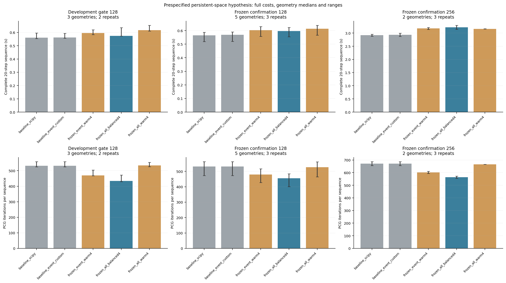
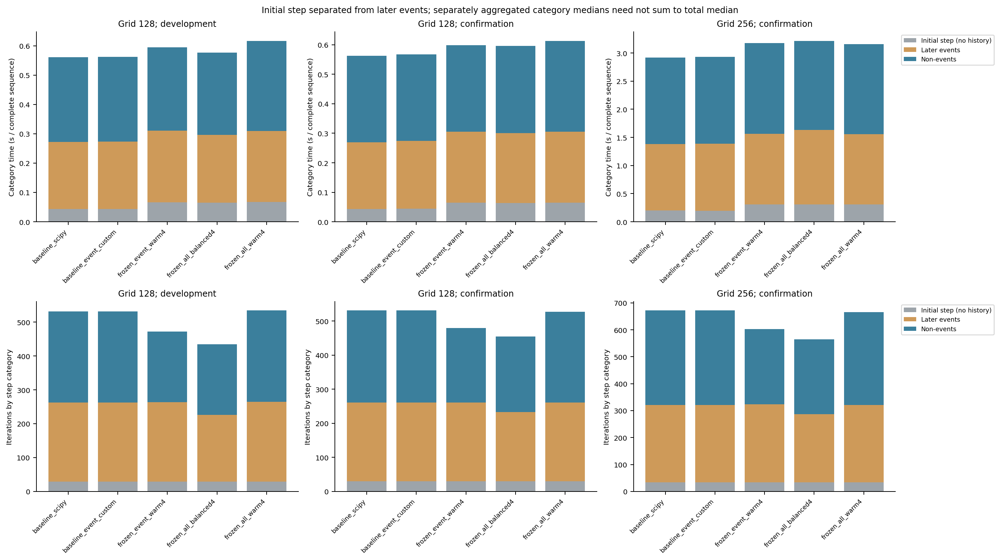
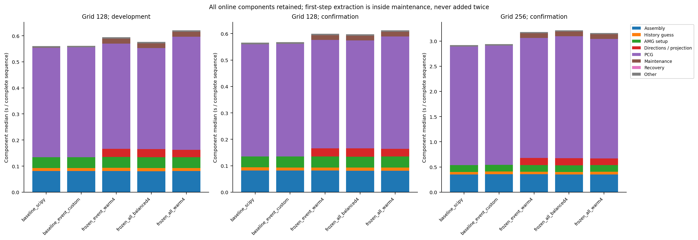

# 第七阶段：冻结历史空间的持续平衡作用

生成时间：2026-11-19T07:34:00.964477+00:00。状态：`complete`。

本阶段主假设在运行前固定为 `frozen_all_balanced4`：仅在首步采集基础 M 的轨迹并提取四个方向，之后所有步均使用当前 A 下的固定平衡接口。开发阶段只检查预定数值门槛，不按性能选择候选；确认始终保留同一套五种方法。没有训练或调用 AI。

## 完整性、计时与聚合

已核验 2700 条在线记录。PCG 失败 0、直接恢复 0、最终失败 0、整个缓存空间拒绝 0；最终显式相对真残差最大值 9.989e-09。
每次完整 20 步先求和，再取同几何重复中位数，最后取几何中位数或逐几何配对比。范围为几何间最小值至最大值，不是置信区间。首步无历史空间，后续事件和非事件分别列示；不能挑选更快的某个步代替完整序列。确认仅有五个独立几何，256 网格复用其中前两个。
组装、历史初值、AMG 刷新、当前方向处理、投影、PCG、真残差、恢复、缓存采集/复制、提取及维护均计入总时间。提取是维护的子项，不能重复相加。各组件分别取中位数，其和不必等于总时间中位数。直接参考解和误差核验在计时外，首步空间哈希在每条完整序列计时结束后计算，仅作来源审计，不参与在线决策。
所有回收方案仅在首步使用基础 M 采集至多 24 列并提取秩4，此后不更新空间或采集新轨迹。后续事件中的自实现 PCG 接收实际使用的 B 或 M，采集容量为零，因此不会把 BA 缓存解释成 MA。每次求解内预条件器固定。
`solver_operator` 审核仅核对正式记录与预定策略的一致性；实际算子对象的传递由源码审查和 100 次小网格 identity 检测求解验证。正式计时没有加入逐次 identity 检测，不能将记录审核当成逐次对象身份验证。
首步空间哈希核对每条序列记录的一致性及同网格/几何/重复下三种回收方法的来源。哈希不同不自动意味着数学子空间不同，需要检查符号或基旋转等价；不据此换样本。相同初始空间也不代表后续求解历史和浮点轨迹逐位相同。

首步来源审计中，共 27 组同网格/几何/重复比较，字节哈希不一致 0 组。所有哈希记录保留在 JSON。

## 开发数值门槛：128网格、3个几何、2重复

| 方法 | 完整秒数中位数 [范围] | 迭代中位数 | 对SciPy配对时间比 | 对自实现配对时间比 | PCG失败/恢复/最终失败/缓存拒绝 |
|---|---:|---:|---:|---:|---:|
| baseline_scipy | 0.560 [0.555, 0.596] | 531.0 | 1.000 | 0.998 | 0/0/0/0 |
| baseline_event_custom | 0.562 [0.556, 0.593] | 531.0 | 1.002 | 1.000 | 0/0/0/0 |
| frozen_event_warm4 | 0.595 [0.584, 0.620] | 469.0 | 1.053 | 1.050 | 0/0/0/0 |
| frozen_all_balanced4 | 0.574 [0.573, 0.637] | 434.0 | 1.035 | 1.031 | 0/0/0/0 |
| frozen_all_warm4 | 0.617 [0.610, 0.653] | 534.0 | 1.100 | 1.098 | 0/0/0/0 |

| 方法 | 首步总秒数 | 后续事件总秒数 | 非事件总秒数 | 首步迭代 | 后续事件迭代 | 非事件迭代 |
|---|---:|---:|---:|---:|---:|---:|
| baseline_scipy | 0.0439 | 0.2279 | 0.2886 | 29.0 | 234.0 | 268.0 |
| baseline_event_custom | 0.0438 | 0.2298 | 0.2882 | 29.0 | 234.0 | 268.0 |
| frozen_event_warm4 | 0.0661 | 0.2448 | 0.2835 | 29.0 | 235.0 | 208.0 |
| frozen_all_balanced4 | 0.0652 | 0.2314 | 0.2798 | 29.0 | 197.0 | 208.0 |
| frozen_all_warm4 | 0.0676 | 0.2420 | 0.3071 | 29.0 | 236.0 | 269.0 |

| 方法 | 方向/投影秒数 | PCG秒数 | 维护秒数 | 其中提取秒数 | PCG+维护秒数 |
|---|---:|---:|---:|---:|---:|
| baseline_scipy | 0.0002 | 0.4201 | 0.0001 | 0.0000 | 0.4202 |
| baseline_event_custom | 0.0002 | 0.4218 | 0.0001 | 0.0000 | 0.4219 |
| frozen_event_warm4 | 0.0308 | 0.4040 | 0.0183 | 0.0181 | 0.4234 |
| frozen_all_balanced4 | 0.0313 | 0.3878 | 0.0180 | 0.0178 | 0.4050 |
| frozen_all_warm4 | 0.0285 | 0.4341 | 0.0188 | 0.0186 | 0.4506 |

同阶段机制配对；小于 1 表示分子更少。all_balanced/event_warm 只增加后续事件中的持续平衡作用；all_balanced/all_warm 比较所有后续步的持续作用；event_warm/all_warm 只增加非事件中的持续作用。

| 分子 / 分母 | 完整时间比 | 完整迭代比 | 后续事件时间比 | 后续事件迭代比 | 非事件时间比 | 非事件迭代比 |
|---|---:|---:|---:|---:|---:|---:|
| baseline_event_custom / baseline_scipy | 1.002 | 1.000 | 1.008 | 1.000 | 0.997 | 1.000 |
| frozen_all_balanced4 / frozen_event_warm4 | 0.983 | 0.929 | 0.975 | 0.857 | 0.991 | 1.000 |
| frozen_all_balanced4 / frozen_all_warm4 | 0.941 | 0.825 | 0.969 | 0.857 | 0.917 | 0.779 |
| frozen_event_warm4 / frozen_all_warm4 | 0.957 | 0.888 | 1.002 | 1.000 | 0.926 | 0.779 |

按本组全部几何的中位时间选出的最快有效基础方法为 `baseline_scipy`。以下固定使用这一种基础方法，再逐几何配对；不逐几何或逐次挑选最快基线。预定主候选始终是 `frozen_all_balanced4`，不随结果更换。

| 回收方法 | 对固定最快基线配对比 | 更快几何数 | 至少节省20%几何数 | 配对中位20%工程线 |
|---|---:|---:|---:|---|
| frozen_event_warm4 | 1.053 | 0/3 | 0/3 | 未通过 |
| frozen_all_balanced4 | 1.035 | 0/3 | 0/3 | 未通过 |
| frozen_all_warm4 | 1.100 | 0/3 | 0/3 | 未通过 |

## 冻结确认：128网格、5个几何、3重复

| 方法 | 完整秒数中位数 [范围] | 迭代中位数 | 对SciPy配对时间比 | 对自实现配对时间比 | PCG失败/恢复/最终失败/缓存拒绝 |
|---|---:|---:|---:|---:|---:|
| baseline_scipy | 0.564 [0.519, 0.587] | 532.0 | 1.000 | 0.997 | 0/0/0/0 |
| baseline_event_custom | 0.569 [0.520, 0.589] | 532.0 | 1.003 | 1.000 | 0/0/0/0 |
| frozen_event_warm4 | 0.602 [0.556, 0.629] | 480.0 | 1.070 | 1.064 | 0/0/0/0 |
| frozen_all_balanced4 | 0.596 [0.555, 0.623] | 455.0 | 1.061 | 1.057 | 0/0/0/0 |
| frozen_all_warm4 | 0.613 [0.565, 0.638] | 527.0 | 1.088 | 1.085 | 0/0/0/0 |

| 方法 | 首步总秒数 | 后续事件总秒数 | 非事件总秒数 | 首步迭代 | 后续事件迭代 | 非事件迭代 |
|---|---:|---:|---:|---:|---:|---:|
| baseline_scipy | 0.0435 | 0.2265 | 0.2930 | 30.0 | 231.0 | 270.0 |
| baseline_event_custom | 0.0445 | 0.2300 | 0.2928 | 30.0 | 231.0 | 270.0 |
| frozen_event_warm4 | 0.0646 | 0.2403 | 0.2932 | 30.0 | 231.0 | 219.0 |
| frozen_all_balanced4 | 0.0640 | 0.2371 | 0.2951 | 30.0 | 203.0 | 222.0 |
| frozen_all_warm4 | 0.0647 | 0.2403 | 0.3083 | 30.0 | 231.0 | 266.0 |

| 方法 | 方向/投影秒数 | PCG秒数 | 维护秒数 | 其中提取秒数 | PCG+维护秒数 |
|---|---:|---:|---:|---:|---:|
| baseline_scipy | 0.0002 | 0.4239 | 0.0001 | 0.0000 | 0.4240 |
| baseline_event_custom | 0.0002 | 0.4262 | 0.0001 | 0.0000 | 0.4263 |
| frozen_event_warm4 | 0.0307 | 0.4108 | 0.0174 | 0.0172 | 0.4309 |
| frozen_all_balanced4 | 0.0310 | 0.4088 | 0.0171 | 0.0170 | 0.4252 |
| frozen_all_warm4 | 0.0290 | 0.4252 | 0.0174 | 0.0173 | 0.4429 |

同阶段机制配对；小于 1 表示分子更少。all_balanced/event_warm 只增加后续事件中的持续平衡作用；all_balanced/all_warm 比较所有后续步的持续作用；event_warm/all_warm 只增加非事件中的持续作用。

| 分子 / 分母 | 完整时间比 | 完整迭代比 | 后续事件时间比 | 后续事件迭代比 | 非事件时间比 | 非事件迭代比 |
|---|---:|---:|---:|---:|---:|---:|
| baseline_event_custom / baseline_scipy | 1.003 | 1.000 | 1.009 | 1.000 | 0.999 | 1.000 |
| frozen_all_balanced4 / frozen_event_warm4 | 0.992 | 0.939 | 0.986 | 0.875 | 0.998 | 1.000 |
| frozen_all_balanced4 / frozen_all_warm4 | 0.976 | 0.862 | 0.987 | 0.875 | 0.963 | 0.835 |
| frozen_event_warm4 / frozen_all_warm4 | 0.984 | 0.917 | 1.000 | 1.000 | 0.961 | 0.835 |

按本组全部几何的中位时间选出的最快有效基础方法为 `baseline_scipy`。以下固定使用这一种基础方法，再逐几何配对；不逐几何或逐次挑选最快基线。预定主候选始终是 `frozen_all_balanced4`，不随结果更换。

| 回收方法 | 对固定最快基线配对比 | 更快几何数 | 至少节省20%几何数 | 配对中位20%工程线 |
|---|---:|---:|---:|---|
| frozen_event_warm4 | 1.070 | 0/5 | 0/5 | 未通过 |
| frozen_all_balanced4 | 1.061 | 0/5 | 0/5 | 未通过 |
| frozen_all_warm4 | 1.088 | 0/5 | 0/5 | 未通过 |

## 冻结确认：256网格、同组前2个几何、3重复

| 方法 | 完整秒数中位数 [范围] | 迭代中位数 | 对SciPy配对时间比 | 对自实现配对时间比 | PCG失败/恢复/最终失败/缓存拒绝 |
|---|---:|---:|---:|---:|---:|
| baseline_scipy | 2.919 [2.880, 2.958] | 671.5 | 1.000 | 0.994 | 0/0/0/0 |
| baseline_event_custom | 2.937 [2.876, 2.998] | 671.5 | 1.006 | 1.000 | 0/0/0/0 |
| frozen_event_warm4 | 3.175 [3.138, 3.212] | 602.0 | 1.088 | 1.081 | 0/0/0/0 |
| frozen_all_balanced4 | 3.218 [3.144, 3.293] | 564.0 | 1.102 | 1.096 | 0/0/0/0 |
| frozen_all_warm4 | 3.159 [3.155, 3.163] | 665.0 | 1.082 | 1.076 | 0/0/0/0 |

| 方法 | 首步总秒数 | 后续事件总秒数 | 非事件总秒数 | 首步迭代 | 后续事件迭代 | 非事件迭代 |
|---|---:|---:|---:|---:|---:|---:|
| baseline_scipy | 0.1987 | 1.1850 | 1.5353 | 34.0 | 287.0 | 350.5 |
| baseline_event_custom | 0.1983 | 1.1912 | 1.5440 | 34.0 | 287.0 | 350.5 |
| frozen_event_warm4 | 0.3090 | 1.2546 | 1.6148 | 34.0 | 289.5 | 278.5 |
| frozen_all_balanced4 | 0.3088 | 1.3252 | 1.5828 | 34.0 | 253.5 | 276.5 |
| frozen_all_warm4 | 0.3109 | 1.2458 | 1.6036 | 34.0 | 287.5 | 343.5 |

| 方法 | 方向/投影秒数 | PCG秒数 | 维护秒数 | 其中提取秒数 | PCG+维护秒数 |
|---|---:|---:|---:|---:|---:|
| baseline_scipy | 0.0002 | 2.3543 | 0.0004 | 0.0000 | 2.3547 |
| baseline_event_custom | 0.0002 | 2.3688 | 0.0004 | 0.0000 | 2.3691 |
| frozen_event_warm4 | 0.1376 | 2.3837 | 0.0912 | 0.0908 | 2.4750 |
| frozen_all_balanced4 | 0.1395 | 2.4247 | 0.0916 | 0.0912 | 2.5157 |
| frozen_all_warm4 | 0.1317 | 2.3734 | 0.0901 | 0.0897 | 2.4643 |

同阶段机制配对；小于 1 表示分子更少。all_balanced/event_warm 只增加后续事件中的持续平衡作用；all_balanced/all_warm 比较所有后续步的持续作用；event_warm/all_warm 只增加非事件中的持续作用。

| 分子 / 分母 | 完整时间比 | 完整迭代比 | 后续事件时间比 | 后续事件迭代比 | 非事件时间比 | 非事件迭代比 |
|---|---:|---:|---:|---:|---:|---:|
| baseline_event_custom / baseline_scipy | 1.006 | 1.000 | 1.005 | 1.000 | 1.005 | 1.000 |
| frozen_all_balanced4 / frozen_event_warm4 | 1.013 | 0.937 | 1.056 | 0.876 | 0.980 | 0.993 |
| frozen_all_balanced4 / frozen_all_warm4 | 1.019 | 0.848 | 1.064 | 0.882 | 0.987 | 0.805 |
| frozen_event_warm4 / frozen_all_warm4 | 1.005 | 0.905 | 1.007 | 1.007 | 1.007 | 0.810 |

按本组全部几何的中位时间选出的最快有效基础方法为 `baseline_scipy`。以下固定使用这一种基础方法，再逐几何配对；不逐几何或逐次挑选最快基线。预定主候选始终是 `frozen_all_balanced4`，不随结果更换。

| 回收方法 | 对固定最快基线配对比 | 更快几何数 | 至少节省20%几何数 | 配对中位20%工程线 |
|---|---:|---:|---:|---|
| frozen_event_warm4 | 1.088 | 0/2 | 0/2 | 未通过 |
| frozen_all_balanced4 | 1.102 | 0/2 | 0/2 | 未通过 |
| frozen_all_warm4 | 1.082 | 0/2 | 0/2 | 未通过 |

## 全部确认几何配对

| 网格/方法/几何 | 完整秒数 | SciPy秒数 | 自实现秒数 | 对本组固定最快基线比 |
|---|---:|---:|---:|---:|
| 128/frozen_event_warm4/45011 | 0.6285 | 0.5874 | 0.5894 | 1.0699 |
| 128/frozen_event_warm4/45012 | 0.6040 | 0.5639 | 0.5698 | 1.0710 |
| 128/frozen_event_warm4/45013 | 0.5594 | 0.5289 | 0.5258 | 1.0576 |
| 128/frozen_event_warm4/45014 | 0.6022 | 0.5669 | 0.5689 | 1.0624 |
| 128/frozen_event_warm4/45015 | 0.5561 | 0.5193 | 0.5198 | 1.0709 |
| 128/frozen_all_balanced4/45011 | 0.6230 | 0.5874 | 0.5894 | 1.0605 |
| 128/frozen_all_balanced4/45012 | 0.5962 | 0.5639 | 0.5698 | 1.0573 |
| 128/frozen_all_balanced4/45013 | 0.5547 | 0.5289 | 0.5258 | 1.0487 |
| 128/frozen_all_balanced4/45014 | 0.6028 | 0.5669 | 0.5689 | 1.0634 |
| 128/frozen_all_balanced4/45015 | 0.5603 | 0.5193 | 0.5198 | 1.0789 |
| 128/frozen_all_warm4/45011 | 0.6380 | 0.5874 | 0.5894 | 1.0860 |
| 128/frozen_all_warm4/45012 | 0.6134 | 0.5639 | 0.5698 | 1.0878 |
| 128/frozen_all_warm4/45013 | 0.5731 | 0.5289 | 0.5258 | 1.0834 |
| 128/frozen_all_warm4/45014 | 0.6174 | 0.5669 | 0.5689 | 1.0891 |
| 128/frozen_all_warm4/45015 | 0.5653 | 0.5193 | 0.5198 | 1.0886 |
| 256/frozen_event_warm4/45011 | 3.1381 | 2.8802 | 2.8763 | 1.0896 |
| 256/frozen_event_warm4/45012 | 3.2121 | 2.9579 | 2.9981 | 1.0860 |
| 256/frozen_all_balanced4/45011 | 3.1435 | 2.8802 | 2.8763 | 1.0914 |
| 256/frozen_all_balanced4/45012 | 3.2928 | 2.9579 | 2.9981 | 1.1132 |
| 256/frozen_all_warm4/45011 | 3.1629 | 2.8802 | 2.8763 | 1.0982 |
| 256/frozen_all_warm4/45012 | 3.1555 | 2.9579 | 2.9981 | 1.0668 |

## 事后固定实测轨迹的成本情景

对主候选每次完整序列先计算 `total − correction − extraction`，再取同几何重复中位数并与基线逐几何配对。两基线都保留，固定最快基线仍按该网格整组实际完整时间选出。该情景不参与选法；JSON 另保留所有回收方法的逐重复、逐几何值。

| 阶段/网格 | 对SciPy配对时间比 | 对自实现配对时间比 | 固定最快基线 | 对固定最快基线比 |
|---|---:|---:|---|---:|
| 开发/128 | 0.948609 | 0.945599 | baseline_scipy | 0.948609 |
| 确认/128 | 0.976230 | 0.974601 | baseline_scipy | 0.976230 |
| 确认/256 | 1.023371 | 1.017107 | baseline_scipy | 1.023371 |

这只是固定实测轨迹、迭代数及其余成本的事后核算，不是实际可运行算法，也不是一般性能下界。它没有假设降低每次 B 应用的代价，仅移除记录中的方向处理/投影和提取组件；维护中的其他成本仍保留。在这些测量下，即便把这两个组件视为零，确认配对中位时间仍未达到节省 20% 的工程线；不能据此断言其他轨迹或其他实现永远达不到。

## 可支持的结论与边界

完整时间、对应迭代和组件成本必须同时解释。持续平衡若只减少迭代而没有完整时间优势，也应保留；若出现完整收益，首先归于经典冻结空间与预条件接口，不能归为 AI 收益或创新。只使用本阶段同协议的真实 PDE 结果比较，不能将跨阶段时间差直接归因于接口变化。
20% 仍是预定工程筛选线，不是统计显著性或论文录用标准。少量几何、单右端和单对比度不足以建立普遍结论；后续改变预算、实现或方程范围需重新冻结并分配新的确认几何。
源代码、协议、分组、开发数值门槛与冻结文件均核对哈希；每条预定记录精确匹配，没有按性能删样本。逐重复成本、逐几何配对、数值失败、空间哈希和输入哈希见 [summary.json](summary.json)，设计见 [运行前协议](../../docs/stage7_protocol_zh.md)。

