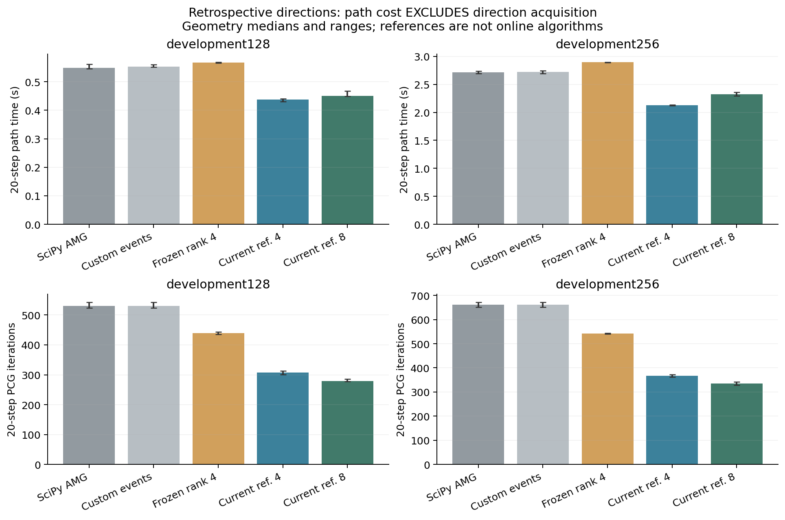

# 第八阶段：当前轨迹参考空间的最后预算筛查

生成时间：2026-11-19T09:35:46.614838+00:00。

**当前参考方向来自已经完成的当前系统轨迹，不是因果在线算法，也不是AI模型或最优方向上界。** 参考路径时间没有包含方向获取；实际组装、初值、AMG、正交化、投影、B构造/应用、PCG、真残差和维护仍计入。

开发规则在运行前固定：同一个q必须在两个网格全部开发几何中均达到SciPy完整时间的0.8倍以内，才允许一次独立确认；若两个q都通过预定选择q4，不在确认后改选。

完整20步求和→同几何重复中位→几何配对和汇总。误差条为几何范围，不是置信区间。构造预算=0.8×SciPy完整时间−参考部署路径时间，负值不支持本参考的训练投入。

参考方向与离线真解先统一加载到内存，再开始计时，采用数据已驻留口径；不包含磁盘读取与方向获取费用。所有方法的部署路径仍独立组装矩阵并构建自己的AMG和历史。
development整批加载费用为0.406秒（每阶段一次，未重复计入两个网格）。

## stage8_development128

共900条路径记录，其中因果对照540条、事后参考360条。PCG失败0、恢复0、最终精度失败0；最大真残差9.988265e-09。

| 方法 | 完整路径秒数中位数 | 迭代中位数 | 对SciPy配对时间比 |
|---|---:|---:|---:|
| baseline_scipy | 0.548370 | 530.0 | 1.000000 |
| baseline_event_custom | 0.552809 | 530.0 | 1.008095 |
| frozen_all_balanced4 | 0.566989 | 440.0 | 1.031959 |
| current_reference4 | 0.436980 | 307.0 | 0.785472 |
| current_reference8 | 0.450016 | 279.0 | 0.820643 |

| 参考方法/几何 | 配对时间比 | 20步构造预算/秒 | 平均每系统预算/毫秒 |
|---|---:|---:|---:|
| current_reference4/46001 | 0.800845 | -0.000461 | -0.023 |
| current_reference4/46002 | 0.785472 | 0.007967 | 0.398 |
| current_reference4/46003 | 0.784810 | 0.008522 | 0.426 |
| current_reference8/46001 | 0.855645 | -0.030362 | -1.518 |
| current_reference8/46002 | 0.820643 | -0.011320 | -0.566 |
| current_reference8/46003 | 0.800390 | -0.000219 | -0.011 |

本组离线准备另含60次基础M参考求解与60次直接参考。共同方向获取总费4.500秒、直接解2.182秒、质量核验1.301秒、存储0.112秒；共同获取费包含两种q与首步冻结参考的提取，不是某一种q的独立算法费用。
参考结构无效系统0个，基础PCG失败0个；预定缓存核验6次，失败0次。

| q | 当前参考投影后剩余误差能量 | 首步冻结4维剩余误差能量 | 当前参考结构无效系统 |
|---|---:|---:|---:|
| 4 | 0.9904552848905875 | 0.9612184358187758 | 0 |
| 8 | 0.8357258668618925 | 0.9612184358187758 | 0 |

误差能量比在同一基础历史初值下测量，先取每几何20系统中位，再取几何中位；不是网络预测误差。独立实际A/M作用下的特征残差、实际秩与逐系统质量记录完整保留在JSON；结构检查通过不代表精确最慢空间。

## stage8_development256

共600条路径记录，其中因果对照360条、事后参考240条。PCG失败0、恢复0、最终精度失败0；最大真残差9.973113e-09。

| 方法 | 完整路径秒数中位数 | 迭代中位数 | 对SciPy配对时间比 |
|---|---:|---:|---:|
| baseline_scipy | 2.717490 | 662.0 | 1.000000 |
| baseline_event_custom | 2.719172 | 662.0 | 1.000601 |
| frozen_all_balanced4 | 2.895497 | 541.5 | 1.065588 |
| current_reference4 | 2.126904 | 367.5 | 0.782694 |
| current_reference8 | 2.324793 | 335.0 | 0.855451 |

| 参考方法/几何 | 配对时间比 | 20步构造预算/秒 | 平均每系统预算/毫秒 |
|---|---:|---:|---:|
| current_reference4/46001 | 0.780050 | 0.054655 | 2.733 |
| current_reference4/46002 | 0.785337 | 0.039521 | 1.976 |
| current_reference8/46001 | 0.860549 | -0.165883 | -8.294 |
| current_reference8/46002 | 0.850354 | -0.135719 | -6.786 |

本组离线准备另含40次基础M参考求解与40次直接参考。共同方向获取总费17.142秒、直接解10.720秒、质量核验3.789秒、存储0.301秒；共同获取费包含两种q与首步冻结参考的提取，不是某一种q的独立算法费用。
参考结构无效系统0个，基础PCG失败0个；预定缓存核验4次，失败0次。

| q | 当前参考投影后剩余误差能量 | 首步冻结4维剩余误差能量 | 当前参考结构无效系统 |
|---|---:|---:|---:|
| 4 | 0.9958837344192584 | 0.9431244511613462 | 0 |
| 8 | 0.892456879954054 | 0.9431244511613462 | 0 |

误差能量比在同一基础历史初值下测量，先取每几何20系统中位，再取几何中位；不是网络预测误差。独立实际A/M作用下的特征残差、实际秩与逐系统质量记录完整保留在JSON；结构检查通过不代表精确最慢空间。

## 预定决策及证据边界

运行器决定的关键字段如下，完整记录见[原始决定](../stage8_decision.json)；报告不会根据汇总中位数替代“所有几何过线”的预定门槛。

```json
{
  "numerically_valid": true,
  "selected_rank": null,
  "proceed_to_confirmation": false,
  "training_authorized": false
}
```

最终状态：`stopped_after_development`；是否运行确认：`False`。
按开发停止规则结束；没有运行确认或学习训练。

参考质量可能有限，尤其当前右端激发的有限轨迹不等于全系统最慢空间。本次未过门槛可支持资源止损，不能证明所有学习空间都没有加速可能。即便参考过线，仍需用实际可执行构造费用和独立确认检验收益。

源码、划分、参考生成诊断、费用及原始文件哈希见[summary.json](summary.json)。研究判断见[第八阶段结论](../../docs/stage8_findings_zh.md)，历史复盘见[路线复盘](../../docs/route_retrospective_zh.md)。


