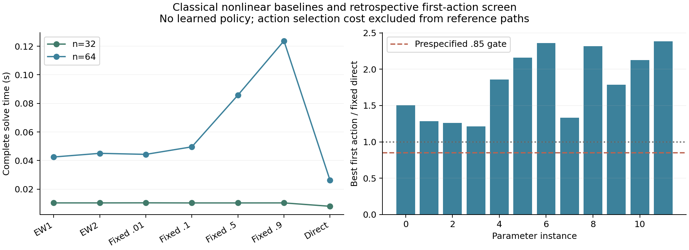

# 第九阶段：非线性内层精度机会筛查

**本轮为经典基线与事后单动作分支诊断，没有AI训练、学习策略或独立确认。**

固定主基线：`direct`；固定分支续接：`ew1`。主基线在全部24个网格–实例上按预定规则选择，没有按每例挑选。

基线504次、分支552次求解；精度失败分别0/0。最大相对非线性真残差9.023547433010459e-09，对高精度离散参考最大相对L2误差7.857034781141228e-09。

另有8次制造解验证、24次高精度离散参考、12次来源轨迹、7次预热求解。32/64复用相同12个参数实例，不构成24个独立样本。

## 离散验证

| 方程 | 最后一对网格收敛阶 | 预定区间 |
|---|---:|---|
| upwind | 0.983896 | [0.75, 1.35] |
| diffusion | 1.999989 | [1.7, 2.3] |

## 32网格经典完整成本

| 方法 | 完整中位秒 | Newton步 | GMRES步 | 线性解成本占比 | ILU成本占比 | 失败次数 |
|---|---:|---:|---:|---:|---:|---:|
| ew1 | 0.010400 | 6.0 | 6.0 | 11.6% | 67.1% | 0 |
| ew2 | 0.010401 | 6.0 | 7.0 | 12.2% | 66.7% | 0 |
| fixed_0.01 | 0.010444 | 6.0 | 6.5 | 11.6% | 67.1% | 0 |
| fixed_0.1 | 0.010378 | 6.0 | 6.0 | 11.6% | 67.3% | 0 |
| fixed_0.5 | 0.010377 | 6.0 | 6.0 | 11.6% | 67.4% | 0 |
| fixed_0.9 | 0.010400 | 6.0 | 6.0 | 11.6% | 67.4% | 0 |
| direct | 0.008036 | 6.0 | 0.0 | 72.8% | 0.0% | 0 |

## 64网格经典完整成本

| 方法 | 完整中位秒 | Newton步 | GMRES步 | 线性解成本占比 | ILU成本占比 | 失败次数 |
|---|---:|---:|---:|---:|---:|---:|
| ew1 | 0.042506 | 7.0 | 37.0 | 18.1% | 75.1% | 0 |
| ew2 | 0.045067 | 7.0 | 40.0 | 22.9% | 70.2% | 0 |
| fixed_0.01 | 0.044341 | 6.5 | 45.5 | 25.4% | 67.5% | 0 |
| fixed_0.1 | 0.049612 | 7.0 | 35.5 | 19.6% | 73.1% | 0 |
| fixed_0.5 | 0.085778 | 14.5 | 32.5 | 14.2% | 79.2% | 0 |
| fixed_0.9 | 0.123713 | 21.0 | 32.0 | 11.3% | 81.5% | 0 |
| direct | 0.026275 | 6.0 | 0.0 | 88.3% | 0.0% | 0 |

先按同一实例三次完整计时取中位，再汇总实例。各成本占比也是先按重复、再按实例取中位，不把汇总中位数的和当作一个真实轨迹。直接Newton的线性解费用包含直接分解；GMRES步数为零不代表没有求解工作。

## 步0有限动作机会与停止决定

事后选出的最佳首动作/固定主基线，配对时间比中位数为 **1.821988**，更快实例 **0/12**；预定条件为不超过0.85且至少9/12更快。

| 实例 | 最佳首倍率 | 完整时间比 | 主基线三次时间MAD/毫秒 | 分支三次时间MAD/毫秒 |
|---|---:|---:|---:|---:|
| 0 | 2.0 | 1.506587 | 0.2561 | 0.1905 |
| 1 | 0.25 | 1.284283 | 0.1730 | 0.0074 |
| 2 | 1.0 | 1.258763 | 0.0343 | 0.0348 |
| 3 | 0.25 | 1.214949 | 0.0524 | 0.0266 |
| 4 | 1.0 | 1.858400 | 0.0728 | 0.3110 |
| 5 | 0.25 | 2.158362 | 0.5102 | 0.1362 |
| 6 | 0.5 | 2.357563 | 0.1655 | 0.0190 |
| 7 | 2.0 | 1.334718 | 0.0276 | 0.1341 |
| 8 | 0.25 | 2.314375 | 0.0072 | 0.4189 |
| 9 | 1.0 | 1.785576 | 0.0468 | 0.1569 |
| 10 | 0.25 | 2.123164 | 0.2136 | 0.7476 |
| 11 | 0.25 | 2.384110 | 0.0333 | 0.2323 |

状态：`stop_current_action_family`。机会门槛通过：`False`；训练：`False`。

这是每实例事后选择首动作的有限参考，排除了选择所需的多次试算费用；不能作为在线或AI加速。后续步骤只报告独立分支的剩余成本，不与其他状态拼接成新轨迹。

| 固定来源Newton步 | 状态数 | 最佳分支/原生EW剩余时间比中位数 |
|---|---:|---:|
| 0 | 12 | 0.993317 |
| 1 | 12 | 0.987917 |
| 2 | 12 | 0.989595 |
| 3 | 12 | 0.998137 |

来源轨迹、状态组织与存储共0.597秒，单列且不作为免费部署过程。全部快照先准备完，再进行分支计时。

数值轨迹审计：184个去重动作在各状态内共143种记录轨迹/最终解签名；10/48个状态所有动作签名相同。事后获选的非原生动作中，8个与原生动作的记录数值轨迹和最终解字节一致，其微小计时优势不能归因为求解路径改善。并非所有状态都对动作不敏感。

Botti2015公式与Oladokun2020全文仍未完整核实，经典对照覆盖与新颖性尚未成立。未过门槛可支持停止当前动作方案；过线也只允许补齐对照和近邻核查。未测其他预条件更新策略、更多动作或跨参数/网格独立确认，不能把此结果推广为所有非线性控制的结论。

[研究结论](../../docs/stage9_findings_zh.md) · [运行前协议](../../docs/stage9_protocol_zh.md) · [原文核查](../../docs/stage9_related_work_zh.md) · [完整聚合](summary.json)

